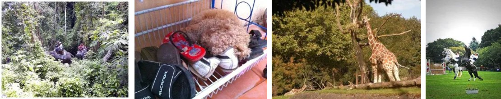
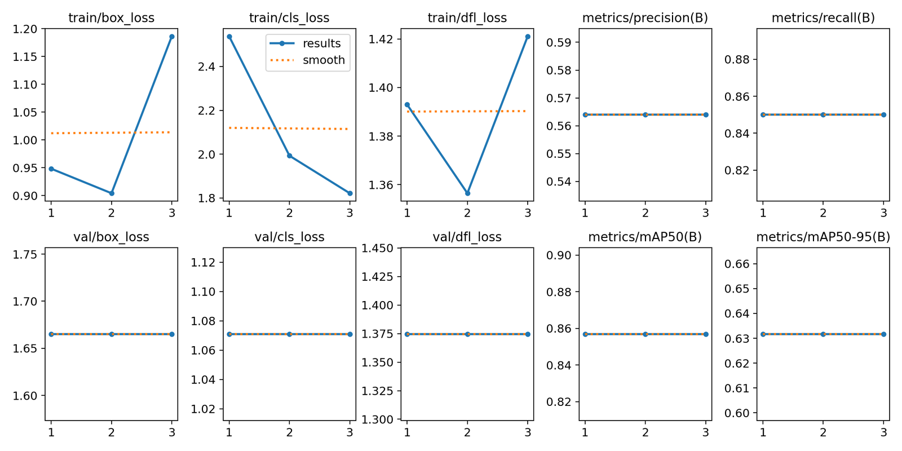
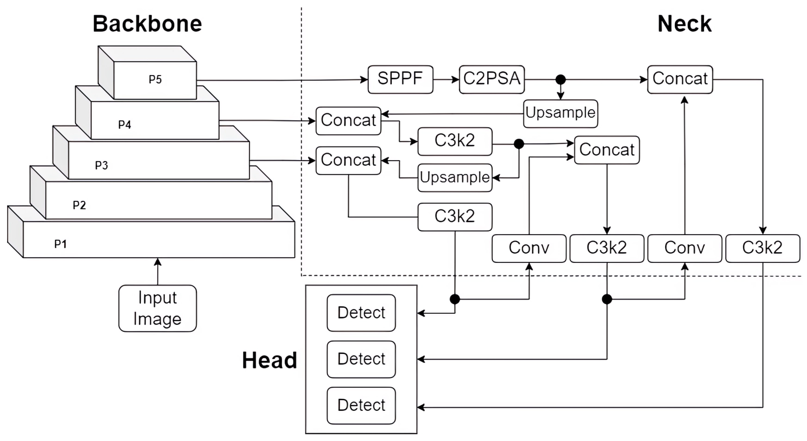
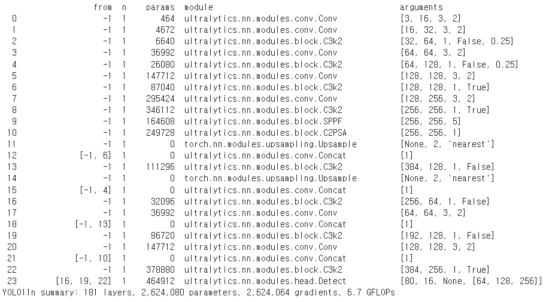
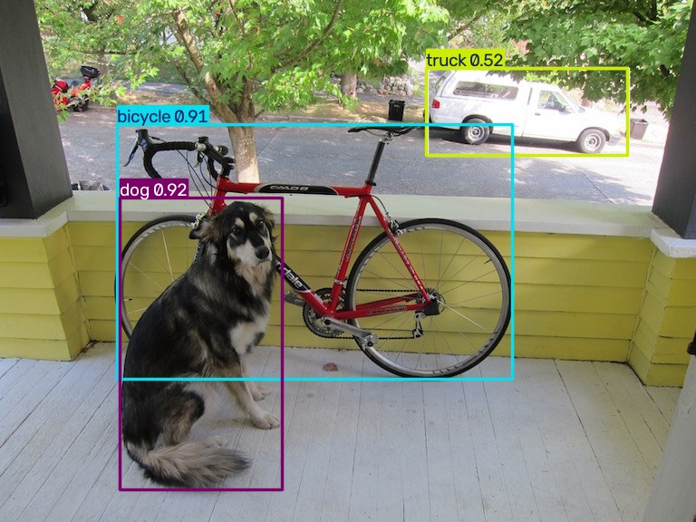
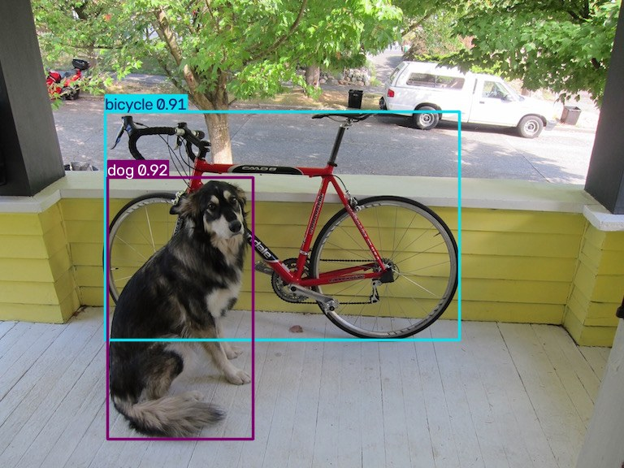

# 실무 프로젝트 2. YOLO 학습(Fine-tuning)과 응용 — 이미지·영상 탐지

> 인공지능 실무 프로젝트 실습 정리 노트 — 2026. 10. 13
> 원본: `20261012DPLR.pptx` (강의 슬라이드 "Application 실습"), `1013실습.ipynb` (실습 노트북)
> 이전 실습: [실무 프로젝트 1. Computer Vision과 Object Detection (YOLO 실습)](./04-YOLO.md)

---

## 📌 목차

1. [실습 목표](#_1-실습-목표)
2. [YOLO 데이터셋의 저장 구조](#_2-yolo-데이터셋의-저장-구조)
3. [Fine-tuning 관련 용어](#_3-fine-tuning-관련-용어)
4. [COCO8 데이터셋](#_4-coco8-데이터셋)
5. [실습 ① 환경 준비와 데이터셋 지정](#_5-실습-1-환경-준비와-데이터셋-지정)
6. [실습 ② 학습 (Training)](#_6-실습-2-학습-training)
7. [YOLO11n 구조](#_7-yolo11n-구조-—-backbone-·-neck-·-head)
8. [실습 ③ 학습된 가중치 확인](#_8-실습-3-학습된-가중치-확인)
9. [실습 ④ 이미지 탐지 (Application 1)](#_9-실습-4-이미지-탐지-application-1)
10. [실험: confidence threshold 바꿔 보기](#_10-실험-confidence-threshold-바꿔-보기)
11. [실습 ⑤ 영상 탐지 (Application 2)](#_11-실습-5-영상-탐지-application-2)
12. [선택 과제: 로컬 PC 웹캠 실시간 탐지](#_12-선택-과제-로컬-pc-웹캠-실시간-탐지)
13. [요약](#_13-요약) · [퀴즈](#_14-셀프-체크-퀴즈)

> 📝 지난 [실무 프로젝트 1](./04-YOLO.md)은 미리 학습된 YOLO를 **그대로 써서** 이미지를 탐지했다. 이번 실습은 그 모델을 **데이터셋으로 추가 학습(fine-tuning)** 해 보고, 학습한 가중치로 **이미지와 영상** 을 탐지한다. **[보충]** 으로 표시한 내용은 슬라이드·노트북에 없는 설명이다.

```
PJ 1: 사전 학습된 yolo11n.pt ──────────────────────────▶ 이미지 탐지
PJ 2: 사전 학습된 yolo11n.pt ──[COCO8로 추가 학습]──▶ best.pt ──▶ 이미지 탐지 / 영상 탐지 / (웹캠)
```

---

## 1. 실습 목표

| 목표 | 내용 |
|---|---|
| **데이터셋 구조** | YOLO에서 쓰이는 Dataset의 (저장) 구조 이해 |
| **탐지 응용** | Image, video에서 detection |

---

## 2. YOLO 데이터셋의 저장 구조

YOLO로 학습하려면 이미지와 **라벨 파일** 을 정해진 폴더 구조로 두고, 그 위치를 `data.yaml` 에 적는다.

```text
Dataset_name/
├── images/
│   ├── train/   img001.jpg, img002.jpg ...
│   └── val/     img101.jpg ...
├── labels/
│   ├── train/   img001.txt, img002.txt ...
│   └── val/     img101.txt ...
└── data.yaml
```

- 이미지 `images/train/img001.jpg` 의 정답은 **같은 이름** 의 `labels/train/img001.txt` 에 있다.
- `train` 은 학습용, `val` 은 검증용(학습에 직접 쓰지 않음)이다.

**[보충] 라벨 파일(`.txt`) 형식** — 물체 하나당 한 줄

```text
<클래스 번호> <x_center> <y_center> <width> <height>
0 0.48 0.63 0.69 0.71
16 0.25 0.55 0.31 0.80
```

- 좌표는 실무 프로젝트 1에서 본 **xywh** 형식이며, 이미지 너비·높이로 나눈 **0~1 정규화 값**(xywhn)이다.
- 클래스 번호는 `data.yaml` 의 이름 목록 순서다 (COCO 기준 0 = person, 16 = dog).

**[보충] `data.yaml` 예시**

```yaml
path: ../datasets/coco8   # 데이터셋 루트
train: images/train        # 학습 이미지 폴더
val: images/val            # 검증 이미지 폴더
names:
  0: person
  1: bicycle
  2: car
  # ... (COCO는 80개 클래스)
```

---

## 3. Fine-tuning 관련 용어

| 용어 | 뜻 (슬라이드) | 이번 실습에서 |
|---|---|---|
| **Pretrained** | 일반적인 객체를 **미리 학습한** 가중치 | `yolo11n.pt` (COCO 80개 클래스로 학습됨) |
| **Fine-tuning** | **특화된 model** 을 만들고자 할 때 **추가 학습** | `yolo11n.pt` 에서 시작해 COCO8로 3 epoch 더 학습 |
| **Epoch** | 전체 학습 데이터를 **한 번** 학습하는 단위 | `epochs=3` → 학습 이미지 전체를 3번 봄 |
| **Validation** | 검증. 학습에 **직접 쓰이지 않은** 데이터로 검증 | 매 epoch이 끝날 때 val 이미지로 P, R, mAP 계산 |

> 💡 **[보충] 왜 처음부터 학습하지 않고 fine-tuning하나?** 처음부터 학습하려면 수십만 장의 이미지와 긴 학습 시간이 필요하다. 사전 학습된 가중치는 이미 "모서리·질감·형태" 같은 일반적인 특징을 알고 있으므로, 내 데이터(예: 공장 불량품, 특정 간판)는 **적은 데이터와 짧은 학습** 으로도 맞출 수 있다.

---

## 4. COCO8 데이터셋

- **COCO8**: Ultralytics가 제공하는 아주 작은 예제 데이터셋. **8개의 이미지로만** 구성되어 있다 (train 4장, val 4장).
- 큰 COCO 데이터셋(약 33만 장, 80개 클래스)에서 몇 장만 뽑은 것이라, 학습 파이프라인이 제대로 돌아가는지 **빠르게 확인하는 용도** 다.
- 출처: [Ultralytics COCO8](https://platform.ultralytics.com/ultralytics/datasets/coco8)



---

## 5. 실습 ① 환경 준비와 데이터셋 지정

```python
!pip install -q ultralytics

import os, glob, zipfile
from pathlib import Path
from ultralytics import YOLO
from PIL import Image
print("GPU 사용 가능:", __import__("torch").cuda.is_available())
```

```text
GPU 사용 가능: False
```

- 이번 실행은 **GPU 없이 CPU** 로 진행되었다. 그래서 학습·추론이 느리다 (아래 로그의 `CPU (Intel Xeon CPU @ 2.20GHz)`).
- **[보충]** Colab에서 **런타임 → 런타임 유형 변경 → GPU** 를 고르면 `True` 가 된다.

```python
if "DATA_YAML" not in globals():
    DATA_YAML = "coco8.yaml"
print("데이터 확인:", DATA_YAML)    # 데이터 확인: coco8.yaml
```

- `DATA_YAML` 이 이미 정의되어 있으면(예: 직접 만든 데이터셋) 그것을 쓰고, 없으면 기본값 `coco8.yaml` 을 쓴다.
- `coco8.yaml` 은 Ultralytics에 내장된 설정이라, 학습을 시작하면 데이터셋을 **자동으로 내려받는다** (`/content/datasets/coco8`).

---

## 6. 실습 ② 학습 (Training)

```python
model = YOLO("yolo11n.pt")          # 사전 학습된 YOLO11 nano에서 시작
train_results = model.train(
    data=DATA_YAML,
    epochs=3,      # epochs은 일단 3으로 유지
    imgsz=640,     # YOLO에서 권장하는 image size
    batch=8,
    plots=True     # 학습 그래프(results.png 등) 저장
)
```

| 인자 | 값 | 의미 |
|---|---|---|
| `data` | `coco8.yaml` | 데이터셋 설정 파일 (2절 구조) |
| `epochs` | 3 | 전체 학습 데이터를 3번 반복 학습 |
| `imgsz` | 640 | 입력 이미지 크기 (YOLO 권장값). 실무 프로젝트 1에서 본 640 Resize와 같다 |
| `batch` | 8 | 한 번에 처리하는 이미지 수 |
| `plots` | True | 학습 결과 그래프를 저장 |

### 학습 로그 (노트북 실행 결과)

```text
Using 4 train, 4 val images for fraction=1.0 at imgsz=640
optimizer: AdamW(lr=0.000119, momentum=0.9) ...
Starting training for 3 epochs...

      Epoch   box_loss   cls_loss   dfl_loss  Instances   Size
        1/3     0.9481      2.538      1.393         13    640
                 Class  Images  Instances    Box(P      R   mAP50  mAP50-95)
                   all       4         17    0.564   0.85   0.857      0.632
        2/3      0.904      1.993      1.356         13    640
                   all       4         17    0.564   0.85   0.857      0.632
        3/3      1.186      1.821      1.421         13    640
                   all       4         17    0.564   0.85   0.857      0.632
3 epochs completed in 0.004 hours.
```

| 항목 | 의미 |
|---|---|
| **box_loss** | 바운딩 박스 **위치** 오차 |
| **cls_loss** | **클래스**(무엇인지) 분류 오차 |
| **dfl_loss** | 박스 경계를 더 정밀하게 맞추는 데 쓰는 손실 (Distribution Focal Loss) **[보충]** |
| **P / R** | Precision(정밀도) / Recall(재현율) — 실무 프로젝트 1의 5.3절 |
| **mAP50 / mAP50-95** | IoU 0.5 기준 / IoU 0.5~0.95 평균 기준 mAP — 실무 프로젝트 1의 5.4절 |

### 최종 검증 결과 (`best.pt`)

```text
YOLO11n summary (fused): 100 layers, 2,616,248 parameters, 0 gradients, 6.5 GFLOPs
         Class  Images  Instances    Box(P       R   mAP50  mAP50-95)
           all       4         17    0.563    0.85   0.857      0.632
        person       3         10    0.554     0.6   0.644      0.275
           dog       1          1    0.541       1   0.995      0.697
         horse       1          2    0.511       1   0.995      0.671
      elephant       1          2    0.367     0.5   0.518      0.257
      umbrella       1          1    0.565       1   0.995      0.995
  potted plant       1          1    0.839       1   0.995      0.895
```

### 학습 그래프 (`results.png`)



> 💡 **[보충] 결과 해석 — 왜 val 지표가 3 epoch 내내 똑같을까?**
> - 학습 이미지가 **4장** 뿐이고, 자동으로 고른 학습률이 **0.000119** 로 매우 작으며, **3 epoch**(= 업데이트 3번)만 돌았다. 그래서 가중치가 거의 바뀌지 않아 **val 손실과 P·R·mAP가 그대로** 다.
> - train 손실(위쪽 그래프)이 오르내리는 것도 4장짜리 작은 배치에 데이터 증강(모자이크, 뒤집기 등)이 무작위로 들어가 생기는 흔들림이다.
> - 즉 이번 학습은 **"학습 파이프라인이 끝까지 돌아가는지"** 확인한 것이고, 성능 향상을 기대한 실험은 아니다. 실제 fine-tuning은 수백~수천 장의 데이터와 수십~수백 epoch을 쓴다.
> - 클래스별로는 사진이 많은 `person` 의 mAP50-95(0.275)가 낮고, 1장뿐인 클래스는 0.995처럼 높게 나오기도 한다. 검증 이미지가 4장이라 통계적으로 의미 있는 숫자는 아니다.

---

## 7. YOLO11n 구조 — Backbone · Neck · Head



> 그림 출처(슬라이드 노트): *Performance Evaluation of YOLOv8, YOLOv9, YOLOv10, and YOLOv11 for Stamp Detection in Scanned Documents*

| 부분 | 역할 | 설명 (슬라이드) |
|---|---|---|
| **Backbone** | 특징 추출 | 이미지에서 모서리, 질감, 형태, 객체의 부분 및 고수준 특징을 추출한다 (그림의 P1~P5) |
| **Neck** | 다중 스케일 특징 융합 | 서로 다른 해상도의 특징을 결합하여 **작은 객체와 큰 객체를 모두** 탐지할 수 있도록 한다 (Upsample, Concat, C3k2) |
| **Detection Head** | 객체 예측 | 융합된 특징을 이용해 객체의 **바운딩 박스** 와 **클래스별 예측값** 을 생성한다 (Detect × 3) |

> 💡 **[보충] 실무 프로젝트 1의 CNN과 연결**: Backbone은 실무 프로젝트 1의 CNN(합성곱 + 풀링)처럼 층이 깊어질수록 해상도는 줄고(P1 → P5) 더 추상적인 특징을 뽑는다. 얕은 층(P3)은 작은 물체, 깊은 층(P5)은 큰 물체를 잘 보므로, Neck이 이 둘을 섞어 **Detect 3개가 각기 다른 크기** 의 물체를 맡는다.

**모델 요약 (학습 시작 시 출력, 슬라이드)**



- 학습 전 요약은 **181 layers, 2,624,080 parameters**, 학습 후 검증 때는 **100 layers, 2,616,248 parameters** 로 나온다.
- **[보충]** 검증 때는 Conv와 BatchNorm 층을 하나로 합치는 **fused** 상태라 층 수와 파라미터 수가 줄어든다. 계산 결과는 같고 추론만 빨라진다.
- 파라미터 약 **260만 개** — 6장(컴퓨터특론)의 GPT-2 small(1억 2,400만 개)과 비교하면 매우 작은 모델이다.

---

## 8. 실습 ③ 학습된 가중치 확인

```python
weights = glob.glob("runs/detect/train*/weights/best.pt")
BEST_WEIGHTS = max(weights, key=os.path.getmtime) if weights else None
print("학습된 가중치:", BEST_WEIGHTS)       # runs/detect/train/weights/best.pt
plots = glob.glob("runs/detect/train*/results.png")
if plots:
    display(Image.open(max(plots, key=os.path.getmtime)))
```

| 코드 | 설명 |
|---|---|
| `runs/detect/train*/` | 학습할 때마다 `train`, `train2`, `train3` … 폴더가 새로 생긴다 |
| `max(..., key=os.path.getmtime)` | 여러 번 학습했을 때 **가장 최근** 파일을 고른다 |
| `best.pt` / `last.pt` | 검증 성능이 **가장 좋았던** 가중치 / **마지막** epoch의 가중치 |
| `results.png` | 6절의 학습 그래프 |

---

## 9. 실습 ④ 이미지 탐지 (Application 1)

```python
from google.colab import files

uploaded_img = files.upload()  # JPG/PNG 이미지 업로드
imgs = [n for n in uploaded_img if n.lower().endswith((".jpg",".jpeg",".png",".webp"))]
if not imgs:
    raise ValueError("이미지를 업로드해주세요.")
TEST_IMAGE = imgs[0]
detector = YOLO(BEST_WEIGHTS) if BEST_WEIGHTS else YOLO("yolo11n.pt")   # 학습한 가중치 우선
pred = detector.predict(source=TEST_IMAGE, conf=0.25, save=True)[0]
pred.show()
for box in pred.boxes:
    cid = int(box.cls[0])
    print(f"{pred.names[cid]}: confidence={float(box.conf[0]):.2f}")
```

```text
image 1/1 /content/dog-car.jpg: 480x640 1 bicycle, 1 car, 1 truck, 1 dog, 161.3ms
dog: confidence=0.92
bicycle: confidence=0.91
truck: confidence=0.52
car: confidence=0.45
```



| 물체 | confidence | 비고 |
|---|---|---|
| dog | 0.92 | |
| bicycle | 0.91 | |
| truck | 0.52 | 뒤쪽 흰색 픽업트럭 |
| car | 0.45 | **[보충]** 같은 흰색 차를 car로도 잡은 것으로 보인다. 두 박스가 거의 겹쳐 그림에서는 truck 박스만 잘 보인다 |

- `detector = YOLO(BEST_WEIGHTS) if BEST_WEIGHTS else YOLO("yolo11n.pt")` — 학습한 `best.pt` 가 있으면 그것을, 없으면 사전 학습 모델을 쓴다.
- `save=True` 면 박스가 그려진 결과 이미지가 `runs/detect/predict*/` 에 저장된다.
- 코드 구조는 실무 프로젝트 1의 실습 2(`result.boxes` 에서 `cls`, `conf` 꺼내기)와 같다.

> 💡 **[보충] 왜 truck과 car가 동시에?** NMS(실무 프로젝트 1의 5.2절)는 **같은 클래스끼리** 겹치는 박스만 지운다. 클래스가 다르면(truck vs car) 겹쳐도 둘 다 남는다. 픽업트럭처럼 두 클래스의 경계에 있는 물체에서 자주 생기는 현상이다.

---

## 10. 실험: confidence threshold 바꿔 보기

```python
low = detector.predict(TEST_IMAGE, conf=0.25, save=False)[0]
high = detector.predict(TEST_IMAGE, conf=0.60, save=False)[0]
print("conf=0.25 탐지 수:", len(low.boxes))
print("conf=0.60 탐지 수:", len(high.boxes))
low.show()
high.show()
```

```text
conf=0.25 탐지 수: 4     (bicycle, car, truck, dog)
conf=0.60 탐지 수: 2     (bicycle, dog)
```

| conf=0.25 | conf=0.60 |
|---|---|
|  |  |
| 4개 탐지 — truck(0.52), car(0.45)까지 포함 | 2개 탐지 — dog(0.92), bicycle(0.91)만 남음 |

- confidence가 **기준(conf) 미만인 박스는 버린다**. 기준을 0.60으로 올리자 0.52(truck), 0.45(car)가 사라졌다.
- **실무 프로젝트 1의 5.3절의 트레이드오프** 그대로다.

| conf 기준 | 검출 수 | Precision | Recall |
|---|---|---|---|
| 낮게 (0.25) | 많음 | ⬇ 헛검출 가능성 증가 | ⬆ 놓치는 물체 감소 |
| 높게 (0.60) | 적음 | ⬆ 확실한 것만 | ⬇ 실제 있는 트럭도 놓침 |

> 이 사진에서는 트럭이 실제로 있으므로, conf=0.60은 **Recall을 잃은** 경우다. 용도에 따라 기준을 정한다 (보행자 탐지처럼 놓치면 안 되면 낮게, 오탐이 비싸면 높게).

---

## 11. 실습 ⑤ 영상 탐지 (Application 2)

슬라이드에서는 **YouTube URL** 을 입력해 바로 탐지했고, 노트북에서는 **영상 파일을 업로드** 해서 탐지했다.

**슬라이드 버전 (YouTube URL)**

```python
youtube_url = input("YouTube URL: ")
results = detector.predict(source=youtube_url, conf=0.35, save=True, stream=True)

frame_count = 0
for result in results:
    frame_count += 1
    if frame_count % 30 == 0:
        print(f"{frame_count}개 프레임 처리")
print("결과: runs/detect/")
```

**노트북 버전 (파일 업로드)**

```python
uploaded_video = files.upload()
videos = [n for n in uploaded_video if n.lower().endswith((".mp4", ".avi", ".mov", ".mkv"))]

if videos:
    video_path = videos[0]
    results = detector.predict(source=video_path, conf=0.35, save=True, stream=True)
    frame_count = 0
    for result in results:
        frame_count += 1
        if frame_count % 30 == 0:
            print(f"{frame_count}개 프레임 처리")
    print(f"\n완료! runs/detect/predict*/")
else:
    print("error!")
```

| 포인트 | 설명 |
|---|---|
| **영상 = 이미지(프레임)의 연속** | YOLO는 영상을 프레임 한 장씩 꺼내 이미지 탐지를 반복한다 |
| `conf=0.35` | 이미지 실습(0.25)보다 조금 높여 헛검출을 줄임 |
| **`stream=True`** | 결과를 한꺼번에 리스트로 만들지 않고 **프레임마다 하나씩** 돌려준다(제너레이터). 2,000프레임 결과를 모두 메모리에 쌓지 않아도 된다 **[보충]** |
| `frame_count % 30 == 0` | 30프레임(약 1초)마다 진행 상황 출력 |
| `save=True` | 박스가 그려진 결과 영상이 `runs/detect/predict*/` 에 저장됨 |

**실행 로그 (일부)**

```text
video 1/1 (frame 1/2000) /content/videoplayback.mp4: 416x640 1 person, 9 cars, 161.9ms
video 1/1 (frame 2/2000) /content/videoplayback.mp4: 416x640 1 person, 8 cars, 126.8ms
video 1/1 (frame 11/2000) /content/videoplayback.mp4: 416x640 10 cars, 1 bus, 127.3ms
video 1/1 (frame 15/2000) /content/videoplayback.mp4: 416x640 1 person, 9 cars, 1 bus, 1 traffic light, 128.4ms
...
video 1/1 (frame 459/2000) /content/videoplayback.mp4: 416x640 4 cars, 1 truck, 207.2ms
```

- 도로 영상이라 프레임마다 car 8~12대, person, bus, traffic light, truck이 탐지되었다.
- CPU에서 프레임당 약 **125~250ms** → 초당 4~8프레임 정도라 **실시간(30fps)보다 느리다**. GPU를 쓰면 훨씬 빨라진다.
- 저장된 로그는 **2,000프레임 중 459번째** 에서 끝나 있다. 실습 중 실행을 멈춘 것으로 보이며, 그래서 마지막 `완료!` 메시지는 출력되지 않았다.

> 💡 **[보충] 프레임마다 개수가 달라지는 이유**: 같은 차라도 프레임마다 confidence가 기준(0.35) 근처를 오르내리면 잡혔다 안 잡혔다 한다. 프레임 사이에서 같은 물체를 이어서 추적하려면 **추적(tracking)** 기능(`model.track(...)`)을 쓴다.

---

## 12. 선택 과제: 로컬 PC 웹캠 실시간 탐지

아래 코드는 **Colab이 아닌 로컬 PC** 에서 실행한다 (Colab은 내 컴퓨터의 웹캠에 직접 접근할 수 없음). `pip install ultralytics opencv-python` 후 실행하고, 창에서 `q` 를 누르면 종료된다.

```python
import cv2
from ultralytics import YOLO

model = YOLO("yolo11n.pt")  # 또는 학습한 best.pt
cap = cv2.VideoCapture(0)   # 0번 카메라(기본 웹캠)
if not cap.isOpened():
    raise RuntimeError("웹캠을 열 수 없습니다.")
while True:
    ok, frame = cap.read()                                   # 프레임 한 장 읽기
    if not ok:
        break
    result = model.predict(frame, conf=0.4, verbose=False)[0]
    cv2.imshow("YOLO Live Detector", result.plot())          # 박스를 그린 이미지 표시
    if cv2.waitKey(1) & 0xFF == ord("q"):                   # q 누르면 종료
        break
cap.release()
cv2.destroyAllWindows()
```

| 코드 | 설명 |
|---|---|
| `cv2.VideoCapture(0)` | 기본 웹캠 열기 |
| `cap.read()` | 프레임 한 장 읽기 → `(성공 여부, 이미지)` |
| `verbose=False` | 프레임마다 로그를 찍지 않음 (실시간이라 로그가 너무 많아짐) |
| `result.plot()` | 박스와 라벨을 그린 이미지(numpy 배열, BGR)를 반환 |
| `cv2.waitKey(1)` | 1ms 동안 키 입력 대기. `q` 면 반복 종료 |
| `release()` / `destroyAllWindows()` | 카메라와 창 정리 |

> 영상 실습(11절)과 원리는 같다. 입력이 **파일 대신 카메라** 이고, 저장 대신 **화면에 바로 표시** 한다는 점만 다르다.

---

## 13. 요약

- YOLO 데이터셋은 `images/{train,val}` + `labels/{train,val}` + `data.yaml` 구조이며, 라벨은 이미지와 같은 이름의 `.txt` 에 `클래스 x y w h`(0~1 정규화)로 적는다.
- **Pretrained** 가중치(`yolo11n.pt`)에서 시작해 내 데이터로 **추가 학습(Fine-tuning)** 하면 적은 데이터로도 특화 모델을 만들 수 있다. **Epoch** 은 전체 데이터를 한 번 보는 단위, **Validation** 은 학습에 쓰지 않은 데이터로 검증하는 것이다.
- 이번 실습은 COCO8(8장)로 3 epoch 학습 → mAP50 0.857, mAP50-95 0.632. 데이터와 epoch이 매우 적어 val 지표는 변하지 않았고, **파이프라인 확인용** 학습이었다.
- YOLO11n = **Backbone**(특징 추출) + **Neck**(다중 스케일 융합) + **Head**(박스·클래스 예측), 파라미터 약 260만 개.
- 학습 결과는 `runs/detect/train*/weights/best.pt` 에 저장되고, 이를 불러와 이미지·영상·웹캠 탐지에 쓴다.
- **confidence 기준** 을 0.25 → 0.60으로 올리면 탐지 수가 4 → 2로 줄어든다 (Precision ↑, Recall ↓).
- 영상은 프레임마다 이미지 탐지를 반복하며, `stream=True` 로 메모리를 아낀다. CPU에서는 실시간보다 느리다.

---

## 14. 셀프 체크 퀴즈

**Q1.** 이미지 `images/val/img101.jpg` 의 정답 라벨 파일 경로는? 라벨 한 줄의 형식은?

<details><summary>▶ 정답 보기</summary>

`labels/val/img101.txt`. 한 줄 = 물체 하나, `클래스번호 x_center y_center width height` (0~1로 정규화된 값).
</details>

**Q2.** Pretrained와 Fine-tuning의 차이는?

<details><summary>▶ 정답 보기</summary>

Pretrained는 일반적인 객체를 미리 학습해 둔 가중치이고, Fine-tuning은 그 가중치에서 출발해 특화된 데이터로 추가 학습해 특화 모델을 만드는 것이다.
</details>

**Q3.** 이번 학습에서 val 지표(P, R, mAP)가 3 epoch 동안 변하지 않은 이유를 두 가지 쓰라.

<details><summary>▶ 정답 보기</summary>

학습 이미지가 4장뿐이고 epoch도 3번(업데이트 3번)뿐이며, 자동 선택된 학습률(0.000119)이 매우 작아 가중치가 거의 바뀌지 않았기 때문이다.
</details>

**Q4.** YOLO11n의 Backbone, Neck, Head의 역할은?

<details><summary>▶ 정답 보기</summary>

Backbone: 이미지에서 특징 추출 / Neck: 서로 다른 해상도의 특징을 결합해 작은·큰 물체를 모두 탐지 가능하게 함 / Head: 바운딩 박스와 클래스별 예측값 생성
</details>

**Q5.** `best.pt` 와 `last.pt` 의 차이는?

<details><summary>▶ 정답 보기</summary>

`best.pt` 는 검증 성능이 가장 좋았던 시점의 가중치, `last.pt` 는 마지막 epoch이 끝났을 때의 가중치다.
</details>

**Q6.** conf를 0.25에서 0.60으로 올리자 truck과 car가 사라졌다. Precision과 Recall은 어떻게 변했다고 볼 수 있나?

<details><summary>▶ 정답 보기</summary>

확실한 것만 남아 Precision은 오르는 방향이지만, 실제로 있는 트럭을 놓쳤으므로 Recall은 떨어졌다.
</details>

**Q7.** 같은 흰색 차가 truck과 car로 동시에 탐지된 이유를 NMS와 연결해 설명하라.

<details><summary>▶ 정답 보기</summary>

NMS는 같은 클래스끼리 겹치는 박스만 제거한다. truck과 car는 클래스가 달라 서로 겹쳐도 둘 다 남는다.
</details>

**Q8.** 영상 탐지에서 `stream=True` 를 쓰는 이유는?

<details><summary>▶ 정답 보기</summary>

결과를 프레임마다 하나씩 돌려주는 제너레이터로 받아, 수천 프레임의 결과를 한꺼번에 메모리에 쌓지 않기 위해서다.
</details>

**Q9.** 웹캠 실습을 Colab이 아닌 로컬 PC에서 하는 이유는?

<details><summary>▶ 정답 보기</summary>

Colab은 원격 서버에서 실행되어 내 컴퓨터의 웹캠(`cv2.VideoCapture(0)`)과 화면 창(`cv2.imshow`)에 직접 접근할 수 없기 때문이다.
</details>

---

### 📚 용어 사전

| 용어 | 뜻 |
|---|---|
| Pretrained weights | 대규모 데이터로 미리 학습된 가중치 (예: `yolo11n.pt`) |
| Fine-tuning | 사전 학습 가중치에서 시작해 특정 데이터로 추가 학습 |
| Epoch | 전체 학습 데이터를 한 번 학습하는 단위 |
| Validation | 학습에 쓰지 않은 데이터로 성능을 확인하는 검증 |
| `data.yaml` | 데이터셋 경로와 클래스 이름을 적은 설정 파일 |
| COCO8 | 이미지 8장짜리 Ultralytics 예제 데이터셋 |
| box / cls / dfl loss | 박스 위치 / 클래스 분류 / 박스 경계 정밀도 손실 |
| Backbone / Neck / Head | 특징 추출 / 다중 스케일 특징 융합 / 박스·클래스 예측 |
| `best.pt` / `last.pt` | 검증 최고 성능 / 마지막 epoch 가중치 |
| confidence threshold (`conf`) | 이 값 미만의 탐지 결과는 버리는 기준 |
| `stream=True` | 결과를 하나씩 돌려주는 제너레이터 방식 |
| fused | Conv와 BatchNorm을 합쳐 추론을 빠르게 한 상태 |
