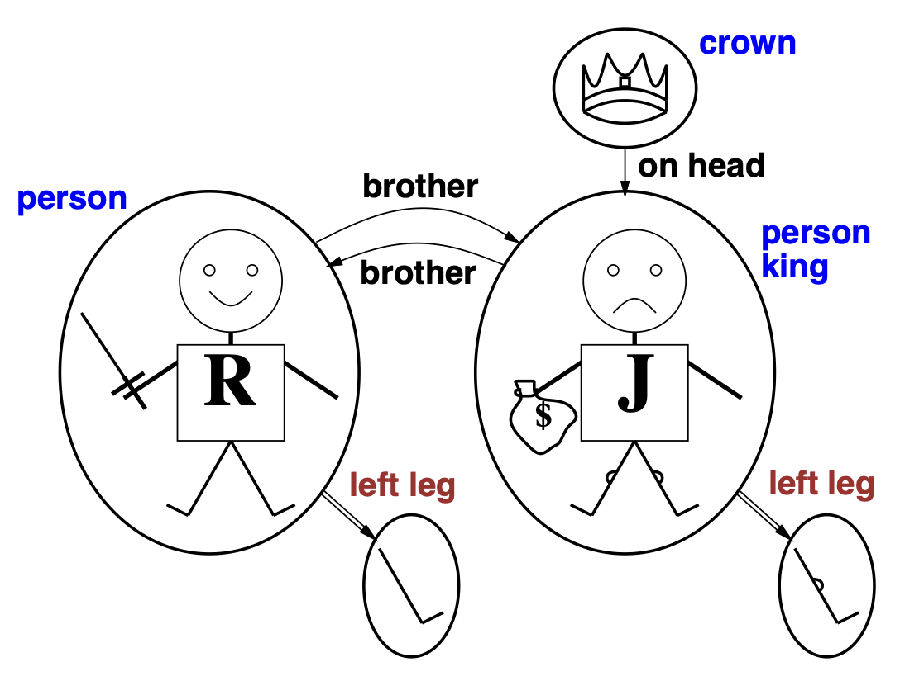
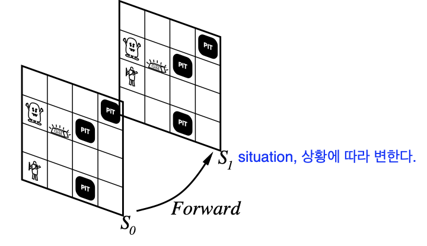

# Chapter 8. 일차 논리 (First-Order Logic)

> 인공지능 강의 정리 노트
> 원본: `AI-ch08.pdf` (Russell & Norvig, *Artificial Intelligence: A Modern Approach* 8장 기반, 슬라이드 1~27쪽)
> 이전 장: [Chapter 7. 논리적 에이전트](./05-logical-agents.md) · 함께 배운 장: [제4장. 전문가 시스템](./08-expert-systems.md)

---

## 📌 목차

1. [왜 일차 논리(FOL)인가? — 명제 논리의 한계와 논리 체계 비교](#_1-왜-일차-논리-fol-인가-—-명제-논리의-한계와-논리-체계-비교-p-1-p-5)
2. [일차 논리의 구문 (Syntax of FOL)](#_2-일차-논리의-구문-syntax-of-fol-p-6-p-9)
3. [일차 논리의 의미와 진리 (Semantics, Model & Interpretation)](#_3-일차-논리의-의미와-진리-semantics-model-interpretation-p-10-p-12)
4. [전칭 한정사($\forall$)와 존재 한정사($\exists$)](#_4-전칭-한정사-와-존재-한정사-p-13-p-16)
5. [일차 논리 문장 작성 연습과 등호(Equality)](#_5-일차-논리-문장-작성-연습과-등호-equality-p-17-p-18)
6. [지식 베이스(KB) vs 데이터베이스 의미론 (UNA · CWA · DC)](#_6-지식-베이스-kb-vs-데이터베이스-의미론-una-·-cwa-·-dc-p-19)
7. [일차 논리 KB와의 상호작용 (Tell / Ask와 치환 $\sigma$)](#_7-일차-논리-kb와의-상호작용-tell-ask와-치환-p-20)
8. [일차 논리로 표현한 웜푸스 세계](#_8-일차-논리로-표현한-웜푸스-세계-p-21-p-22)
9. [변화 추적과 상황 미적분 (Situation Calculus)](#_9-변화-추적과-상황-미적분-situation-calculus-p-23-p-25)
10. [일차 논리에서의 지식 공학 (Knowledge Engineering)](#_10-일차-논리에서의-지식-공학-knowledge-engineering-p-26)
11. [요약 및 수업 정리 메모](#_11-요약-및-수업-정리-메모-p-27) · [셀프 체크 퀴즈](#_12-셀프-체크-퀴즈)

---

### 🎯 이 장의 핵심 질문과 수업 도입 메모 (`p.1`~`p.2`)

> **📝 수업 필기 (`p.1`)**
> - 지난 시간에는 Logical Agent를 배웠다: **PL(Propositional Logic, 명제 논리)** — 단순한 형태의 문장으로 표현력이 **상당히 제한적**이다.
> - 이번 시간에는 **FOL(First-Order Logic, 일차 논리)** — 지식 기반(Knowledge Base) 표현력을 대폭 확장한다.

- **Outline (`p.2`)**:
  1. Why FOL? (왜 일차 논리가 필요한가?)
  2. Syntax and semantics of FOL (일차 논리의 구문과 의미)
  3. Fun with sentences (자연어 문장을 일차 논리로 옮기기)
  4. Wumpus world in FOL (일차 논리로 웜푸스 세계 정의하기)

---

## 1. 왜 일차 논리(FOL)인가? — 명제 논리의 한계와 논리 체계 비교 (`p.1`~`p.5`)

### 1.1 명제 논리(Propositional Logic)의 장단점 (`p.3`)

| 구분 | 특성 | 원문 설명 및 의미 |
|---|---|---|
| 😊 **장점 1** | **선언적 (Declarative)** | 구문의 각 조각이 세상의 사실(fact)에 대응한다. (`pieces of syntax correspond to facts`) |
| 😊 **장점 2** | **부분·선언·부정 정보 허용** | 일반적인 자료구조나 데이터베이스와 달리, 불완전하거나 `OR`($\lor$)·`NOT`($\lnot$)으로 된 정보도 표현할 수 있다. |
| 😊 **장점 3** | **합성적 (Compositional)** | 복합 문장 $B_{1,1} \land P_{1,2}$의 의미는 각 부분인 $B_{1,1}$의 의미와 $P_{1,2}$의 의미로부터 조합되어 결정된다. |
| 😊 **장점 4** | **문맥 독립적 (Context-independent)** | 맥락에 따라 뜻이 바뀌는 자연어와 달리, 문장의 의미가 문맥에 좌우되지 않고 명확하다. |
| ☹️ **단점** | **매우 제한적인 표현력**<br>(`very limited expressive power`) | 자연어와 달리 **"구덩이(pit)는 인접한 칸에 바람(breeze)을 일으킨다"** 라는 일반 규칙을 한 문장으로 말할 수 없고, **모든 칸마다 일일이 별도의 문장**($B_{1,1} \Leftrightarrow (P_{1,2} \lor P_{2,1})$ 등)을 다 적어 주어야 한다. |

> **📝 수업 필기 (`p.3`)**
> - 명제 논리의 **가장 큰 단점은 표현력이 떨어져서 현실과 동떨어져 있다**는 점이다.
> - 이를 **개선한 것이 FOL(일차 논리)** 이다. **좀 더 자연어 표현에 가깝게 지식을 추론하고 표현**할 수 있다.

---

### 1.2 일차 논리(First-Order Logic)가 바라보는 세상 (`p.4`)

명제 논리가 세상에 오직 **단순 사실(facts)** 만 존재한다고 가정하는 반면, **일차 논리(FOL)** 는 자연어와 마찬가지로 세상이 다음 **세 가지 요소**로 이루어져 있다고 가정합니다.

1. **Objects (객체 / 개체)**:
   - 사람, 집, 숫자, 이론, 클라우스 요하니스(`Klaus Iohannis`), 색상, 야구 경기, 전쟁, 세기(centuries) 등 세상에 존재하는 개별 대상들.
2. **Relations (관계 / 속성)**:
   - **단항 관계(속성, Unary relations/Properties)**: `red`(빨갛다), `round`(둥글다), `bogus`(가짜다), `prime`(소수이다), `multistoried`(다층이다) 등 객체 하나의 성질.
   - **다항 관계($n$-ary relations)**: `brother of`(~의 형제), `bigger than`(~보다 크다), `inside`(~안에 있다), `part of`(~의 일부), `has color`(~색을 가진다), `occurred after`(~이후에 발생했다), `owns`(~를 소유한다), `comes between`(~사이에 온다) 등 객체들 사이의 관계.
3. **Functions (함수)**:
   - `father of`(~의 아버지), `best friend`(~의 단짝 친구), `third inning of`(~의 3회), `one more than`(~보다 1 큰 수), `end of`(~의 끝) 등 **주어진 객체에 대해 단 하나의 결과 객체(값)를 대응시키는 관계**.

> **📝 수업 필기 (`p.4`)**
> - **오브젝트(Object)와 관계(Relation)로 표현하여 실제 세상을 기술**한다.
> - **대표적으로 ER 다이어그램**(Entity-Relationship Diagram, 개체-관계 모델)과 같은 철학이다.

---

### 1.3 논리 체계 일반 비교: 존재론적 개입 vs 인식론적 개입 (`p.5`)

다양한 논리·추론 체계는 **세상에 무엇이 존재한다고 가정하는가(존재론적 개입)** 와 **에이전트가 지식을 어떤 상태로 믿는가(인식론적 개입)** 에 따라 구분됩니다.

- **Ontological commitment (존재론적 개입)**: 실제 세상에 무엇이 존재하는지에 대한 가정 (*what is assumed about reality*).
- **Epistemological commitment (인식론적 개입)**: 에이전트가 가질 수 있는 지식(믿음)의 상태 (*possible states of knowledge* — 내가 어떻게 인식하느냐).

| 언어 / 체계 (Language) | 존재론적 개입 (Ontological Commitment)<br>*실제 세상에 무엇이 존재하는지* | 인식론적 개입 (Epistemological Commitment)<br>*내가 어떻게 인식하느냐* | 수업 필기 메모 (`p.5`) |
|---|---|---|---|
| **Propositional logic** (명제 논리) | `facts` (사실) | `true / false / unknown` | 사실에 대한 판단 |
| **First-order logic** (일차 논리) | `facts, objects, relations` | `true / false / unknown` | 사실, 객체, 관계 |
| **Temporal logic** (시간 논리) | `facts, objects, relations, times` | `true / false / unknown` | 시간 포함 (고차/시간 확장) |
| **Probability theory** (확률 이론) | `facts` | `degree of belief` $\in [0, 1]$ | 확률론적 / 확률의 정도 |
| **Fuzzy logic** (퍼지 논리) | `facts + degree of truth` | `known interval value` | 사실 자체가 정도의 값을 가짐 (예: "약간 따뜻함") |

---

## 2. 일차 논리의 구문 (Syntax of FOL) (`p.6`~`p.9`)

### 2.1 기본 구성 요소 (Basic Elements) (`p.7`)

> **📝 수업 필기 (`p.7`)**: 명제 논리에서 기호와 표현을 넓힌 **확장된 논리**이다.

| 구성 요소 | 슬라이드 예시 | 역할 및 설명 |
|---|---|---|
| **Constants (상수 기호)** | `KingJohn`, `2`, `UTCN`, `Klaus`, $\dots$ | 세상의 **특정 객체(Object)** 하나를 가리키는 고유 이름 |
| **Predicates (술어 기호)** | `Brother`, `>`, $\dots$ | 객체들의 **관계(Relation)** 나 속성을 나타내며, 결과는 **참/거짓** |
| **Functions (함수 기호)** | `Sqrt`, `LeftLegOf`, $\dots$ | 객체를 입력받아 **또 다른 객체(Object)** 를 반환하는 함수적 관계 |
| **Variables (변수)** | $x, y, a, b, \dots$ | 구체적인 객체가 정해지지 않은 빈자리 (한정사와 함께 쓰임) |
| **Connectives (논리 연결사)** | $\land, \lor, \lnot, \Rightarrow, \Leftrightarrow$ | 문장들을 연결하는 **논리기호** (`p.7` 필기) |
| **Equality (등호)** | $=$ | 두 항(Term)이 **동일한 객체**를 가리킴을 나타냄 |
| **Quantifiers (한정사 / 양화사)** | $\forall$ (전칭), $\exists$ (존재) | 변수가 가리키는 대상의 범위(전체 또는 일부)를 지정 |

---

### 2.2 BNF 문법과 연산자 우선순위 (`p.6`)

> **📝 수업 필기 (`p.6`)**: `Term` = **오브젝트**, `Quantifier` = **universal($\forall$), exist($\exists$)**, `Predicate` = **관계**

```text
Sentence        → AtomicSentence | ComplexSentence
AtomicSentence  → Predicate | Predicate(Term, ...) | Term = Term
ComplexSentence → ( Sentence ) | [ Sentence ]
                | ¬Sentence
                | Sentence ∧ Sentence
                | Sentence ∨ Sentence
                | Sentence ⇒ Sentence
                | Sentence ⇔ Sentence
                | Quantifier Variable, ... Sentence

Term            → Function(Term, ...)   ← [필기] 오브젝트를 가리키는 표현
                | Constant
                | Variable

Quantifier      → ∀ | ∃                 ← [필기] universal, exist
Constant        → A | X₁ | John | ...
Variable        → a | x | s | ...
Predicate       → True | False | After | Loves | Raining | ...  ← [필기] 관계
Function        → Mother | LeftLeg | ...

OPERATOR PRECEDENCE (우선순위 높음 → 낮음):  ¬, =, ∧, ∨, ⇒, ⇔
```

---

### 2.3 항(Term), 원자 문장(Atomic Sentence), 복합 문장(Complex Sentence) (`p.8`~`p.9`)

#### ① 항 (Term) — 객체를 가리키는 표현 (`p.8`)
$$\text{Term} = \text{function}(\text{term}_1, \dots, \text{term}_n) \;\text{ or }\; \text{constant} \;\text{ or }\; \text{variable}$$
- **항(Term)** 은 참/거짓을 가지는 문장이 아니라 **세상 속의 객체(Object)를 지칭하는 명사구**입니다.
- 상수(`KingJohn`), 변수(`x`), 또는 함수 호출(`LeftLegOf(Richard)`, `Father(Richard)`)이 모두 항(Term)이 됩니다. 함수 안에 또 함수를 중첩(`Length(LeftLegOf(Richard))`)할 수도 있습니다.

#### ② 원자 문장 (Atomic Sentence) — 가장 기본이 되는 참/거짓 문장 (`p.8`)
$$\text{Atomic sentence} = \text{predicate}(\text{term}_1, \dots, \text{term}_n) \;\text{ or }\; \text{term}_1 = \text{term}_2$$
- 술어 기호 안에 항(Term)들을 넣거나, 두 항을 등호($=$)로 연결하면 비로소 **참/거짓을 판별할 수 있는 문장**이 됩니다.
- **슬라이드 예시 (`p.8`)**:
  - $\text{Brother}(\text{KingJohn}, \text{RichardTheLionheart})$ — 존 왕과 사자심왕 리처드는 형제이다.
  - $>(\text{Length}(\text{LeftLegOf}(\text{Richard})), \text{Length}(\text{LeftLegOf}(\text{KingJohn})))$ — 리처드의 왼다리 길이가 존 왕의 왼다리 길이보다 길다.
  - $\text{Married}(\text{Father}(\text{Richard}), \text{Mother}(\text{Richard}))$ — 리처드의 아버지와 리처드의 어머니는 결혼한 사이다.

#### ③ 복합 문장 (Complex Sentence) (`p.9`)
원자 문장들에 논리 연결사($\lnot S$, $S_1 \land S_2$, $S_1 \lor S_2$, $S_1 \Rightarrow S_2$, $S_1 \Leftrightarrow S_2$)를 붙여 만듭니다.
- **슬라이드 예시 (`p.9`)**:
  - $\text{Sibling}(\text{KingJohn}, \text{Richard}) \Rightarrow \text{Sibling}(\text{Richard}, \text{KingJohn})$
  - $>(1, 2) \lor \le(1, 2)$
  - $>(1, 2) \land \lnot >(1, 2)$
  - $\lnot \text{Brother}(\text{LeftLeg}(\text{Richard}), \text{John})$ — 리처드의 왼다리는 존의 형제가 아니다.

---

## 3. 일차 논리의 의미와 진리 (Semantics, Model & Interpretation) (`p.10`~`p.12`)

### 3.1 모델(Model)과 해석(Interpretation) (`p.10`)

> **📝 수업 필기 (`p.10`)**
> - **참이라는 것은 모델(Model) 관점과 인터프리테이션(Interpretation)에서 참이어야 한다.**
> - 논리학에서는 우리가 만든 기호 체계(Syntax)만으로는 참/거짓을 판단할 수 없고, 이 기호가 실제 세계(Model)에서 무엇을 뜻하는지 **해석(Interpretation)** 을 지정해 주어야 한다.
> - **Interpretation**은 **논리식에 적힌 기호(이름표)들이 실제 세상(모델)의 무엇을 가리키는가(Referent, 지시 대상)를 짝지어 주는 규칙**이다.

1. **모델 (Model)**:
   - 1개 이상의 **객체(objects, domain elements)** 들과 **그들 사이의 관계(relations among them)** 로 이루어진 세계입니다.
2. **해석 (Interpretation)**:
   - 문법 기호(Syntax)가 모델 속의 어떤 대상(Referent)을 가리키는지 지정합니다:

| 문법 기호 (Syntax) | $\rightarrow$ | 지시 대상 (Referent in Model) | 의미 |
|---|---|---|---|
| **Constant symbols (상수 기호)** | $\rightarrow$ | **objects (객체)** | 각 상수 기호가 모델 안의 어떤 개체를 가리키는지 지정 |
| **Predicate symbols (술어 기호)** | $\rightarrow$ | **relations (관계)** | 각 술어 기호가 모델 안의 어떤 관계(순서쌍들의 집합)를 가리키는지 지정 |
| **Function symbols (함수 기호)** | $\rightarrow$ | **functional relations (함수적 관계)** | 입력 개체마다 유일한 결과 개체를 대응시키는 함수적 관계를 지정 |

3. **원자 문장의 참·거짓 판정 조건 (`p.10`, `p.12`)**:
   - 원자 문장 $\text{predicate}(\text{term}_1, \dots, \text{term}_n)$이 **참(true)** 이 될 필요충분조건(iff)은, 각 항 $\text{term}_1, \dots, \text{term}_n$이 가리키는 **객체들의 순서쌍**이 $\text{predicate}$가 가리키는 **관계(relation) 집합 안에 포함되어 있는 것**입니다.

---

### 3.2 일차 논리 모델과 진리 판정 예시 (`p.11`~`p.12`)



- **모델 구성 (`p.11`)**:
  - **객체(Objects, 5개)**: 사자심왕 리처드(`R`), 사악한 존 왕(`J`), 리처드의 왼다리, 존의 왼다리, 왕관(`crown`).
  - **단항 관계(속성)**: `person` = $\{R, J\}$, `king` = $\{J\}$, `crown` = $\{\text{왕관}\}$.
  - **이항 관계**: `brother` = $\{\langle R, J \rangle, \langle J, R \rangle\}$, `on head` = $\{\langle \text{왕관}, J \rangle\}$.
  - **함수적 관계**: `left leg` = $\{R \mapsto \text{R의 왼다리}, \; J \mapsto \text{J의 왼다리}\}$.
- **진위 판단 예시 (`p.12`)**:
  - 해석(Interpretation)이 $\text{Richard} \rightarrow \text{사자심왕 리처드}$, $\text{John} \rightarrow \text{사악한 존 왕}$, $\text{Brother} \rightarrow \text{형제 관계}$로 주어졌을 때,
  - 문장 $\text{Brother}(\text{Richard}, \text{John})$은 모델에서 $\langle R, J \rangle$가 `brother` 관계 안에 들어 있으므로 **참(True)** 으로 판정됩니다 (`p.12` 필기: **진위를 판단**).

---

## 4. 전칭 한정사($\forall$)와 존재 한정사($\exists$) (`p.13`~`p.16`)

### 4.1 전칭 한정사 (Universal Quantification, $\forall$) (`p.13`~`p.14`)

> **📝 수업 필기 (`p.13`)**: `for all = universal` · $\forall x \; \text{At}(x, \text{D21}) \Rightarrow \text{Smart}(x)$ $\rightarrow$ **"D21 방에 있는 모든 사람은 스마트하다."**

- **문법**: $\forall \langle\text{variables}\rangle \; \langle\text{sentence}\rangle$
- **의미 (`p.13`)**: $\forall x \; P$가 모델 $m$에서 참이려면, 모델 안의 **가능한 모든 객체(each possible object)** 를 $x$에 대입했을 때 $P$가 전부 참이어야 합니다.
- **직관적 동치 (논리곱 $\land$의 나열)**:
  $$\forall x \; \text{At}(x, \text{D21}) \Rightarrow \text{Smart}(x)$$
  는 모델 안의 모든 객체를 하나씩 대입한 문장들을 **AND($\land$)** 로 묶은 것과 같습니다:
  $$\begin{aligned}
  &(\text{At}(\text{JipaGeorge}, \text{D21}) \Rightarrow \text{Smart}(\text{JipaGeorge})) \\
  \land \; &(\text{At}(\text{PopaAndrada}, \text{D21}) \Rightarrow \text{Smart}(\text{PopaAndrada})) \\
  \land \; &(\text{At}(\text{MacariaGeorgiana}, \text{D21}) \Rightarrow \text{Smart}(\text{MacariaGeorgiana})) \land \dots
  \end{aligned}$$

#### ⚠️ 전칭 한정사($\forall$)에서 피해야 할 흔한 실수 (`p.14`)
- **규칙**: **$\forall$의 주 연결사(main connective)는 항상 함의($\Rightarrow$)** 여야 합니다.
- **흔한 실수**: $\forall$와 $\land$를 함께 쓰는 경우
  $$\forall x \; \text{At}(x, \text{D21}) \land \text{Smart}(x) \quad \text{(❌ 잘못된 표현)}$$
  - 이렇게 쓰면 **"세상의 모든 것이 D21 강의실에 있고, 세상의 모든 것이 똑똑하다"** 라는 지나치게 강한 뜻이 되어 버립니다.

---

### 4.2 존재 한정사 (Existential Quantification, $\exists$) (`p.15`~`p.16`)

> **📝 수업 필기 (`p.15`)**: `there exists, 일부 있다.` · $\exists x \; \text{At}(x, \text{Stanford}) \land \text{Smart}(x)$ $\rightarrow$ **"스탠포드에 있는 일부(누군가)는 스마트하다."**

- **문법**: $\exists \langle\text{variables}\rangle \; \langle\text{sentence}\rangle$
- **의미 (`p.15`)**: $\exists x \; P$가 모델 $m$에서 참이려면, 모델 안의 **어떤 객체(some possible object, 적어도 하나)** 를 $x$에 대입했을 때 $P$가 참이면 됩니다.
- **직관적 동치 (논리합 $\lor$의 나열)**:
  $$\exists x \; \text{At}(x, \text{Stanford}) \land \text{Smart}(x)$$
  는 모델 안의 각 객체를 대입한 문장들을 **OR($\lor$)** 로 묶은 것과 같습니다:
  $$\begin{aligned}
  &(\text{At}(\text{KingJohn}, \text{Stanford}) \land \text{Smart}(\text{KingJohn})) \\
  \lor \; &(\text{At}(\text{Richard}, \text{Stanford}) \land \text{Smart}(\text{Richard})) \\
  \lor \; &(\text{At}(\text{Stanford}, \text{Stanford}) \land \text{Smart}(\text{Stanford})) \lor \dots
  \end{aligned}$$

#### ⚠️ 존재 한정사($\exists$)에서 피해야 할 흔한 실수 (`p.16`)
- **규칙**: **$\exists$의 주 연결사(main connective)는 항상 논리곱($\land$)** 이어야 합니다.
- **흔한 실수**: $\exists$와 $\Rightarrow$를 함께 쓰는 경우
  $$\exists x \; \text{At}(x, \text{Stanford}) \Rightarrow \text{Smart}(x) \quad \text{(❌ 잘못된 표현)}$$
  - 함의($P \Rightarrow Q$)는 가정($P$)이 거짓이면 무조건 참이 됩니다. 따라서 **스탠퍼드에 있지 않은 대상이 세상에 단 하나라도 있으면**, 스탠퍼드에 똑똑한 사람이 없어도 이 문장은 무조건 **참(true)** 이 되어 버립니다! (`is true if there is anyone who is not at Stanford!`)

#### 📌 한눈에 비교하는 $\forall$ vs $\exists$ 짝꿍 공식

| 한정사 | 뜻 | 짝꿍 연결사 | 올바른 패턴 | 잘못 썼을 때의 문제 |
|---|---|---|---|---|
| **$\forall x$** | 모든 $x$에 대하여 | **$\Rightarrow$ (이면)** | $\forall x \; P(x) \Rightarrow Q(x)$ | $\land$를 쓰면 "세상 모든 개체가 $P$이고 $Q$이다"가 됨 |
| **$\exists x$** | 어떤 $x$가 존재하여 | **$\land$ (그리고)** | $\exists x \; P(x) \land Q(x)$ | $\Rightarrow$를 쓰면 "$P$가 아닌 개체만 하나 있어도 무조건 참"이 됨 |

---

## 5. 일차 논리 문장 작성 연습과 등호(Equality) (`p.17`~`p.18`)

### 5.1 자연어 문장을 일차 논리로 옮기기 (`Fun with sentences`, `p.17`)

1. **"Brothers are siblings" (형제는 남매/형제자매이다)**
   $$\forall x, y \; \text{Brother}(x, y) \Rightarrow \text{Sibling}(x, y)$$
2. **"Sibling is symmetric" (형제자매 관계는 대칭적이다)**
   $$\forall x, y \; \text{Sibling}(x, y) \Leftrightarrow \text{Sibling}(y, x)$$
3. **"One's mother is one's female parent" (어머니란 여성인 부모이다)**
   $$\forall x, y \; \text{Mother}(x, y) \Leftrightarrow (\text{Female}(x) \land \text{Parent}(x, y))$$
4. **"A first cousin is a child of a parent's sibling" (사촌이란 부모의 형제자매의 자녀이다)**
   $$\forall x, y \; \text{FirstCousin}(x, y) \Leftrightarrow \exists p, ps \; \text{Parent}(p, x) \land \text{Sibling}(ps, p) \land \text{Parent}(ps, y)$$
   - 해석: $x$와 $y$가 사촌이라는 것은, $x$의 부모 $p$와 그 부모의 형제자매 $ps$가 존재하여 $ps$가 $y$의 부모인 것과 동치이다.
5. **"There is a barber who shaves all men in town who do not shave themselves." (마을에서 스스로 면도하지 않는 모든 남성을 면도해 주는 이발사가 존재한다 — 러셀의 이발사 역설)**
   $$\exists b \; \text{Barber}(b) \land \forall x \; (\text{Man}(x) \land \lnot \text{Shaves}(x, x)) \Rightarrow \text{Shaves}(b, x)$$

---

### 5.2 등호 (Equality, $=$) (`p.18`)

- **정의**: $\text{term}_1 = \text{term}_2$가 주어진 해석 아래에서 **참(true)** 이 될 필요충분조건은, $\text{term}_1$과 $\text{term}_2$가 **완전히 동일한 객체(same object)** 를 가리키는 것입니다.
  - 예: $\text{Father}(\text{John}) = \text{Henry}$ (`Father(John)`이라는 함수가 반환한 객체와 상수 `Henry`가 가리키는 객체가 동일 인물임).
  - 예: $2 = 2$는 모든 모델에서 참이므로 **타당(valid)** 하고, $\forall x \; \times(\text{Sqrt}(x), \text{Sqrt}(x)) = x$는 **충족 가능(satisfiable)** 합니다.
- **등호를 활용한 친형제자매(`Sibling`)의 엄밀한 정의 (`p.18`)**:
  "두 사람 $x, y$가 형제자매라는 것은, **$x$와 $y$가 서로 다른 사람**($\lnot(x = y)$)이고, **서로 다른 두 부모 $m, f$**($\lnot(m = f)$)가 존재하여 $m$과 $f$ 모두 $x$와 $y$의 부모라는 뜻이다."
  $$\forall x, y \; \text{Sibling}(x, y) \Leftrightarrow \big[\lnot(x = y) \land \exists m, f \; \lnot(m = f) \land \text{Parent}(m, x) \land \text{Parent}(f, x) \land \text{Parent}(m, y) \land \text{Parent}(f, y)\big]$$
  - 만약 $\lnot(x = y)$를 빼먹으면, 부모가 같은 자기 자신($x = x$)도 자기 자신의 형제가 되어 버립니다!

---

## 6. 지식 베이스(KB) vs 데이터베이스 의미론 (UNA · CWA · DC) (`p.19`)

> **📝 수업 필기 (`p.19`)**
> - **널러지베이스(Knowledge Base)와 디비(Database)랑 차이가 있다**를 설명.
> - **널러지베이스에서는 모든 관계를 다 기술해야 하고, 데이터베이스는 기본 가정이 있다.**

### 6.1 왜 일차 논리(KB)에서는 문장이 길어지는가?

**"Richard's brothers are John and Geoffrey" (리처드의 형제는 존과 제프리다)** 라는 문장을 일차 논리(FOL KB)로 엄밀하게 적으면 다음과 같이 매우 길어집니다:

$$\underbrace{\text{Brother}(\text{John}, \text{Richard}) \land \text{Brother}(\text{Geoffrey}, \text{Richard})}_{\text{① 존과 제프리는 리처드의 형제다}} \land \underbrace{\text{John} \neq \text{Geoffrey}}_{\text{② 존과 제프리는 다른 인물이다}} \land \underbrace{\forall x \; \text{Brother}(x, \text{Richard}) \Rightarrow (x = \text{John} \lor x = \text{Geoffrey})}_{\text{③ 그 외에 다른 형제는 없다}}$$

일차 논리는 **열린 세계 가정(Open World Assumption)** 을 따르기 때문에:
- `John ≠ Geoffrey`를 안 적으면 두 이름이 동일 인물의 다른 별명일 수도 있다고 보고,
- $\forall x \dots$를 안 적으면 아직 모르는 제3의 형제가 더 있을 수도 있다고 봅니다.

---

### 6.2 데이터베이스의 3가지 기본 가정 (Database Semantics) (`p.19`)

반면 **데이터베이스(DB)** 는 다음 **3가지 가정**을 기본으로 깔고 있습니다:

| 기본 가정 | 원문 정의 | 의미 및 효과 |
|---|---|---|
| **① Unique names assumption (UNA)**<br>고유 이름 가정 | `every constant refer to a distinct object` | 서로 다른 상수 기호는 무조건 **서로 다른 객체**를 가리킨다.<br>$\rightarrow$ $\text{John} \neq \text{Geoffrey}$를 따로 적을 필요가 없다! |
| **② Closed world assumption (CWA)**<br>닫힌 세계 가정 | `atomic sentences not known to be true are in fact false` | 참이라고 알려지지 않은(DB에 저장되지 않은) 원자 문장은 **모두 거짓(false)** 으로 간주한다.<br>$\rightarrow$ 적히지 않은 다른 형제는 자동으로 거짓이 된다! |
| **③ Domain closure (DC)**<br>영역 폐쇄 가정 | `each model contains no more domain elements than those named by the constant symbols` | 모델 안에는 상수 기호로 이름 붙여진 개체들 외에 **이름 없는 추가 개체가 더 존재하지 않는다**. |

- **결과**: 이 3가지 가정 덕분에 데이터베이스에서는 단지 아래 한 줄만 저장하면 위 긴 수식과 완전히 같은 뜻이 됩니다:
  $$\text{Brother}(\text{John}, \text{Richard}) \land \text{Brother}(\text{Geoffrey}, \text{Richard})$$

### 6.3 "What about reasoning on Internet?" (인터넷에서의 추론은?) (`p.19`)

- **인터넷(웹) 환경에서는 UNA, CWA, DC 가정이 모두 성립하지 않습니다.**
  1. 같은 사람/대상이 여러 이름이나 URL로 불리므로 **UNA 불가**.
  2. 웹페이지에 어떤 사실이 안 적혀 있다고 해서 거짓이 아니라 아직 모르는 것(Unknown)이므로 **CWA 불가**.
  3. 웹에는 새로운 개체가 끊임없이 추가되므로 **DC 불가**.
- 따라서 인터넷이나 시맨틱 웹(온톨로지)에서의 추론은 데이터베이스 방식이 아니라 **열린 세계 가정(OWA)을 따르는 논리 기반 지식베이스(KB)** 방식으로 다루어야 합니다.

---

## 7. 일차 논리 KB와의 상호작용 (Tell / Ask와 치환 $\sigma$) (`p.20`)

### 7.1 `Tell`과 `Ask`
웜푸스 세계의 에이전트가 시각 $t = 5$에 악취(`Smell`)와 바람(`Breeze`)을 느끼고 반짝임은 못 느꼈다면(`None`):

1. **`Tell` (인지 사실 입력)**:
   $$\text{Tell}(\text{KB}, \text{Percept}([\text{Smell}, \text{Breeze}, \text{None}], 5))$$
2. **`Ask` (해야 할 행동 질의)**:
   $$\text{Ask}(\text{KB}, \exists a \; \text{Action}(a, 5))$$
   - 의미: "시각 $t=5$에 KB가 함의하는 특정 행동 $a$가 존재하는가?"

### 7.2 치환 (Substitution / Binding List, $\sigma$)

> **📝 수업 필기 (`p.20`)**: $\sigma$는 **시그마(sigma)** 라고 읽는다.

- 질의에 대한 답은 단순한 `Yes`뿐 아니라, 변수에 어떤 값을 대입하면 참이 되는지 알려 주는 **치환(substitution, 바인딩 리스트)** $\sigma$ 형태로 돌아옵니다:
  $$\text{Answer: } \text{Yes}, \; \{a / \text{Shoot}\}$$
- **치환 표기법 $S\sigma$**:
  - 문장 $S$에 치환 $\sigma$를 대입한 결과를 $S\sigma$라 표기합니다.
  - 예: $S = \text{Smarter}(x, y)$이고 $\sigma = \{x/\text{Hillary}, \; y/\text{Bill}\}$이면,
    $$S\sigma = \text{Smarter}(\text{Hillary}, \text{Bill})$$
- **일반 정의**: $\text{Ask}(\text{KB}, S)$는 $\text{KB} \models S\sigma$를 만족하는 하나 또는 모든 치환 $\sigma$를 반환합니다.

---

## 8. 일차 논리로 표현한 웜푸스 세계 (`p.21`~`p.22`)

명제 논리에서는 칸마다 수십 개씩 적어야 했던 웜푸스 세계의 규칙이, 일차 논리에서는 변수($t, x, y$)와 한정사($\forall, \exists$) 덕분에 **단 한 줄의 일반 규칙**으로 깔끔하게 표현됩니다.

### 8.1 지각(Perception), 반사(Reflex), 인접(Adjacent) 규칙 (`p.21`)

1. **Perception (감각 리스트 해석)**:
   $$\forall b, g, t \;\; \text{Percept}([\text{Smell}, b, g], t) \Rightarrow \text{Smelt}(t)$$
   $$\forall s, b, t \;\; \text{Percept}([s, b, \text{Glitter}], t) \Rightarrow \text{AtGold}(t)$$
2. **Reflex (단순 반사 규칙)**:
   $$\forall t \;\; \text{AtGold}(t) \Rightarrow \text{Action}(\text{Grab}, t)$$
3. **Reflex with internal state (내부 상태를 가진 반사 규칙)**:
   - 이미 금을 쥐고 있는지(`Holding(Gold, t)`) 확인하여 중복 `Grab`을 방지합니다:
   $$\forall t \;\; \text{AtGold}(t) \land \lnot \text{Holding}(\text{Gold}, t) \Rightarrow \text{Action}(\text{Grab}, t)$$
   - 단, $\text{Holding}(\text{Gold}, t)$는 센서로 직접 관측할 수 없으므로 **상태의 변화를 추적(keeping track of change)** 해야 합니다.
4. **인접한 칸(`Adjacent`)의 수학적 정의**:
   $$\forall x, y, a, b \;\; \text{Adjacent}([x, y], [a, b]) \Leftrightarrow \big(x = a \land (y = b - 1 \lor y = b + 1)\big) \lor \big(y = b \land (x = a - 1 \lor x = a + 1)\big)$$

---

### 8.2 숨겨진 속성 추론: 진단 규칙 vs 인과 규칙 (`p.22`)

1. **시각 $t$의 감각으로부터 위치 $x$의 속성 추론**:
   $$\forall x, t \;\; \text{At}(\text{Agent}, x, t) \land \text{Smelt}(t) \Rightarrow \text{Smelly}(x)$$
   $$\forall x, t \;\; \text{At}(\text{Agent}, x, t) \land \text{Breeze}(t) \Rightarrow \text{Breezy}(x)$$
2. **구덩이(`Pit`)와 바람(`Breezy`)의 관계 표현 3가지**:

| 구분 | 수식 | 설명 및 한계 |
|---|---|---|
| **Diagnostic rule**<br>(진단 규칙: 결과 $\rightarrow$ 원인) | $\forall y \; \text{Breezy}(y) \Rightarrow \exists x \; \text{Pit}(x) \land \text{Adjacent}(x, y)$ | 바람이라는 **결과**로부터 구덩이라는 **원인**을 추론 |
| **Causal rule**<br>(인과 규칙: 원인 $\rightarrow$ 결과) | $\forall x, y \; \text{Pit}(x) \land \text{Adjacent}(x, y) \Rightarrow \text{Breezy}(y)$ | 구덩이라는 **원인**으로부터 바람이라는 **결과**를 추론.<br>⚠️ 불완전함: 구덩이가 주변에 없을 때 바람이 안 분다는 보장이 없음 |
| **Definition for `Breezy`**<br>(쌍조건 $\Leftrightarrow$ 완전 정의) ⭐ | $\forall y \; \text{Breezy}(y) \Leftrightarrow \big[\exists x \; \text{Pit}(x) \land \text{Adjacent}(x, y)\big]$ | 진단 규칙과 인과 규칙을 하나로 합친 **완전한 정의**.<br>바람이 안 불면($\lnot\text{Breezy}(y)$) 인접 칸에 구덩이가 없다는 것까지 추론 가능! |

---

## 9. 변화 추적과 상황 미적분 (Situation Calculus) (`p.23`~`p.25`)

### 9.1 상황 미적분 (Situation Calculus) (`p.23`)

> **📝 수업 필기 (`p.23`)**: `eternally` = **영원히** · `Situation calculus` (밑줄 강조) · $S_1$: **situation, 상황에 따라 변한다.**



- 세상의 사실들은 영원히(`eternally`) 고정되어 있지 않고 **상황(situation)에 따라 변합니다**.
- **Situation calculus (상황 미적분)** 는 일차 논리에서 시간/행동에 따른 변화를 표현하는 표준 방식입니다:
  1. 변할 수 있는 모든 술어(fluent)의 마지막 인자로 **상황(situation) 변수**를 추가합니다.
     - 예: $\text{Holding}(\text{Gold})$ 대신 $\text{Holding}(\text{Gold}, \text{Now})$ 또는 $\text{Holding}(\text{Gold}, S_0)$.
  2. 상황과 상황 사이를 **`Result(a, s)` 함수**로 연결합니다.
     - $\text{Result}(a, s)$: 상황 $s$에서 행동 $a$를 수행한 결과로 도달하는 **다음 상황(새 상황 객체)** 을 반환합니다. (그림: $S_1 = \text{Result}(\text{Forward}, S_0)$)

---

### 9.2 행동 기술 I: 효과 공리와 프레임 문제 (`p.24`)

행동이 세계에 미치는 영향을 기술할 때 직면하는 **3가지 고전적 문제**입니다:

| 개념 / 문제 | 수식 및 정의 | 핵심 내용 |
|---|---|---|
| **Effect axiom**<br>(효과 공리) | $\forall s \; \text{AtGold}(s) \Rightarrow \text{Holding}(\text{Gold}, \text{Result}(\text{Grab}, s))$ | 행동으로 인해 **변하는 것(changes)** 을 기술 |
| **Frame axiom**<br>(프레임 공리) | $\forall s \; \text{HaveArrow}(s) \Rightarrow \text{HaveArrow}(\text{Result}(\text{Grab}, s))$ | 행동과 무관하여 **변하지 않는 것(non-changes)** 을 기술<br>(금을 집어도 화살 보유 여부는 그대로 유지됨) |
| **① Frame problem**<br>(프레임 문제) ⭐ | **변하지 않는 수많은 사실들을 어떻게 효율적으로 다룰 것인가?** | **(a) 표현 문제(Representation)**: 세상 모든 행동 $\times$ 무관한 속성마다 프레임 공리를 일일이 다 적어야 하는 문제<br>**(b) 추론 문제(Inference)**: 매 단계마다 변하지 않은 상태를 계속 복사(copy-over)해서 증명해야 하는 비효율 |
| **② Qualification problem**<br>(자격/전제조건 문제) | 행동이 성공하기 위한 **모든 예외 조건(caveats)을 다 나열할 수 없는 문제** | 예: 금을 잡으려는데 금이 미끄럽다면? 바닥에 못 박혀 있다면? 무게가 10톤이라면? |
| **③ Ramification problem**<br>(파생/부수효과 문제) | 행동으로 인해 발생하는 **수많은 부수적 결과(secondary consequences)를 다 적을 수 없는 문제** | 예: 금을 집으면 금 위의 먼지도 함께 이동하고, 장갑이 마모되고, 팔 근육 피로도가 올라가는 등 |

---

### 9.3 행동 기술 II: 후속 상태 공리 (Successor-State Axioms) (`p.25`)

**표현상의 프레임 문제(Representational frame problem)** 를 깔끔하게 해결하는 방법이 **후속 상태 공리(Successor-state axioms)** 입니다.

- **핵심 아이디어**: 공리를 '행동(action)'마다 적지 말고, **변하는 '술어(predicate)' 하나마다 딱 한 줄의 쌍조건문($\Leftrightarrow$)으로 정의**합니다!
- **후속 상태 공리의 일반 공식 (`p.25`)**:
  $$\text{행동 후 } P\text{가 참이다} \;\Leftrightarrow\; \big[\text{방금 한 행동이 } P\text{를 참으로 만들었거나} \;\lor\; (\text{원래 } P\text{가 참이었고 방금 한 행동이 } P\text{를 거짓으로 만들지 않았다})\big]$$

#### 💡 슬라이드 예시 2가지 (`p.25`)
1. **금을 쥐고 있는 상태 (`Holding(Gold, ...)`에 대한 후속 상태 공리)**:
   $$\forall a, s \;\; \text{Holding}(\text{Gold}, \text{Result}(a, s)) \;\Leftrightarrow\; \Big[(a = \text{Grab} \land \text{AtGold}(s)) \;\lor\; (\text{Holding}(\text{Gold}, s) \land a \neq \text{Release})\Big]$$
   - 해석: 행동 $a$ 이후에 금을 쥐고 있으려면, ① 금이 있는 곳에서 방금 `Grab`(잡기)을 했거나, ② 이미 금을 쥐고 있었고 방금 `Release`(놓기)를 하지 않았으면 된다. (화살을 쏘든 앞으로 가든 `Release`가 아니므로 자동으로 유지됨 $\rightarrow$ 프레임 공리 불필요!)
2. **화살 보유 상태 (`HaveArrow`에 대한 후속 상태 공리)**:
   $$\forall t \;\; \text{HaveArrow}(t + 1) \;\Leftrightarrow\; \big(\text{HaveArrow}(t) \land \lnot \text{Action}(\text{Shoot}, t)\big)$$
   - 해석: 화살을 새로 얻는 행동은 없으므로, 이전에 화살이 있었고 방금 `Shoot`(발사)을 하지 않았다면 다음 시각에도 화살을 가지고 있다.

---

## 10. 일차 논리에서의 지식 공학 (Knowledge Engineering) (`p.26`)

**지식 공학자(Knowledge engineer)** 가 특정 도메인을 조사하여 중요한 개념을 파악하고, 도메인의 객체와 관계를 형식적 논리 표현으로 구축하는 **7단계 절차**입니다:

| 단계 | 원문 단계명 | 설명 및 핵심 키워드 |
|---|---|---|
| **1단계** | **Identify the task** | 해결할 과제를 정의하고, 지식베이스(KB)가 답해야 할 **역량 질문(competency questions)** 목록을 작성한다. |
| **2단계** | **Assemble the relevant knowledge** | 도메인 전문가나 자료로부터 관련 지식을 수집한다 (**지식 획득, knowledge acquisition**). |
| **3단계** | **Decide on a vocabulary** | 술어(predicates), 함수(functions), 상수(constants) 어휘를 결정한다 — 도메인 개념을 논리 이름으로 번역하는 과정이며, 그 결과물을 **온톨로지(ontology)** 라 한다. |
| **4단계** | **Encode general knowledge** | 모든 어휘 용어들의 의미를 규정하는 **일반 도메인 규칙(기본 공리, axioms)** 을 인코딩한다. |
| **5단계** | **Encode a description of the specific problem instance** | 지금 풀고자 하는 **구체적인 문제 상황(인스턴스)** 을 원자 문장(atomic sentences, 사실)으로 인코딩한다. |
| **6단계** | **Pose queries to the inference procedure** | 추론 절차에 질의(`Ask`)를 던져 답을 얻는다. |
| **7단계** | **Debug the knowledge base** | 누락되거나 잘못된 공리를 찾아 지식베이스를 디버깅한다. |

---

## 11. 요약 및 수업 정리 메모 (`p.27`)

- **First-order logic (일차 논리)**:
  - 명제 논리보다 표현력이 강화되어 현실 세계를 자연스럽게 표현하도록 발전했다 (`p.27` 필기).
  - **의미론적 기본 단위(semantic primitives)**: **객체(objects)** 와 **관계(relations)**.
  - **구문 요소(syntax)**: 상수(`constants`), 함수(`functions`), 술어(`predicates`), 등호(`equality`), 한정사(`quantifiers`).
- **향상된 표현력 (Increased expressive power)**:
  - 웜푸스 세계의 규칙을 칸마다 반복하지 않고 간결하게 정의할 수 있다.
- **Situation calculus (상황 미적분)**:
  - 일차 논리에서 행동과 상태 변화를 기술하는 규약이며, 이를 통해 계획 수립(planning)을 지식베이스 상의 추론 문제로 공식화할 수 있다.

> **📝 슬라이드 하단 교수님 수업 총정리 메모 (`p.27`)**
> 1. **[전문가 시스템](./08-expert-systems.md) PPT 연결**:
>    - **순방향 추론(Forward Chaining)** 과 **역방향 추론(Backward Chaining)** 방법이 있으며, **역방향 추론은 목표(결과)를 가지고 필요한 것만 추론하니까 조금 더 효율적**이라는 평가를 받는다.
>    - 전문가 시스템은 **Rule-base(규칙 기반)** 이며, **장기 기억(Long-Term Memory)에는 규칙(Rule)** 이 들어가고 **단기 기억(Short-Term Memory)에는 사실(Fact)** 이 들어간다.
> 2. **다음 시간 예고**:
>    - 최근에는 **온톨로지(Ontology)** 가 많이 나오는데, 다음 시간에 온톨로지를 배운다.

---

## 12. 셀프 체크 퀴즈

**Q1.** 명제 논리(Propositional Logic)와 비교했을 때 일차 논리(First-Order Logic)의 존재론적 개입(Ontological Commitment)과 인식론적 개입(Epistemological Commitment)은 각각 무엇인가? (`p.5`)

<details><summary>▶ 정답 보기</summary>

- **존재론적 개입(Ontological Commitment)**: 세상에 단순 사실(`facts`)뿐 아니라 **객체(`objects`)** 와 **관계(`relations`, 함수 포함)** 가 존재한다고 가정한다.
- **인식론적 개입(Epistemological Commitment)**: 명제 논리와 동일하게 문장에 대해 **`true` / `false` / `unknown`** 의 믿음 상태를 가진다.
</details>

**Q2.** 일차 논리에서 해석(Interpretation)이 상수 기호, 술어 기호, 함수 기호에 각각 지정해 주는 지시 대상(Referent)은 무엇이며, 술어와 함수의 결정적 차이는 무엇인가? (`p.10`)

<details><summary>▶ 정답 보기</summary>

- **상수 기호(Constant symbols)** $\rightarrow$ **객체(Objects)**
- **술어 기호(Predicate symbols)** $\rightarrow$ **관계(Relations)** (평가 결과는 **참/거짓 진릿값**이 되며 원자 문장을 이룸)
- **함수 기호(Function symbols)** $\rightarrow$ **함수적 관계(Functional relations)** (평가 결과는 진릿값이 아니라 **또 다른 유일한 객체(Object)** 이며 항(Term)을 이룸)
</details>

**Q3.** "스탠퍼드에 똑똑한 사람이 누군가 있다"를 일차 논리로 쓸 때 $\exists x \; \text{At}(x, \text{Stanford}) \Rightarrow \text{Smart}(x)$라고 쓰면 안 되는 이유를 설명하고, 올바른 수식을 쓰라. (`p.15`~`p.16`)

<details><summary>▶ 정답 보기</summary>

- **이유**: 함의($P \Rightarrow Q$)는 가정($P$)이 거짓이면 항상 참이 되므로, 스탠퍼드에 있지 않은 대상($\text{At}(x, \text{Stanford}) = \text{false}$)이 세상에 단 하나라도 있으면 스탠퍼드에 똑똑한 사람이 없어도 문장 전체가 참이 되어 버린다.
- **올바른 수식**: 존재 한정사($\exists$)는 논리곱($\land$)과 짝지어 써야 한다.
  $$\exists x \; \text{At}(x, \text{Stanford}) \land \text{Smart}(x)$$
</details>

**Q4.** 데이터베이스 의미론(Database Semantics)이 일차 논리 지식베이스(KB)와 달리 짧은 문장만으로도 완전한 추론을 할 수 있게 해 주는 3가지 기본 가정을 쓰라. (`p.19`)

<details><summary>▶ 정답 보기</summary>

1. **고유 이름 가정 (UNA, Unique Names Assumption)**: 서로 다른 상수 기호는 서로 다른 객체를 가리킨다 ($\text{John} \neq \text{Geoffrey}$ 생략 가능).
2. **닫힌 세계 가정 (CWA, Closed World Assumption)**: 참이라고 알려지지 않은 원자 문장은 모두 거짓(`false`)으로 간주한다.
3. **영역 폐쇄 가정 (DC, Domain Closure)**: 모델에는 상수 기호로 이름 붙여진 개체 외에 다른 개체가 존재하지 않는다.
</details>

**Q5.** 상황 미적분(Situation Calculus)에서 프레임 문제(Frame Problem)란 무엇이며, 이를 해결하기 위한 후속 상태 공리(Successor-State Axiom)의 기본 형태를 쓰라. (`p.24`~`p.25`)

<details><summary>▶ 정답 보기</summary>

- **프레임 문제**: 행동이 일어날 때 변하는 것은 소수이고 대다수 속성은 그대로 유지되는데, **변하지 않는 속성(non-changes)** 들을 표현하기 위해 수많은 프레임 공리를 일일이 작성해야 하고(표현 문제) 매 단계마다 상태를 복사해 추론해야 하는(추론 문제) 비효율.
- **후속 상태 공리 형태**: 행동마다 공리를 적는 대신 **술어 $P$ 하나마다** 다음 쌍조건문으로 정의한다:
  $$\text{행동 후 } P\text{가 참} \;\Leftrightarrow\; \big[\text{행동이 } P\text{를 참으로 만들었거나} \;\lor\; (\text{이미 } P\text{가 참이었고 행동이 } P\text{를 거짓으로 만들지 않음})\big]$$
</details>
