# 제4장. 전문가 시스템 (Expert Systems)

> 인공지능 강의 정리 노트
> 원본: `제4장 전문가 시스템.pptx` (슬라이드 1~31쪽)
> 관련 장: [Chapter 7. 논리적 에이전트](./05-logical-agents.md) · [Chapter 8. 일차 논리](./07-first-order-logic.md)

---

## 📌 목차

1. [학습 목표와 전문가 시스템 개발 배경](#_1-학습-목표와-전문가-시스템-개발-배경-p-2-p-6)
2. [전문가 시스템의 구조와 구성 요소](#_2-전문가-시스템의-구조와-구성-요소-p-4-p-7-p-8)
3. [지식 표현 방법과 데이터·정보·지식 계층](#_3-지식-표현-방법과-데이터·정보·지식-계층-p-9-p-11)
4. [생성 규칙 (Production Rules) 작성법](#_4-생성-규칙-production-rules-작성법-p-12-p-14)
5. [추론 엔진과 기억 장치: 장기 기억(규칙) vs 단기 기억(사실)](#_5-추론-엔진과-기억-장치-장기-기억-규칙-vs-단기-기억-사실-p-15-p-17)
6. [추론 방법: 순방향 추론 vs 역방향 추론](#_6-추론-방법-순방향-추론-vs-역방향-추론-p-18-p-24)
7. [Lab: 추론 실습 1·2 (단계별 완전 풀이)](#_7-lab-추론-실습-1·2-단계별-완전-풀이-p-25-p-26)
8. [충돌 해법 (Conflict Resolution)](#_8-충돌-해법-conflict-resolution-p-27-p-28)
9. [전문가 시스템의 장단점 및 요약](#_9-전문가-시스템의-장단점-및-요약-p-29-p-30) · [셀프 체크 퀴즈](#_10-셀프-체크-퀴즈)

---

## 1. 학습 목표와 전문가 시스템 개발 배경 (`p.2`~`p.6`)

### 1.1 학습 목표 (`p.2`)
- **지식(Knowledge)** 의 개념을 이해한다.
- **규칙 기반(Rule-based) 전문가 시스템**의 구조와 구성 요소를 살펴본다.
- 전문가 시스템에서 **추론(Inference)이 이루어지는 과정**(순방향·역방향 추론)을 이해한다.
- 전문가 시스템의 **장단점**을 이해한다.

---

### 1.2 전문가 시스템 개발의 배경: 범용 탐색(GPS)에서 도메인 지식으로 (`p.3`)

1. **초창기 인공지능의 시도 — GPS (General Problem Solver)**:
   - 인공지능 초창기에는 세상에 존재하는 모든 문제를 **"탐색(Search)"** 만으로 해결할 수 있는 범용 문제 해결기(GPS)를 만들고자 노력했습니다.
2. **범용 탐색의 한계**:
   - GPS와 같은 시스템은 상태 공간이 단순한 **매우 제한된 장난감 영역(예: "블록 세계", Blocks World)** 에서만 작동이 가능했습니다.
3. **패러다임의 전환 $\rightarrow$ 전문가 시스템 (Expert System)**:
   - 실제적인 현실 문제를 해결하기 위해 연구자들은 **보다 제한된 특정 전문 영역에 역량을 집중**하는 것이 필요하다는 것을 깨달았습니다.
   - 무엇보다 **"도메인 지식(Knowledge)이 범용 추론 기법만큼이나 중요하다"** 는 사실을 깨닫게 되면서 **전문가 시스템(Expert System)** 이 탄생했습니다.

---

### 1.3 전문가 시스템의 의의와 최초의 성공 사례: MYCIN (`p.5`~`p.6`)

- **전문가 시스템의 정의와 의의 (`p.5`, `p.30`)**:
  - 특수한 전문 영역에서 **인간 전문가의 의사 결정 능력을 흉내 내는 컴퓨터 시스템**입니다.
  - 기존의 **절차적 코드(procedural code)** 가 아니라, **규칙(Rules)으로 표현되는 지식을 통해 추론**함으로써 복잡한 문제를 해결하도록 설계되었습니다.
  - 인공지능(AI) 소프트웨어 역사상 **최초의 상업적·실용적 성공을 거둔 형태**입니다.

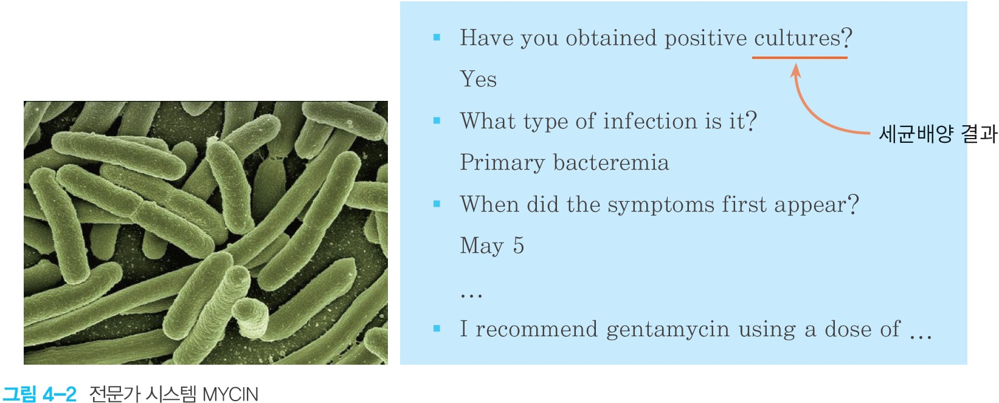

- **대표 사례: MYCIN (`p.6`)**:
  - 1970년대 스탠퍼드 대학교에서 개발된 의료 전문가 시스템으로, **박테리아 감염을 진단하고 적절한 항생제와 복용량을 처방**하는 시스템입니다.
  - 약 450~600개의 `IF-THEN` 규칙을 기반으로 환자의 세균배양 결과(`cultures`), 감염 유형(`Primary bacteremia`), 증상 발현 시점 등을 대화형으로 질의하여 경험이 부족한 신참 의사들을 보조하는 데 매우 효과적이었습니다.

---

## 2. 전문가 시스템의 구조와 구성 요소 (`p.4`, `p.7`, `p.8`)

### 2.1 전문가 시스템의 전체 흐름 (`그림 4-1`, `그림 4-3`)

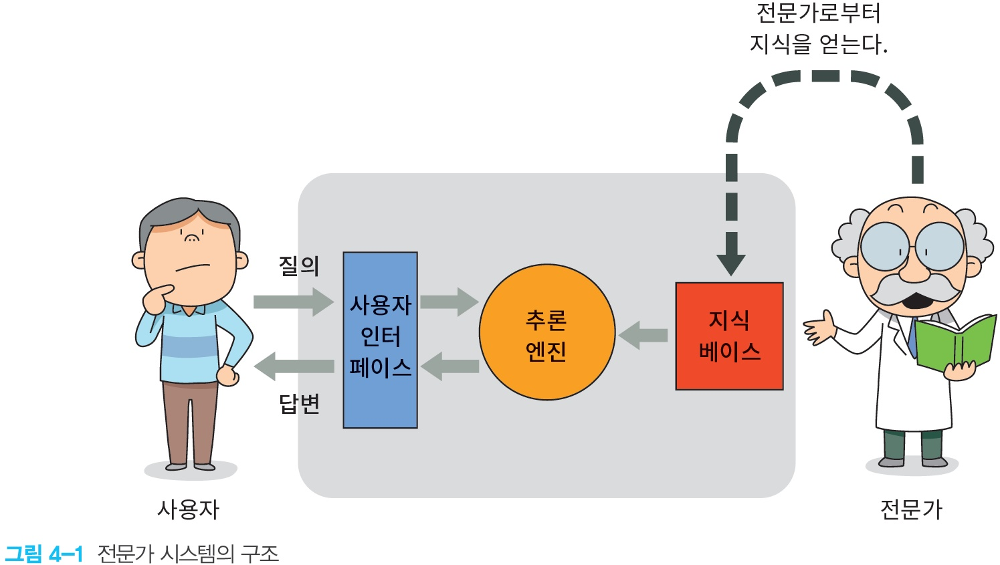

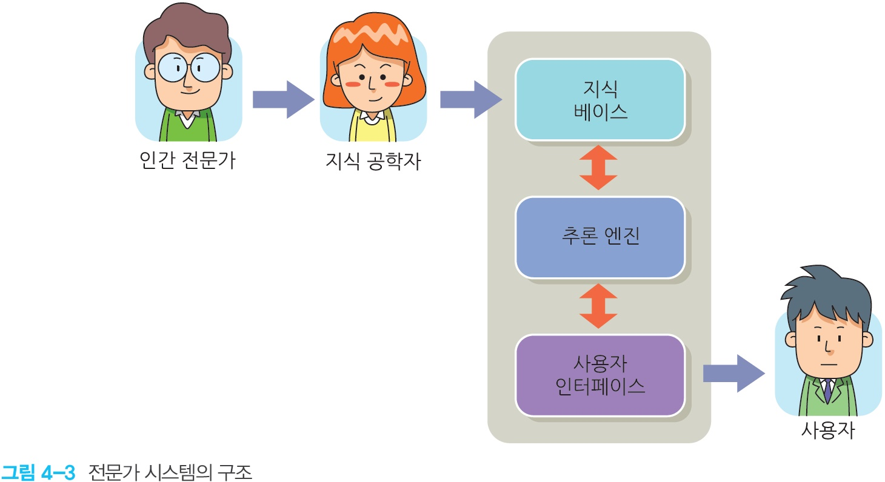

### 2.2 3대 핵심 구성 요소와 참여자 역할 (`p.7`~`p.8`)

| 구분 | 구성 요소 / 역할 | 핵심 기능 |
|---|---|---|
| **시스템 내부 3대 요소** | **① 지식 베이스 (Knowledge Base)** | 인간 전문가로부터 얻은 도메인 지식(**규칙**)을 저장하는 핵심 저장소 (`그림 4-4`) |
| | **② 추론 엔진 / 추론 기관 (Inference Engine)** | 지식 베이스의 규칙과 현재 사실을 결합해 새로운 결론을 도출하는 추론 알고리즘 |
| | **③ 사용자 인터페이스 (User Interface)** | 일반 사용자로부터 질의(Query)와 현상 데이터를 입력받고 추론 결과(답변)와 설명을 전달 |
| **관련 인물** | **인간 전문가 (Domain Expert)** | 해당 분야(의학, 법률, 고장 진단 등)의 깊은 경험과 노하우를 가진 전문가 |
| | **지식 공학자 (Knowledge Engineer)** | 인간 전문가와의 인터뷰·분석을 통해 지식을 추출하여 컴퓨터가 다룰 수 있는 **규칙(지식 베이스)으로 변환·구축**하는 전문가 |
| | **사용자 (User)** | 문제 해결이나 자문을 얻기 위해 전문가 시스템에 질의하는 비전문가 또는 실무자 |

- **지식과 인공지능 (`p.8`)**:
  - 인간의 지능은 단순한 탐색만으로 구현되는 것이 아닙니다.
  - 인간은 방대한 **지식(Knowledge)** 을 가지고 있으며, 습득한 지식을 이용해 새로운 사실을 추론합니다. 따라서 지식은 인공지능에서 가장 핵심적인 요소 중 하나로 간주됩니다.

---

## 3. 지식 표현 방법과 데이터·정보·지식 계층 (`p.9`~`p.11`)

### 3.1 대표적인 지식 표현 방법 5가지 (`p.9`)

인공지능에서 컴퓨터에 지식을 담는 대표적인 5가지 방법입니다:

| 지식 표현 방법 | 영문 명칭 | 특징 요약 |
|---|---|---|
| **1. 생성 규칙** | **Production Rule** | `IF (조건) THEN (결론/행동)` 형태. 이해하고 작성하기 가장 직관적이며 전문가 시스템의 주력 방식 |
| **2. 술어 논리** | **Predicate Logic** | [Chapter 8. 일차 논리](./07-first-order-logic.md)처럼 객체, 술어, 함수, 한정사($\forall, \exists$)로 엄밀하게 표현 |
| **3. 의미망** | **Semantic Net** | 개념(노드)과 개념 간의 관계(방향 간선, 예: `is-a`, `has-a`)를 그래프 형태로 표현 |
| **4. 프레임** | **Frame** | 객체 지향의 클래스처럼 대상의 속성(Slot)과 값(Facet), 기본값, 절차를 구조화해 표현 |
| **5. 개념 그래프** | **Conceptual Graph** | 의미망과 논리를 결합하여 개념 노드와 관계 노드의 이분 그래프로 지식을 표현 |

---

### 3.2 데이터(Data) $\rightarrow$ 정보(Information) $\rightarrow$ 지식(Knowledge) (`p.10`~`p.11`)

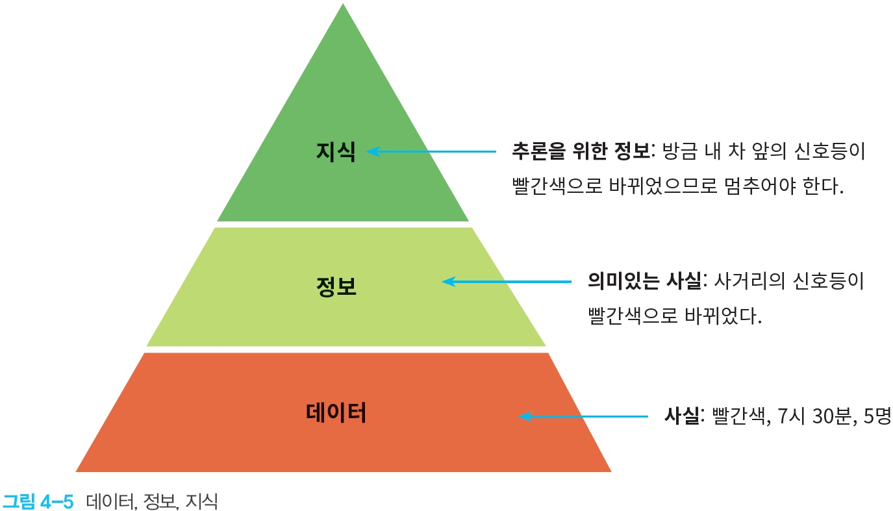

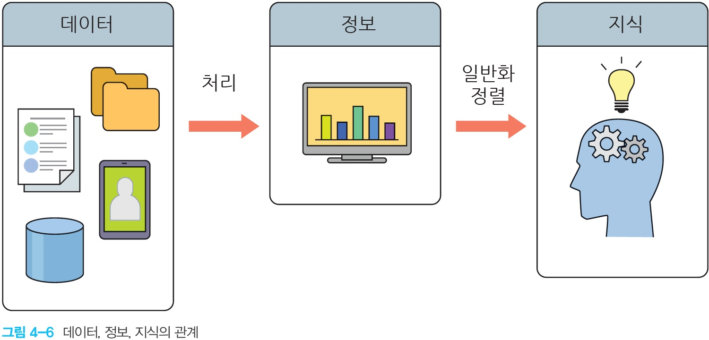

| 계층 | 정의 | 변환 과정 (`그림 4-6`) | 신호등 예시 (`그림 4-5`) |
|---|---|---|---|
| **데이터 (Data)** | 가공되지 않은 단순한 **원시 사실(Raw facts)** 이나 수치 | 원시 수집 | *"빨간색, 7시 30분, 5명"* |
| **정보 (Information)** | 데이터를 **처리(Processing)** 하여 맥락과 의미가 부여된 **의미 있는 사실** | 데이터 $\xrightarrow{\text{처리}}$ 정보 | *"사거리의 신호등이 빨간색으로 바뀌었다."* |
| **지식 (Knowledge)** | 정보를 **일반화·정렬**하여 의사결정과 **추론을 위해 사용할 수 있는 규칙화된 정보** | 정보 $\xrightarrow{\text{일반화·정렬}}$ 지식 | *"방금 내 차 앞의 신호등이 빨간색으로 바뀌었으므로 **차를 멈추어야 한다**."* |

---

## 4. 생성 규칙 (Production Rules) 작성법 (`p.12`~`p.14`)

### 4.1 규칙의 기본 구조 (`p.12`, `p.30`)

규칙(Rules)은 **생성 규칙(Production Rule)** 이라고도 부르며, 다른 지식 표현 방법에 비해 사람이 이해하고 작성하기 쉽습니다.

$$\text{IF } \underbrace{\langle\text{조건 / 전제 / 상황 (Antecedent)}\rangle}_{\text{IF 부분}} \;\; \text{THEN } \underbrace{\langle\text{행동 / 결론 / 결과 (Consequent)}\rangle}_{\text{THEN 부분}}$$

- **기본 규칙 예시 (`p.12`)**:
  - **규칙 #1**: `IF` 신호등이 녹색이다. `THEN` 자동차를 진행한다.
  - **규칙 #2**: `IF` 신호등이 빨강색이다. `THEN` 자동차를 멈춘다.
  - **규칙 #3**: `IF` 배터리의 전압이 낮다. `THEN` 시동이 걸리지 않을 것이다.

### 4.2 복합 조건 (`AND`, `OR`)과 수학 연산자 활용 (`p.13`~`p.14`)

1. **`AND` / `OR` 논리 연산자 사용 (`p.13`)**:
   - **규칙 #4 (`AND`)**: `IF` 자동차가 움직이지 않는다 `AND` 연료 탱크가 비었다 `THEN` 자동차에 연료를 급유한다.
   - **규칙 #5 (`OR`)**: `IF` 도로가 미끄럽다 `OR` 안개가 자욱하다 `THEN` 속도를 시속 60km 이하로 낮춘다.
2. **수학 비교 연산자(`>`, `<`, `>=`) 및 다중 조건 결합 (`p.14`)**:
   - **규칙 #6**: `IF` 현금 인출액 > 100만원 `THEN` 공인인증서가 필요하다.
   - **규칙 #7**: `IF` 고객의 나이 < 18 `AND` 영화등급 >= 19 `THEN` 영화관 입장이 불가능하다.
   - **규칙 #8 (화학 시료 분석)**: `IF` 시료는 액체이다 `AND` 자극성 있는 냄새가 난다 `AND` 어는점이 높아서 겨울에 쉽게 고체로 된다 `THEN` 시료의 성분은 초산이다.
   - **규칙 #9 (일상 의사결정)**: `IF` 여름이다 `AND` 하늘이 흐리다 `AND` 일기예보 강수확률 > 60% `THEN` 우산을 가지고 나간다.

---

## 5. 추론 엔진과 기억 장치: 장기 기억(규칙) vs 단기 기억(사실) (`p.15`~`p.17`)

> **📝 수업 강조 포인트**: 전문가 시스템은 인간의 인지 기억 구조를 모방하여 **장기 기억 장치에는 규칙(Rule)** 을 저장하고, **단기 기억 장치에는 현재 문제의 사실(Fact)** 을 저장합니다.

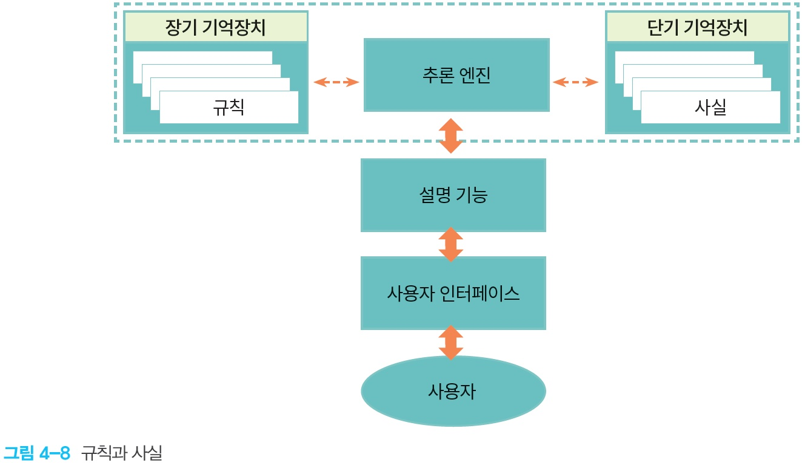

### 5.1 장기 기억장치 vs 단기 기억장치 비교 (`p.15`~`p.17`)

| 구분 | 장기 기억장치 (Long-Term Memory) | 단기 기억장치 (Short-Term Memory) |
|---|---|---|
| **저장 내용** | **규칙 (Rules)** (`IF A THEN B`) | **사실 (Facts)** (`A가 참이다`, 새로 도출된 `B가 참이다`) |
| **대응 개념** | **지식 베이스 (Knowledge Base)** | **작업 기억 (Working Memory)** |
| **역할과 특징** | 도메인 전문가의 일반적인 지식이 영구 저장됨. 개별 문제가 바뀌어도 유지됨 | 현재 해결 중인 구체적인 사건/환자의 관측 사실과 추론 중간 결과를 임시 저장함 |

### 5.2 추론 엔진의 작동 원리 (규칙 점화, Firing) (`그림 4-9`, `그림 4-10`)

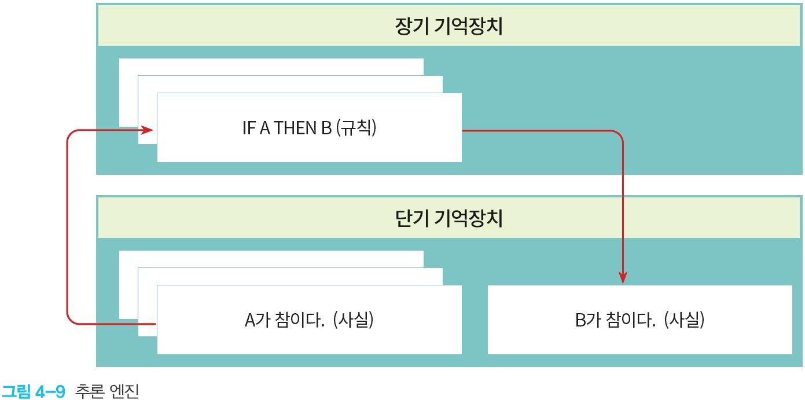

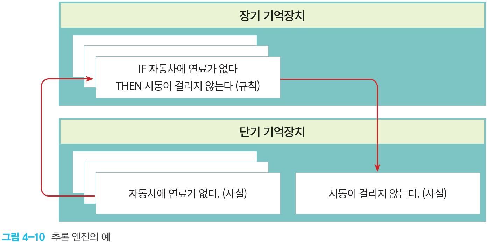

1. **매칭 (Match)**: 추론 엔진이 **단기 기억장치의 사실(`자동차에 연료가 없다`)** 과 **장기 기억장치 규칙의 `IF` 전제 조건**을 비교합니다.
2. **점화 (Fire / Act)**: 조건이 일치하면 해당 규칙이 **점화(fire)** 되어, `THEN` 부분의 결론(`시동이 걸리지 않는다`)이 **단기 기억장치의 새로운 사실(Fact)로 추가**됩니다.
3. **설명 기능 (Explanation Facility, `그림 4-8`)**: 왜 그런 결론이 나왔는지(어떤 규칙과 사실이 사용되었는지) 사용자에게 근거를 설명해 줍니다.

---

## 6. 추론 방법: 순방향 추론 vs 역방향 추론 (`p.18`~`p.24`)

전문가 시스템의 추론 엔진이 규칙과 사실을 연결하는 방향에는 **순방향 추론(Forward Chaining)** 과 **역방향 추론(Backward Chaining)** 두 가지가 있습니다 (`p.18`).

| 비교 항목 | 순방향 추론 (Forward Chaining) | 역방향 추론 (Backward Chaining) |
|---|---|---|
| **출발점 $\rightarrow$ 도착점** | **알려진 사실(Facts) $\rightarrow$ 결론(Conclusion)** | **목표/가설(Goal) $\rightarrow$ 이를 뒷받침하는 증거 사실(Facts)** |
| **구동 방식** | **자료 구동형 (Data-driven)**: 단기 기억의 사실로부터 `IF` 조건이 맞는 규칙을 차례로 점화 | **목표 구동형 (Goal-driven)**: 증명하려는 목표(`THEN` 부분)를 세우고 필요한 하위 목표(`IF` 조건)를 역추적 |
| **장점** | 관찰된 사실들로부터 가능한 모든 결과를 자연스럽게 도출 | **목표와 관련된 규칙만 선택적으로 검사하므로 탐색이 훨씬 효율적** (`Ch.8 p.27` 교수님 필기 강조!) |
| **단점 (`p.21`)** | **목표와 관련 없는 규칙들까지 모두 점화**되어 불필요한 연산이 발생할 수 있음 | 목표(가설)를 미리 설정해야 함 |

---

### 6.1 순방향 추론 (Forward Chaining) 상세 과정 (`p.19`~`p.21`)

#### 동물원 동물 식별 예제 (`p.19`~`p.20`)
- **장기 기억장치 (규칙 #1 ~ #4)**:
  - **규칙 #1 ($A \rightarrow X$)**: `IF` 동물이 털이 있다($A$) `THEN` 포유류이다($X$).
  - **규칙 #2 ($X \land B \rightarrow Y$)**: `IF` 동물이 포유류이다($X$) `AND` 고기를 먹는다($B$) `THEN` 육식동물이다($Y$).
  - **규칙 #3 ($Y \land C \land D \rightarrow Z$)**: `IF` 동물이 육식동물이다($Y$) `AND` 황갈색이다($C$) `AND` 갈기가 있다($D$) `THEN` **사자이다($Z$)**.
  - **규칙 #4 ($Y \land C \land E \rightarrow W$)**: `IF` 동물이 육식동물이다($Y$) `AND` 황갈색이다($C$) `AND` 검은 줄무늬가 있다($E$) `THEN` 호랑이이다($W$).
- **단기 기억장치 (초기 사실)**:
  - $A$: 털이 있다, $B$: 고기를 먹는다, $C$: 황갈색이다, $D$: 갈기가 있다.

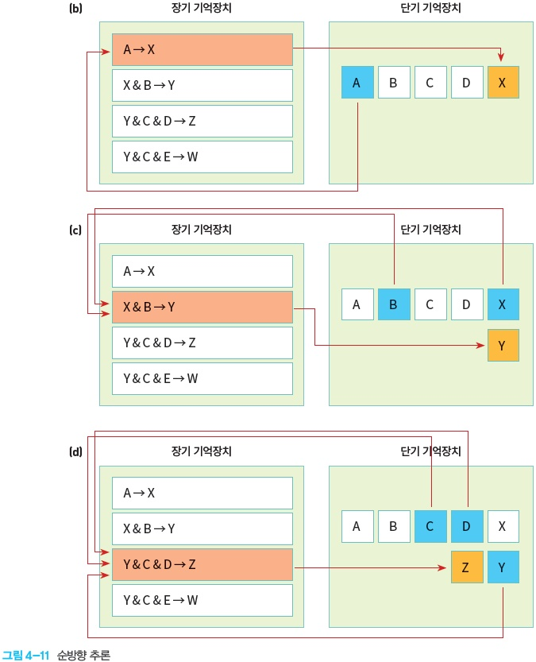

1. **(b) 1단계**: 단기 기억에 사실 $A$가 있으므로 규칙 #1($A \rightarrow X$)이 점화 $\rightarrow$ 단기 기억에 새로운 사실 **$X$(포유류)** 추가! (단기 기억: $\{A, B, C, D, X\}$)
2. **(c) 2단계**: 단기 기억에 $X$와 $B$가 모두 있으므로 규칙 #2($X \land B \rightarrow Y$)가 점화 $\rightarrow$ 단기 기억에 새로운 사실 **$Y$(육식동물)** 추가! (단기 기억: $\{A, B, C, D, X, Y\}$)
3. **(d) 3단계**: 단기 기억에 $Y, C, D$가 모두 있으므로 규칙 #3($Y \land C \land D \rightarrow Z$)이 점화 $\rightarrow$ 단기 기억에 최종 결론 **$Z$(사자)** 추가!

---

### 6.2 역방향 추론 (Backward Chaining) 상세 과정 (`p.22`~`p.24`)

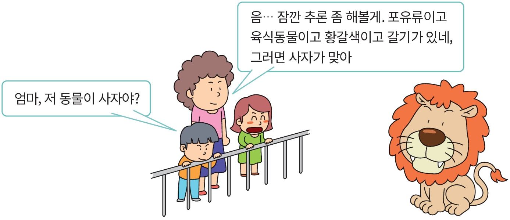

역방향 추론은 **"저 동물이 사자($Z$)인가?"** 라는 **목표(가설)** 에서 출발하여, 이를 증명하기 위해 필요한 하위 목표(Sub-goal)를 스택처럼 쌓아 내려간 뒤 사실 데이터로 확인하며 거꾸로 올라옵니다.

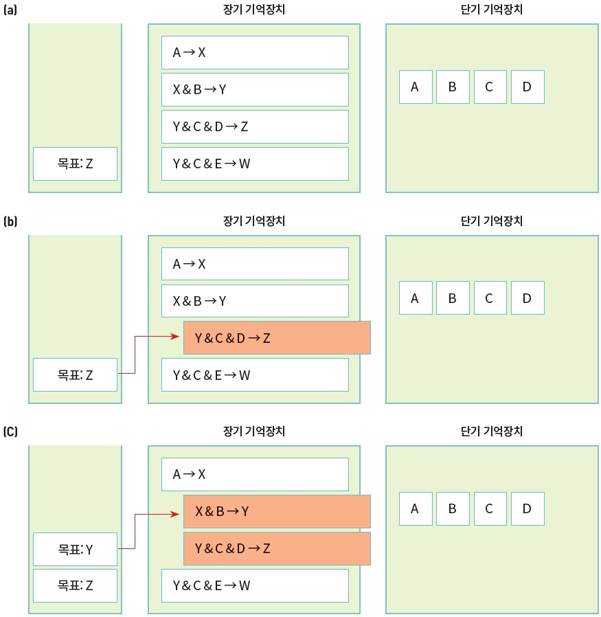

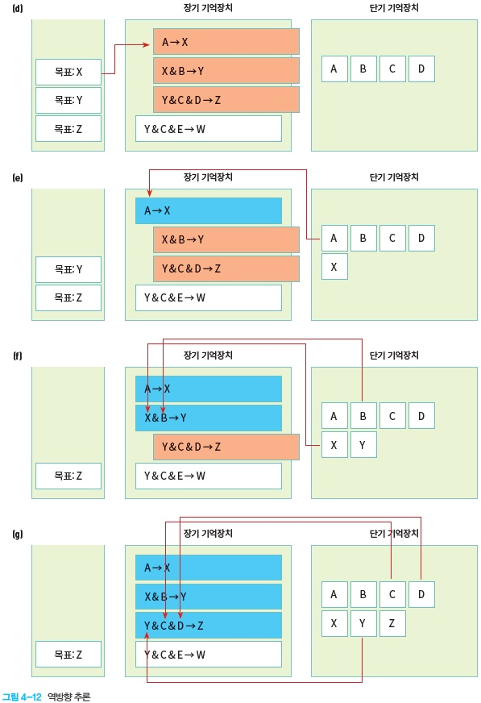

| 단계 | 목표 스택 (Goal Stack) | 추론 엔진의 동작 | 단기 기억장치 (사실) |
|---|---|---|---|
| **(a)** | `[목표: Z]` | 최종 목표 $Z$(사자)가 단기 기억에 있는지 확인 $\rightarrow$ 없음 | $\{A, B, C, D\}$ |
| **(b)** | `[목표: Z]` | 결론(`THEN`)이 $Z$인 **규칙 #3 ($Y \land C \land D \rightarrow Z$)** 을 찾음. $C, D$는 단기 기억에 있으나 **$Y$가 없으므로 $Y$를 새로운 하위 목표로 추가** | $\{A, B, C, D\}$ |
| **(c)** | `[목표: Y, 목표: Z]` | 결론이 $Y$인 **규칙 #2 ($X \land B \rightarrow Y$)** 를 찾음. $B$는 단기 기억에 있으나 **$X$가 없으므로 $X$를 새로운 하위 목표로 추가** | $\{A, B, C, D\}$ |
| **(d)** | `[목표: X, 목표: Y, 목표: Z]` | 결론이 $X$인 **규칙 #1 ($A \rightarrow X$)** 을 찾음. 전제 조건인 $A$가 단기 기억에 있는지 확인 | $\{A, B, C, D\}$ |
| **(e)** | `[목표: Y, 목표: Z]` | **$A$가 단기 기억에 존재함!** $\rightarrow$ 규칙 #1($A \rightarrow X$) 성립, 단기 기억에 **$X$ 추가**, 목표 $X$ 해결 | $\{A, B, C, D, \mathbf{X}\}$ |
| **(f)** | `[목표: Z]` | $X$와 $B$가 모두 확인되었으므로 규칙 #2($X \land B \rightarrow Y$) 성립, 단기 기억에 **$Y$ 추가**, 목표 $Y$ 해결 | $\{A, B, C, D, X, \mathbf{Y}\}$ |
| **(g)** | `[목표: Z 달성!]` | $Y, C, D$가 모두 확인되었으므로 규칙 #3($Y \land C \land D \rightarrow Z$) 성립, 단기 기억에 **$Z$ 추가** $\rightarrow$ **목표 $Z$ 증명 완료!** | $\{A, B, C, D, X, Y, \mathbf{Z}\}$ |

---

## 7. Lab: 추론 실습 1·2 (단계별 완전 풀이) (`p.25`~`p.26`)

### 7.1 Lab 1: 기호 규칙 순방향 추론 실습 (`p.25`)

> **문제**: 다음과 같은 규칙(1~6)과 초기 사실($A, B, F$)이 있을 때 **순방향 추론**을 진행시켜 보자. **추론의 목표는 $G$이다.**

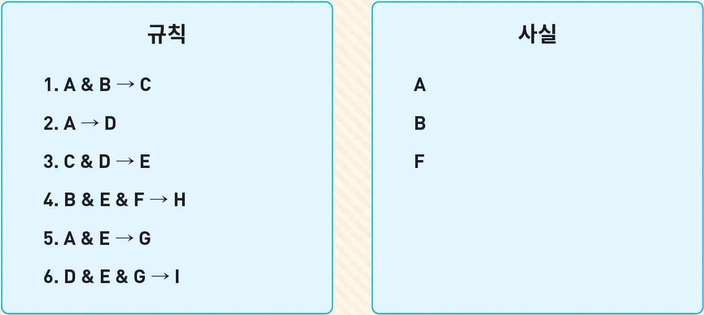

#### ✅ 단계별 순방향 추론 풀이

| 단계 | 현재 단기 기억 (사실 집합) | 조건이 충족되어 점화(Fire)되는 규칙 | 새로 추가되는 사실 | 비고 |
|---|---|---|---|---|
| **초기 상태** | $\{A, B, F\}$ | — | — | 초기 주어진 사실 |
| **1회전 (규칙 1)** | $\{A, B, F\}$ | **규칙 1**: $A \land B \rightarrow C$ ($A, B$ 존재) | **$C$** | 단기 기억: $\{A, B, F, C\}$ |
| **1회전 (규칙 2)** | $\{A, B, F, C\}$ | **규칙 2**: $A \rightarrow D$ ($A$ 존재) | **$D$** | 단기 기억: $\{A, B, F, C, D\}$ |
| **2회전 (규칙 3)** | $\{A, B, F, C, D\}$ | **규칙 3**: $C \land D \rightarrow E$ ($C, D$ 존재) | **$E$** | 단기 기억: $\{A, B, F, C, D, E\}$ |
| **3회전 (규칙 4)** | $\{A, B, F, C, D, E\}$ | **규칙 4**: $B \land E \land F \rightarrow H$ ($B, E, F$ 존재) | **$H$** | ⚠️ **목표 $G$와 무관한 규칙이지만 조건이 맞아 점화됨** (순방향 추론의 단점 사례!) |
| **3회전 (규칙 5)** | $\{A, B, F, C, D, E, H\}$ | **규칙 5**: $A \land E \rightarrow G$ ($A, E$ 존재) | **$G$ (목표 도달!)** | 단기 기억: $\{A, B, F, C, D, E, H, \mathbf{G}\}$ |
| *(추가 진행 시)* | $\{A, B, F, C, D, E, H, G\}$ | **규칙 6**: $D \land E \land G \rightarrow I$ | $I$ | 목표 $G$ 달성 시 종료하거나 $I$까지 도출 가능 |

> 💡 **Lab 1의 핵심 교훈**: 목표는 $G$인데, 순방향 추론을 하면 중간에 목표와 관련 없는 **규칙 4($B \land E \land F \rightarrow H$)** 까지 점화되는 것을 직접 확인할 수 있습니다.

---

### 7.2 Lab 2: 화재 처리 전문가 시스템 추론 실습 (`p.26`)

> **문제**: 화재를 처리하는 전문가 시스템을 가정하자. 다음 규칙과 사실이 저장되어 있을 때 **① 순방향 추론**과 **② 역방향 추론(목표: "소방서에 신고한다")** 을 각각 진행해 보자.
> - **규칙 #1**: `IF` 주위가 뜨겁다 `AND` 연기가 난다 `THEN` 불이 났다.
> - **규칙 #2**: `IF` 알람이 울린다 `THEN` 연기가 난다.
> - **규칙 #3**: `IF` 불이 났다 `THEN` 소방서에 신고한다.
> - **초기 사실**: **사실 A**: `알람이 울린다`, **사실 B**: `주위가 뜨겁다`.

#### ✅ ① 순방향 추론 (Forward Chaining) 진행 과정
1. **초기 단기 기억**: `{알람이 울린다, 주위가 뜨겁다}`
2. **1단계 (규칙 #2 점화)**:
   - 사실 `알람이 울린다`가 규칙 #2의 조건과 일치 $\rightarrow$ 새로운 사실 **`연기가 난다`** 추가!
   - 단기 기억: `{알람이 울린다, 주위가 뜨겁다, 연기가 난다}`
3. **2단계 (규칙 #1 점화)**:
   - 사실 `주위가 뜨겁다`와 `연기가 난다`가 모두 단기 기억에 있으므로 규칙 #1의 조건과 일치 $\rightarrow$ 새로운 사실 **`불이 났다`** 추가!
   - 단기 기억: `{알람이 울린다, 주위가 뜨겁다, 연기가 난다, 불이 났다}`
4. **3단계 (규칙 #3 점화)**:
   - 사실 `불이 났다`가 규칙 #3의 조건과 일치 $\rightarrow$ 최종 결론 **`소방서에 신고한다`** 도출 완료!

#### ✅ ② 역방향 추론 (Backward Chaining) 진행 과정 (목표: `소방서에 신고한다`)
1. **목표 설정**: 최종 목표 $G_0 =$ **`소방서에 신고한다`** (단기 기억에 없음).
2. **하위 목표 1 생성 (규칙 #3 역추적)**:
   - 결론이 `소방서에 신고한다`인 **규칙 #3**을 찾음 $\rightarrow$ 전제 조건인 $G_1 =$ **`불이 났다`** 를 하위 목표로 설정 (단기 기억에 없음).
3. **하위 목표 2 생성 (규칙 #1 역추적)**:
   - 결론이 `불이 났다`인 **규칙 #1**을 찾음 $\rightarrow$ 전제 조건인 `주위가 뜨겁다`와 `연기가 난다`를 확인.
   - `주위가 뜨겁다`는 **초기 사실 B로 이미 존재(증명됨)**!
   - 단기 기억에 없는 $G_2 =$ **`연기가 난다`** 를 새로운 하위 목표로 설정.
4. **하위 목표 2 증명 (규칙 #2 역추적 및 사실 확인)**:
   - 결론이 `연기가 난다`인 **규칙 #2**를 찾음 $\rightarrow$ 전제 조건인 `알람이 울린다`가 **초기 사실 A로 단기 기억에 존재함**!
5. **역순으로 목표 확정**:
   - `알람이 울린다`(사실 A) $\xrightarrow{\text{규칙 #2}}$ **`연기가 난다`** 확정!
   - `주위가 뜨겁다`(사실 B) + `연기가 난다` $\xrightarrow{\text{규칙 #1}}$ **`불이 났다`** 확정!
   - `불이 났다` $\xrightarrow{\text{규칙 #3}}$ 최종 목표 **`소방서에 신고한다`** 증명 완료!

---

## 8. 충돌 해법 (Conflict Resolution) (`p.27`~`p.28`)

### 8.1 규칙 간 충돌 문제 (`p.27`)

동일한 사실들이 입력되었을 때 **여러 규칙의 `IF` 조건이 동시에 만족되면서 서로 상반된 결론**을 내리는 경우(갈등 집합, Conflict Set 발생), 어떤 규칙을 먼저 점화해야 할까요?

- **슬라이드 충돌 예시 (`p.27`)**:
  - **규칙 #1**: `IF` 환자가 통증을 느낀다 `THEN` **진통제를 처방한다.** (우선순위: 20)
  - **규칙 #2**: `IF` 환자가 통증을 느낀다 `AND` 환자의 나이 > 60 `AND` 심장병 이력이 있다 `THEN` **응급실로 간다.** (우선순위: 90)
  - **입력된 사실**: `환자가 통증을 느낀다`, `환자의 나이 > 60`, `심장병 이력이 있다`.
  - $\rightarrow$ 규칙 #1과 규칙 #2의 조건이 **둘 다 참**이 됩니다! 단순 진통제만 주고 돌려보내면 큰일이 나므로 규칙 #2가 선택되어야 합니다.

### 8.2 3가지 대표적인 충돌 해법 (Conflict Resolution Strategies) (`p.28`)

| 충돌 해법 | 원문 설명 (`p.28`) | 위 의료 예시 적용 및 의미 |
|---|---|---|
| **① 우선순위 부여 방식** (Rule Priority / Salience) | 각 규칙에 **우선순위(Priority)** 를 부여하고 **가장 높은 우선순위를 가진 규칙**을 먼저 점화하는 방법 | 규칙 #2(우선순위 90) > 규칙 #1(우선순위 20)이므로 **규칙 #2 점화** |
| **② 특수성 우선 방식** (Specificity Ordering) | 조건(`IF`절)이 더 구체적이고 까다로운 **가장 특수한 규칙(Most specific rule)** 을 먼저 점화하는 방법 | 조건이 3개인 규칙 #2가 조건이 1개인 규칙 #1보다 더 특수한 경우를 다루므로 **규칙 #2 점화** |
| **③ 최신성 우선 방식** (Recency Ordering) | 단기 기억장치에 **가장 최근에 입력된 데이터(사실)** 를 사용하는 규칙을 먼저 점화하는 방법 | 시시각각 변하는 실시간 상황(예: 방금 들어온 최신 센서 경보)에 즉각 반응하도록 유도 |

---

## 9. 전문가 시스템의 장단점 및 요약 (`p.29`~`p.30`)

### 9.1 전문가 시스템의 장점과 단점 (`p.29`)

| 구분 | 내용 | 상세 설명 |
|---|---|---|
| **장점 1** | **자연스러운 지식 표현** | `IF-THEN`을 사용하는 규칙은 인간 전문가의 지식을 표현하는 매우 자연스럽고 이해하기 쉬운 방법이다. |
| **장점 2** | **지식 베이스와 추론 엔진의 분리** | 지식 베이스(도메인 지식)와 추론 엔진(알고리즘)이 분리되어 있으므로, 지식 베이스만 교체하면 **다른 영역에도 쉽게 적용**할 수 있다. |
| **단점 1** | **자동 학습 불가능** | 데이터로부터 스스로 **지식을 학습(Learning)할 수 없다** (인간 전문가와 지식 공학자가 수동으로 규칙을 입력해야 하는 지식 획득 병목 현상). |
| **단점 2** | **탐색의 비효율성** | 규칙과 사실이 많아질수록 매칭 및 **탐색이 비효율적**이다. |
| **단점 3** | **유지보수의 어려움** | 규칙이 수천~수만 개로 많아지게 되면 규칙 간 충돌·순환 등으로 인해 **유지보수하는 것이 매우 어려워진다**. |

---

### 9.2 장 요약 (Summary) (`p.30`)

1. **전문가 시스템**은 특수한 영역에서 인간 전문가의 의사 결정 능력을 흉내 내는 컴퓨터 시스템이다.
2. 전문가 시스템은 **추론 엔진**, **지식 베이스**, **사용자 인터페이스**로 구성된다.
3. 규칙들은 `IF`와 `THEN`의 두 부분으로 되어 있으며, `IF` 부분은 **전제(antecedent)**, `THEN` 부분은 **결과(consequent)** 라고 불린다.
4. 전문가 시스템에서 추론하는 방법에는 2가지가 있다:
   - **순방향 추론(Forward Chaining)**: 알려진 사실로부터 출발하여 결론을 이끌어 내는 방법.
   - **역방향 추론(Backward Chaining)**: 목표를 설정하고 추론 엔진이 이를 증명하는 증거를 찾는 방법.

---

## 10. 셀프 체크 퀴즈

**Q1.** 인공지능 초창기의 GPS(General Problem Solver)가 실패하고 전문가 시스템이 등장하게 된 배경은 무엇인가? (`p.3`)

▶ 정답 보기

초창기 GPS는 세상의 모든 문제를 범용적인 **"탐색"** 만으로 해결하려 했으나 블록 세계 같은 제한된 영역에서만 작동했다. 현실 문제를 해결하려면 범용 탐색 기법 못지않게 **특정 도메인의 풍부한 지식(Knowledge)** 이 필수적이라는 것을 깨닫고, 제한된 전문 영역의 지식을 규칙으로 담아 추론하는 **전문가 시스템**이 등장했다.

**Q2.** 전문가 시스템의 3대 핵심 구성 요소를 쓰고, 장기 기억장치와 단기 기억장치에 각각 무엇이 저장되는지 설명하라. (`p.7`, `p.15`~`p.16`)

▶ 정답 보기

- **3대 구성 요소**: **지식 베이스(Knowledge Base)**, **추론 엔진(Inference Engine)**, **사용자 인터페이스(User Interface)**.
- **장기 기억장치**: 변하지 않는 도메인 지식인 **규칙(Rules, `IF-THEN`)** 이 저장된다 (= 지식 베이스).
- **단기 기억장치**: 현재 문제 상황에서 관측되었거나 추론으로 새로 도출된 **사실(Facts)** 이 저장된다 (= 작업 기억).

**Q3.** 순방향 추론과 역방향 추론의 차이점과, 목표가 정해져 있을 때 역방향 추론이 더 효율적인 이유를 설명하라. (`p.18`~`p.24`)

▶ 정답 보기

- **순방향 추론**: 알려진 **사실(Facts)** 에서 출발해 조건이 맞는 규칙을 모두 점화하여 결론으로 나아가는 방식. 목표와 무관한 규칙까지 점화될 수 있다는 단점이 있다.
- **역방향 추론**: 확인하고자 하는 **목표(Goal, 결과)** 에서 출발해 그 목표를 결론(`THEN`)으로 갖는 규칙만 거꾸로 추적하며 사실 여부를 확인하는 방식. **목표 증명에 필요한 규칙만 선택적으로 검사하므로 더 효율적**이다.

**Q4.** 동일한 사실에 대해 여러 규칙의 조건이 동시에 만족되어 상반된 결론이 나올 때, 이를 해결하는 충돌 해법(Conflict Resolution) 3가지를 쓰라. (`p.27`~`p.28`)

▶ 정답 보기

1. **우선순위(Priority) 부여**: 각 규칙에 우선순위를 매기고 가장 높은 우선순위의 규칙을 점화한다.
2. **특수성(Specificity) 우선**: 조건(`IF`절)이 더 구체적인 가장 특수한 규칙을 먼저 점화한다.
3. **최신성(Recency) 우선**: 단기 기억장치에 가장 최근에 입력된 데이터를 사용하는 규칙을 먼저 점화한다.

