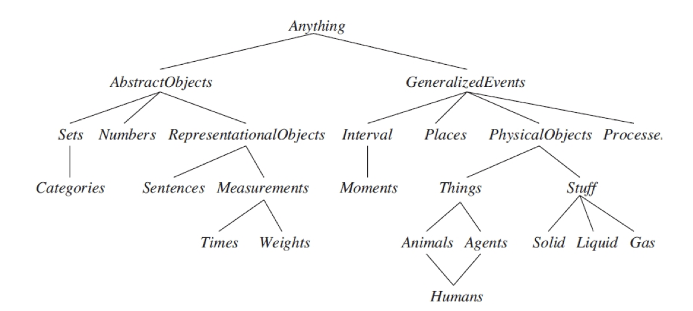
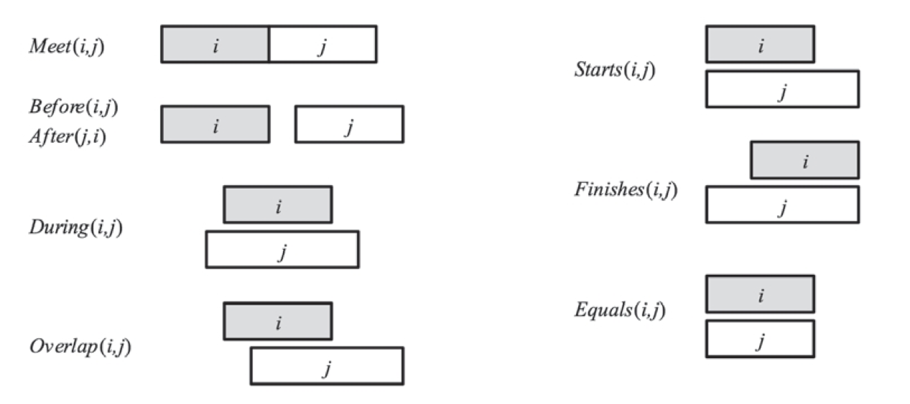
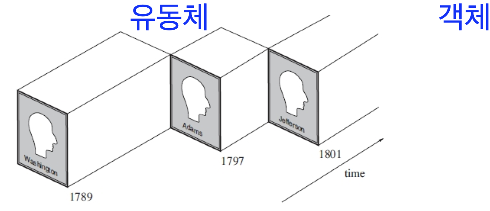
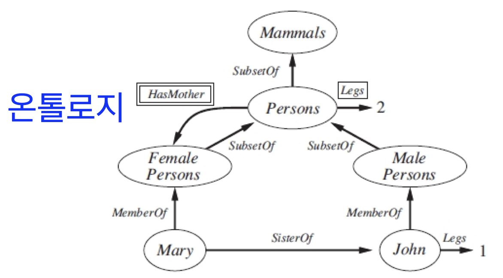
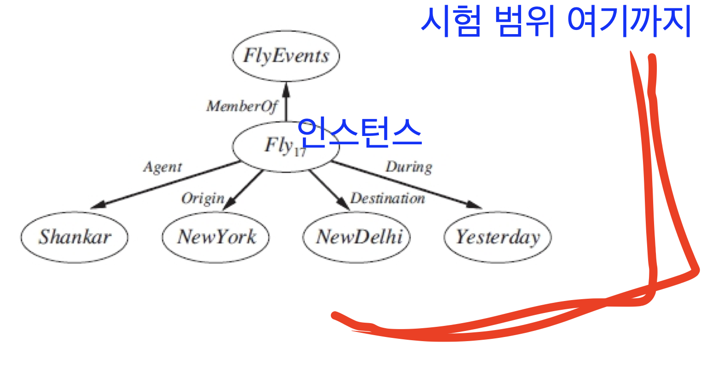

# Chapter 10 (제5장). 지식 표현 (Knowledge Representation)

> 인공지능 강의 정리 노트 (이번 학기 마지막 이론 진도)
> 원본: `제05장 지식표현(강의)-변경.key` (Russell & Norvig, *Artificial Intelligence: A Modern Approach* 10장 기반, 슬라이드 1~25쪽)
> ⚠️ **시험 범위 안내 (`p.21` 필기)**: **슬라이드 `p.21` 시맨틱 네트워크(`Fly_17` 인스턴스)까지가 11월 17일 중간고사 시험 범위** 이며, `p.22`~`p.25` 인터넷 쇼핑 월드 예제는 시험 범위 외(참고용)입니다.
> 이전 장: [Chapter 8. 일차 논리](./07-first-order-logic.md) · [제4장. 전문가 시스템](./08-expert-systems.md) · 시험 대비: [인공지능 중간고사(이론) 완벽 대비](./midterm-review.md)

---

## 📌 목차

1. [온톨로지 공학 (Ontological Engineering)과 상위 온톨로지](#_1-온톨로지-공학-ontological-engineering-과-상위-온톨로지-p-2-p-3)
2. [범주(Categories)와 객체: 실체화(Reification)와 분류 계층](#_2-범주-categories-와-객체-실체화-reification-와-분류-계층-p-4-p-6)
3. [복합 객체(Composite Objects), 다발(Bunch), 측정치(Measurements)](#_3-복합-객체-composite-objects-다발-bunch-측정치-measurements-p-7-p-9)
4. [사건 미적분 (Event Calculus)과 프로세스(Processes)](#_4-사건-미적분-event-calculus-과-프로세스-processes-p-10-p-15)
5. [시간 구간(Time Intervals)과 유동체(Fluents)](#_5-시간-구간-time-intervals-과-유동체-fluents-p-16-p-19)
6. [시맨틱 네트워크 (Semantic Networks) — ⭐ 시험 범위 끝 (`p.20`~`p.21`)](#_6-시맨틱-네트워크-semantic-networks-—-⭐-시험-범위-끝-p-20-p-21)
7. [[참고 · 시험 범위 외] 인터넷 쇼핑 월드 (`p.22`~`p.25`)](#_7-참고-·-시험-범위-외-인터넷-쇼핑-월드-p-22-p-25)
8. [셀프 체크 퀴즈 (단답형 · 개념 설명 대비)](#_8-셀프-체크-퀴즈-단답형-·-개념-설명-대비)

---

## 1. 온톨로지 공학 (Ontological Engineering)과 상위 온톨로지 (`p.2`~`p.3`)

### 1.1 온톨로지(Ontology)의 정의 (`p.3`)

> **원문 정의**: "An ontology is a **vocabulary** and a **theory** of a certain **part of reality** (Special-purpose / General-purpose ontologies)"
> **📝 수업 필기 (`p.3`)**: **"어휘와 이론으로 지식을 표현하는 방법"**

- **온톨로지(Ontology)** 란 현실 세계의 특정 영역(또는 세계 전체)에 존재하는 개념들을 부르는 **어휘(Vocabulary: 상수·술어·함수 이름)** 와, 그 개념들 사이의 의미·관계를 규정한 **이론(Theory: 일차 논리 공리들)** 의 결합입니다.
  - **특수 목적 온톨로지 (Special-purpose ontology)**: 특정 도메인(예: 의료 진단, 회로 설계, 인터넷 쇼핑)에만 적용되는 온톨로지.
  - **범용/상위 온톨로지 (General-purpose / Upper ontology)**: 시간, 공간, 사건, 물리적 객체, 범주 등 **모든 도메인에 공통으로 적용되는 가장 추상적이고 일반적인 개념 계층** 을 정의한 온톨로지.
- **온톨로지 공학 (Ontological Engineering)**:
  - 특정 장난감 문제(예: 웜푸스 세계)를 넘어, 현실 세계의 복잡하고 광범위한 영역(쇼핑, 의학, 상식 등)을 표현할 수 있도록 **일반적이고 유연한 상위 개념 틀을 설계하는 작업** 입니다.

### 1.2 상위 온톨로지(Upper Ontology) 계층 구조 (`p.3`)

- 최상위 개념인 **`Anything`** 아래에 크게 두 갈래로 나뉩니다:
  1. **`AbstractObjects` (추상적 객체)**: 시공간을 차지하지 않는 수학적·기호적 개념
     - `Sets` (집합) $\rightarrow$ `Categories` (범주)
     - `Numbers` (숫자)
     - `RepresentationalObjects` (표현 객체) $\rightarrow$ `Sentences` (문장), `Measurements` (측정치 $\rightarrow$ `Times`, `Weights`)
  2. **`GeneralizedEvents` (일반화된 사건 — 시공간을 차지하는 대상)**:
     - `Intervals` (시간 구간) $\rightarrow$ `Moments` (순간)
     - `Places` (장소)
     - `PhysicalObjects` (물리적 객체) $\rightarrow$ **`Things` (개별 사물: 동물·에이전트·인간처럼 경계가 뚜렷해 셀 수 있는 명사)** vs **`Stuff` (물질: 고체·액체·기체, 물·버터처럼 쪼개도 성질이 유지되는 불가산 명사)**
     - `Processes` (프로세스 / 연속 사건)

### 1.3 대규모 온톨로지를 구축하는 4가지 접근법 (`p.3`)

슬라이드에서 밑줄(🔴)로 강조된 핵심 사례들입니다:

| 구축 방식 | 대표 프로젝트 | 특징 및 설명 |
|---|---|---|
| **① 훈련된 온톨로지 전문가 팀이 직접 구축** 🔴 | **CYC** | 지식 공학자·온톨로지 전문가들이 수십 년간 인간의 상식(commonsense knowledge)을 수작업 논리 공리로 입력 |
| **② 기존 데이터베이스/위키에서 개념 가져오기** 🔴 | **DBpedia** | 위키피디아(Wikipedia)의 정형 데이터(인포박스 등)로부터 개념과 관계를 자동으로 추출·변환 |
| **③ 텍스트 문서에서 정보 자동 추출** | **ReVerb** | 웹상의 방대한 자연어 텍스트 문서를 구문 분석하여 주어-관계-목적어 형태를 자동 마이닝 |
| **④ 대중(크라우드소싱) 참여로 상식 입력** | **OpenMind** | 일반 인터넷 사용자 누구나 상식 문장을 입력하게 하여 수집 (ConceptNet의 모태) |

---

## 2. 범주(Categories)와 객체: 실체화(Reification)와 분류 계층 (`p.4`~`p.6`)

### 2.1 왜 범주(Category) 수준에서 추론하는가? (`p.4`)

- **핵심 원리**: **모든 추론은 개별 객체가 아니라 범주(Category, 클래스/집합) 수준에서 일어납니다.** (`Reasoning takes place at the level of categories`)
- **예시**:
  - 우리가 마트에서 농구공을 살 때, 세상의 특정 농구공 번호(`Basketball_42`)를 지정해서 찾는 것이 아니라 **`Basketballs`(농구공이라는 범주)** 에 속하는 아무 객체나 사면 됩니다.
  - 겉껍질 색, 지름, 모양, 과일 코너 위치 등의 공통 속성으로 객체를 특정 범주(`Tomatoes`, 수박 등)로 **분류(Classify)** 하고, 범주에 속한다는 사실로부터 보이지 않는 속성(속이 빨갛고 둥글다)을 **추론(예측)** 합니다:
    $$\forall x \;\; x \in \text{Tomatoes} \Rightarrow \text{Red}(x) \land \text{Round}(x)$$

---

### 2.2 일차 논리(FOL)에서 범주를 표현하는 두 가지 방법과 실체화(Reification) ⭐ (`p.4`)

일차 논리에서 "객체 $b$는 농구공이다"라는 범주 정보를 표현할 때 **두 가지 선택지** 가 있습니다:

| 방식 | 표기 예시 | 원리 및 특징 |
|---|---|---|
| **① 술어(Predicate)로 표현** | $\text{Basketball}(b)$ | 범주를 단항 술어(참/거짓을 반환하는 속성)로 취급한다. ⚠️ **한계**: 일차 논리에서는 술어 자리에 변수를 넣거나 술어를 다른 술어의 인자로 넣을 수 없어, **"농구공 범주는 공 범주의 부분집합이다"** 같은 범주 자체에 대한 문장을 표현하기 불편하다. |
| **② 객체(Object / 집합)로 표현 — 실체화(Reification)** ⭐ | $b \in \text{Basketballs}$ $\equiv \text{Member}(b, \text{Basketballs})$ | **실체화 (Reification: `turning a proposition/predicate into an object`)**: 술어(또는 명제/사건)였던 `Basketball`을 **`Basketballs`라는 하나의 독립된 객체(집합)** 로 격상시킨다. $\rightarrow$ 범주 자체가 객체가 되었으므로 $\text{Subset}(\text{Basketballs}, \text{Balls})$ (`Basketballs` $\subset$ `Balls`)처럼 **범주와 범주 사이의 관계를 자유롭게 표현** 할 수 있다! |

> 💡 **단답형 필수 용어 — 실체화(Reification)**:
> 원래 객체가 아니던 **명제(proposition), 술어(범주), 또는 사건(event)을 하나의 '객체(Object)'로 변환** 하여, 그 대상 자체에 대해 속성을 부여하거나 다른 관계의 인자로 넣을 수 있게 만드는 기법입니다.

---

### 2.3 범주에 관한 사실들과 분류 계층 (Taxonomical Hierarchy) (`p.5`)

> **📝 수업 필기 (`p.5`)**: **"정보를 분류표로 표현하는 방식"** (`Subset`에 빨간 밑줄 강조)

1. **인스턴스 관계 (Instance relations, `is-a` / `MemberOf`)**:
   - 개별 객체가 특정 범주(집합)의 원소임을 나타냅니다:
     $$b \in \text{Basketballs} \quad (\equiv \text{Member}(b, \text{Basketballs}))$$
2. **분류 계층 (Taxonomical hierarchies, `Subset` / 하위 범주)** 🔴:
   - 한 범주가 더 큰 상위 범주의 부분집합(하위 클래스)임을 나타냅니다 (생물 종 분류, 도서관 분류, 직업, 상업 제품 카테고리 등):
     $$\text{Basketballs} \subset \text{Balls} \quad (\equiv \text{Subset}(\text{Basketballs}, \text{Balls}))$$
3. **속성의 상속 (Inheritance of properties)**:
   - 상위 범주가 가진 속성은 하위 범주의 모든 원소에 자동으로 **상속(Inheritance)** 됩니다.
   - 예: 음식(`Food`)은 먹을 수 있고(`edible`), 과일(`Fruit`)은 음식의 부분집합($\text{Fruit} \subset \text{Food}$)이므로, 모든 과일은 먹을 수 있습니다.
4. **범주 원소의 공통 속성 도출 (필요조건)**:
   $$(x \in \text{Basketballs}) \Rightarrow \text{Spherical}(x) \quad \text{(농구공이면 구형이다)}$$
5. **속성으로부터 범주 소속 인식 (충분조건 / 인식 규칙)**:
   $$\text{Orange}(x) \land \text{Round}(x) \land \text{Diameter}(x) = 9.5'' \land x \in \text{Balls} \Rightarrow x \in \text{Basketballs}$$
6. **범주 자체의 속성 (Category as a whole)**:
   - 개별 원소가 아니라 **범주(집합) 자체가 또 다른 상위 범주의 원소** 가 될 수 있습니다:
     $$\text{Dogs} \in \text{DomesticatedSpecies} \quad \text{('개'라는 종 자체는 가축화된 종의 원소이다)}$$
7. **필요충분조건($\Leftrightarrow$)에 의한 범주의 엄밀한 정의**:
   $$x \in \text{Bachelors} \;\Leftrightarrow\; \text{Unmarried}(x) \land x \in \text{Adults} \land x \in \text{Males}$$
   - 미혼이면서 성인이고 남성이면 곧 독신남(`Bachelors`)이다.

---

### 2.4 하위 범주가 아닌 범주 간 관계: 서로소 · 완전 분해 · 분할 (`p.6`)

범주들의 집합 $s$와 상위 범주 $c$ 사이의 관계를 나타내는 3가지 핵심 개념입니다:

| 개념 | 수식 정의 (`p.6`) | 의미 및 슬라이드 예시 |
|---|---|---|
| **① Disjoint (서로소)** | $\text{Disjoint}(s) \Leftrightarrow (\forall c_1, c_2 \;\; c_1 \in s \land c_2 \in s \land c_1 \neq c_2 \Rightarrow \text{Intersection}(c_1, c_2) = \{\})$ | 두 범주에 **동시에 속하는 공통 원소가 하나도 없다** (교집합이 공집합). 예: $\text{Disjoint}(\{\text{Animals}, \text{Vegetables}\})$ |
| **② ExhaustiveDecomposition** (완전 분해 / 남김없는 분해) | $\text{ExhaustiveDecomposition}(s, c) \Leftrightarrow (\forall i \;\; i \in c \Leftrightarrow \exists c_2 \;\; c_2 \in s \land i \in c_2)$ | 상위 범주 $c$의 모든 원소는 반드시 하위 범주 집합 $s$ 중 **적어도 하나에 속한다** (단, 서로 겹칠 수도 있음 — 이중국적 가능). 예: $\text{ExhaustiveDecomposition}(\{\text{Americans}, \text{Canadians}, \text{Mexicans}\}, \text{NorthAmericans})$ |
| **③ Partition (분할)** ⭐ | $\text{Partition}(s, c) \Leftrightarrow \text{Disjoint}(s) \land \text{ExhaustiveDecomposition}(s, c)$ | **서로소(겹치지 않음)이면서 동시에 완전 분해(빠짐없음)** 인 관계! 예: $\text{Partition}(\{\text{Males}, \text{Females}\}, \text{Animals})$ |

---

## 3. 복합 객체(Composite Objects), 다발(Bunch), 측정치(Measurements) (`p.7`~`p.9`)

### 3.1 복합 객체 (Composite Objects)와 `PartOf` 관계 (`p.7`)

객체가 더 작은 부품(part)들로 이루어져 있는 **부분-전체 관계(포함 관계)** 는 `PartOf` 술어로 표현합니다.

- **예시**:
  - $\text{PartOf}(\text{Bucharest}, \text{Romania})$ (부쿠레슈티는 루마니아의 일부)
  - $\text{PartOf}(\text{Romania}, \text{EasternEurope})$ (루마니아는 동유럽의 일부)
  - $\text{PartOf}(\text{EasternEurope}, \text{Europe})$ (동유럽은 유럽의 일부)
- **`PartOf` 관계의 두 가지 수학적 성질 (`p.7`)**:
  1. **추이적 (Transitive)**: $x$가 $y$의 일부이고 $y$가 $z$의 일부이면, $x$는 $z$의 일부이다.
     $$\text{PartOf}(x, y) \land \text{PartOf}(y, z) \Rightarrow \text{PartOf}(x, z)$$
  2. **반사적 (Reflexive)**: 모든 객체는 자기 자신의 일부이다.
     $$\text{PartOf}(x, x)$$
- **구조적 관계로 정의되는 복합 객체 — 이족보행 동물(`Biped`) 예시 (`p.7`)**:
  - 복합 객체는 단순히 부품들이 모인 것을 넘어 **부품들 사이의 구조적 연결(`Attached`)** 로 특징지어집니다 ("이족보행 동물은 몸통에 붙어 있는 정확히 두 개의 다리를 가진다"):
    $$\begin{aligned}
    \text{Biped}(a) \Rightarrow \exists l_1, l_2, b \;\; &\text{Leg}(l_1) \land \text{Leg}(l_2) \land \text{Body}(b) \land \\
    &\text{PartOf}(l_1, a) \land \text{PartOf}(l_2, a) \land \text{PartOf}(b, a) \land \\
    &\text{Attached}(l_1, b) \land \text{Attached}(l_2, b) \land l_1 \neq l_2 \land \\
    &\big[\forall l_3 \;\; \text{Leg}(l_3) \land \text{PartOf}(l_3, a) \Rightarrow (l_3 = l_1 \lor l_3 = l_2)\big]
    \end{aligned}$$

---

### 3.2 다발 (Bunch) — 구조 없는 복합 객체 (`p.8`)

- **정의**: **"확정된 부분(parts)들로 이루어져 있지만, 부품 간에 특별한 구조(structure)는 없는 복합 객체"** (`Composite objects with definite parts but no particular structure`).
- **왜 집합(`Set`) 대신 `Bunch`가 필요한가?**
  - "이 봉지에 든 사과 3개의 무게는 2파운드다" 를 표현할 때, 수학적 **집합(Set)** 은 추상적 객체(`AbstractObject`)이므로 **무게나 물리적 위치를 가질 수 없습니다**.
  - 반면 $\text{BunchOf}(\text{Apple}_1, \text{Apple}_2, \text{Apple}_3)$는 사과 3개를 원소(element)가 아닌 **물리적 부분(part)으로 갖는 하나의 물리적 복합 객체** 이므로 무게를 잴 수 있습니다!
  - 특징: $\text{BunchOf}(\{x\}) = x$ (원소 1개짜리 다발은 그 객체 자신과 같음 — 집합에서는 $\{x\} \neq x$인 것과 대조됨).
- **논리적 최소화 (Logical Minimization)를 통한 `BunchOf(s)` 정의 (`p.8`)**:
  1. 집합 $s$의 모든 원소 $x$는 $\text{BunchOf}(s)$의 부품(`PartOf`)이다:
     $$\forall x \;\; x \in s \Rightarrow \text{PartOf}(x, \text{BunchOf}(s))$$
  2. $\text{BunchOf}(s)$는 이 조건을 만족하는 **가장 작은 객체(smallest object)** 이다 (즉, $s$의 모든 원소를 부분으로 포함하는 임의의 객체 $y$가 있다면, $\text{BunchOf}(s)$ 역시 $y$의 일부이다):
     $$\forall y \;\; \big[\forall x \;\; x \in s \Rightarrow \text{PartOf}(x, y)\big] \Rightarrow \text{PartOf}(\text{BunchOf}(s), y)$$

---

### 3.3 측정치 (Measurements) (`p.9`)

> **📝 수업 필기 (`p.9`)**: **"정량적으로 표현하는 경우"**

1. **단위 함수 (Unit functions)를 이용한 정량적 표현**:
   - 길이, 질량, 가격, 시간 같은 물리량의 값인 **측정치(measures)** 는 순수한 숫자(`1.5`, `3.81`)로만 쓰면 단위가 섞여 혼란스러우므로, **숫자에 단위 함수(`Inches`, `Centimeters`, `Hours`, `$`)를 결합한 객체** 로 표현합니다:
     $$\text{Length}(L_1) = \text{Inches}(1.5) = \text{Centimeters}(3.81)$$
     $$\text{Centimeters}(2.54 \times d) = \text{Inches}(d) \quad \text{(단위 변환 공리)}$$
     $$\text{Diameter}(\text{Basketball}_{12}) = \text{Inches}(9.5), \quad \text{ListPrice}(\text{Basketball}_{12}) = \$(19)$$
     $$d \in \text{Days} \Rightarrow \text{Duration}(d) = \text{Hours}(24)$$
2. **비정량적 측정치 (Non-quantitative measures)의 표현**:
   - 시험 난이도(`Difficulty`), 예상 점수(`ExpectedScore`), 아름다움, 맛처럼 **정확한 숫자로 잴 수는 없지만 대소 비교(`>`, `<`)는 가능한 척도** 도 논리로 표현할 수 있습니다:
     $$e_1 \in \text{Exam} \land e_2 \in \text{Exam} \land \text{During}(\text{FirstSession}, e_1) \land \text{During}(\text{SecondSession}, e_2) \Rightarrow \text{Difficulty}(e_2) > \text{Difficulty}(e_1)$$
     $$e_1 \in \text{Exam} \land e_2 \in \text{Exam} \land \text{Difficulty}(e_2) > \text{Difficulty}(e_1) \Rightarrow \text{ExpectedScore}(e_2) < \text{ExpectedScore}(e_1)$$

---

## 4. 사건 미적분 (Event Calculus)과 프로세스(Processes) (`p.10`~`p.15`)

### 4.1 왜 상황 미적분(Situation Calculus) 대신 사건 미적분(Event Calculus)이 필요한가? (`p.11`)

> **📝 수업 필기 (`p.11`)**: **"액션 중간에 무슨 일이 일어나는지 알 수 없다."**

- [8장에서 배운 상황 미적분(Situation Calculus)](./07-first-order-logic.md#_9-변화-추적과-상황-미적분-situation-calculus-p-23-p-25)은 행동을 순간적이고 순차적인 전이($S_0 \xrightarrow{a} S_1$)로만 다룹니다.
- **상황 미적분의 한계 (`p.11`)**:
  1. **연속적인 행동 (Continuous action)**: 예컨대 *'욕조에 물 채우기(filling a bathtub)'* 를 할 때, 상황 미적분은 행동 전에 욕조가 비어 있었고 행동이 끝난 뒤 가득 찼다는 것만 말할 수 있을 뿐, **행동 도중에(during the action) 무슨 일이 일어나는지 말할 수 없습니다.**
  2. **동시에 일어나는 행동 (Concurrent actions)**: 욕조에 물이 차기를 기다리는 동안 동시에 *'양치질하기(brushing one's teeth)'* 처럼 여러 사건이 겹쳐 일어나는 상황을 표현하기 어렵습니다.
- **해결책 — 사건 미적분 (Event Calculus)**:
  - 상태가 시점(point in time) $t$에 참임을 $T(f, t)$로 나타내고, **사건(Event)을 시간 구간(Time interval) 동안 발생하는 사건 범주의 인스턴스(객체)로 실체화** 합니다:
    $$T(\text{At}(\text{Mircea}, \text{TUCN}), t)$$
    $$E_1 \in \text{Flyings} \land \text{Flyer}(E_1, \text{Mircea}) \land \text{Origin}(E_1, \text{Cluj}) \land \text{Destination}(E_1, \text{Bucuresti})$$
    $$\text{축약 표기: } E_1 \in \text{Flyings}(\text{Mircea}, \text{Cluj}, \text{Bucuresti})$$

---

### 4.2 사건 미적분의 6대 핵심 술어 (Predicates for Event Calculus) ⭐ (`p.12`)

**단답형·개념 설명 시험 대비 필수 암기 표** 입니다:

| 술어 (Predicate) | 원문 정의 (`p.12`) | 한국어 의미 |
|---|---|---|
| **$T(f, t)$** | `Fluent f is true at time t` | 유동체(상태) $f$가 시각 $t$에 **참(True)** 이다. |
| **$\text{Happens}(e, i)$** | `Event e happens over the time interval i` | 사건 $e$가 시간 구간 $i$ 동안 **발생한다**. |
| **$\text{Initiates}(e, f, t)$** | `Event e causes fluent f to start to hold at time t` | 사건 $e$가 시각 $t$에 유동체 $f$를 **참이 되도록 시작(작동)시킨다**. |
| **$\text{Terminates}(e, f, t)$** | `Event e causes fluent f to cease to hold at time t` | 사건 $e$가 시각 $t$에 유동체 $f$를 **거짓이 되도록 종료시킨다**. |
| **$\text{Clipped}(f, i)$** | `Fluent f ceases to be true at some point during time interval i` | 시간 구간 $i$ 도중 어느 시점에 다른 사건이 개입하여 $f$가 **끊겼다(거짓이 되었다)**. |
| **$\text{Restored}(f, i)$** | `Fluent f becomes true sometime during time interval i` | 시간 구간 $i$ 도중 어느 시점에 다른 사건이 개입하여 $f$가 **다시 복구되었다(참이 되었다)**. |

- **`Start` 사건 (`p.12`)**: 초기 시각(시작 시점)에 어떤 유동체들이 참으로 시작되거나 거짓으로 시작되는지 지정하는 특수 초기 사건입니다.

---

### 4.3 사건 미적분의 공리들과 웜푸스 예제 (`p.13`~`p.14`)

> **📝 수업 필기 (`p.13`)**: **"이벤트가 트리거해서 $f$를 작동했다."**

1. **유동체 $f$가 시각 $t$에 참일 조건 (`p.13`)**:
   - 과거 구간 $(t_1, t_2)$에 사건 $e$가 발생하여 시각 $t_1$에 $f$를 시작(`Initiates`)시켰고, 그 이후 시각 $t$까지 구간 $(t_1, t)$ 동안 다른 사건에 의해 끊기지(`¬Clipped`) 않았다면, 시각 $t$에 $f$는 참이다:
     $$\text{Happens}(e, (t_1, t_2)) \land \text{Initiates}(e, f, t_1) \land \lnot\text{Clipped}(f, (t_1, t)) \land (t_1 < t) \;\Rightarrow\; T(f, t)$$
2. **유동체 $f$가 시각 $t$에 거짓일 조건 (`p.13`)**:
   - 사건 $e$가 시각 $t_1$에 $f$를 종료(`Terminates`)시켰고, 시각 $t$까지 다시 복구되지(`¬Restored`) 않았다면, 시각 $t$에 $f$는 거짓이다:
     $$\text{Happens}(e, (t_1, t_2)) \land \text{Terminates}(e, f, t_1) \land \lnot\text{Restored}(f, (t_1, t)) \land (t_1 < t) \;\Rightarrow\; \lnot T(f, t)$$
3. **`Clipped`, `Restored`, 구간 진리 `T(f, (t1, t2))`의 정의 (`p.13`)**:
   $$\text{Clipped}(f, (t_1, t_2)) \;\Leftrightarrow\; \exists e, t, t_3 \;\; \text{Happens}(e, (t, t_3)) \land (t_1 \le t < t_2) \land \text{Terminates}(e, f, t)$$
   $$\text{Restored}(f, (t_1, t_2)) \;\Leftrightarrow\; \exists e, t, t_3 \;\; \text{Happens}(e, (t, t_3)) \land (t_1 \le t < t_2) \land \text{Initiates}(e, f, t)$$
   $$T(f, (t_1, t_2)) \;\Leftrightarrow\; \big[\forall t \;\; (t_1 \le t < t_2) \Rightarrow T(f, t)\big]$$
4. **웜푸스 세계 화살 보유(`HaveArrow`) 예제 (`p.14`)**:
   - 에이전트 $a$가 화살을 얻는 유일한 방법은 시작(`Start`)할 때뿐이고, 화살을 소진하는 유일한 방법은 쏘는 사건(`Shootings(a)`)뿐이다:
     $$\text{Initiates}(e, \text{HaveArrow}(a), t) \;\Leftrightarrow\; e = \text{Start}$$
     $$\text{Terminates}(e, \text{HaveArrow}(a), t) \;\Leftrightarrow\; e \in \text{Shootings}(a)$$

---

### 4.4 이산 사건(Discrete Events) vs 프로세스(Processes / Liquid Events) (`p.15`)

> **📝 수업 필기 (`p.15`)**: **"서브 인터벌(subinterval)도 있을 수 있다. $t_2, t_3$"**

| 구분 | 이산 사건 (Discrete Events) | 프로세스 / 연속 사건 (Processes / Liquid Events) |
|---|---|---|
| **특징** | 명확한 **시작, 중간, 끝** 이 있어서, **도중에 중단하거나 일부 구간만 잘라내면 원래 사건과 다른 것이 됨** | 시간 구간 동안 균질하게 진행되어, **전체 구간 중 아무 부분 구간(subinterval)만 잘라내도 여전히 같은 종류의 사건임** |
| **예시** | *미르체아의 루마니아 여행(Mircea's trip)* — 절반만 가다 멈추면 그 여행이 아님 | *비행하기(`Flyings`)*, *달리기*, *물 채우기* — 비행 중 20분만 잘라내도 여전히 `Flyings`의 원소임 |
| **물리적 객체와의 비유 (`Temporal substances`)** | **Things (개별 사물 / 가산 명사)**: 농구공을 반으로 자르면 더 이상 농구공이 아님 | **Stuff (물질 / 불가산 명사)**: 물(liquid)이나 버터 한 덩어리에서 일부를 덜어내도 여전히 물이고 버터임 |

- **프로세스의 부분 구간(Subinterval) 공리 (`p.15`)**:
  $$(e \in \text{Processes}) \land \text{Happens}(e, (t_1, t_4)) \land (t_1 < t_2 < t_3 < t_4) \;\Rightarrow\; \text{Happens}(e, (t_2, t_3))$$
  - 프로세스 $e$가 구간 $(t_1, t_4)$ 동안 발생한다면, 그 안의 임의의 부분 구간 $(t_2, t_3)$ 동안에도 발생한다.

---

## 5. 시간 구간(Time Intervals)과 유동체(Fluents) (`p.16`~`p.19`)

### 5.1 순간(Moments)과 연장된 구간(Extended Intervals) (`p.16`)

> **📝 수업 필기 (`p.16`)**: `Time(Begin(AD2001))` = **1월 1일**, `Time(End(AD2001))` = **12월 31일**

- 시간 구간(`Intervals`)은 길이가 0인 **순간(`Moments`)** 과 길이가 0보다 큰 **연장된 구간(`ExtendedIntervals`)** 으로 **분할(`Partition`)** 됩니다:
  $$\text{Partition}(\{\text{Moments}, \text{ExtendedIntervals}\}, \text{Intervals})$$
  $$i \in \text{Moments} \;\Leftrightarrow\; \text{Duration}(i) = \text{Seconds}(0)$$
  $$\text{Interval}(i) \;\Rightarrow\; \text{Duration}(i) = \big(\text{Time}(\text{End}(i)) - \text{Time}(\text{Begin}(i))\big)$$
- 기준 시각(예: `AD1900`의 시작 = `Seconds(0)`)을 두면 모든 구간의 시작(`Begin`), 끝(`End`), 길이(`Duration`), 날짜(`Date`)를 초 단위로 환산해 다룰 수 있습니다:
  - $\text{Time}(\text{Begin}(\text{AD2001})) = \text{Date}(0, 0, 0, 1, \text{Jan}, 2001) = \text{Seconds}(3187324800)$ (**2001년 1월 1일**)
  - $\text{Time}(\text{End}(\text{AD2001})) = \text{Seconds}(3218860800)$ (**2001년 12월 31일 끝**)
  - $\text{Duration}(\text{AD2001}) = \text{Seconds}(31536000)$ (1년 = 31,536,000초)

---

### 5.2 시간 구간들 사이의 관계 술어 (Allen's Interval Relations) (`p.17`~`p.18`)

> **📝 수업 필기 (`p.17`)**: $\text{Meet}(i, j) \Leftrightarrow \text{End}(i) = \text{Begin}(j)$ $\rightarrow$ **"$i$가 끝나고(끝나자마자) $j$가 시작"**

| 시간 구간 술어 | 수식 정의 (`p.17`) | 의미 |
|---|---|---|
| **$\text{Meet}(i, j)$** ⭐ | $\text{End}(i) = \text{Begin}(j)$ | 구간 $i$가 **끝나는 바로 그 시점에 구간 $j$가 이어서 시작** 됨 |
| **$\text{Before}(i, j)$** | $\text{End}(i) < \text{Begin}(j)$ | 구간 $i$가 끝난 뒤 시간 간격을 두고 구간 $j$가 시작됨 |
| **$\text{After}(j, i)$** | $\text{Before}(i, j)$ | 구간 $j$가 구간 $i$보다 시간상 뒤에 있음 |
| **$\text{During}(i, j)$** | $\text{Begin}(j) < \text{Begin}(i) < \text{End}(i) < \text{End}(j)$ | 구간 $i$ 전체가 더 긴 구간 $j$의 **내부에 완전히 포함** 됨 |
| **$\text{Overlap}(i, j)$** | $\text{Begin}(i) < \text{Begin}(j) < \text{End}(i) < \text{End}(j)$ | 구간 $i$가 먼저 시작해서 끝나기 전에 $j$가 시작되어 **일부가 겹침** |
| **$\text{Begins}(i, j)$ / $\text{Starts}(i, j)$** | $\text{Begin}(i) = \text{Begin}(j)$ | 두 구간의 **시작 시점이 같음** |
| **$\text{Finishes}(i, j)$** | $\text{End}(i) = \text{End}(j)$ | 두 구간의 **종료 시점이 같음** |
| **$\text{Equals}(i, j)$** | $\text{Begin}(i) = \text{Begin}(j) \land \text{End}(i) = \text{End}(j)$ | 두 구간의 시작과 끝이 모두 일치함 |

- **시간 구간 술어 활용 예제 (`p.18`)**:
  - "엘리자베스 2세의 재위 기간은 조지 6세의 재위 기간 직후에 곧바로 이어졌고(`Meets`), 엘비스 프레슬리의 활동기는 1950년대와 겹쳤다(`Overlap`)."
    $$\text{Meets}(\text{ReignOf}(\text{GeorgeVI}), \text{ReignOf}(\text{ElizabethII}))$$
    $$\text{Overlap}(\text{Fifties}, \text{ReignOf}(\text{Elvis}))$$
    $$\text{Begin}(\text{Fifties}) = \text{Begin}(\text{AD1950}), \quad \text{End}(\text{Fifties}) = \text{End}(\text{AD1959})$$

---

### 5.3 물리적 객체(Objects)와 상태 유동체(State Fluents) (`p.19`)

> **📝 수업 필기 (`p.19`)**:
> - `A physical object: chunk of space-time (USA)` $\rightarrow$ **미국, 실체**
> - `State fluents: Population(USA), President(USA)` $\rightarrow$ **바뀌는 상태**
> - `President(USA)` = **유동체(Fluent)**, `GeorgeWashington` = **객체(Object)**

1. **물리적 객체 (Physical Object)**:
   - 시공간(space-time)의 한 덩어리(chunk)로 볼 수 있습니다. 예를 들어 **미국(`USA`)** 은 1776년에 시작되어 현재까지 진행 중인 거대한 시공간적 실체입니다.
2. **상태 유동체 (State Fluents — 시간에 따라 바뀌는 상태)**:
   - 미국의 인구(`Population(USA)`)나 **미국의 대통령(`President(USA)`)** 처럼 시간에 따라 값이 변하는 속성을 **유동체(Fluent)** 라 합니다.
   - 여기서 `President(USA)`는 **서로 다른 시간대마다 서로 다른 인물 객체(1789년 워싱턴 $\rightarrow$ 1797년 애덤스 $\rightarrow$ 1801년 제퍼슨)로 구성되는 단일 유동체 객체** 를 가리킵니다:
     $$T(\text{Equals}(\text{President}(\text{USA}), \text{GeorgeWashington}), \text{AD1790})$$
     - 해석: 서기 1790년(`AD1790`) 구간 동안에는 `President(USA)`(유동체)와 `GeorgeWashington`(인물 객체)이 같다는 사실이 참(`T`)이다.

---

## 6. 시맨틱 네트워크 (Semantic Networks) — ⭐ 시험 범위 끝 (`p.20`~`p.21`)

> **📝 수업 필기 (`p.20`~`p.21`)**:
> - **지금은 널리지 그래프(Knowledge Graph, 지식 그래프)를 많이 쓴다.**
> - 시맨틱 네트워크는 **온톨로지** 를 시각적 그래프로 표현한 것이다.
> - `Fly_17` = **인스턴스(Instance)**
> - 🔴 **`p.21`까지가 이번 중간고사 시험 범위!**

### 6.1 시맨틱 네트워크의 개념과 상속·기본값·오버라이딩 (`p.20`)

**시맨틱 네트워크(Semantic Network, 의미망)** 는 개념(범주·개체)을 **노드(타원)** 로, 개념들 사이의 관계(`SubsetOf`, `MemberOf`, `SisterOf`, `Legs` 등)를 **방향 화살표(링크)** 로 표현하는 그래프 기반 지식 표현 방식입니다. 현대의 **지식 그래프(Knowledge Graph)** 의 직접적인 모태입니다.

1. **범주 간 관계 vs 원소 간 관계의 명확한 구분 (`p.20`)**:
   - 그림에서 `Persons`에서 `FemalePersons`로 가는 이중 박스 표시된 `HasMother` 링크는 `Persons`라는 집합 자체가 어머니를 가진다는 뜻이 아니라, **"`Persons`의 모든 원소 $x$에 대해, $x$의 어머니 $y$는 `FemalePersons`의 원소이다"** 라는 뜻입니다:
     $$\forall x \;\; x \in \text{Persons} \Rightarrow \big[\forall y \;\; \text{HasMother}(x, y) \Rightarrow y \in \text{FemalePersons}\big]$$
2. **상속(Inheritance), 기본값(Default values), 재정의(Overriding) (`p.20`)**:
   - **상속과 기본값**: `Persons`에 `Legs → 2`가 연결되어 있으므로, 하위 범주(`FemalePersons`, `MalePersons`)를 거쳐 개별 인스턴스인 **`Mary`는 별도 표시가 없어도 다리가 2개라는 속성을 자동으로 상속** 받습니다.
   - **오버라이딩 (Overriding, 예외 재정의)**: 반면 **`John` 노드는 자기 자신에게 직접 `Legs → 1`이라는 링크가 붙어 있으므로**, 상위 범주(`Persons`)의 기본값(`2`)을 **무시(재정의, Override)** 하고 다리가 1개인 것으로 추론합니다!
   - 이를 일차 논리로 적으면 예외 조건($x \neq \text{John}$)을 명시하는 것과 같습니다:
     $$\forall x \;\; x \in \text{Persons} \land x \neq \text{John} \Rightarrow \text{Legs}(x, 2)$$

---

### 6.2 시맨틱 네트워크에서 다항 관계($n$-ary relation)의 표현 — 사건의 실체화 (`p.21`) ⭐

- **문제**: 시맨틱 네트워크의 화살표(링크)는 기본적으로 **두 노드(출발점 $\rightarrow$ 도착점)만 잇는 이항 관계(Binary relation)** 만 표현할 수 있습니다.
- 그렇다면 인자가 4개인 4항 관계 문장인 **"어제(`Yesterday`) 샨카르(`Shankar`)가 뉴욕(`NewYork`)에서 뉴델리(`NewDelhi`)로 비행했다"**:
  $$\text{Fly}(\text{Shankar}, \text{NewYork}, \text{NewDelhi}, \text{Yesterday})$$
  는 시맨틱 네트워크로 어떻게 표현할까요?

- **해결책 — 사건의 실체화 (Event Reification)**:
  1. 비행 사건 자체를 가리키는 **`Fly_17`이라는 구체적인 사건 인스턴스(객체) 노드** 를 하나 만듭니다 (`p.21` 필기: **인스턴스**).
  2. `Fly_17`을 전체 비행 사건 범주인 `FlyEvents`에 `MemberOf`로 연결합니다.
  3. 이제 4개의 인자를 각각 `Fly_17`에서 뻗어 나가는 **4개의 이항 관계(역할 링크)** 로 쪼개어 연결합니다:
     - $\text{MemberOf}(\text{Fly}_{17}, \text{FlyEvents})$
     - $\text{Agent}(\text{Fly}_{17}, \text{Shankar})$ (행위 주체)
     - $\text{Origin}(\text{Fly}_{17}, \text{NewYork})$ (출발지)
     - $\text{Destination}(\text{Fly}_{17}, \text{NewDelhi})$ (목적지)
     - $\text{During}(\text{Fly}_{17}, \text{Yesterday})$ (발생 시간)

> 🔴 **시험 범위 체크**: 슬라이드 `p.21`에 표시된 대로 **여기(`Semantic Networks`의 사건 인스턴스 실체화)까지가 11월 17일 중간고사 시험 범위** 입니다!

---

## 7. [참고 · 시험 범위 외] 인터넷 쇼핑 월드 (`p.22`~`p.25`)

(슬라이드 뒷부분 `p.22`~`p.25`는 시험 범위 밖이나 전체 교안 완결성을 위해 핵심만 요약합니다.)

- **쇼핑 에이전트 (`p.23`)**: 구매자의 상품 설명(예: "300달러 이하의 캐논 디지털 카메라")을 받아 온라인 상점(`OnlineStores`) 홈페이지에서 관련 카테고리 링크 체인(`RelevantChain`)을 따라가며 상품 판매 페이지(`offer`)를 찾고 순위를 매기는 에이전트.
- **관련 카테고리 분류 체계 (`p.24`)**: 질의어(`query`)와 링크 텍스트(`text`)가 동의어이거나 상위/하위 범주 관계($c_1 \subset c_2 \lor c_2 \subset c_1$)이면 관련 카테고리로 판단(`RelevantCategoryName`).
- **제안 비교와 지배 관계 (`Dominance`, `p.25`)**:
  - 가격(`Price`)은 상품 자체의 속성이 아니라 **판매 제안(`offer`)의 속성** 이다.
  - **지배(Dominance)**: 상품 $X$가 상품 $Y$보다 **적어도 하나의 속성에서 더 우수하고, 나머지 모든 속성에서 뒤처지지 않을 때** "$X$가 $Y$를 지배한다($X$ dominates $Y$)"고 한다.

---

## 8. 셀프 체크 퀴즈 (단답형 · 개념 설명 대비)

**Q1.** 온톨로지(Ontology)의 정의를 슬라이드의 두 가지 핵심 키워드(영문/한글)를 포함하여 설명하라. (`p.3`)

▶ 정답 보기

온톨로지란 현실 세계의 특정 부분에 대한 **어휘(Vocabulary)** 와 **이론(Theory)** 으로 지식을 표현하는 방법이다. (특정 도메인용 온톨로지와 모든 영역에 공통 적용되는 범용/상위 온톨로지로 나뉜다.)

**Q2.** 일차 논리에서 범주(Category)를 표현할 때 술어(`Basketball(b)`) 대신 집합 객체(`b ∈ Basketballs`)로 바꾸어 표현하는 기법을 무엇이라 하며, 왜 이렇게 하는가? (`p.4`)

▶ 정답 보기

- **용어**: **실체화 (Reification)** (`turning a proposition/predicate into an object`).
- **이유**: 범주를 하나의 **객체(집합)** 로 만들어야 $\text{Subset}(\text{Basketballs}, \text{Balls})$처럼 범주 자체를 다른 술어의 인자로 넣어 **범주 간의 계층 관계(부분집합 등)나 범주 자체의 속성을 표현하고 추론** 할 수 있기 때문이다.

**Q3.** 범주 간 관계에서 ① `Disjoint(s)`, ② `ExhaustiveDecomposition(s, c)`, ③ `Partition(s, c)`의 차이를 설명하라. (`p.6`)

▶ 정답 보기

1. **`Disjoint(s)` (서로소)**: 범주 집합 $s$에 속한 서로 다른 두 범주가 공통 원소를 하나도 갖지 않음(교집합이 공집합).
2. **`ExhaustiveDecomposition(s, c)` (완전 분해)**: 상위 범주 $c$의 모든 원소가 $s$에 속한 하위 범주들 중 적어도 하나에 포함됨(빠짐없음, 단 겹칠 수는 있음).
3. **`Partition(s, c)` (분할)**: **서로소(`Disjoint`)이면서 동시에 완전 분해(`ExhaustiveDecomposition`)** 인 관계 (겹치지도 않고 빠짐도 없이 나누어짐).

**Q4.** 상황 미적분(Situation Calculus)의 어떤 한계 때문에 사건 미적분(Event Calculus)이 도입되었으며, 사건 미적분의 6가지 기본 술어는 무엇인가? (`p.11`~`p.12`)

▶ 정답 보기

- **도입 배경(상황 미적분의 한계)**: 상황 미적분은 행동 전후의 결과만 다룰 수 있어, 욕조에 물을 채우는 것처럼 **연속적인 행동 도중에(during the action) 무슨 일이 일어나는지** 와 **동시에 여러 행동이 일어나는 상황** 을 표현할 수 없다.
- **6가지 기본 술어**:
  1. $T(f, t)$: 유동체 $f$가 시각 $t$에 참이다.
  2. $\text{Happens}(e, i)$: 사건 $e$가 시간 구간 $i$ 동안 발생한다.
  3. $\text{Initiates}(e, f, t)$: 사건 $e$가 시각 $t$에 유동체 $f$를 시작시킨다.
  4. $\text{Terminates}(e, f, t)$: 사건 $e$가 시각 $t$에 유동체 $f$를 종료시킨다.
  5. $\text{Clipped}(f, i)$: 구간 $i$ 도중 어떤 사건에 의해 $f$가 거짓이 되었다(끊겼다).
  6. $\text{Restored}(f, i)$: 구간 $i$ 도중 어떤 사건에 의해 $f$가 다시 참이 되었다(복구되었다).

**Q5.** 시맨틱 네트워크(Semantic Networks)의 주요 장점은 무엇이며, `Fly(Shankar, NewYork, NewDelhi, Yesterday)`처럼 인자가 3개 이상인 다항 관계($n$-ary relation)는 시맨틱 네트워크에서 어떻게 표현하는가? (`p.20`~`p.21`)

▶ 정답 보기

- **장점**: 개념과 분류 계층을 그래프 형태로 직관적으로 시각화할 수 있으며, 상위 범주의 속성·기본값을 하위 범주와 인스턴스가 자동으로 물려받는 **속성 상속(Inheritance)** 과 예외적인 인스턴스의 값을 덮어쓰는 **오버라이딩(Overriding)** 추론이 매우 간편하다. (현대 **지식 그래프 Knowledge Graph** 의 기반)
- **다항 관계 표현법**: 시맨틱 네트워크의 링크는 두 노드만 연결하는 이항 관계만 표현할 수 있으므로, 사건 자체를 **`Fly_17`이라는 사건 인스턴스(객체) 노드로 실체화(Reification)** 한 뒤, `Fly_17` 노드에서 각 인자로 향하는 이항 관계 링크(`Agent`, `Origin`, `Destination`, `During`)들을 연결하여 표현한다.

