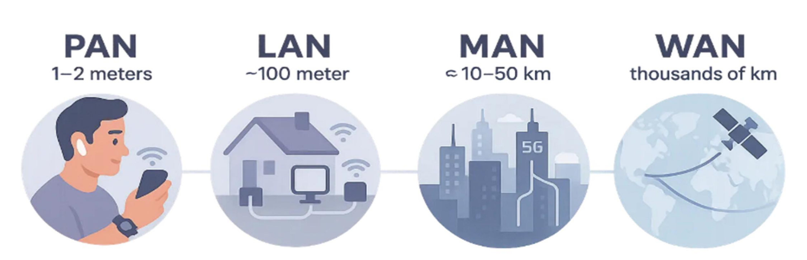
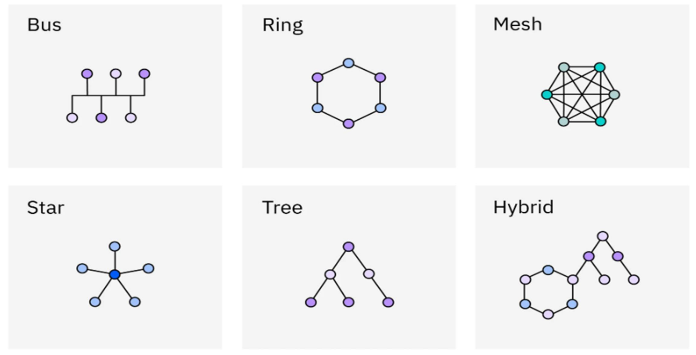
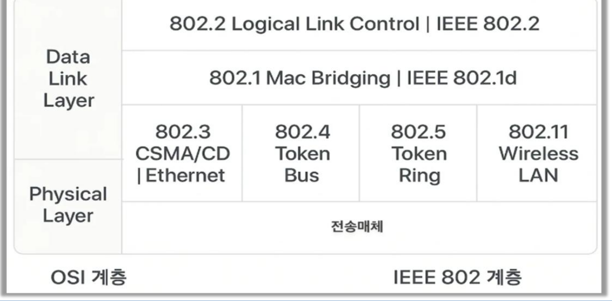
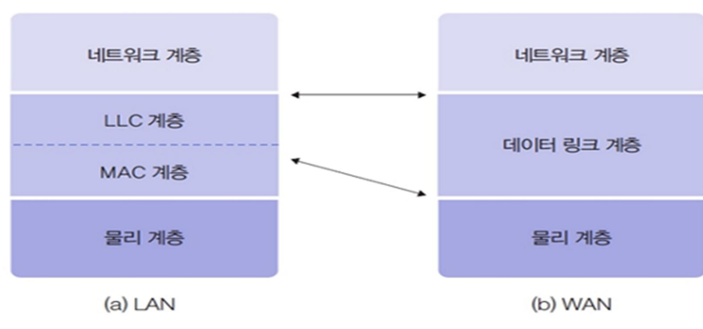
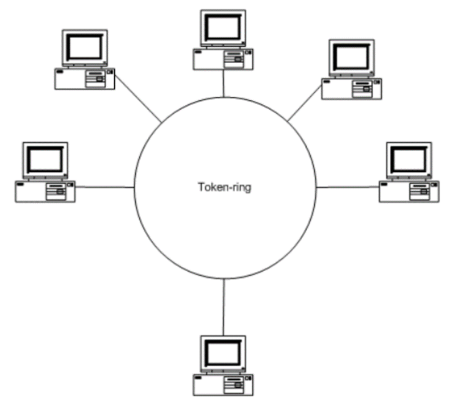
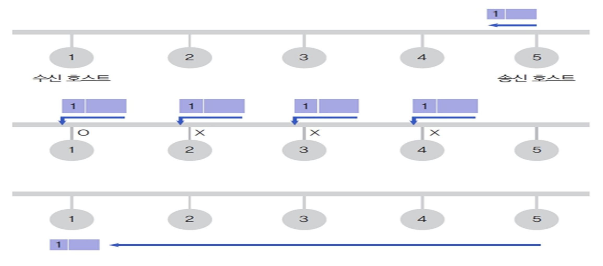
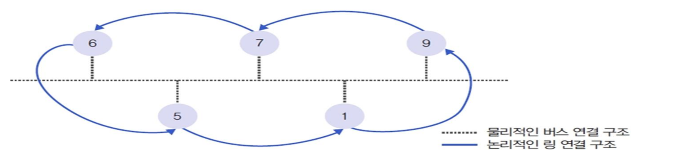
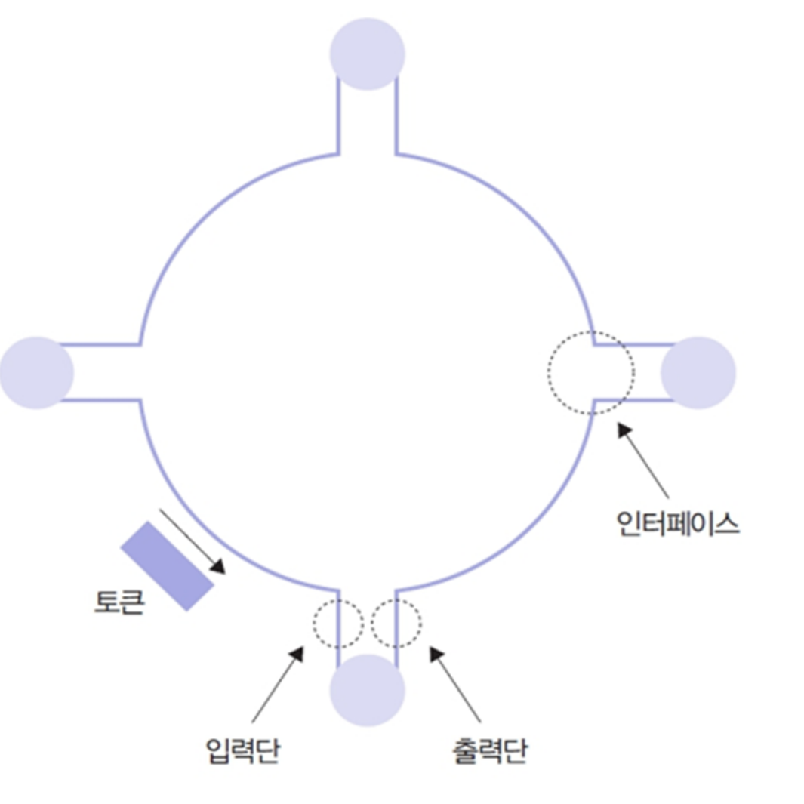
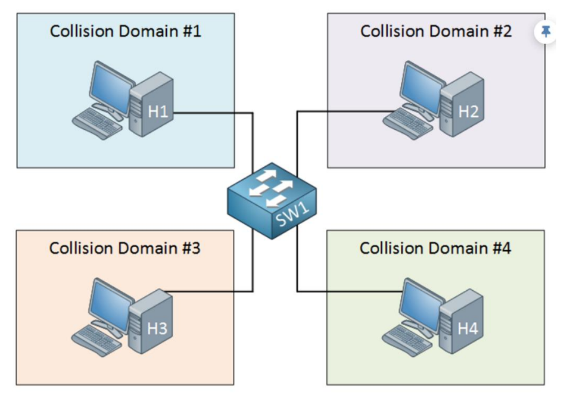
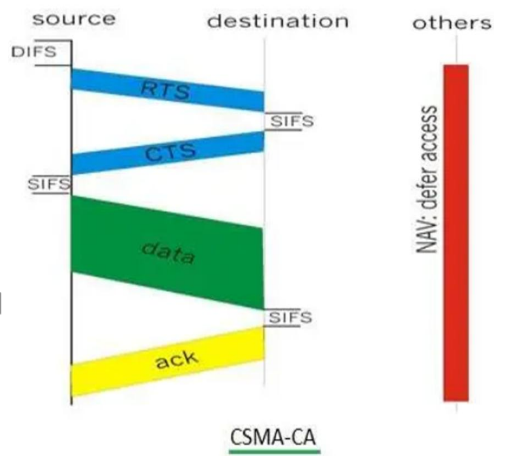

# Computer Network - Chapter 04. Network Access Layer

> 한양대학교 공학대학원 컴퓨터공학 - Computer Network\
> 원본: `ch04. Network Access Layer.pdf` (수업 필기가 추가된 최신본, 22쪽)\
> 구성: **1. Network Classification (p.3 ~ p.6) / 2. MAC Layer (p.7 ~ p.19) / Review (p.20 ~ p.21)**\
> 이전 장: [Chapter 3. Network Technologies](./03-network-technologies.md) · 다음 장: [Chapter 5. Internet Layer](./05-internet-layer.md)
>
> 강의자료 내용과 PDF에 적은 **수업 필기** 를 함께 정리한 복습 노트다. 필기는 원문에 가깝게 옮기고 "📝 수업 필기"로 구분했다. 슬라이드·필기에 없는 설명은 **[보충]** 으로 표시했다.

------------------------------------------------------------------------

## 📌 목차

- [0. 시험에 직결되는 필기 요약](#_0-시험에-직결되는-필기-요약)
- [1. Chapter 4 전체 흐름](#_1-chapter-4-전체-흐름)
- [2. 전송 거리에 따른 네트워크 분류 (p.3)](#_2-전송-거리에-따른-네트워크-분류-p-3)
- [3. Network Topologies ★★★ (p.4)](#_3-network-topologies-★★★-p-4)
- [4. Network Protocol과 IEEE 802 (p.5)](#_4-network-protocol과-ieee-802-p-5)
- [5. 데이터 링크 계층의 이층 구조 (p.6)](#_5-데이터-링크-계층의-이층-구조-p-6)
- [6. MAC 계층과 LLC 계층 (p.7 ~ p.9)](#_6-mac-계층과-llc-계층-p-7-p-9)
- [7. 공유 매체와 충돌 (p.10)](#_7-공유-매체와-충돌-p-10)
- [8. 공유 버스에서의 데이터 전송 (p.11)](#_8-공유-버스에서의-데이터-전송-p-11)
- [9. Token Bus (p.12 ~ p.13)](#_9-token-bus-p-12-p-13)
- [10. Token Ring (p.14 ~ p.15)](#_10-token-ring-p-14-p-15)
- [11. Collision Domain과 Broadcast Domain (p.16 ~ p.17)](#_11-collision-domain과-broadcast-domain-p-16-p-17)
- [12. CSMA/CD 동작 (p.18)](#_12-csma-cd-동작-p-18)
- [13. CSMA/CA — 무선 LAN (p.19)](#_13-csma-ca-—-무선-lan-p-19)
- [14. Review — 숙제, 시험에 나올 수 있음 (p.20 ~ p.21)](#_14-review-—-숙제-시험에-나올-수-있음-p-20-p-21)
- [15. 핵심 비교 정리](#_15-핵심-비교-정리)
- [16. 자기점검](#_16-자기점검)

------------------------------------------------------------------------

## 0. 시험에 직결되는 필기 요약

| 필기 | 위치 | 의미 |
|---|---|---|
| "**별3개 시험문제 확정, 무조건 나온다.**" | p.4 Topology | 토폴로지 6가지는 **반드시 출제** |
| "**2~3줄 요약해서 써주면 된다.** 장점 단점 어디에 썼나 이해했나" | p.4 | 토폴로지마다 **구조·장단점·사용처** 를 2~3줄로 쓸 수 있으면 된다 → [3.3절 답안 예시](#_3-3-서술-답안-예시-2-3줄) |
| "**CSMA/CD 를 서술해라.**" | p.5 | CSMA/CD 동작 서술 출제 가능 → [12절](#_12-csma-cd-동작-p-18) |
| 라우터 3 / 허브 1 / 스위치 2 / 리피터 1 | p.5 | 장비별 **계층 번호** → [11.2절](#_11-2-장비별-도메인-구분-—-p-17) |
| "토큰 버스와 토큰 링을 잘 구분해야 한다." | p.12 | 비교 문제 → [10.3절](#_10-3-token-ring-vs-token-bus-—-p-15) |
| "숙제 / MAC 도 숙제 / **둘 다 시험에 나올 수 있다.**" | p.21 | Review Q1(MAC 주소)·Q2(IPv6 128 bits) → [14절](#_14-review-—-숙제-시험에-나올-수-있음-p-20-p-21) |

> 💡 5장 PDF의 중간고사 메모 "mac 인지 ipv6 로 하나는 문제 냈다"는 이 **Review Q1(MAC)·Q2(IPv6)** 를 가리키는 것으로 보인다.

------------------------------------------------------------------------

## 1. Chapter 4 전체 흐름

> **여러 컴퓨터가 하나의 전송 매체를 함께 쓸 때, 누가 언제 보내고 충돌은 어떻게 처리하는가?**

```text
1. Network Classification
   ├── 전송 거리: PAN / LAN / MAN / WAN
   ├── Topology: Bus / Ring / Mesh / Star / Tree / Hybrid   ★★★
   ├── Protocol: 물리적 측면 / 논리적 측면
   └── IEEE 802 → 데이터 링크 계층 = LLC(상부) + MAC(하부)
2. MAC Layer
   ├── 공유 매체 충돌 해결 전략
   │   ├── 충돌 허용 후 해결: CSMA/CD (Ethernet, 802.3)
   │   └── 충돌 원천 차단: Token Bus(802.4) / Token Ring(802.5) / 타임 슬롯
   ├── Collision Domain / Broadcast Domain → Hub(L1) / Switch(L2) / Router(L3)
   ├── CSMA/CD 동작 (유선)
   └── CSMA/CA 동작 (무선 LAN, 802.11): RTS → CTS → DATA → ACK
Review: 스위치의 MAC 주소 학습(ARP/RARP), IPv6 128 bits
```

------------------------------------------------------------------------

# Part 1. Network Classification

## 2. 전송 거리에 따른 네트워크 분류 (p.3)

**Network Classification by Transmission Distance (Tx - Rx)** — 송신(Tx)과 수신(Rx) 사이의 거리로 나눈다.



| 구분 | 이름 | 범위 (슬라이드) | 📝 수업 필기 |
|---|---|---|---|
| **PAN** | Personal Area Network | 1 ~ 2 m | personal |
| **LAN** | Local Area Network | ~100 m | local — **학교, 집** |
| **MAN** | Metropolitan Area Network | ≈ 10 ~ 50 km | metropolitan — **도시** |
| **WAN** | Wide Area Network | thousands of km | wide |

```text
Personal → Local → Metropolitan → Wide      (범위가 점점 커진다)
개인       학교·집   도시             국가·대륙
```

> 💡 **[보충]** PAN의 예는 블루투스 이어폰·스마트워치, LAN은 집·사무실 Wi-Fi와 이더넷, MAN은 도시 단위 통신망, WAN은 인터넷처럼 국가·대륙을 잇는 망이다.

------------------------------------------------------------------------

## 3. Network Topologies ★★★ (p.4)

> 📝 **수업 필기: "별3개 시험문제 확정, 무조건 나온다."**
> 📝 "2~3줄 요약해서 써주면 된다. 장점 단점 어디에 썼나 이해했나"

**Topology** 는 노드들이 어떤 모양으로 연결되어 있는지를 나타낸다.



### 3.1 토폴로지별 수업 필기

| 토폴로지 | 📝 수업 필기 (원문 그대로) |
|---|---|
| **Bus** | 일직선, 브로드캐스팅한다. 자신에게 맞으면 수행한다. 맞지 않으면 버린다. 구축/확장할 때 비용이 안 들어서 유리하다. 고장이 나도 나한테 영향이 없다. 단점: 선로 자체가 고장이 나면 다 끝난다. 이더넷, 802.3 |
| **Ring** | 순환하고, 토큰 형식에서 많이 쓴다. 공정 자동화에서 많이 쓴다. 순차적. 끊기면 안 되는 실시간 제어망에 쓴다. 도로 교통 제어망 |
| **Mesh** | 다중연결, 1:N, N:1, N:M. 하나 끊겨도 살아있는데 돈이 많이 든다. 군사, ARPANET |
| **Star** | 중앙제어, 허브. 3번, point to point. 모든 통신은 중앙을 통해서. ip, port 각각 사용한다. 중앙이 죽으면 전체가 마비 |
| **Tree** | 위계질서, 관리자 측면에서 IP 대역으로 관리. 인터넷 망, 아파트 단지, 학교 |
| **Hybrid** | 짬뽕. 국가 차원에서 거대 프로젝트 |

> Star 필기의 "3번"은 무엇을 가리키는지 필기만으로는 분명하지 않다.

### 3.2 구조 · 장점 · 단점 · 사용처 정리

| 토폴로지 | 구조 | 장점 | 단점 | 사용처 (필기) |
|---|---|---|---|---|
| **Bus** | 한 줄의 공용 선로에 모든 노드 연결, **브로드캐스팅** | 구축·확장 비용이 적음, 한 노드가 고장 나도 다른 노드에 영향 없음 | **선로 자체가 고장 나면 전체 마비**, 노드가 많으면 충돌 증가 **[보충]** | 이더넷(802.3) |
| **Ring** | 노드가 고리 모양으로 연결, 데이터가 **순환** | **순차적** 이고 공정, 시간 예측 가능 | 한 곳이 끊기면 전체에 영향 (10.3절 표) | 토큰 방식, 공장 자동화, 실시간 제어망, 도로 교통 제어망 |
| **Mesh** | 노드끼리 **다중 연결** (1:N, N:1, N:M) | 하나가 끊겨도 다른 경로로 **살아 있음** (신뢰성 최고) | **비용이 많이 듦** (회선 수 많음) | 군사망, ARPANET |
| **Star** | 모든 노드가 **중앙 장비(허브·스위치)** 에 점대점 연결 | **중앙 제어**, 관리가 쉬움, 노드 추가가 쉬움 **[보충]** | **중앙이 죽으면 전체 마비** | 현대 LAN |
| **Tree** | Star를 계층으로 쌓은 **위계** 구조 | 관리자 측면에서 **IP 대역으로 관리** 하기 좋음 | 상위 노드 장애 시 하위 전체 영향 **[보충]** | 인터넷 망, 아파트 단지, 학교 |
| **Hybrid** | 여러 토폴로지의 **혼합(짬뽕)** | 각 구조의 장점을 상황에 맞게 조합 **[보충]** | 설계·관리 복잡 **[보충]** | 국가 차원의 거대 프로젝트 |

> 💡 **[보충] Mesh의 비용**: 노드 n개를 모두 직접 연결하려면 회선이 n(n−1)/2개 필요하다. 노드 10개면 45개 회선 → "돈이 많이 든다".

### 3.3 서술 답안 예시 (2~3줄)

> 교수님이 "2~3줄 요약해서 써주면 된다"고 하셨으므로, 각 토폴로지를 **구조 → 장점 → 단점 → 사용처** 순서로 2~3줄에 쓴다.

- **Bus**: 하나의 공용 선로에 모든 노드가 일직선으로 연결되어 데이터를 브로드캐스팅하고, 각 노드는 자기 데이터만 받고 나머지는 버린다. 구축·확장 비용이 적고 한 노드의 고장이 다른 노드에 영향을 주지 않지만, 선로 자체가 고장 나면 전체가 마비된다. 이더넷(IEEE 802.3)이 대표적이다.
- **Ring**: 노드가 고리 형태로 연결되어 데이터가 한 방향으로 순환하며, 주로 토큰 방식으로 순서대로 전송한다. 순차적이고 공정해 끊기면 안 되는 실시간 제어망(공장 자동화, 도로 교통 제어망)에 쓰이지만, 링의 한 곳이 끊기면 전체에 영향을 줄 수 있다.
- **Mesh**: 노드들이 1:N, N:M으로 다중 연결되어 한 링크가 끊겨도 다른 경로로 통신이 유지된다. 신뢰성이 가장 높지만 회선이 많아 비용이 크며, 군사망이나 ARPANET처럼 생존성이 중요한 망에 쓰였다.
- **Star**: 모든 노드가 중앙 장비(허브·스위치)에 점대점으로 연결되어 모든 통신이 중앙을 거친다. 중앙에서 제어·관리하기 쉽지만 중앙 장비가 죽으면 전체가 마비된다.
- **Tree**: Star 구조를 위계적으로 쌓은 형태로, 관리자가 IP 대역 단위로 나누어 관리하기 좋다. 인터넷 망, 아파트 단지, 학교망에 쓰이며 상위 노드 장애가 하위 전체에 영향을 준다.
- **Hybrid**: 여러 토폴로지를 혼합한 형태로, 국가 차원의 거대 프로젝트처럼 규모가 큰 망에서 각 구조의 장점을 조합해 쓴다.

------------------------------------------------------------------------

## 4. Network Protocol과 IEEE 802 (p.5)

### 4.1 Network Protocol의 두 측면

| 측면 | 내용 (슬라이드) |
|---|---|
| **물리적 측면** | 전송 매체, 접속 단자, 전송 신호 규격 등 |
| **논리적 측면** | 데이터 형식(프레임), 주소 지정, 오류 제어, 흐름 제어, 전송 절차 등 |

(두 줄 모두 형광펜 강조됨)

> 💡 물리적 측면은 "**무엇으로** 연결하나"(케이블·커넥터·신호), 논리적 측면은 "**어떤 규칙으로** 주고받나"(프레임·주소·오류·흐름 제어)다. 6절의 MAC(물리에 가까움)과 LLC(논리)로 이어진다.

### 4.2 LAN Protocol Standards — IEEE 802

- **IEEE** (전기전자공학자협회, Institute of Electrical and Electronics Engineers): 전기, 전자, 컴퓨터, 정보통신 등 기술 분야에서 인류의 이익을 위한 기술 발전에 전념하는 **세계 최대 규모의 전문 기술 조직**
- **IEEE 802 LAN 표준안**



| 표준 | 내용 | 매체 접근 방식 |
|---|---|---|
| **802.2** | Logical Link Control (**LLC**) | — |
| **802.1** | MAC Bridging (802.1d) | — |
| **802.3** | **Ethernet** | **CSMA/CD** |
| **802.4** | **Token Bus** | 토큰 |
| **802.5** | **Token Ring** | 토큰 |
| **802.11** | **Wireless LAN** | **CSMA/CA** (13절) |

- OSI의 **데이터 링크 계층** 이 IEEE 802에서는 **LLC(802.2) + MAC(802.3/4/5/11)** 로 나뉘고, 그 아래가 물리 계층(전송매체)이다.

### 4.3 📝 p.5 수업 필기

| 필기 | 정리 |
|---|---|
| "**CSMA/CD 를 서술해라.**" | 서술형 출제 가능 → 12절 |
| 라우터 : 3 | Router = **L3** |
| 허브 : 1, 브로드캐스팅, 브로드캐스팅 | Hub = **L1**, 항상 모든 포트로 브로드캐스팅 |
| 스위치 : 2, 브로드캐스팅 후 1:1 | Switch = **L2**, 처음엔 브로드캐스팅, MAC 주소를 배운 뒤 **1:1** 전달 |
| 리피터 : 1 | Repeater = **L1** (신호 증폭·재생) **[보충]** |
| (802.4 Token Bus 옆) "공정자동화에서 자기 / 시작 시간 알 수 있다." | 토큰 버스는 자기 차례(시작 시간)를 **예측할 수 있어** 공장 자동화에 쓰임 → 9절 |

------------------------------------------------------------------------

## 5. 데이터 링크 계층의 이층 구조 (p.6)

**IEEE 802** 는 LAN 환경에서 네트워크 자원을 효율적으로 활용하려고 데이터 링크 계층을 둘로 나눈다.



**데이터 링크 2계층으로 나눈 이유**: 수많은 연결 방식(Wi-Fi, 이더넷, 블루투스 등)

- **MAC 계층** 은 선로의 종류(무선, 유선)에 따라 방식이 다름
- **LLC 계층** 은 유·무선을 쓰든 상관없이 동일 방식으로 데이터를 처리

### 📝 수업 필기 — 우체통 비유

| 계층 | 질문 | 우체통 비유 |
|---|---|---|
| **LLC** (상부) | "**제대로 갔는가?**" | **우체통에 들어갔는지 확인** — 논리적 |
| **MAC** (하부) | "**어떻게 보낼 것인가?**" | **우체통에 넣는 행위** — 물리적 |

- LAN 쪽 그림 옆: "**다양한 형태**" — 아래쪽 MAC이 유선·무선 등 다양한 형태로 갈린다.
- WAN 쪽 그림 옆: "**데이터만 본다. 수많은 데이터를 다 처리 못하니**" — WAN은 데이터 링크 계층을 하나로 두고 데이터 전달에만 집중한다.

```text
           ┌──────────────┐
           │ 네트워크 계층 │
LLC  ──────┤ "제대로 갔나?" (우체통에 들어갔는지 확인, 논리적)  ← 유·무선 공통
MAC  ──────┤ "어떻게 보내나?" (우체통에 넣는 행위, 물리적)        ← 유선/무선마다 다름
           │ 물리 계층     │
           └──────────────┘
```

------------------------------------------------------------------------

# Part 2. MAC Layer

## 6. MAC 계층과 LLC 계층 (p.7 ~ p.9)

### 6.1 MAC 계층 (Media Access Control Layer) — p.7

- **특성**: 전송 선로 물리 특성 반영, **LAN 종류별 상이**
- **Main Methods**

| 방식 | 설명 (슬라이드) | 📝 수업 필기 |
|---|---|---|
| **CSMA/CD** | 공유 버스 방식, **이더넷(Ethernet) 표준** | "**서로 말하려고 하는 것 : CD**" |
| **Token Ring** | 점대점 순환 구조, 토큰 제어 프레임 순환 (Point-to-point ring topology; token-based control) | "**발언권을 주는 것, CD(충돌)가 발생 안 한다.**" |



> 💡 회의에 비유하면 CSMA/CD는 **서로 먼저 말하려는 자유 토론**(그래서 말이 겹치는 충돌이 생김), Token Ring은 **마이크(발언권)를 가진 사람만 말하는 회의**(충돌이 없음)다.

> ⚠️ 필기 원문은 "발언권을 주는 것, CD(충돌) 가 발생안한다"로, 띄어쓰기상 "발생한다"로 잘못 읽기 쉽다. 토큰 방식은 **충돌이 발생하지 않는다**.

### 6.2 LLC 계층 (Logical Link Control Layer) — p.8

- **특성**: 송수신 호스트 사이의 프레임 전송 과정에서 물리적인 오류가 발생하면 이를 복구하는 작업
- 📝 수업 필기: "**논리적으로 오류제어, 흐름제어를 해준다.**"

| Main Method | 설명 |
|---|---|
| **오류 제어** (Error Control) | 데이터 변형·분실 복구 (Recovery from data corruption or loss) |
| **흐름 제어** (Flow Control) | 송수신 호스트 간 속도 차이 조절 (Speed adjustment between hosts) |

### 6.3 MAC vs LLC — p.9

| 구분 | MAC 계층 (하부) | LLC 계층 (상부) |
|---|---|---|
| **관심사** | 물리적 매체 접촉 (**How to access?**) | 데이터 논리 전달 (**Is it correct?**) |
| **주요 주소** | MAC 주소 (하드웨어 주소) | SAP (서비스 액세스 포인트) |
| **의존성** | 하드웨어/케이블 종류에 강하게 의존 | 상위 네트워크 계층과 연계 |

📝 p.9 수업 필기: "**기술사 집중적으로 2년 / 박사 10년**" (수업 중 말씀하신 내용의 메모로 보이며, 이 표와 직접 연결되는 설명은 필기에 없다)

> 💡 **[보충] 주소로 구분하기**: MAC 주소는 랜카드에 박힌 48비트 하드웨어 주소(예: `00:1A:2B:3C:4D:5E`), SAP는 LLC가 위쪽 어느 프로토콜(예: IP)로 데이터를 넘길지 가리키는 번호다.

------------------------------------------------------------------------

## 7. 공유 매체와 충돌 (p.10)

**Shared Media Access & Collision**

- **기본 전제**: 다중 접근 채널 방식에서 **데이터 충돌은 상존**
- **해결 전략 (Two Strategies)** — 📝 필기: "**해결방법**"

| 전략 | 방식 | 예 |
|---|---|---|
| 1. **충돌 허용 및 사후 해결** (Collision Detection/Recovery) | 충돌 발생 시 **감지 및 재전송** | CSMA/CD, Ethernet |
| 2. **충돌 원천 차단** (Collision Avoidance/Prevention) | **전송 권한 제어** 로 충돌 방지 | Token Ring |

📝 수업 필기: "**사용자가 적을 땐 효율적이나 많을 땐 별로고, 많을 땐 트래픽 잼을 발생한다.**" — 충돌 허용 방식(이더넷)의 특징

**Transmission Control Methods**

| 방법 | 설명 |
|---|---|
| **Ethernet** | CSMA/CD 방식 사용, **충돌 허용 모델** |
| **Avoidance** | **타임 슬롯(Time Slot)** 배정 등 전송 시간대 분리 |
| **Token Control** | 토큰 버스 및 토큰 링, **논리적 타임 슬롯 변형 형태** |

```text
사용자 적음 → 충돌 드묾 → CSMA/CD 효율적 (기다리지 않고 바로 보냄)
사용자 많음 → 충돌 잦음 → 재전송 증가 → 트래픽 잼 → 토큰 방식이 유리
```

------------------------------------------------------------------------

## 8. 공유 버스에서의 데이터 전송 (p.11)

**Data Transmission on a Shared Bus** — 5번(송신 호스트)이 1번(수신 호스트)에게 보내는 예



| 단계 | 그림 | 📝 수업 필기 |
|---|---|---|
| ① 전송 | 5번이 목적지 1번 프레임을 버스에 올림 | "**전송, 버스형, 양방향, 브로드캐스팅으로 간다.**" |
| ② 전달 | 프레임이 1~4번 **모든 노드** 에 도착 | "**노드에 다 보냈어. 목적지가 다르면 discard 시킨다. 1번 노드는 맞다고 알려준다.**" (2·3·4번은 ×, 1번은 ○) |
| ③ 완료 | 1번이 프레임을 받음 | "**전송 완료**" |

> 💡 이것이 3절 Bus 토폴로지 필기("브로드캐스팅한다. 자신에게 맞으면 수행, 맞지 않으면 버린다")의 실제 동작이다. 모든 노드가 같은 선로를 들으므로 둘이 동시에 보내면 **충돌** 이 난다 → 12절 CSMA/CD.

------------------------------------------------------------------------

## 9. Token Bus (p.12 ~ p.13)

### 9.1 구조와 동작 — p.12

| 항목 | 내용 (슬라이드) |
|---|---|
| **Structure** | 물리적 공유 버스(점선) + 논리적 링 구조(실선) (Physical shared bus + Logical ring structure) |
| **Mechanism** | CSMA/CD와 다른 전송 방식 사용 |
| **Transmission Control** | 토큰(제어 프레임)을 이용한 **순차적** 데이터 전송 |



📝 수업 필기

- "**물리적으로는 버스, 논리적으론 링**"
- "**토큰 버스와 토큰 링을 잘 구분해야 한다.** 앉아 있는 모양은 버스지만 발언권을 순서대로 준다."
- "**토큰 버스는 CD 가 없다. 예측 가능, 공장자동화 FA. 이더넷은 눈치가 필요하다.**"

```text
물리 구조 (점선, 버스):   6 ─── 5 ─── 7 ─── 1 ─── 9     모두 한 선로에 매달림
논리 구조 (실선, 링):     6 → 7 → 9 → 1 → 5 → 6 …        토큰을 이 순서로 넘김
```

> 💡 **[보충] 토큰 순서는 위치가 아니라 주소** 다. 그림에서 선로 위 위치는 6, 5, 7, 1, 9 순이지만 토큰은 6 → 7 → 9 → 1 → 5 처럼 정해진 **논리적 순번** 으로 돈다 (10.3절 표의 "주소 순서대로 논리적인 순번").

### 9.2 Ethernet vs Token Bus — p.13

| 구분 | 일반 이더넷 (CSMA/CD) | 토큰 버스 (IEEE 802.4) |
|---|---|---|
| **물리 구조** | 공유 버스 / 스타형 | 공유 버스 |
| **대화 규칙** | **자유 경쟁** (충돌 허용) | **순번제** (토큰 소유) |
| **장점** | 단순함, 저렴함 | 충돌 없음, **시간 예측 가능** |
| **단점** | 부하 증가 시 성능 저하 | 토큰 관리 복잡 (분실 시 복구 등) |

```text
Ethernet  = 자유 경쟁 = 눈치 보며 말하기 (충돌 가능)
Token Bus = 순번제    = 발언권을 받은 사람만 말하기 (충돌 없음, 내 차례 예측 가능 → 공장 자동화)
```

------------------------------------------------------------------------

## 10. Token Ring (p.14 ~ p.15)

### 10.1 Token Ring Operational Modes — p.14

- **Structure**: 순환 전송 매체 및 점대점(Point-to-Point) 방식 연결



| 모드 | 내용 (슬라이드) | 📝 수업 필기 |
|---|---|---|
| **Listen Mode** | 입력 비트를 출력단으로 **즉시 재전송**. 호스트 장애 시 자동 전환으로 **네트워크 연속성 유지** | "**연속성을 유지할 수 있어서 신뢰성이 있다.**" / "생각보다 혁신적인데 **내가 할 말이 없으면 순간적으로 마이크를 넘겨준다.** 즉시 재전송한다." |
| **Transmit Mode** | 토큰 획득 후 데이터 프레임 **전송 권한 보유** | "**전송 모드 : 권한 획득 전송**" |

📝 상단 필기: "**신뢰성, 컴퓨터가 꺼지면 프로그램상에서 스킵을 하고 다음 타자로 넘긴다.**"

```text
Listen Mode   : 들어온 비트 → 그대로 출력단으로 (보낼 게 없으면 바로 다음으로 넘김)
                꺼진 호스트는 건너뛰고(스킵) 다음 노드로 → 링이 끊기지 않음 = 신뢰성
Transmit Mode : 토큰 획득 → 내 데이터 프레임 전송 → 토큰을 다음 노드로
```

### 10.2 📝 p.15 필기

| 위치 | 📝 수업 필기 |
|---|---|
| Token Ring 장점 아래 | "**백본망에서 안정적으로 주고 받을 때**", "**공평한 대역폭**" |
| Token Bus 장점 아래 | "**A공정 했어, B공정 했어, C공정 했어. 시간을 두고 기다릴 수 있다.** FA, 공장 자동화. 계획성 있게 인력 쉬어, 소프트웨어 쉬어." |
| 표 위 (Token Bus 쪽) | "**내 차례 알 수 있고, 장비 설치하기 쉽다.**" |

### 10.3 Token Ring vs Token Bus — p.15

| 구분 | 토큰 링 (Token Ring) | 토큰 버스 (Token Bus) |
|---|---|---|
| **물리적 형태** | 고리(Ring) 구조: 케이블이 원형으로 연결됨 | 일자(Bus) 구조: 모든 호스트가 한 줄에 매달림 |
| **토큰 전달** | **물리적 이웃(옆자리)에게 순서대로** 전달 | **주소 순서대로** 논리적인 순번을 정해 전달 |
| **장점** | 구조가 단순하고 **공정함** (순차적) | 버스 구조의 **설치 편의성 + 링의 질서** |
| **단점** | **한 곳만 끊겨도 전체 네트워크 마비** 가능 | 토큰 관리(순서 제어) 소프트웨어가 **복잡함** |
| **쓰임 (필기)** | 백본망, 공평한 대역폭 | 공장 자동화(FA), 내 차례 예측 |

(밑줄 강조: "물리적 이웃(옆자리)에게 순서대로", "주소 순서대로", "공정함", "전체 … 마비", "복잡함")

> 💡 공통점은 **토큰으로 순서를 제어해 충돌이 없다** 는 것, 차이는 **물리적 연결 형태** 와 **토큰을 넘기는 기준**(옆자리 vs 주소 순서)이다.

------------------------------------------------------------------------

## 11. Collision Domain과 Broadcast Domain (p.16 ~ p.17)

### 11.1 두 도메인의 정의 — p.16

📝 제목 옆 필기: CSMA/CD = "**반송파 감지 다중 접속 / 충돌 탐지**"

| 도메인 | 정의 (슬라이드) | 📝 수업 필기 |
|---|---|---|
| **Collision Domain** | 네트워크상에서 데이터 **충돌이 발생할 수 있는 영역** | "**여러 데이터를 동시에 전송하면 깨지는 공간**" |
| **Broadcast Domain** | (정의 없음) | "**전체 다 알리는 영역**" |



| 장비 | 브로드캐스트 도메인 | 특징 (슬라이드) |
|---|---|---|
| **허브 (Hub)** | 변화 없음 (1개) | 모든 포트로 신호를 뿌림 (충돌 도메인도 1개) |
| **스위치 (Switch)** | 변화 없음 (1개) | 유니캐스트는 나눠주지만, **브로드캐스트는 모든 포트로 전달** |
| **라우터 (Router)** | **나누어짐** (L3 경계) | 포트마다 서로 다른 브로드캐스트 도메인 형성 |

📝 수업 필기

- "**허브에서 장비가 많아서 충돌이 심하면 쪼갠다.**" → 스위치로 충돌 도메인을 나눔
- "**라우터는 서로 다른 망의 브로드캐스팅을 죽여버린다. 너무 많은 신호들이 발생**" → 브로드캐스트가 너무 많아지면 라우터로 도메인을 나눔

### 11.2 장비별 도메인 구분 — p.17

| 장비 (Layer) | Collision | Broadcast | 핵심 동작 원리 | 📝 수업 필기 |
|---|---|---|---|---|
| **허브 (L1)** | 1개 | 1개 | 들어온 신호를 **모든 포트로 그대로 복제** 해서 보냄 | "**계속 한방 한방, 24포트**" |
| **스위치 (L2)** | **포트 수만큼** | 1개 | **MAC 주소** 를 보고 필요한 포트에만 전달 (Unicast) | "**처음에는 한방 그 다음 1:1, 포트별로 구분**" |
| **라우터 (L3)** | 포트 수만큼 | **포트 수만큼** | **IP 주소** 를 보고 서로 다른 네트워크로 길을 찾아줌 | "**공학관 본관 연결, 이웃 간 완벽한 신뢰**" |

📝 표 아래 필기: "**백본 L4 스위치**"

```text
            Collision 도메인     Broadcast 도메인      기준 주소
Hub (L1)    1개 (전체가 한 방)    1개                   없음 (신호 복제)
Switch (L2) 포트마다 분리         1개                   MAC
Router (L3) 포트마다 분리         포트마다 분리          IP

Collision 분리는 Switch부터, Broadcast 분리는 Router부터
```

> 💡 필기 해석
> - **허브 "계속 한방 한방, 24포트"**: 24포트 허브라도 모든 포트가 **한 방(하나의 충돌 도메인)** 이다.
> - **스위치 "처음에는 한방 그 다음 1:1"**: 처음에는 목적지 MAC을 몰라 모든 포트로 보내지만(브로드캐스팅, p.5 필기 "브로드캐스팅 후 1:1"), MAC 주소를 배운 뒤에는 해당 포트로만 1:1 전달한다 → Review Q1과 연결.
> - **라우터 "공학관 본관 연결"**: 서로 다른 건물(서로 다른 네트워크)을 잇는 장비의 예.
> - **"백본 L4 스위치"**: 캠퍼스 백본에는 L4(전송 계층 정보까지 보는) 스위치를 쓴다는 메모. **[보충]** L4 스위치는 포트 번호 등을 보고 부하 분산을 한다.

------------------------------------------------------------------------

## 12. CSMA/CD 동작 (p.18)

> 📝 p.5 필기: "**CSMA/CD 를 서술해라.**" · 5장 중간고사 메모: "CSMA/CD 3단계가 어떻게 동작하는지? → 1단계 Carrier sensing, 2단계 MA, 3단계 CD"

**CSMA/CD = Carrier Sense Multiple Access with Collision Detection** (슬라이드 표기는 "Carrier Sence") — 📝 "반송파 감지 다중 접속 / 충돌 탐지"

| 단계 | 내용 (슬라이드) | 📝 수업 필기 |
|---|---|---|
| **① Carrier Sense** (반송파 감지) | 케이블에 흐르는 신호(**반송파**) 감지 | "**이놈 저놈 다 오니까 반송파를 감지해야 한다.**" |
| **② Multiple Access** (다중 접속) | 여러 컴퓨터가 하나의 네트워크에 접속할 수 있도록 허용 | |
| **③ Collision Detection** (충돌 감지) | 다중 접속을 허용하기 때문에 두 컴퓨터가 비어 있다고 판단하고 데이터를 전송할 수 있다. 출발지 컴퓨터는 데이터를 전송하는 도중에 다른 컴퓨터에서 보낸 데이터와 **충돌이 발생하지 않는지 감지** 하고 있다가, 충돌이 발생하면 **전송을 중단** 하고 **임의의 시간 동안 기다렸다가** 다시 전송을 시도 | "**jam 시그널을 보낸다. 랜덤한 시간 동안 대기한다. 더미 데이터 테스트 데이터를 보낸다. 이걸 보내서 아무 작업 안 하면 보낸다.**" |

```text
① Carrier Sense : 선로에 신호(반송파)가 있나? ── 있으면 대기
        ↓ 비어 있음
② Multiple Access : 여러 컴퓨터가 같은 선로에 접속해 전송 시작
        ↓
③ Collision Detection : 보내는 도중 충돌 감지
        ├─ 충돌 없음 → 전송 완료
        └─ 충돌 발생 → 전송 중단 → jam 시그널 전송(모두에게 충돌 알림)
                      → 랜덤한 시간 대기 → 다시 ①부터 (재전송)
```

### 서술 답안 예시

> CSMA/CD는 이더넷(IEEE 802.3)의 매체 접근 방식으로, 충돌을 허용하고 사후에 해결한다. ① **Carrier Sense**: 전송 전에 케이블의 반송파를 감지해 선로가 비었는지 확인한다. ② **Multiple Access**: 선로가 비어 있으면 여러 컴퓨터가 같은 선로에 접속해 전송한다. ③ **Collision Detection**: 전송 도중 충돌을 감지하면 전송을 멈추고 jam 신호를 보낸 뒤, 랜덤한 시간만큼 기다렸다가 재전송한다. 사용자가 적을 때는 효율적이지만 많아지면 충돌과 재전송이 늘어 트래픽 잼이 생긴다.

> 💡 **[보충] 왜 "랜덤한" 시간인가?** 충돌한 두 컴퓨터가 똑같은 시간만큼 기다리면 다시 동시에 보내 또 충돌한다. 서로 다른 무작위 시간을 기다려야 다음 시도에서 엇갈린다.

------------------------------------------------------------------------

## 13. CSMA/CA — 무선 LAN (p.19)

> 📝 **수업 필기로 제목이 고쳐졌다**: 슬라이드 제목 "CSMA/**CD** (… Collision **Detection**)"에서 **D에 ×를 치고 "CA"**, **Detection을 지우고 "Avoidance"** 로 고쳐 적었다 (필기 원문 철자는 "Adoidance"). 📝 "**여기는 wifi 통신이다.**"
>
> 즉 이 페이지는 **CSMA/CA (Carrier Sense Multiple Access with Collision Avoidance)** 다. 그림 아래에도 "CSMA-CA"라고 적혀 있다.



| 단계 | 내용 (슬라이드) |
|---|---|
| **Carrier Sense** | 데이터를 전송하기 **전에** 네트워크가 사용 중인지 확인 |
| **랜덤 백오프** (Random Backoff) | 네트워크가 **비어 있더라도 바로 전송하지 않고** 임의의 시간 동안 기다렸다 전송 |
| **ACK 확인** (ACK Confirmation) | 데이터를 전송한 후 목적지 컴퓨터가 데이터를 잘 받았는지 확인 |

**그림의 흐름** (RTS, CTS에 빨간 동그라미)

```text
source                         destination                  others
  │── RTS (request to send) ──────▶│                          │
  │◀── CTS (clear to send) ────────│                          │ NAV: defer access
  │── DATA ───────────────────────▶│                          │ (전송을 미룸)
  │◀── ACK ────────────────────────│                          │
```

| 신호 | 📝 필기 | 의미 **[보충]** |
|---|---|---|
| **RTS** | request to send | "보내도 될까요?" — 전송 요청 |
| **CTS** | clear to send | "보내세요" — 허락. 이를 들은 다른 단말(others)은 그동안 전송을 미룸 (NAV) |
| **DATA** | | 실제 데이터 |
| **ACK** | | 수신 확인 |

📝 필기: "**tcp 에서 three way handshake 를 다룬다.**" — 이렇게 신호를 주고받으며 확인하는 방식은 이후 TCP의 3-way handshake에서 다룬다는 뜻

### CSMA/CD vs CSMA/CA

| 구분 | CSMA/CD | CSMA/CA |
|---|---|---|
| 풀이 | Collision **Detection** (충돌 감지) | Collision **Avoidance** (충돌 회피) |
| 환경 | **유선** — 이더넷 (802.3) | **무선** — Wi-Fi (802.11) |
| 전략 | 충돌을 **허용하고 사후에** 감지·재전송 | 충돌을 **미리 피함** (랜덤 백오프, RTS/CTS, ACK) |
| 랜덤 대기 시점 | 충돌 **후** | 전송 **전** (비어 있어도 기다림) |

> 💡 **[보충] 무선에서 CD를 못 쓰는 이유**: 무선은 자기가 보내는 신호가 너무 강해서 전송 중에 다른 신호(충돌)를 듣기 어렵고, 서로 보이지 않는 단말(숨은 노드)끼리도 충돌한다. 그래서 감지 대신 **회피** 한다.

------------------------------------------------------------------------

## 14. Review — 숙제, 시험에 나올 수 있음 (p.20 ~ p.21)

> 📝 p.21 필기: "**숙제 / MAC 도 숙제 / 둘 다 시험에 나올 수 있다.**"

### 14.1 Q1. 새 컴퓨터의 MAC 주소를 스위치는 어떻게 업데이트할까? (p.20)

> 새 컴퓨터가 스위치에 연결되면 스위치는 새 컴퓨터의 MAC 주소를 모른다. 그럼 스위치에서 MAC 주소를 어떻게 업데이트할까?
>
> ① CDMA/CA ② Token Ring ③ ARP ④ CMDA/CD ⑤ RARP

📝 수업 필기 (보기 옆)

- ③ ARP 옆: "**IP 를 모를 땐 mac 으로 IP 를 알아낸다.**"
- ⑤ RARP 옆: "**mac 으로 IP 를 알아낸다.**"

**[보충] 정확한 정의와 풀이 방향**

| 프로토콜 | 아는 것 → 알아내는 것 | 쓰임 |
|---|---|---|
| **ARP** (Address Resolution Protocol) | **IP 주소 → MAC 주소** | 같은 LAN에서 상대의 IP는 아는데 MAC을 모를 때, 브로드캐스트로 "이 IP 가진 사람 MAC 알려 줘"라고 물음 |
| **RARP** (Reverse ARP) | **MAC 주소 → IP 주소** | 자기 MAC만 알고 IP를 모르는 장치가 IP를 받아 옴 (지금은 DHCP로 대체) |

> ⚠️ **원자료상의 차이**: ARP 옆 필기("IP를 모를 땐 mac으로 IP를 알아낸다")는 표준 정의(ARP = IP로 MAC을 알아냄)와 방향이 반대이고, RARP 필기와 내용이 같다. 필기할 때 두 줄이 섞였을 가능성이 있으니 **ARP = IP → MAC, RARP = MAC → IP** 로 기억한다.

- 보기 중 스위치의 MAC 학습과 직접 관련된 것은 **③ ARP** 로 보는 것이 일반적이다. 새 컴퓨터가 통신을 시작하며 ARP 요청 같은 프레임을 보내면, 스위치는 그 프레임의 **출발지 MAC 주소와 들어온 포트** 를 MAC 주소 테이블에 기록한다(**MAC 주소 학습**). **[보충]**
- 강의자료에 정답 표시는 없으므로, 숙제로 제출한 답과 교수님 설명을 기준으로 확정한다.
- ①은 CDMA(코드 분할 다중 접속, 이동통신 방식)로 CSMA/CA와 철자가 다르고, ④ "CMDA/CD"도 CSMA/CD의 오기다. **[보충]**

> 💡 11.2절의 스위치 필기 "**처음에는 한방 그 다음 1:1**"과 연결된다. 처음에는 목적지 MAC을 몰라 모든 포트로 보내고(Flooding), 주소를 배운 뒤에는 그 포트로만 보낸다.

### 14.2 Q2. IPv6 주소는 왜 128 bits인가? (p.21)

```text
fe80:0000:0000:0000:50cd:fd4a:c05c:666a   >> 128 bits
```

- `:` 로 구분된 블록이 **8개**
- 블록 하나 = 16진수 **4자리**, 16진수 1자리 = **4 bits** → 블록 하나 = **16 bits**
- **16 bits × 8블록 = 128 bits**

> 💡 **[보충] 비교**: IPv4는 `192.168.0.1`처럼 8 bits × 4 = **32 bits** 다. IPv6는 주소 고갈 문제를 해결하려고 4배인 128 bits를 쓴다. MAC 주소는 `00:1A:2B:3C:4D:5E`처럼 8 bits × 6 = **48 bits** 다 ("MAC도 숙제" 대비).

| 주소 | 표기 예 | 크기 |
|---|---|---|
| MAC | `00:1A:2B:3C:4D:5E` (16진수 2자리 × 6) | **48 bits** |
| IPv4 | `192.168.0.1` (10진수 × 4) | **32 bits** |
| IPv6 | `fe80:0000:…:666a` (16진수 4자리 × 8) | **128 bits** |

------------------------------------------------------------------------

## 15. 핵심 비교 정리

```text
Network Access Layer
├── 거리: PAN(개인) < LAN(학교·집) < MAN(도시) < WAN(광역)
├── Topology ★★★ (구조·장단점·사용처 2~3줄)
│   Bus(일직선·저렴·선로 고장 시 전체 마비·이더넷) · Ring(순환·토큰·실시간 제어)
│   Mesh(다중연결·생존성·고비용·군사) · Star(중앙·허브·중앙 장애 시 마비)
│   Tree(위계·IP 대역 관리·아파트/학교) · Hybrid(혼합·국가 프로젝트)
├── IEEE 802: 802.2 LLC / 802.3 Ethernet / 802.4 Token Bus / 802.5 Token Ring / 802.11 무선 LAN
├── 데이터 링크 = LLC(상부, 논리, "제대로 갔나?") + MAC(하부, 물리, "어떻게 보내나?")
├── 충돌 전략: 허용 후 해결(CSMA/CD) vs 원천 차단(토큰, 타임 슬롯)
├── Token Bus = 물리 Bus + 논리 Ring (주소 순, 예측 가능, FA)
│   Token Ring = 물리 Ring (옆자리 순, 공정, Listen/Transmit, 한 곳 끊기면 마비)
├── Domain: Hub(L1) 1/1 · Switch(L2) 포트별/1 · Router(L3) 포트별/포트별
├── CSMA/CD(유선): 반송파 감지 → 다중 접속 → 충돌 감지 → jam → 랜덤 대기 → 재전송
├── CSMA/CA(무선): 반송파 감지 → 랜덤 백오프 → RTS/CTS → DATA → ACK
└── Review: ARP(IP→MAC) / RARP(MAC→IP) · MAC 48 / IPv4 32 / IPv6 128 bits
```

헷갈리기 쉬운 것

1. **Token Bus ≠ Token Ring** — 물리 모양(버스 vs 링)과 토큰 넘기는 기준(주소 순서 vs 옆자리)
2. **p.19는 CSMA/CA** (교수님이 제목을 고침) — 무선, 충돌 회피
3. **스위치는 충돌 도메인만 나누고, 브로드캐스트 도메인은 라우터가 나눈다**
4. **ARP = IP → MAC**, RARP = MAC → IP
5. LLC는 **상부**, MAC은 **하부**

------------------------------------------------------------------------

## 16. 자기점검

> 답을 먼저 떠올린 뒤 `▶ 정답 보기`를 눌러 확인한다.

**Q1.** PAN, LAN, MAN, WAN을 범위와 예로 구분하라.

<details><summary>▶ 정답 보기</summary>

PAN 1~2 m(개인), LAN ~100 m(학교·집), MAN 10~50 km(도시), WAN 수천 km(국가·대륙). 송수신 거리(Tx–Rx) 기준이다.
</details>

**Q2.** (★★★) Bus 토폴로지를 구조·장점·단점·사용처로 2~3줄 서술하라.

<details><summary>▶ 정답 보기</summary>

하나의 공용 선로에 모든 노드가 일직선으로 연결되어 브로드캐스팅하고, 각 노드는 자기 데이터만 받는다. 구축·확장 비용이 적고 한 노드 고장이 다른 노드에 영향을 주지 않지만, 선로 자체가 고장 나면 전체가 마비된다. 이더넷(802.3)이 대표적이다.
</details>

**Q3.** (★★★) Mesh와 Star의 장단점을 비교하라.

<details><summary>▶ 정답 보기</summary>

Mesh는 다중 연결이라 한 링크가 끊겨도 통신이 유지되지만 회선이 많아 비용이 크다(군사, ARPANET). Star는 중앙 장비로 제어·관리가 쉽지만 중앙이 죽으면 전체가 마비된다.
</details>

**Q4.** (★★★) Ring과 Tree는 각각 어디에 주로 쓰이는가?

<details><summary>▶ 정답 보기</summary>

Ring: 토큰 방식, 공장 자동화, 끊기면 안 되는 실시간 제어망(도로 교통 제어망). Tree: 위계 구조로 IP 대역별 관리가 쉬워 인터넷 망, 아파트 단지, 학교망.
</details>

**Q5.** 데이터 링크 계층을 LLC와 MAC으로 나눈 이유는? 우체통 비유로 두 계층을 설명하라.

<details><summary>▶ 정답 보기</summary>

Wi-Fi, 이더넷, 블루투스 등 연결 방식이 다양해서, 매체마다 다른 부분(MAC)과 공통으로 처리할 부분(LLC)을 나눴다. MAC은 우체통에 넣는 행위(물리적, 어떻게 보낼까), LLC는 우체통에 들어갔는지 확인(논리적, 제대로 갔나)이다.
</details>

**Q6.** MAC 계층과 LLC 계층을 관심사, 주요 주소, 의존성으로 비교하라.

<details><summary>▶ 정답 보기</summary>

MAC: 물리적 매체 접촉(How to access?), MAC 주소, 하드웨어·케이블에 강하게 의존. LLC: 데이터 논리 전달(Is it correct?), SAP, 상위 네트워크 계층과 연계.
</details>

**Q7.** IEEE 802.3, 802.4, 802.5, 802.11은 각각 무엇이고 어떤 매체 접근 방식을 쓰는가?

<details><summary>▶ 정답 보기</summary>

802.3 Ethernet(CSMA/CD), 802.4 Token Bus(토큰), 802.5 Token Ring(토큰), 802.11 무선 LAN(CSMA/CA). 802.2는 LLC.
</details>

**Q8.** 공유 매체에서 충돌을 해결하는 두 가지 전략과 예는? 충돌 허용 방식은 사용자가 많을 때 어떤 문제가 있는가?

<details><summary>▶ 정답 보기</summary>

충돌 허용 및 사후 해결(CSMA/CD, 이더넷), 충돌 원천 차단(토큰 링·버스, 타임 슬롯). 사용자가 많으면 충돌과 재전송이 늘어 트래픽 잼이 발생한다.
</details>

**Q9.** Token Bus가 "물리적으로는 버스, 논리적으로는 링"인 이유와, 공장 자동화(FA)에 쓰이는 이유는?

<details><summary>▶ 정답 보기</summary>

모든 호스트가 한 줄의 버스에 매달려 있지만, 토큰은 주소 순서로 정한 논리적 순번(링)으로 돈다. 충돌(CD)이 없고 내 차례(전송 시작 시간)를 예측할 수 있어 계획적으로 움직여야 하는 공장 자동화에 맞다.
</details>

**Q10.** (필기) 일반 이더넷과 토큰 버스를 대화 규칙, 장점, 단점으로 비교하라.

<details><summary>▶ 정답 보기</summary>

이더넷: 자유 경쟁(충돌 허용, "눈치가 필요"), 단순·저렴, 부하 증가 시 성능 저하. 토큰 버스: 순번제(토큰 소유), 충돌 없음·시간 예측 가능, 토큰 관리 복잡(분실 시 복구 등).
</details>

**Q11.** Token Ring의 Listen Mode와 Transmit Mode를 설명하고, 신뢰성이 있다고 하는 이유는?

<details><summary>▶ 정답 보기</summary>

Listen Mode는 들어온 비트를 출력단으로 즉시 재전송(할 말이 없으면 마이크를 바로 넘김)하고, Transmit Mode는 토큰을 얻어 데이터 프레임을 보낸다. 호스트가 꺼져도 자동 전환으로 건너뛰고 다음으로 넘겨 링의 연속성을 유지하므로 신뢰성이 있다.
</details>

**Q12.** Token Ring과 Token Bus를 물리적 형태, 토큰 전달 방식, 장단점으로 비교하라.

<details><summary>▶ 정답 보기</summary>

Ring: 원형 케이블, 물리적 이웃(옆자리)에게 순서대로, 단순·공정하지만 한 곳이 끊기면 전체 마비 가능. Bus: 일자형, 주소 순서로 정한 논리적 순번, 설치 편의성 + 링의 질서지만 토큰 관리 소프트웨어가 복잡.
</details>

**Q13.** Collision Domain과 Broadcast Domain을 정의하라.

<details><summary>▶ 정답 보기</summary>

Collision Domain: 데이터 충돌이 발생할 수 있는 영역(동시에 보내면 깨지는 공간). Broadcast Domain: 브로드캐스트가 전달되는 영역(전체에 다 알리는 영역).
</details>

**Q14.** 허브, 스위치, 라우터의 계층과 Collision/Broadcast 도메인 수를 쓰라.

<details><summary>▶ 정답 보기</summary>

허브 L1: 1개/1개. 스위치 L2: 포트 수만큼/1개. 라우터 L3: 포트 수만큼/포트 수만큼. (리피터도 L1)
</details>

**Q15.** (서술) CSMA/CD의 동작을 3단계로 서술하라.

<details><summary>▶ 정답 보기</summary>

① Carrier Sense: 케이블의 반송파를 감지해 선로가 비었는지 확인. ② Multiple Access: 비어 있으면 여러 컴퓨터가 같은 선로에 접속해 전송. ③ Collision Detection: 전송 중 충돌을 감지하면 전송을 멈추고 jam 신호를 보낸 뒤 랜덤한 시간 대기 후 재전송.
</details>

**Q16.** p.19의 방식은 무엇이고, RTS·CTS·DATA·ACK 순서의 의미는?

<details><summary>▶ 정답 보기</summary>

CSMA/CA(무선 LAN, 802.11). RTS로 전송을 요청하고, CTS로 허락을 받으면(다른 단말은 대기) DATA를 보내고, ACK로 수신을 확인한다.
</details>

**Q17.** CSMA/CD와 CSMA/CA의 차이는?

<details><summary>▶ 정답 보기</summary>

CD는 유선(이더넷)에서 충돌을 허용하고 감지 후 재전송한다. CA는 무선(Wi-Fi)에서 전송 전 랜덤 백오프와 RTS/CTS로 충돌을 미리 피하고 ACK로 확인한다.
</details>

**Q18.** (숙제) ARP와 RARP의 차이는? 새 컴퓨터가 연결됐을 때 스위치는 MAC 주소를 어떻게 알게 되는가?

<details><summary>▶ 정답 보기</summary>

ARP는 IP로 MAC을, RARP는 MAC으로 IP를 알아낸다. 새 컴퓨터가 ARP 요청 등 프레임을 보내면 스위치는 그 출발지 MAC과 들어온 포트를 MAC 주소 테이블에 기록한다(보기 중에서는 ③ ARP가 관련). 정답은 숙제·교수님 설명으로 확인.
</details>

**Q19.** (숙제) IPv6 주소가 128 bits인 이유를 계산으로 설명하라. MAC 주소는 몇 bits인가?

<details><summary>▶ 정답 보기</summary>

16진수 4자리(4 bits × 4 = 16 bits) 블록이 8개 → 16 × 8 = 128 bits. MAC 주소는 16진수 2자리(8 bits) × 6 = 48 bits.
</details>
