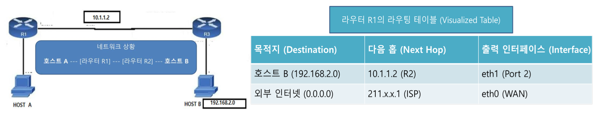
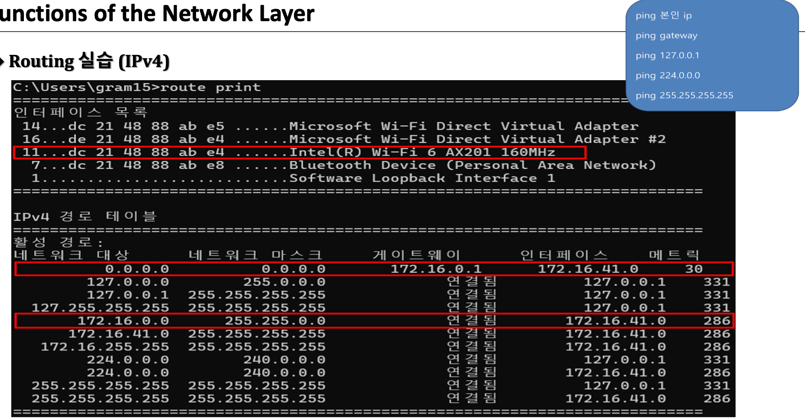
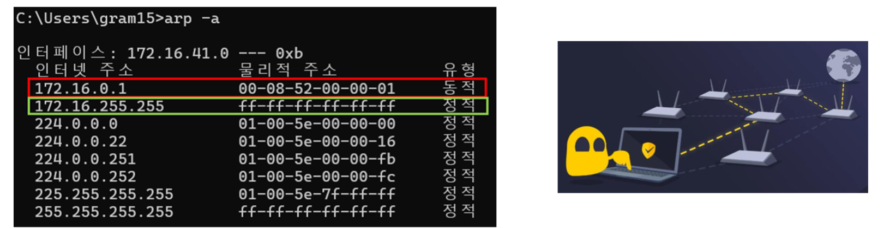
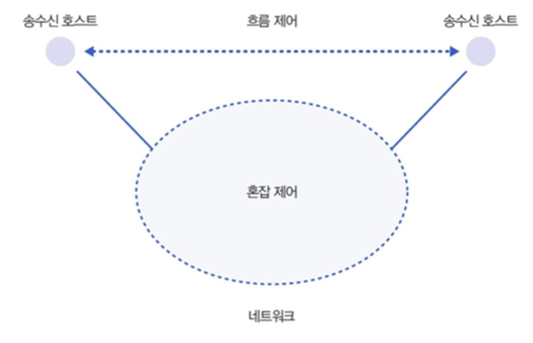
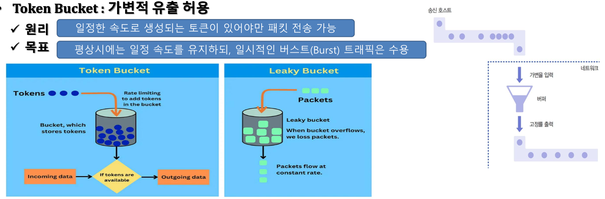
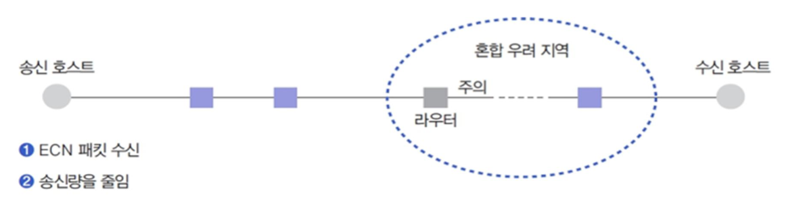

# Computer Network - Chapter 05 (Part 2). Internet Layer — 라우팅 테이블·실습과 혼잡 제어

> 한양대학교 공학대학원 컴퓨터공학 - Computer Network\
> 원본: `ch05. Internet Layer.pdf` (전체 27쪽 중 후반부)\
> 학습 범위: **p.10 ~ p.27 — Routing Table · Routing 실습(`route print`, `ping`, `arp`) · Routing Information Processing · 2. Congestion Control · Review(Q1~Q5)**\
> 이전 노트: [Chapter 5 (Part 1). Internet Layer (p.1 ~ p.9)](./05-internet-layer.md) · [Chapter 4. Network Access Layer](./04-network-access-layer.md)
>
> 💡 앞선 [05-internet-layer.md](./05-internet-layer.md)가 중간고사 범위(p.1 ~ p.9)를 다루었다면, 이 문서는 중간고사 이후 진도인 **p.10부터 끝(p.27)까지** 를 빠짐없이 정리한 후반부 노트다. 특히 p.3 교수님 메모(**"기말은 수식을 증명할 수 있어야 한다"**)에 대비하여 p.21 **토큰 버킷 최대 버스트 시간($S$) 공식 유도 및 계산 과정** 을 상세히 수록했다.

------------------------------------------------------------------------

## 📌 목차

- [1. 후반부(p.10 ~ p.27) 전체 흐름](#_1-후반부-p-10-p-27-전체-흐름)
- [2. Routing Table — 최적 경로를 찾는 이정표 (p.10)](#_2-routing-table-최적-경로를-찾는-이정표-p-10)
- [3. Routing 실습 (1) — IPv4 경로 테이블과 route print (p.11)](#_3-routing-실습-1-ipv4-경로-테이블과-route-print-p-11)
- [4. Routing 실습 (2) — ping과 네트워크 주소 분석 (p.12)](#_4-routing-실습-2-ping과-네트워크-주소-분석-p-12)
- [5. Routing 실습 (3) — arp -a와 MAC 주소 구조 (p.13 ~ p.14)](#_5-routing-실습-3-arp-a와-mac-주소-구조-p-13-p-14)
- [6. Routing Information Processing — 경로 결정 4방식 (p.15)](#_6-routing-information-processing-경로-결정-4방식-p-15)
- [7. Congestion Control과 Flow Control 비교 (p.16 ~ p.17)](#_7-congestion-control과-flow-control-비교-p-16-p-17)
- [8. Traffic Shaping — 리키 버킷 vs 토큰 버킷 (p.18 ~ p.20)](#_8-traffic-shaping-리키-버킷-vs-토큰-버킷-p-18-p-20)
- [9. Token Bucket 수식 증명과 최대 버스트 시간 계산 (p.21) ⭐](#_9-token-bucket-수식-증명과-최대-버스트-시간-계산-p-21)
- [10. Congestion Elimination & Avoidance — Rerouting · ECN (p.22 ~ p.23)](#_10-congestion-elimination-avoidance-rerouting-ecn-p-22-p-23)
- [11. 핵심 요약 트리 및 헷갈리기 쉬운 포인트](#_11-핵심-요약-트리-및-헷갈리기-쉬운-포인트)
- [12. 주요 용어 정리 (Key Terminology)](#_12-주요-용어-정리-key-terminology)
- [13. 강의자료 Review (p.24 ~ p.26) 및 실전 예상문제 (자기점검)](#_13-강의자료-review-p-24-p-26-및-실전-예상문제-자기점검)

------------------------------------------------------------------------

## 1. 후반부 (p.10 ~ p.27) 전체 흐름

```text
Chapter 5. Internet Layer (Part 2: p.10 ~ p.27)
├── 1. Functions of the Network Layer (후반부: p.10 ~ p.15)
│   ├── Routing Table (p.10)              : 정의 · 필수 정보(Destination, Next Hop) · 이정표 역할
│   ├── Routing 실습 (p.11 ~ p.14)
│   │   ├── route print (p.11)            : 인터페이스 목록 · 기본 게이트웨이(0.0.0.0) · On-link
│   │   ├── ping 실습 (p.12)              : 내 IP · 게이트웨이 · 루프백 · 멀티캐스트 · 브로드캐스트
│   │   └── arp -a 실습 (p.13 ~ p.14)     : IP↔MAC 매칭(동적/정적) · 옆 학우 MAC 찾기 · OUI(48비트)
│   └── Routing Information Processing (p.15)
│       └── Source / Distributed / Centralized(RCC) / Hierarchical Routing
├── 2. Congestion Control (p.16 ~ p.23)
│   ├── 개념 및 비교 (p.16)               : Flow Control(1:1, 수신 측) vs Congestion Control(망 전체)
│   ├── 혼잡의 4대 원인 (p.17)            : 과도한 트래픽 · 재전송 악순환 · 패킷 폐기 · 알고리즘 영향
│   ├── Traffic Shaping (p.18 ~ p.21)
│   │   ├── 성형 전(Bursty) vs 성형 후(Smooth) 비교 (p.18)
│   │   ├── Leaky Bucket(고정 유출) vs Token Bucket(버스트 허용) (p.19 ~ p.20)
│   │   └── Token Bucket 수식 모델 (p.21) : S = b / (M - r) 유도 및 스트리밍 예제 계산 ⭐
│   └── 혼잡 제거 및 회피 (p.22 ~ p.23)   : Rerouting · Resource Negotiation · ECN(Implicit vs Explicit)
└── 3. Review (p.24 ~ p.26)               : 핵심 복습 문제 Q1 ~ Q5
```

### 🎯 이 파트의 핵심 질문

1. 라우터와 내 PC는 패킷을 받았을 때 **어느 인터페이스의 어느 다음 장비(Next Hop)** 로 내보낼지 어떻게 즉시 결정하는가?
2. 같은 서브넷 안의 통신(`On-link` + `ARP`)과 외부 네트워크로 나가는 통신(`Default Gateway`)은 경로 테이블에서 어떻게 구분되는가?
3. 네트워크 전체가 막히는 **혼잡(Congestion)** 을 예방하기 위해 트래픽 모양을 어떻게 다듬고(**Traffic Shaping**), 버스트가 허용되는 최대 시간($S$)은 어떻게 수식으로 증명하는가?

------------------------------------------------------------------------

## 2. Routing Table — 최적 경로를 찾는 이정표 (p.10)

### 2.1 라우팅 테이블의 정의·필수 정보·역할 (p.10)

| 항목 | 슬라이드 원문 (p.10) | 핵심 해설 **[보충]** |
|---|---|---|
| **정의** | 패킷 전송 시 **최적 경로를 신속히 찾기 위한 핵심 데이터베이스** | 라우터(및 호스트) 내부 메모리에 유지되는 경로 조견표 |
| **필수 정보 1: Destination** | 최종 도달해야 할 **네트워크 또는 호스트 주소** | 패킷 헤더의 목적지 IP 주소와 대조하는 기준 키(Key) |
| **필수 정보 2: Next Hop** | 목적지로 가기 위해 거쳐야 할 **바로 다음의 라우터 주소** | 라우터는 전체 경로를 다 들고 있지 않고 **다음 징검다리(Next Hop)** 만 지정함 |
| **역할** | **패킷 입력을 출력 경로로 연결하는 이정표** | 입력 포트로 들어온 패킷을 어느 출력 인터페이스(Port)로 내보낼지 결정 |

> 💡 **[보충] 왜 전체 경로가 아니라 `Next Hop`만 저장할까?**
> 인터넷에는 수십만 개의 라우터가 존재한다. 만약 모든 라우터가 출발지부터 목적지까지의 전체 경로를 일일이 저장한다면 테이블 크기가 폭발하고, 중간 링크 하나만 끊겨도 전 세계 라우터가 경로를 다시 짜야 한다. 대신 각 라우터가 **"이 목적지로 가려면 다음 사거리(Next Hop) 어디로 가라"** 라는 이정표만 들고 있으면(Hop-by-Hop Forwarding), 테이블이 간결해지고 장애 발생 시 주변 라우터만 이정표를 고치면 된다.

### 2.2 라우터 R1의 라우팅 테이블 시각화 분석 (p.10)



```text
[네트워크 상황 (p.10 왼쪽 그림)]
  HOST A ─── [라우터 R1] ───(10.1.1.2)─── [라우터 R2/R3] ─── HOST B (192.168.2.0)
                 │
                 └─── (eth0 / WAN: 211.x.x.1) ───▶ 외부 인터넷 (ISP)
```

**라우터 R1의 라우팅 테이블 (Visualized Table, p.10 오른쪽 표)**

| 목적지 (Destination) | 다음 홉 (Next Hop) | 출력 인터페이스 (Interface) | 동작 의미 **[보충]** |
|---|---|---|---|
| **호스트 B (`192.168.2.0`)** | `10.1.1.2` (R2) | `eth1` (Port 2) | 목적지가 `192.168.2.x` 대역이면 `eth1` 포트를 통해 이웃 라우터 R2(`10.1.1.2`)로 전달 |
| **외부 인터넷 (`0.0.0.0`)** | `211.x.x.1` (ISP) | `eth0` (WAN) | 테이블에 명시되지 않은 **모든 외부 목적지(Default Route)** 는 WAN 포트(`eth0`)를 통해 ISP 라우터로 전달 |

> 💡 **[보충] `0.0.0.0` (Default Route, 기본 경로)의 의미**:
> 라우터 R1이 전 세계 모든 웹사이트의 IP 대역을 라우팅 테이블에 다 적어둘 수는 없다. 따라서 아는 내부 목적지(`192.168.2.0`)는 구체적으로 적고, **"나머지 모르는 모든 목적지(`0.0.0.0`)"** 는 상위 인터넷 서비스 제공자(ISP, `211.x.x.1`)에게 넘기도록 설정한다.

------------------------------------------------------------------------

## 3. Routing 실습 (1) — IPv4 경로 테이블과 `route print` (p.11)

라우터 장비뿐만 아니라 우리가 쓰는 **일반 PC(호스트)** 도 내부에 자체 라우팅 테이블을 가지고 있다. Windows 명령 프롬프트에서 `route print` 명령을 실행하면 내 PC의 인터페이스 목록과 IPv4 경로 테이블을 확인할 수 있다.



### 3.1 인터페이스 목록 분석 (p.11 상단 빨간 박스)

```text
인터페이스 목록
 14...dc 21 48 88 ab e5 ......Microsoft Wi-Fi Direct Virtual Adapter
 16...de 21 48 88 ab e4 ......Microsoft Wi-Fi Direct Virtual Adapter #2
┌─────────────────────────────────────────────────────────────────────────┐
│11...dc 21 48 88 ab e4 ......Intel(R) Wi-Fi 6 AX201 160MHz               │ ◀ [빨간 박스 1]
└─────────────────────────────────────────────────────────────────────────┘
  7...dc 21 48 88 ab e8 ......Bluetooth Device (Personal Area Network)
  1...........................Software Loopback Interface 1
```

- **빨간 박스 1 (`11...dc 21 48 88 ab e4 ... Intel(R) Wi-Fi 6 AX201 160MHz`)**:
  - 현재 PC가 무선 공유기(AP)와 실제로 통신하는 **주 무선랜 네트워크 어댑터(NIC)** 다.
  - 가운데 16진수 6쌍(`dc 21 48 88 ab e4`)은 이 무선랜 카드의 **물리적 주소(MAC 주소, 48비트)** 이다 (뒤의 p.14 MAC 주소 분석과 이어진다).

### 3.2 IPv4 경로 테이블 핵심 행(Row) 해부 (p.11 하단 빨간 박스 2개)

| 네트워크 대상 (Destination) | 네트워크 마스크 (Netmask) | 게이트웨이 (Next Hop) | 인터페이스 (내 IP) | 메트릭 (Metric) | 구분 및 핵심 의미 (p.11) |
|---|---|---|---|---|---|
| **`0.0.0.0`** *(빨간 박스 2)* | **`0.0.0.0`** | **`172.16.0.1`** | **`172.16.41.0`** | **`30`** | **기본 경로 (Default Route)**: 외부 인터넷으로 나가는 모든 패킷은 공유기/게이트웨이(`172.16.0.1`)로 보냄 |
| `127.0.0.0` | `255.0.0.0` | `연결됨` | `127.0.0.1` | `331` | **루프백(Loopback)**: 내 컴퓨터 자신에게 되돌아오는 내부 테스트 경로 |
| **`172.16.0.0`** *(빨간 박스 3)* | **`255.255.0.0`** | **`연결됨` (On-link)** | **`172.16.41.0`** | **`286`** | **로컬 서브넷 경로**: 같은 동네(`172.16.x.x`) 안의 호스트와는 게이트웨이를 거치지 않고 **직접(연결됨)** 통신 |
| `172.16.41.0` | `255.255.255.255` | `연결됨` | `172.16.41.0` | `286` | **호스트 자체 경로**: 내 IP 주소(`172.16.41.0`) 그 자체를 가리키는 경로 |
| `172.16.255.255` | `255.255.255.255` | `연결됨` | `172.16.41.0` | `286` | **서브넷 브로드캐스트**: `172.16.0.0/16` 서브넷 전체에 방송하는 주소 |
| `224.0.0.0` | `240.0.0.0` | `연결됨` | `172.16.41.0` | `286` | **멀티캐스트(Multicast, D클래스)**: 특정 그룹에 속한 호스트들에게 동시 전송 |
| `255.255.255.255` | `255.255.255.255` | `연결됨` | `172.16.41.0` | `286` | **제한된 브로드캐스트(Limited Broadcast)**: 현재 연결된 로컬 링크 전체에 방송 |

> 💡 **[보충] 왜 게이트웨이 칸에 IP 대신 `연결됨`(On-link)이라고 적혀 있을까?**
> 목적지가 `172.16.x.x`처럼 나와 **같은 서브넷(같은 스위치/와이파이 대역)** 에 있을 때는 L3 라우터(게이트웨이)의 도움을 받을 필요가 없다. 바로 **ARP** 로 상대방의 MAC 주소를 알아내어 L2 스위치로 직접 프레임을 던지면 되기 때문에, 다음 라우터(Next Hop)가 필요 없다는 뜻에서 **`연결됨` (On-link)** 으로 표시된다.
>
> 💡 **[보충] 메트릭(Metric)이란?**
> 해당 경로를 사용할 때 드는 **비용(Cost)** 이다. 숫자가 **작을수록 우선순위가 높고 빠른 경로** 를 뜻한다(위 표에서 기본 게이트웨이 경로 메트릭은 `30`으로 가장 낮다).

------------------------------------------------------------------------

## 4. Routing 실습 (2) — `ping`과 네트워크 주소 분석 (p.12)

### 4.1 실습 환경의 3대 핵심 주소 항목 (p.12 표)

| 주소 항목 | 의미 (p.12) | 실제 값 (p.12) | 기술적 보충 해설 **[보충]** |
|---|---|---|---|
| **내 IP 주소** | 현재 내 컴퓨터의 식별 번호 | `172.16.41.0` | `172.16.0.0/16` 대역 안에서 호스트 부분이 `.41.0`으로 할당된 유효한 호스트 IP |
| **기본 게이트웨이** | 외부 인터넷으로 나가는 문 | `172.16.0.1` | 내 서브넷에서 외부 망으로 패킷을 라우팅해 주는 첫 번째 라우터(Next Hop)의 IP |
| **네트워크 마스크** | 내가 속한 동네의 크기 | `255.255.0.0` (B 클래스: 6만 대 이상) | 앞 16비트가 네트워크 ID(`172.16`), 뒤 16비트가 호스트 ID ($2^{16} - 2 = 65,534$대 수용) |

> ⚠️ **[보충] 왜 `172.16.41.0`처럼 끝자리가 `.0`인데 호스트 IP로 쓸 수 있을까?**
> 흔히 C 클래스(`/24`, 마스크 `255.255.255.0`)에서는 끝자리 `.0`이 네트워크 주소라 호스트에 쓸 수 없다. 하지만 여기서는 네트워크 마스크가 **`255.255.0.0` (`/16`, B 클래스)** 이다! 따라서 네트워크 주소는 `172.16.0.0` 하나뿐이고, 브로드캐스트 주소는 `172.16.255.255`이다. 그 사이에 있는 `172.16.41.0`은 호스트 비트가 `00101001 00000000`으로 모두 0이 아니므로 **완벽히 정상적인 일반 호스트 IP** 다.

### 4.2 5가지 `ping` 명령어의 역할과 진단 단계 (p.11 ~ p.12 파란 박스)

슬라이드 p.11 우측 상단과 p.12 좌측 하단에 제시된 5가지 `ping` 명령어는 **가까운 곳에서 먼 곳 순서로 네트워크 계층을 점검** 하는 표준 진단 절차다.

```text
[나 자신(SW)] ──▶ [내 랜카드(NIC)] ──▶ [게이트웨이(Router)] ──▶ [특정 그룹 / 전체 동네]
ping 127.0.0.1    ping 본인 ip         ping gateway             ping 224.0.0.0 / 255.255.255.255
```

| 실행 명령어 (p.12) | 대상 주소 (예시) | 점검 목적 및 의미 **[보충]** |
|---|---|---|
| **`ping 본인 ip`** | `ping 172.16.41.0` | 내 컴퓨터의 **무선랜 카드(NIC) 하드웨어 및 드라이버** 가 정상 작동하는지 확인 |
| **`ping gateway`** | `ping 172.16.0.1` | 내 PC에서 **기본 게이트웨이(라우터/공유기)** 까지 로컬 연결(Wi-Fi/스위치)이 정상인지 확인 |
| **`ping 127.0.0.1`** | `ping 127.0.0.1` | 물리적 랜카드를 거치지 않고 운영체제 내부의 **TCP/IP 프로토콜 스택(소프트웨어)** 이 정상인지 확인 (Loopback 테스트) |
| **`ping 224.0.0.0`** | `ping 224.0.0.0` | **멀티캐스트(Multicast)** 그룹 기본 주소로의 패킷 송신 테스트 |
| **`ping 255.255.255.255`** | `ping 255.255.255.255` | 현재 서브넷의 모든 호스트에게 보내는 **제한된 브로드캐스트(Limited Broadcast)** 테스트 |

------------------------------------------------------------------------

## 5. Routing 실습 (3) — `arp -a`와 MAC 주소 구조 (p.13 ~ p.14)

### 5.1 `arp -a` 명령을 통한 IP ↔ MAC 주소 매칭 확인 (p.13)

네트워크 계층(L3)에서 IP 주소로 다음 홉(Next Hop)이나 같은 동네의 목적지를 결정했더라도, 실제로 스위치나 무선랜(L2, 데이터 링크 계층)을 통해 프레임을 전달하려면 반드시 상대방의 **물리적 주소(MAC 주소)** 를 알아야 한다. 이때 **IP 주소를 MAC 주소로 변환해 주는 프로토콜이 ARP(Address Resolution Protocol)** 이며, `arp -a` 명령으로 PC에 캐싱된 **ARP 테이블** 을 조회한다.



**`arp -a` 출력 테이블 및 슬라이드 요약표 (p.13)**

| 항목 (p.13) | 의미 (p.13) | 실제 주소 매칭 (p.13) | 유형 (p.13 화면) | 핵심 해설 **[보충]** |
|---|---|---|---|---|
| **게이트웨이** *(빨간 박스)* | **외부로 나가는 통로의 MAC** | `172.16.0.1` $\rightarrow$ `00-08-52-00-00-01` | **동적 (Dynamic)** | 외부와 통신하기 위해 내 PC가 ARP Request를 보내 실시간으로 알아낸 공유기(라우터)의 MAC 주소. 일정 시간 통신이 없으면 캐시에서 지워짐 |
| **브로드캐스트** *(초록 박스 및 하단)* | **전체 공지용 MAC** | `172.16.255.255` $\rightarrow$ `ff-ff-ff-ff-ff-ff`<br>`255.255.255.255` $\rightarrow$ `ff-ff-ff-ff-ff-ff` | **정적 (Static)** | 모든 비트가 1인 MAC(`ff-ff-ff-ff-ff-ff`)은 LAN 안의 모든 장비가 수신하는 브로드캐스트 주소이므로 ARP 질문 없이 고정 매핑됨 |
| **멀티캐스트** | **특정 그룹 전송용 MAC** | `224.0.0.x` $\rightarrow$ `01-00-5e-...` | **정적 (Static)** | IPv4 멀티캐스트 주소(`224.0.0.0`~)는 규칙에 따라 항상 `01-00-5e`로 시작하는 전용 MAC 주소로 자동 매핑됨 |

### 5.2 옆 학우 PC의 MAC 주소 알아내기 실습 (p.14 상단)

슬라이드 p.14는 같은 강의실(같은 서브넷)에 있는 옆 학우의 IP 주소만 알고 있을 때 그 학우의 MAC 주소를 찾아내는 3단계 과정을 보여 준다.

```text
[Step 1] 1. ping [옆 학우 ip]     # 성공 혹은 Request Timed Out
            │  (내 PC가 ICMP Echo를 보내기 전에 먼저 ARP Request 브로드캐스트를 전송함!)
            ▼
[Step 2] 2. arp -a                # 실행 (방금 ARP Reply로 받아온 캐시 테이블 조회)
            │
            ▼
[Step 3] 3. result : 학우 ip의 MAC 주소 확인 완료!
```

> 💡 **[보충] 왜 `ping` 결과가 `Request Timed Out`으로 실패해도 `arp -a`에는 학우의 MAC 주소가 나타날까? (시험 빈출 원리)**
> 1. 내 PC가 `ping [옆 학우 IP]`(L3 ICMP 패킷)를 보내려면, 먼저 L2 프레임 헤더에 넣을 **옆 학우의 MAC 주소** 가 필요하다.
> 2. 그래서 ICMP 패킷을 보내기 **직전에** 먼저 **ARP Request("이 IP 쓰시는 분 MAC 알려주세요")** 를 브로드캐스트로 보낸다.
> 3. 옆 학우의 Windows 방화벽은 보통 보안상 `ping`(ICMP Echo Reply, L3) 응답은 막아 두지만, 같은 네트워크 통신의 필수 전제인 **ARP Reply(L2 응답)는 막지 않는다**.
> 4. 따라서 화면에는 `Request Timed Out`(ICMP 응답 없음)이 뜨더라도, 이미 그 앞 단계에서 ARP 응답을 받아왔기 때문에 `arp -a`를 치면 **옆 학우의 MAC 주소가 동적(Dynamic) 항목으로 선명하게 찍혀 있다!**

### 5.3 48비트 MAC 주소의 구조 해부 (p.14 하단)

```text
MAC 주소 :  DC - 21 - 48  -  88 - AB - E5   (총 48비트 = 6바이트 = 16진수 12자리)
           └──────┬──────┘  └──────┬──────┘
            앞의 6자리 (24비트)    뒤의 6자리 (24비트)
            OUI (제조사 코드)      시리얼 번호 (제품 고유 번호)
```

| 구분 | 자리수 · 크기 | 명칭 및 부여 주체 (p.14) | 역할 **[보충]** |
|---|---|---|---|
| **앞의 6자리** (`DC-21-48`) | 16진수 6자리 (24비트, 3바이트) | **OUI (Organizationally Unique Identifier)**: **IEEE(전기전자공학자협회)** 가 제조사에 부여한 고유 코드 | 랜카드 제조사 식별 (예: `DC-21-48`은 Intel Corporation의 코드) |
| **뒤의 6자리** (`88-AB-E5`) | 16진수 6자리 (24비트, 3바이트) | **제조사가 제품에 부여한 시리얼 번호** (NIC Specific) | 동일 제조사 내에서 각 랜카드마다 겹치지 않게 일련번호 부여 $\rightarrow$ 전 세계 유일성 확보 |

------------------------------------------------------------------------

## 6. Routing Information Processing — 경로 결정 4방식 (p.15)

라우팅 경로 정보를 **누가 수집하고 어디서 계산·결정하는가** 에 따라 네 가지 방식으로 분류한다.

| 분류 (p.15) | 슬라이드 정의 (p.15) | 경로 결정 주체 | 장점 **[보충]** | 단점 및 한계 **[보충]** |
|---|---|---|---|---|
| **Source Routing** (소스 라우팅) | **송신 호스트가 목적지까지의 경로를 직접 결정** | **송신 호스트** (패킷 헤더에 거쳐 갈 라우터 목록을 모두 적어 보냄) | 중간 라우터의 계산 부담이 적고, 송신자가 원하는 특정 경로 강제 가능 | 송신 호스트가 전체 망 구조를 다 알아야 하며, 패킷 헤더가 길어지고 대규모 망에 부적합 |
| **Distributed Routing** (분산 라우팅) | **경로상의 각 라우터가 협력하여 경로 선택 참여** | **모든 개별 라우터** (이웃과 정보를 주고받으며 각자 계산) | 단일 장애점(SPOF)이 없어 **신뢰성·생존성 우수**, 변화에 즉각 대응 | 라우터 간 제어 패킷 교환 오버헤드 발생, 일시적 경로 불일치(루프) 가능 |
| **Centralized Routing** (중앙 집중 라우팅) | **특별한 관리 호스트(RCC)가 모든 경로 정보 집중 관리** | **RCC** (Routing Control Center, 중앙 제어 센터) | 개별 라우터 부담 감소, 전역적(Global)으로 일관된 최적 경로 계산 가능 | **RCC 고장 시 전체 라우팅 마비**, RCC 주변으로 상태 보고 트래픽 집중(병목) |
| **Hierarchical Routing** (계층 라우팅) | **분산 및 중앙 방식의 조합으로 전체 네트워크를 계층화하여 관리** | **영역(Region/AS) 내부 + 영역 간 계층 분담** | **대규모 네트워크(인터넷)에서 라우팅 테이블 크기를 획기적으로 축소**, 확장성 최고 | 계층 구조 설계가 필요하며 완전 최단 경로보다 약간 우회할 수 있음 |

```text
[Source Routing]        송신 호스트가 [A → R1 → R3 → B] 전체 경로를 패킷에 직접 적어 보냄
[Distributed Routing]   R1 ⇄ R2 ⇄ R3 각 라우터가 서로 정보를 나누며 자율적으로 다음 홉 결정
[Centralized Routing]   중앙 관리 호스트(RCC) ──(경로 하달)──▶ R1, R2, R3
[Hierarchical Routing]  전체 망을 구역(Region/AS)으로 나누어 [구역 내부(중앙/분산) + 구역 간 연결]로 계층화
```

> 💡 **[보충] 왜 오늘날 인터넷은 `Hierarchical Routing`(계층 라우팅)을 쓰는가?**
> 우편 배달을 생각하면 쉽다. 서울에서 부산 해운대구 우동으로 택배를 보낼 때, 서울 우체국은 해운대구의 골목길 지도를 알 필요가 없다. 단지 **"부산 광역우체국으로 보낸다"** 까지만 알면 되고, 부산에 도착한 뒤에야 해운대 우체국이 세부 번지수를 보고 배달한다. 이처럼 네트워크를 계층(자율 시스템 AS $\rightarrow$ 내부 서브넷)으로 나누어 관리하는 것이 **Hierarchical Routing** 이다.

------------------------------------------------------------------------

## 7. Congestion Control과 Flow Control 비교 (p.16 ~ p.17)

여기서부터는 5장의 두 번째 대주제인 **`2. Congestion Control` (혼잡 제어)** 이다.

### 7.1 Congestion과 Congestion Control의 정의 (p.16 상단)

| 용어 | 슬라이드 정의 (p.16) | 비유 및 부연 **[보충]** |
|---|---|---|
| **Congestion (혼잡)** | **네트워크 성능이 급격히 저하되는 과부하 상태** | 명절 고속도로에 차가 한꺼번에 몰려 모든 차가 가다 서다를 반복하며 정체되는 현상 |
| **Congestion Control (혼잡 제어)** | **네트워크 전체의 전송 능력을 관리하여 혼잡 문제를 해결** | 고속도로 진입 램프 신호등으로 진입 차량 수를 조절하거나 우회도로로 분산시키는 교통 통제 |

### 7.2 Flow Control vs Congestion Control 완벽 비교 (p.16 하단 ⭐)

> 앞선 중간고사 서술형 출제 메모뿐 아니라 p.25 Review **Q4** 에도 그대로 출제된 **가장 중요한 비교 주제** 다.



| 비교 기준 | Flow Control (흐름 제어) | Congestion Control (혼잡 제어) |
|---|---|---|
| **슬라이드 정의 (p.16)** | **송수신 호스트 간 1:1 전송 속도 조절** | **호스트와 라우터를 포함한 네트워크 전체(Subnet) 상황 고려** |
| **핵심 고려 대상 (p.16 파란 박스)** | **수신 측의 처리 능력을 고려** | **네트워크의 데이터 수용 능력을 고려** |
| **관여 범위** | 송신 호스트 $\leftrightarrow$ 수신 호스트 (**종단 간 1:1 문제**) | 송신 호스트 + 중간 라우터들 + 링크 (**네트워크 전체 문제**) |
| **발생 원인** | 송신자가 너무 빨리 보내 **수신자의 버퍼가 넘침** | 여러 호스트가 동시에 많이 보내 **중간 라우터 큐·링크가 포화됨** |
| **주로 담당하는 계층 **[보충]**** | 데이터 링크 계층(L2), 전송 계층(L4, TCP 수신 윈도우) | **네트워크 계층(L3)** 및 전송 계층(L4, TCP 혼잡 윈도우) 협동 |

### 7.3 혼잡의 4대 원인 (Causes of Congestion, p.17)

슬라이드 p.17은 네트워크에서 혼잡이 발생하고 한 번 발생한 혼잡이 스스로 눈덩이처럼 커지는 **4가지 원인** 을 제시한다.

| # | 원인 항목 (p.17) | 슬라이드 설명 (p.17) | 왜 혼잡을 악화시키는가? **[보충]** |
|---|---|---|---|
| **1** | **과도한 트래픽** | **네트워크 용량 초과 전송** | 입력되는 패킷 속도가 라우터와 링크의 출력 대역폭을 초과하여 라우터 내부 큐(버퍼)가 빠르게 차오름 |
| **2** | **재전송의 악순환** | **타임아웃 발생 시 패킷 재전송으로 혼잡 심화** | 큐가 꽉 차서 패킷이 지연되거나 버려지면, 송신 측은 타임아웃 후 **같은 패킷을 또 재전송** 하여 이미 막힌 도로에 차를 두 배로 밀어 넣음 |
| **3** | **패킷 폐기** | **순서 뒤바뀜 등으로 인한 패킷 유실이 재전송 유발** | 비연결형 전송 등에서 패킷 순서가 뒤바뀌거나 버퍼 오버플로우로 패킷이 폐기되면, 이를 복구하려는 재전송 트래픽이 추가로 발생함 |
| **4** | **알고리즘 영향** | **부적절한 라우팅 경로 선택이 특정 구간 혼잡 유발** | 라우팅 알고리즘이 트래픽을 골고루 분산하지 못하고 특정 라우터·링크로만 경로를 몰아주면 해당 구간에 국소적 병목이 발생함 |

```text
[재전송의 악순환 (Congestion Collapse 피드백 루프)]
과도한 트래픽 유입 ──▶ 라우터 버퍼 포화 (지연 급증 · 패킷 폐기)
       ▲                                    │
       │                                    ▼
네트워크 부하 가중 ◀── 송신 호스트가 패킷 재전송 ◀── ACK 미수신으로 타임아웃(Timeout) 발생
```

------------------------------------------------------------------------

## 8. Traffic Shaping — 리키 버킷 vs 토큰 버킷 (p.18 ~ p.20)

혼잡이 터진 뒤에 수습하는 것보다, 애초에 호스트가 네트워크로 패킷을 내보낼 때 **일정하고 예측 가능한 속도로 다듬어서 내보내면** 혼잡을 미리 예방할 수 있다. 이 기법을 **트래픽 성형(Traffic Shaping)** 이라고 한다.

### 8.1 Traffic Shaping의 3대 핵심 원리 (p.18 상단)

1. **버스트(Burst) 제어**: 특정 시간대에 갑자기 집중되는 트래픽 현상(Bursty Traffic) 완화
2. **전송률 규격화**: 예측 가능한 일정한 전송률로 패킷 송신
3. **사전 협상**: 네트워크 유입 패킷 분포를 미리 약속(SLA/트래픽 계약)하여 혼잡 방지

### 8.2 성형 전(Unshaped) vs 성형 후(Shaped) 비교표 (p.18 하단)

| 구분 | 성형 전 (Unshaped) | 성형 후 (Shaped) |
|---|---|---|
| **트래픽 형태** | **울퉁불퉁함 (Bursty)** | **매끄러움 (Smooth/Flat)** |
| **예측 가능성** | **매우 낮음** (돌발 상황 발생) | **매우 높음** (대역폭 계산 가능) |
| **네트워크 부하** | **특정 순간 임계치 초과** | **평균 부하 유지** |

```text
전송률 ▲ [성형 전: Unshaped (Bursty)]          전송률 ▲ [성형 후: Shaped (Smooth/Flat)]
       │    █       █                                │
  임계치├───███─────███─────────── (순간 초과!)   임계치├───────────────────────────
       │   ███     ████                              │  ████████████████████████ (평균 부하 유지)
       └────────────────────────▶ 시간                └────────────────────────▶ 시간
```

### 8.3 Traffic Shaping 두 가지 핵심 알고리즘 (p.19 ~ p.20 ⭐)



#### (1) Leaky Bucket (리키 버킷): 일정한 유출량 유지 (p.19)
- **원리**: 유입되는 패킷 양과 상관없이 **바닥의 구멍을 통해 일정한 속도로만 패킷을 내보냄** (구멍 난 양동이에 물을 아무리 한꺼번에 부어도 바닥 구멍으로는 일정한 물줄기만 떨어지는 원리; 양동이가 넘치면(`When bucket overflows`) 패킷은 손실됨)
- **목표**: **트래픽의 가변성을 완전히 제거** 하여 네트워크 부하를 평탄화

#### (2) Token Bucket (토큰 버킷): 가변적 유출 허용 (p.19)
- **원리**: 버킷에 패킷 대신 **일정한 속도로 생성되는 토큰(Token, 전송 티켓)** 을 모아 두며, **버킷에 토큰이 있어야만 패킷 전송 가능**
- **목표**: **평상시에는 일정 속도를 유지하되, 일시적인 버스트(Burst) 트래픽은 수용** (한동안 데이터를 안 보내서 버킷에 토큰이 가득 모여 있으면, 갑자기 큰 데이터가 들어와도 모아 둔 토큰을 한꺼번에 쓰면서 빠르게 내보낼 수 있음!)

#### (3) 리키 버킷(Leaky Bucket) vs 토큰 버킷(Token Bucket) 비교표 (p.20)

| 구분 | 리키 버킷 (Leaky Bucket) | 토큰 버킷 (Token Bucket) |
|---|---|---|
| **핵심 비유** | **구멍 난 양동이** (패킷을 담음) | **토큰(티켓) 보관함** (토큰을 담음) |
| **출력 속도** | **무조건 고정 (Fixed)** | **가변적 (Burst 수용 가능)** |
| **패킷 처리** | 버킷이 **넘치면 즉시 폐기** | **토큰이 없으면 대기 또는 폐기** (토큰이 모여 있으면 즉시 고속 전송) |
| **적합한 서비스** | **일정한 대역폭이 필요한 실시간 전송** (일정 비트레이트 음성/오디오 등) | **불규칙하게 데이터가 터져 나오는 웹 통신** (웹 브라우징, 스트리밍 초기 버퍼링 등) |

> 💡 **[보충] 두 알고리즘을 절대 헷갈리지 않는 핵심 포인트 (p.26 Review Q5 직결)**:
> - **Leaky Bucket** 은 **"절대 과속 금지"** 다. 앞에 차가 하나도 없었어도 무조건 정해진 고정 속도로만 내보낸다.
> - **Token Bucket** 은 **"평소에 마일리지(토큰)를 저축했다가 급할 때 일시적 과속(Burst) 허용"** 이다.

------------------------------------------------------------------------

## 9. Token Bucket 수식 증명과 최대 버스트 시간 계산 (p.21) ⭐

> ⚠️ **기말고사 핵심 대비 (p.3 메모 "기말은 수식을 증명할 수 있어야 한다" + p.21 계산 시나리오)**:
> 토큰 버킷 모델에서 버킷에 토큰이 가득 차 있을 때 최대 속도($M$)로 연속 전송할 수 있는 **최대 버스트 전송 시간($S$)** 의 공식 유도 과정과 예제 풀이를 완벽히 숙지해야 한다.

### 9.1 변수 정의 (p.21 상단)

| 기호 | 영문 명칭 (p.21) | 한글 정의 (p.21) | 스트리밍 비유 (p.21 표) | 단위 (예시) |
|---|---|---|---|---|
| **$r$** | Token Arrival Rate | **초당 생성되는 토큰 생성률** | 영화의 평균 재생 속도 (Bitrate) | $\text{Mbps}$ (또는 $\text{bytes/sec}$) |
| **$b$** | Burst Size / Capacity | **버킷에 담을 수 있는 최대 토큰 수** | 초기 버퍼링 데이터양 (버퍼 크기) | $\text{Mb}$ (또는 $\text{bytes}$) |
| **$M$** | Peak Rate | **네트워크가 허용하는 최대 전송 속도** | 내 통신사의 최대 다운로드 속도 | $\text{Mbps}$ (단, $M > r$) |
| **$S$** | Burst Time | **최대 버스트 전송 시간** | 최대 속도로 데이터를 당겨오는 시간 | $\text{sec}$ (초) |

### 9.2 최대 버스트 전송 시간 $S = \frac{b}{M - r}$ 수식 증명 (유도 과정)

**[증명 단계]**

1. **초기 상태 가정**: 버킷에 최대 용량만큼 토큰이 가득 차 있어 현재 보유한 토큰의 양이 **$b$** 라고 하자.
2. **버스트 구간($S$초 동안)의 총 가용 토큰량(전송 가능량)**:
   - 처음에 버킷에 들어 있던 토큰 **$b$** 에 더해, 버스트 전송이 진행되는 **$S$초 동안에도 초당 $r$의 속도로 새로운 토큰이 계속 생성** 되어 들어온다.
   - 따라서 $S$초 동안 사용할 수 있는 총 토큰(데이터) 양은 다음과 같다:
     $$\text{총 가용 토큰량} = b + r \cdot S$$
3. **버스트 구간($S$초 동안)의 실제 최대 전송량**:
   - 이 $S$초 동안 송신 호스트는 네트워크가 허용하는 최대 전송 속도 **$M$** 으로 데이터를 쉼 없이 내보낸다.
   - 따라서 $S$초 동안 실제로 빠져나간 총 데이터양은 다음과 같다:
     $$\text{총 출력 데이터양} = M \cdot S$$
4. **방정식 수립 및 $S$에 대한 정리**:
   - 버킷의 토큰이 완전히 바닥나는 순간이 최대 버스트 전송 시간 $S$이므로, 두 양이 같아지는 시점을 구한다:
     $$b + r \cdot S = M \cdot S$$
   - 우변으로 $r \cdot S$를 이항하여 $S$로 묶는다:
     $$b = M \cdot S - r \cdot S = (M - r) \cdot S$$
   - 양변을 $(M - r)$로 나누면($M > r$), 최종 공식을 얻는다:
     $$S = \frac{b}{M - r}$$

> 💡 **[보충] 직관적 이해 (순수 소모 속도)**:
> 최대 속도 $M$으로 토큰을 쓰면서 동시에 $r$만큼 토큰이 보충되므로, 버킷에 저장된 토큰이 줄어드는 **순수 감소 속도(Net Drain Rate)** 는 초당 **$(M - r)$** 이다. 초기 저축량 $b$를 초당 순수 감소량 $(M - r)$로 나누면 바닥날 때까지 걸리는 시간 $S = \frac{b}{M - r}$가 바로 나온다!

### 9.3 슬라이드 시나리오 예제 풀이 및 표 완성 (p.21 하단)

> **문제 (p.21 원문)**:
> 영화 화질(Bitrate)은 **$10\text{ Mbps}$**, 네트워크 속도는 **$50\text{ Mbps}$**, 버퍼(buffer)는 **$200\text{ Mb}$** 라 한다면 토큰 버킷 모델을 이용하여 **최대 버스트 전송 시간($S$)** 을 구하라.

**[단계별 풀이]**

1. 주어진 값을 각 변수에 대입한다 (단위가 모두 $\text{Mb}$, $\text{Mbps}$로 통일되어 있는지 확인):
   - 토큰 생성률 $r = 10\text{ Mbps}$
   - 버킷 크기(초기 버퍼) $b = 200\text{ Mb}$
   - 최대 전송 속도 $M = 50\text{ Mbps}$
2. 공식 $S = \frac{b}{M - r}$에 대입한다:
   $$S = \frac{200\text{ Mb}}{50\text{ Mbps} - 10\text{ Mbps}} = \frac{200\text{ Mb}}{40\text{ Mbps}} = 5\text{초 (sec)}$$
3. **[검산]**: $5$초 동안 최대 속도 $50\text{ Mbps}$로 전송하면 총 $50 \times 5 = 250\text{ Mb}$를 보낸다. 이는 초기 버퍼 $200\text{ Mb}$ + $5$초간 새로 생성된 토큰($10\text{ Mbps} \times 5\text{초} = 50\text{ Mb}$) = $250\text{ Mb}$와 정확히 일치한다! (5초가 지난 뒤부터는 버킷이 비었으므로 토큰 생성 속도인 $r = 10\text{ Mbps}$로 속도가 내려간다.)

**슬라이드 p.21 우측 하단 테이블 완성본**

| 변수 | 스트리밍 (p.21) | 예시 값 (정답 채움) |
|---|---|---|
| **$r$ (Token Rate)** | 영화의 평균 재생 속도 | **$10\text{ Mbps}$** |
| **$b$ (Bucket Size)** | 초기 버퍼링 데이터양 | **$200\text{ Mb}$** |
| **$M$ (Peak Rate)** | 내 통신사의 최대 다운로드 속도 | **$50\text{ Mbps}$** |
| **$S$ (Burst Time)** | 최대 속도로 데이터를 당겨오는 시간 | **$S = \frac{200}{50 - 10} = 5\text{초 (sec)}$** |

------------------------------------------------------------------------

## 10. Congestion Elimination & Avoidance — Rerouting · ECN (p.22 ~ p.23)

### 10.1 혼잡 제거 및 회피 3대 기법 (p.22)

| 기법 (p.22) | 슬라이드 정의 (p.22) | 상세 동작 원리 **[보충]** |
|---|---|---|
| **Rerouting** (재라우팅) | **특정 구간 혼잡 시 해당 지역을 우회하는 가상 회선 설정** | 기존 경로에 혼잡이 발생하면 라우터가 정체 구간을 피해 다른 경로로 우회 회선을 다시 설정함 |
| **Resource Negotiation** (자원 협상) | **가상 회선 연결 단계에서 호스트와 서브넷 간 전송 조건 협의** | 데이터 전송 시작 전에 대역폭·버퍼·최대 전송률 등을 미리 협상하고 자원을 예약하여 과부하를 원천 차단함 |
| **ECN** (`Explicit Congestion Notification`) | **라우터가 송신자에게 혼잡 발생을 직접 알리는 명시적 통지 기능** | 패킷이 버려질 때까지 기다리지 않고, 라우터 큐가 차오르기 시작할 때 미리 헤더에 혼잡 경고 표시(Marking)를 남김 |



```text
[ECN 동작 순서 (p.22 하단 그림)]
  송신 호스트 ──────▶ [라우터] ──▶ ┌───────────────────────────────┐
       ▲                          │   혼잡 우려 지역 (주의!)       │
       │                          │  [라우터] ───(주의)─── [라우터] │ ──▶ 수신 호스트
       │                          └───────┬───────────────────────┘
       └──── ❶ ECN 패킷 수신 ◀────────────┘
             ❷ 송신량을 줄임 (패킷 유실 및 재전송이 터지기 전에 선제 감속!)
```

### 10.2 일반적인 혼잡 제어(Implicit) vs ECN 기반 혼잡 제거(Explicit) 비교표 (p.23 ⭐)

| 구분 | 일반적인 혼잡 제어 (Implicit, 암시적) | ECN 기반 혼잡 제거 (Explicit, 명시적) |
|---|---|---|
| **감지 방법** | **패킷 유실(Loss) 후 타임아웃으로 인지** | **라우터가 직접 헤더에 표시(Marking)** |
| **반응 속도** | **느림** (재전송 발생 후 조치) | **매우 빠름** (유실 전 즉시 대응) |
| **네트워크 부하** | **재전송으로 인해 부하 증가 위험** | **재전송 없이 속도만 조절하여 효율적** |

> 💡 **[보충] 왜 `Implicit`(암시적)보다 `Explicit`(명시적, ECN)이 훨씬 효율적인가?**
> - **암시적(Implicit) 방식**: 라우터가 혼잡해도 아무 말을 안 하다가 버퍼가 넘치면 패킷을 그냥 버린다(Drop). 송신자는 한참 뒤에 타임아웃이 나야 *"아, 응답이 안 오는 걸 보니 어디선가 막혔나 보다"* 하고 눈치챈다. 이미 패킷이 버려졌으므로 **재전송** 을 해야 해서 막힌 네트워크에 부담을 더 준다.
> - **명시적(Explicit, ECN) 방식**: 라우터 버퍼가 꽉 차서 패킷을 버리기 **직전(혼잡 우려 단계)** 에 패킷 헤더의 ECN 비트에 표시(Marking)를 해서 알린다. 패킷 자체는 버려지지 않고 전달되며, 경고를 받은 송신자는 **재전송 없이 즉시 송신 속도만 줄이므로** 네트워크 부하가 늘어나지 않는다!

------------------------------------------------------------------------

## 11. 핵심 요약 트리 및 헷갈리기 쉬운 포인트

```text
Network Layer 후반부 핵심 요약 (p.10 ~ p.26)
├── Routing Table (p.10)
│   ├── 정의: 최적 경로를 신속히 찾기 위한 핵심 데이터베이스 (이정표 역할)
│   └── 필수 정보 2가지: Destination (목적지 주소) + Next Hop (바로 다음 라우터 주소) ⭐
├── Routing 실습 (p.11 ~ p.14)
│   ├── route print : 0.0.0.0(기본 게이트웨이 172.16.0.1) vs 172.16.0.0(255.255.0.0, 연결됨)
│   ├── ping 5종    : 본인 IP / gateway / 127.0.0.1(루프백) / 224.0.0.0(멀티) / 255.255.255.255(브로드)
│   └── arp -a      : 게이트웨이(동적) / 브로드캐스트(ff-ff-ff-ff-ff-ff, 정적) / 멀티캐스트(01-00-5e...)
│                     MAC 48비트 = 앞 6자리 OUI(IEEE가 제조사에 부여) + 뒤 6자리 시리얼 번호(제조사 부여)
├── Routing Information Processing (p.15)
│   └── Source(송신 호스트) / Distributed(각 라우터 협력) / Centralized(관리 호스트 RCC) / Hierarchical(계층화)
└── Congestion Control (p.16 ~ p.23)
    ├── Flow Control(1:1, 수신 측 처리 능력) vs Congestion Control(망 전체 Subnet, 데이터 수용 능력) ⭐
    ├── 혼잡 원인 4가지: 과도한 트래픽, 재전송의 악순환, 패킷 폐기, 알고리즘 영향
    ├── Traffic Shaping: 성형 전(Bursty, 예측 낮음) → 성형 후(Smooth/Flat, 예측 높음, 평균 부하 유지)
    ├── Leaky Bucket(구멍 난 양동이, 무조건 고정 출력, 실시간 전송) vs Token Bucket(토큰 보관함, 버스트 허용, 웹 통신) ⭐
    ├── Token Bucket 수식: b + rS = MS  ⇒  S = b / (M - r)  (예제: 200 / (50 - 10) = 5초) ⭐⭐
    └── 혼잡 제거/회피: Rerouting(우회), Resource Negotiation(사전 협의), ECN(직접 헤더 표시, 유실 전 즉시 대응)
```

### ⚠️ 시험에서 헷갈리기 쉬운 포인트 Top 6

1. **라우팅 테이블의 필수 정보 2가지**: 출발지 IP나 패킷 크기가 아니라 **`Destination`(목적지 주소)과 `Next Hop`(다음 홉 라우터 주소)** 이다 (Review Q1).
2. **관리자가 미리 저장해 변화 대응이 어려운 라우팅**: `Centralized`나 `Hierarchical`이 아니라 **`Static Routing`(정적 라우팅)** 이다 (Review Q2). 한편 모든 경로를 중앙 관리 호스트(**RCC**)가 집중 관리하는 것은 **`Centralized Routing`** 이다 (p.15).
3. **MAC 주소(48비트, 16진수 12자리)의 앞 6자리 vs 뒤 6자리**: 앞 6자리(24비트)는 **OUI(IEEE가 제조사에 부여)** 이고, 뒤 6자리(24비트)는 **제조사가 제품에 부여한 시리얼 번호** 다 (p.14).
4. **흐름 제어 vs 혼잡 제어**: **흐름 제어 = 송수신 호스트 간 1:1(수신 측 처리 능력)**, **혼잡 제어 = 라우터 포함 네트워크 전체(네트워크 데이터 수용 능력)** (p.16, Review Q4).
5. **Leaky Bucket vs Token Bucket**: 무조건 일정한 고정 속도로만 내보내 가변성을 완전 제거하는 것은 **Leaky Bucket**, 평소에 토큰을 모았다가 **일시적 버스트(Burst)를 허용** 하는 것은 **Token Bucket** 이다 (p.19~20, Review Q5).
6. **일반 혼잡 제어(Implicit) vs ECN(Explicit)**: 패킷이 버려진 뒤 타임아웃으로 늦게 아는 것이 **Implicit**, 패킷 유실 전에 라우터가 헤더에 직접 마킹하여 재전송 없이 속도만 줄이는 것이 **Explicit(ECN)** 이다 (p.23).

------------------------------------------------------------------------

## 12. 주요 용어 정리 (Key Terminology)

| 용어 (영문) | 한글 명칭 | 핵심 정의 | 출처 페이지 |
|---|---|---|---|
| **Routing Table** | 라우팅 테이블 | 패킷 전송 시 최적 경로를 신속히 찾기 위한 핵심 데이터베이스 (필수 요소: `Destination`, `Next Hop`) | p.10 |
| **Destination** | 목적지 주소 | 패킷이 최종 도달해야 할 네트워크 또는 호스트 주소 | p.10 |
| **Next Hop** | 다음 홉 | 목적지로 가기 위해 거쳐야 할 바로 다음의 라우터 주소 | p.10 |
| **Default Gateway** | 기본 게이트웨이 | 로컬 네트워크에서 외부 인터넷(`0.0.0.0/0`)으로 나가는 통로 역할을 하는 라우터 IP | p.11 ~ p.12 |
| **Network Mask** | 네트워크 마스크 | IP 주소에서 내가 속한 네트워크(동네)의 크기를 구분하는 비트 마스크 (예: `255.255.0.0`) | p.11 ~ p.12 |
| **ARP** (`Address Resolution Protocol`) | 주소 결정 프로토콜 | 논리적 IP 주소를 물리적 MAC 주소(48비트)로 변환·매칭하는 프로토콜 (`arp -a`로 조회) | p.13 ~ p.14 |
| **OUI** (`Organizationally Unique Identifier`) | 제조사 고유 코드 | 48비트 MAC 주소의 앞 6자리(24비트)로, IEEE가 네트워크 장비 제조사에 부여하는 식별자 | p.14 |
| **Source Routing** | 소스 라우팅 | 송신 호스트가 목적지까지의 전체 경로를 직접 결정하는 라우팅 방식 | p.15 |
| **Distributed Routing** | 분산 라우팅 | 경로상의 각 라우터가 서로 협력하여 경로 선택에 참여하는 방식 | p.15 |
| **Centralized Routing (RCC)** | 중앙 집중 라우팅 | 특별한 관리 호스트(**RCC**, Routing Control Center)가 모든 경로 정보를 집중 관리하는 방식 | p.15 |
| **Hierarchical Routing** | 계층 라우팅 | 분산 및 중앙 방식의 조합으로 전체 네트워크를 계층화하여 관리하는 방식 | p.15 |
| **Congestion** | 혼잡 | 과도한 트래픽 등으로 인해 네트워크 성능이 급격히 저하되는 과부하 상태 | p.16 ~ p.17 |
| **Flow Control** | 흐름 제어 | 수신 측의 처리 능력을 고려하여 송수신 호스트 간 1:1 전송 속도를 조절하는 기능 | p.16 |
| **Congestion Control** | 혼잡 제어 | 네트워크의 데이터 수용 능력을 고려하여 호스트와 라우터를 포함한 서브넷 전체의 전송 능력을 관리하는 기능 | p.16 |
| **Traffic Shaping** | 트래픽 성형 | 버스트(Burst)를 제어하고 전송률을 규격화하여 네트워크 유입 트래픽을 매끄럽게(Smooth) 다듬는 기법 | p.18 |
| **Leaky Bucket** | 리키 버킷 | 구멍 난 양동이처럼 유입량과 무관하게 무조건 일정한 고정 속도로만 패킷을 내보내는 트래픽 성형 알고리즘 | p.19 ~ p.20 |
| **Token Bucket** | 토큰 버킷 | 일정 속도로 생성되는 토큰이 있어야 전송을 허용하여, 평상시 일정 속도를 유지하되 일시적 버스트(Burst)를 수용하는 알고리즘 | p.19 ~ p.21 |
| **Rerouting** | 재라우팅 | 특정 구간 혼잡 발생 시 해당 지역을 우회하는 가상 회선을 설정하는 기법 | p.22 |
| **Resource Negotiation** | 자원 협상 | 가상 회선 연결 단계에서 호스트와 서브넷 간 전송 조건(대역폭, 버퍼 등)을 미리 협의하는 기법 | p.22 |
| **ECN** (`Explicit Congestion Notification`) | 명시적 혼잡 통지 | 라우터가 패킷 유실 전에 헤더에 직접 표시(Marking)하여 송신자에게 혼잡 발생을 명시적으로 알리는 기능 | p.22 ~ p.23 |

------------------------------------------------------------------------

## 13. 강의자료 Review (p.24 ~ p.26) 및 실전 예상문제 (자기점검)

> 먼저 강의자료 p.24 ~ p.26에 수록된 공식 **Review 5문항(Q1 ~ Q5)** 을 풀고, 이어서 실습·수식·서술형 시험 대비를 위한 **심화 예상문제 10문항(Q6 ~ Q15)** 으로 실력을 점검한다. 답을 먼저 떠올린 뒤 `▶ 정답 및 해설 보기`를 눌러 확인한다.

### Part A. 강의자료 원본 Review 문제 (p.24 ~ p.26)

**Q1. [강의자료 p.24 Review Q1]** 라우팅 테이블(Routing Table)에서 패킷을 목적지로 보내기 위해 반드시 포함해야 하는 가장 핵심적인 정보 두 가지는 무엇인가요?
① 출발지 IP와 패킷의 데이터 크기
② 사용자의 이름과 접속 시간
③ 라우터의 제조사와 하드웨어 성능
④ 목적지 호스트와 다음 홉(Next Hop)

<details><summary>▶ 정답 및 해설 보기</summary>

- **정답**: **④ 목적지 호스트와 다음 홉(Next Hop)**
- **해설 (p.10)**: 라우팅 테이블의 필수 정보(Key Elements) 두 가지는 패킷이 최종 도달해야 할 주소인 **Destination(목적지 네트워크 또는 호스트 주소)** 과, 그 목적지로 가기 위해 거쳐야 할 바로 다음 라우터 주소인 **Next Hop(다음 홉)** 이다.
</details>

**Q2. [강의자료 p.24 Review Q2]** 라우팅 방식 중 관리자가 경로 정보를 미리 저장하며, 네트워크 변화에 자동으로 대처하기 어려운 방식은 무엇인가요?
① 계층 라우팅 (Hierarchical Routing)
② 동적 라우팅 (Dynamic Routing)
③ 정적 라우팅 (Static Routing)
④ 분산 라우팅 (Distributed Routing)

<details><summary>▶ 정답 및 해설 보기</summary>

- **정답**: **③ 정적 라우팅 (Static Routing)**
- **해설 (p.8 ~ p.9)**: 정적 라우팅(Static Routing)은 네트워크 관리자(사람)가 전송 전에 경로 정보를 라우터에 미리 저장 및 관리하는 방식으로, 보안이 우수하고 라우팅 프로토콜 오버헤드가 없지만 네트워크 변화 시 수동 업데이트가 필요해 자동 대처가 어렵다.
</details>

**Q3. [강의자료 p.25 Review Q3]** 라우터 사이의 전송 지연 시간을 측정하기 위해 사용하는 패킷의 명칭은 무엇인가요?
① ECN 패킷
② HELLO 패킷
③ ECHO 패킷
④ ARP 패킷

<details><summary>▶ 정답 및 해설 보기</summary>

- **정답**: **③ ECHO 패킷**
- **해설 (p.8 ~ p.9)**: 라우터 초기화 및 동적 라우팅에서 **ECHO 패킷** 은 라우터 간 **전송 지연 시간(Delay)** 을 측정하기 위해 사용하고, **HELLO 패킷** 은 이웃 라우터의 유무 파악 및 경로 정보 획득을 위해 사용한다. (① ECN은 명시적 혼잡 통지, ④ ARP는 IP $\rightarrow$ MAC 주소 변환)
</details>

**Q4. [강의자료 p.25 Review Q4]** 흐름 제어(Flow Control)와 혼잡 제어(Congestion Control)의 차이점에 대한 설명으로 옳은 것은?
① 흐름 제어는 보안을 위해 존재하고 혼잡 제어는 속도만을 위해 존재한다.
② 흐름 제어는 송수신 호스트 간의 문제이고, 혼잡 제어는 네트워크 전체의 전송 능력 문제이다.
③ 혼잡 제어는 1:1 통신만 다루며 흐름 제어는 라우터를 관리한다.
④ 두 제어 방식은 완전히 동일한 개념으로 이름만 다르다.

<details><summary>▶ 정답 및 해설 보기</summary>

- **정답**: **② 흐름 제어는 송수신 호스트 간의 문제이고, 혼잡 제어는 네트워크 전체의 전송 능력 문제이다.**
- **해설 (p.16)**: **흐름 제어(Flow Control)** 는 수신 측의 처리 능력을 고려하여 **송수신 호스트 간 1:1 전송 속도** 를 조절하는 것이고, **혼잡 제어(Congestion Control)** 는 네트워크의 데이터 수용 능력을 고려하여 **호스트와 라우터를 포함한 네트워크 전체(Subnet)** 의 전송 능력을 관리하는 것이다.
</details>

**Q5. [강의자료 p.26 Review Q5]** 트래픽 성형 알고리즘 중 평소에 토큰을 저축했다가 일시적인 버스트(Burst) 트래픽을 허용하는 방식은 무엇인가요?
① 토큰 버킷 (Token Bucket)
② 중앙 라우팅 (Centralized Routing)
③ 리키 버킷 (Leaky Bucket)
④ 소스 라우팅 (Source Routing)

<details><summary>▶ 정답 및 해설 보기</summary>

- **정답**: **① 토큰 버킷 (Token Bucket)**
- **해설 (p.19 ~ p.20)**: **토큰 버킷(Token Bucket)** 은 일정한 속도로 생성되는 토큰을 버킷에 보관했다가 토큰이 있을 때 패킷을 전송하므로, 평상시에는 일정 속도를 유지하되 모아 둔 토큰만큼 **일시적인 버스트(Burst) 트래픽을 허용** 한다. 반면 **리키 버킷(Leaky Bucket)** 은 구멍 난 양동이처럼 유입량과 무관하게 **무조건 일정한 고정 속도로만** 패킷을 유출한다.
</details>

---

### Part B. 기말고사 대비 심화 예상문제 (단답 · 서술 · 수식 증명 · 계산)

**Q6. [실습 · 단답/서술]** Windows에서 `arp -a` 명령을 실행했을 때 나타나는 세 가지 대표 주소 항목(게이트웨이, 브로드캐스트, 멀티캐스트)의 의미와 각각의 MAC 주소 형태, 그리고 매핑 유형(동적 vs 정적)을 비교하여 설명하시오. (p.13)

<details><summary>▶ 정답 및 해설 보기</summary>

- **게이트웨이 (`172.16.0.1` $\rightarrow$ `00-08-52-...`)**: 외부 인터넷으로 나가는 통로(라우터 인터페이스)의 MAC 주소이며, ARP 프로토콜로 실시간 학습하므로 유형이 **동적(Dynamic)** 이다.
- **브로드캐스트 (`255.255.255.255` 또는 `172.16.255.255` $\rightarrow$ `ff-ff-ff-ff-ff-ff`)**: 로컬 네트워크 전체 공지용 MAC 주소로, 모든 비트가 1(`ff-ff-ff-ff-ff-ff`)로 고정되어 있으므로 유형이 **정적(Static)** 이다.
- **멀티캐스트 (`224.0.0.x` $\rightarrow$ `01-00-5e-...`)**: 특정 그룹 전송용 MAC 주소로, 규칙에 의해 `01-00-5e` 접두사로 자동 변환되므로 유형이 **정적(Static)** 이다.
</details>

**Q7. [실습 · 원리 서술]** 같은 서브넷에 있는 옆 학우의 IP로 `ping [옆 학우 IP]`를 실행했을 때 `Request Timed Out`이 발생했다. 그런데도 바로 이어서 `arp -a`를 실행하면 옆 학우의 MAC 주소가 목록에 정상적으로 나타나는 이유를 설명하시오. (p.14)

<details><summary>▶ 정답 및 해설 보기</summary>

내 PC가 L3 `ping`(ICMP Echo Request) 패킷을 전송하려면 먼저 L2 프레임 헤더를 만들기 위해 **ARP Request 브로드캐스트** 를 보내 옆 학우의 MAC 주소를 알아내야 한다. 옆 학우 PC의 방화벽이 보안상 ICMP 응답(`ping` 응답)은 차단하더라도 L2 통신을 위한 **ARP Reply 응답은 정상적으로 반환** 하기 때문에, `ping` 자체는 `Request Timed Out`이 뜨더라도 ARP 캐시 테이블(`arp -a`)에는 옆 학우의 MAC 주소가 기록된다.
</details>

**Q8. [단답형]** MAC 주소 `DC-21-48-88-AB-E5`의 전체 비트 수는 몇 비트이며, 앞의 6자리(`DC-21-48`)와 뒤의 6자리(`88-AB-E5`)는 각각 무엇을 의미하는가? (p.14)

<details><summary>▶ 정답 및 해설 보기</summary>

- **전체 크기**: **48비트** (6바이트, 16진수 12자리)
- **앞의 6자리 (`DC-21-48`, 24비트)**: **OUI (Organizationally Unique Identifier)** — IEEE(전기전자공학자협회)가 제조사에 부여한 고유 코드
- **뒤의 6자리 (`88-AB-E5`, 24비트)**: 제조사가 각 제품(랜카드)에 부여한 고유 **시리얼 번호**
</details>

**Q9. [비교 서술형]** 라우팅 정보 처리 방식(Routing Information Processing) 4가지(`Source`, `Distributed`, `Centralized`, `Hierarchical`)의 경로 결정 방식을 각각 1줄씩 설명하시오. (p.15)

<details><summary>▶ 정답 및 해설 보기</summary>

1. **Source Routing (소스 라우팅)**: **송신 호스트** 가 목적지까지의 전체 경로를 직접 결정한다.
2. **Distributed Routing (분산 라우팅)**: 경로상의 **각 라우터가 서로 협력** 하여 자율적으로 경로 선택에 참여한다.
3. **Centralized Routing (중앙 집중 라우팅)**: 특별한 중앙 관리 호스트(**RCC**, Routing Control Center)가 모든 경로 정보를 집중 관리한다.
4. **Hierarchical Routing (계층 라우팅)**: **분산 및 중앙 방식을 조합** 하여 전체 네트워크를 계층화하여 관리한다.
</details>

**Q10. [서술형]** 네트워크에서 혼잡(Congestion)이 발생하는 4가지 주요 원인을 제시하고, 그중 '재전송의 악순환'이 왜 혼잡을 심화시키는지 설명하시오. (p.17)

<details><summary>▶ 정답 및 해설 보기</summary>

- **혼잡의 4대 원인**: ① 과도한 트래픽(네트워크 용량 초과 전송), ② 재전송의 악순환, ③ 패킷 폐기(순서 뒤바뀜 등으로 인한 패킷 유실), ④ 알고리즘 영향(부적절한 라우팅 경로 선택).
- **재전송의 악순환 메커니즘**: 네트워크 혼잡으로 큐 지연이 길어지거나 패킷이 유실되면 송신 호스트에서 **타임아웃(Timeout)** 이 발생한다. 이때 송신 호스트가 유실된 것으로 판단한 패킷을 **다시 전송(재전송)** 하면, 이미 용량을 초과한 네트워크에 중복 트래픽이 추가로 유입되어 혼잡이 더욱 악화되는 악순환이 발생한다.
</details>

**Q11. [비교 서술형]** 트래픽 성형(Traffic Shaping) 알고리즘인 **리키 버킷(Leaky Bucket)** 과 **토큰 버킷(Token Bucket)** 을 핵심 비유, 출력 속도, 패킷 처리 방식, 적합한 서비스 측면에서 비교하시오. (p.19 ~ p.20)

<details><summary>▶ 정답 및 해설 보기</summary>

- **리키 버킷 (Leaky Bucket)**: 바닥에 **구멍 난 양동이** 비유. 유입량과 무관하게 출력 속도가 **무조건 고정(Fixed)** 되며, 버킷이 넘치면 패킷을 **즉시 폐기** 한다. 트래픽 가변성을 완전히 제거하므로 **일정한 대역폭이 필요한 실시간 전송** 에 적합하다.
- **토큰 버킷 (Token Bucket)**: 일정 속도로 토큰이 쌓이는 **토큰(티켓) 보관함** 비유. 토큰이 있어야 전송할 수 있으며, 모아 둔 토큰을 사용해 **가변적 출력(일시적 Burst 수용)** 이 가능하다. 토큰이 없으면 **대기 또는 폐기** 하며, **불규칙하게 데이터가 터져 나오는 웹 통신** 에 적합하다.
</details>

**Q12. [수식 증명형 ⭐]** 토큰 버킷(Token Bucket) 모델에서 초당 토큰 생성률을 $r$, 버킷 최대 용량을 $b$, 네트워크 최대 전송 속도를 $M$이라 할 때, 버킷이 가득 찬 상태에서 최대 속도 $M$으로 연속 전송할 수 있는 최대 버스트 전송 시간 $S$가 $S = \frac{b}{M - r}$임을 증명하시오. (p.21)

<details><summary>▶ 정답 및 해설 보기</summary>

1. 버스트 전송이 시작될 때 버킷에는 초기 토큰 **$b$** 가 가득 차 있고, 버스트가 지속되는 **$S$초 동안에도 초당 $r$의 속도로 새 토큰이 생성** 되므로 $S$초 동안 추가로 생성되는 토큰은 **$r \cdot S$** 이다.
2. 따라서 $S$초 동안 사용할 수 있는 총 토큰의 양은 **$b + r \cdot S$** 이다.
3. 한편 $S$초 동안 네트워크 최대 속도 **$M$** 으로 전송되는 총 데이터양은 **$M \cdot S$** 이다.
4. 최대 버스트 시간 $S$는 사용 가능한 토큰이 모두 소진되는 시점이므로 다음 등식이 성립한다:
   $$b + r \cdot S = M \cdot S$$
5. 우변으로 $r \cdot S$를 이항하여 정리하면:
   $$b = (M - r) \cdot S \implies S = \frac{b}{M - r}$$
   이 성립한다. (단, $M > r$)
</details>

**Q13. [수식 계산형 ⭐]** 어떤 동영상 스트리밍 서비스의 평균 재생 화질(토큰 생성률 $r$)이 $10\text{ Mbps}$, 사용자의 통신사 최대 다운로드 속도(Peak Rate $M$)가 $50\text{ Mbps}$, 초기 버퍼(버킷 크기 $b$)가 $200\text{ Mb}$일 때, 최대 버스트 전송 시간($S$)과 그 $S$초 동안 실제로 전송된 총 데이터양을 구하시오. (p.21)

<details><summary>▶ 정답 및 해설 보기</summary>

1. **최대 버스트 전송 시간($S$)**:
   $$S = \frac{b}{M - r} = \frac{200\text{ Mb}}{50\text{ Mbps} - 10\text{ Mbps}} = \frac{200}{40} = \mathbf{5\text{초}}$$
2. **$5$초 동안 전송된 총 데이터양**:
   $$\text{총 전송량} = M \cdot S = 50\text{ Mbps} \times 5\text{초} = \mathbf{250\text{ Mb}}$$
   *(초기 버퍼 $200\text{ Mb}$ + $5$초 동안 추가 생성된 토큰 $10 \times 5 = 50\text{ Mb}$ = $250\text{ Mb}$)*
</details>

**Q14. [응용 계산형]** 만약 토큰 버킷 모델에서 버킷 용량 $b = 300\text{ Mb}$, 토큰 생성률 $r = 20\text{ Mbps}$일 때, 최대 버스트 전송 시간 $S$를 최소 $6\text{초}$ 이상 유지하려면 네트워크의 최대 전송 속도 $M$은 최대 몇 $\text{Mbps}$ 이하로 제한해야 하는가? (p.21 응용)

<details><summary>▶ 정답 및 해설 보기</summary>

$$S = \frac{b}{M - r} \ge 6 \implies \frac{300}{M - 20} \ge 6$$
$$300 \ge 6(M - 20) \implies 50 \ge M - 20 \implies M \le \mathbf{70\text{ Mbps}}$$
따라서 최대 전송 속도 $M$을 **$70\text{ Mbps}$ 이하** 로 설정하면 최소 $6$초 동안 버스트 전송을 유지할 수 있다.
</details>

**Q15. [비교 서술형 ⭐]** 일반적인 혼잡 제어(Implicit)와 **ECN(Explicit Congestion Notification)** 기반 혼잡 제거(Explicit) 방식을 **감지 방법, 반응 속도, 네트워크 부하** 의 세 가지 기준으로 비교하여 서술하시오. (p.22 ~ p.23)

<details><summary>▶ 정답 및 해설 보기</summary>

- **감지 방법**: 일반적인 혼잡 제어(Implicit)는 **패킷 유실(Loss)이 발생한 후 타임아웃** 으로 혼잡을 인지하는 반면, ECN 기반 혼잡 제거(Explicit)는 패킷이 유실되기 전에 **라우터가 직접 패킷 헤더에 혼잡 표시(Marking)** 를 하여 송신자에게 알린다.
- **반응 속도**: 일반 방식은 패킷 손실과 재전송 발생 후에야 조치하므로 **느리지만**, ECN은 패킷 유실 전에 즉시 통지하므로 반응 속도가 **매우 빠르다**.
- **네트워크 부하**: 일반 방식은 버려진 패킷의 **재전송으로 인해 네트워크 부하가 오히려 증가할 위험** 이 있으나, ECN은 **패킷 재전송 없이 송신 속도만 선제적으로 조절하므로 매우 효율적** 이다.
</details>
