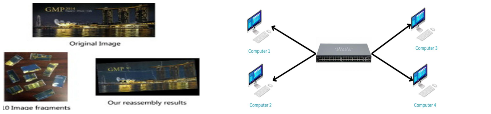
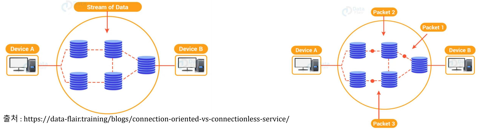
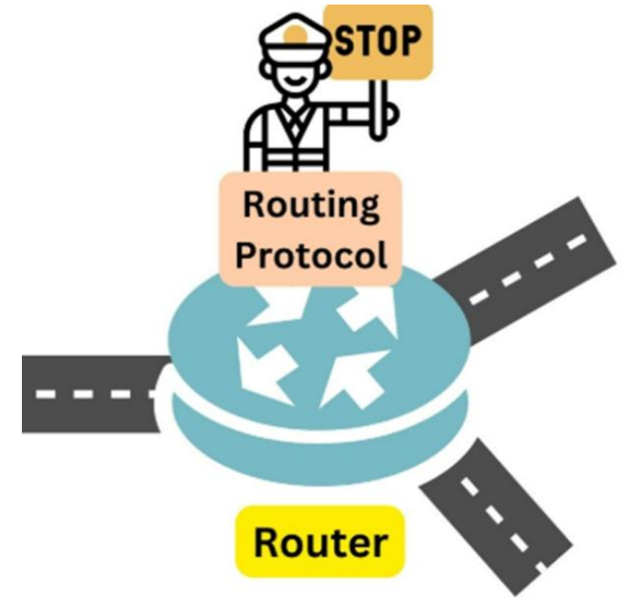
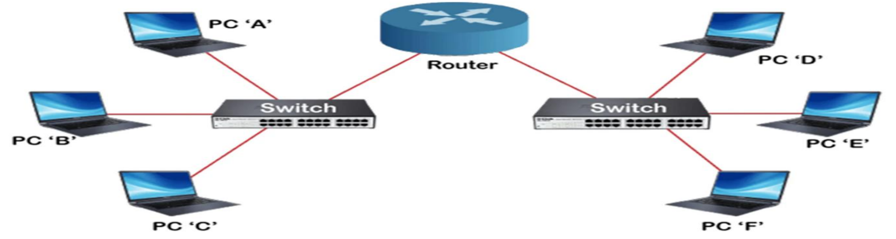

# Computer Network - Chapter 05. Internet Layer

> 한양대학교 공학대학원 컴퓨터공학 - Computer Network\
> 원본: `ch05. Internet Layer.pdf` (교수님 수업 메모가 추가된 PDF)\
> 학습 범위: **p.3 ~ p.9 — 1. Functions of the Network Layer 중 Routing 분류까지**\
> 이전 장: [Chapter 4. Network Access Layer](./04-network-access-layer.md)
>
> ⚠️ p.9에 "**중간고사 범위는 여기까지**, 중간고사 끝나고 실습한다"라는 메모가 있어, 이 노트는 **p.9까지** 만 정리한다. p.10 이후(Routing Table, 실습, 2. Congestion Control)는 중간고사 이후 진도에서 정리한다.
>
> p.1 ~ p.2에는 교수님이 알려 주신 **중간고사 출제 메모** 가 있어서 맨 앞 [0. 중간고사 대비](#_0-중간고사-대비-p-1-p-2-수업-메모) 에 따로 정리했다.

------------------------------------------------------------------------

## 📌 목차

- [0. 중간고사 대비 (p.1 ~ p.2 수업 메모)](#_0-중간고사-대비-p-1-p-2-수업-메모)
- [1. Chapter 5 전체 흐름](#_1-chapter-5-전체-흐름)
- [2. Key Functions of Network Layer (p.3 ~ p.4)](#_2-key-functions-of-network-layer-p-3-p-4)
- [3. Services Offered to Transport Layer (p.5 ~ p.6)](#_3-services-offered-to-transport-layer-p-5-p-6)
- [4. Routing — 기능·목표·공평성 (p.7)](#_4-routing-—-기능·목표·공평성-p-7)
- [5. Routing — 분류와 라우터 초기화 (p.8)](#_5-routing-—-분류와-라우터-초기화-p-8)
- [6. Static vs Dynamic Routing (p.9)](#_6-static-vs-dynamic-routing-p-9)
- [7. 시험 핵심 정리](#_7-시험-핵심-정리)
- [8. 자기점검](#_8-자기점검)

------------------------------------------------------------------------

## 0. 중간고사 대비 (p.1 ~ p.2 수업 메모)

> 시험일: **2026-10-22(목)** 예정 · 메모에 "**40분에 시험 시작**"이라고 적혀 있다.
> 교수님 말씀(p.3 메모): "**기말고사는 어렵지만 중간고사는 편하게 가자.** 기말은 수식을 증명할 수 있어야 한다."

### 0.1 문항 수 — ⚠️ 메모끼리 다르다

| 위치 | 메모 내용 |
|---|---|
| p.1 왼쪽 | **단답식 문제 10개** |
| p.1 오른쪽 | **서술형 6문항** |
| p.9 | "시험문제는 **6~7문제**, **단답식 3문제**, **서술형으로 3~4개**" |

→ 원자료상의 차이다. p.1은 "출제 후보 목록"을, p.9는 "실제 시험 구성"을 말씀하신 것일 수 있지만 확실하지 않으므로, **두 목록을 모두 대비** 하는 것이 안전하다.

### 0.2 단답식 출제 메모 (p.1 왼쪽, "힌트는 메모")

메모를 그대로 옮기고, 오른쪽에 앞 장 노트로 확인한 **답의 방향** 을 붙였다.

| # | 메모 원문 | 답의 방향 · 참고 노트 |
|---|---|---|
| 1 | 네트워크 3가지 요소 | **Node, Link, Protocol** → [2장 3절](./02-network-concepts.md) |
| 2 | OSI 7 계층, TCP/IP 모델 비교 | OSI 7계층 ↔ TCP/IP 4계층 대응 → [2장 5~6절](./02-network-concepts.md) |
| 3 | 전송계층에서의 단위 프로토콜 PDU | 전송 계층의 PDU = **Segment** (Data → Segment → Packet → Frame → Bit) → [2장 7절](./02-network-concepts.md) |
| 4 | 컴퓨터네트워크 역사 TCP/IP 프로토콜 설계를 한 사람이 한 말 O/X | TCP/IP 설계 = **Vint Cerf와 Bob Kahn**. WWW 창시자(Tim Berners-Lee)와 헷갈리지 말 것 → [2장 2.2절](./02-network-concepts.md) |
| 5 | IEEE 802. 표준안에서 이더넷, 토큰, 버스 몇 번인가 | **802.3 Ethernet / 802.4 Token Bus / 802.5 Token Ring** → [4장 4절](./04-network-access-layer.md) (메모 원문은 "IT3E 802"로 적혀 있으나 IEEE 802를 뜻함) |
| 6 | CSMA/CA 는 몇번인가, CSMA/CD | **CSMA/CA = 802.11 무선 LAN**, **CSMA/CD = 802.3 이더넷** |
| 7 | 그 표준에서 데이터링크 계층을 하위계층과 상위계층 2개로 나눈거 / 하부와 상부 명칭 : LLC vs ? | 상위 = **LLC**(802.2), 하위 = **MAC** → [4장 5절](./04-network-access-layer.md) |
| 8 | hub layer 1, switch layer 2 | Hub = **L1**(신호 복제), Switch = **L2**(MAC 기준) → [4장 16절](./04-network-access-layer.md) |
| 9 | 캐스케이딩하는 네트워크 장비는? | 메모에 정답이 없다. **[보충]** 캐스케이딩(cascading)은 장비끼리 줄줄이 연결해 포트를 늘리는 것으로, 보통 **허브·스위치** 를 이렇게 연결한다. 수업에서 말씀하신 답을 확인할 것 |
| 10 | 무선랜 : CSMA/CA, 신호 타이밍 설명 request to send 등등 | **RTS → CTS → DATA → ACK** 순서 (아래 0.4 참고) |
| 11 | 동적 라우팅 환경, 라우팅간의 전송지연시간 ECHO | 라우터 간 전송 지연 시간 측정 = **ECHO 패킷** (이번 장 [5.2절](#_5-2-router-initialization-—-hello와-echo-⭐)) |
| 12 | 토큰 버킷은 패스 | **출제 제외** |

### 0.3 서술형 출제 메모 (p.1 오른쪽 + p.2)

| # | 메모 원문 | 메모에 적힌 답 / 정리 |
|---|---|---|
| 1 | OSI 7 계층과 TCP/IP 구조 비교, 계층화를 한 목적? | 2장 계층 모델 |
| 2 | 계층화를 하는 이점은? | "**각 계층에서 표준화, 복잡한 것은 단순화, 상호간 독립성**" |
| 3 | CSMA/CD 3단계가 어떻게 동작하는지? | "**1단계 Carrier Sensing, 2단계 MA(Multiple Access), 3단계 CD(Collision Detection)**" |
| 4 | 토큰버스 802.4 — 물리적 구조와 논리적 동작방식을 → 일반 이더넷과 토큰 방식의 차이점을 말하라 | "토큰버스는 부딪힐 일이 적다." 이더넷은 "**충돌이 날 수 있다**", 토큰은 "**토큰을 소유한 순서대로 권한 부여, 안 받으면 원천 차단**" (Token Bus = Physical Bus + Logical Ring) |
| 5 | 올바른 목적지로 전달하기 위한 라우팅 테이블의 역할 | 아래 0.5 참고 (p.10 내용) |
| 6 | 흐름제어, 혼잡제어 하는 이유와 2개의 차이점 | 아래 0.6 참고 |
| 7 | 네트워크를 구성하는 3가지 핵심요소 명칭 → 노드, 링크, 프로토콜 어떻게 작용하는지 설명 (p.2) | "광케이블, UTP 케이블 등등", "**이 3가지가 어떻게 연동되어서 어떻게 동작하는지 설명**", "**완벽한 상호 연동성을 확보**" |

기타 메모

- "**계층적인 전달 순서는 시험에 안 나옴**"
- p.2: "mac 인지 ipv6 로 하나는 문제 냈다." — 4장 Review의 **Q1(새 컴퓨터의 MAC 주소, ARP/RARP)** 과 **Q2(IPv6가 128 bits인 이유)** 를 가리킨다. 4장 PDF에 "숙제 / MAC 도 숙제 / 둘 다 시험에 나올 수 있다"는 필기가 있다 → [4장 14절](./04-network-access-layer.md#_14-review-—-숙제-시험에-나올-수-있음-p-20-p-21)

### 0.4 [보충] CSMA/CA 신호 타이밍 — RTS / CTS

무선 LAN(802.11)은 전송 중에 충돌을 **감지하기 어렵기 때문에**, 충돌을 **미리 피하는(Collision Avoidance)** 방식을 쓴다.

```text
송신 단말                 AP(수신)                 주변 단말
   │── RTS (Request To Send) ──▶│                    │
   │◀── CTS (Clear To Send) ────│──── CTS 수신 ─────▶│ (일정 시간 전송 보류)
   │── DATA ───────────────────▶│                    │
   │◀── ACK ────────────────────│                    │
```

| 신호 | 의미 |
|---|---|
| **RTS** | "보내도 될까요?" — 전송 요청 |
| **CTS** | "보내세요" — 허락. 이 신호를 들은 주변 단말은 그동안 전송을 미룬다 |
| **DATA** | 실제 데이터 전송 |
| **ACK** | 수신 확인 |

> 4장 노트에서 정리했듯, 4장 강의자료 p.19는 제목은 CSMA/CD인데 그림은 이 RTS → CTS → DATA → ACK(CSMA/CA)를 나타낸다.

### 0.5 라우팅 테이블의 역할 (p.10 — 중간고사 범위 밖 페이지지만 서술형 메모에 있음)

| 항목 | 내용 (p.10 원문) |
|---|---|
| **정의** | 패킷 전송 시 최적 경로를 **신속히 찾기 위한 핵심 데이터베이스** |
| **Destination** | 최종 도달해야 할 네트워크 또는 호스트 주소 |
| **Next Hop** | 목적지로 가기 위해 거쳐야 할 **바로 다음의 라우터 주소** |
| **역할** | 패킷 입력을 출력 경로로 연결하는 **이정표** |

서술형 답안 예시

> 라우터는 패킷의 목적지 주소를 보고 **라우팅 테이블에서 Destination을 찾아**, 그에 해당하는 **Next Hop(다음 라우터)** 과 출력 경로로 패킷을 보낸다. 즉 라우팅 테이블은 들어온 패킷을 올바른 출력 경로로 연결하는 **이정표** 이자, 최적 경로를 빠르게 찾게 해 주는 데이터베이스다.

### 0.6 [보충] 흐름 제어 vs 혼잡 제어

| 구분 | 흐름 제어 (Flow Control) | 혼잡 제어 (Congestion Control) |
|---|---|---|
| **보호 대상** | **수신자** — 수신 측 버퍼가 넘치지 않게 | **네트워크 전체** — 중간 라우터·링크가 과부하되지 않게 |
| **범위** | 송신자 ↔ 수신자 **둘 사이** (종단 간) | 여러 송신자가 함께 쓰는 **네트워크 구간** |
| **원인** | 송신 속도 > 수신 처리 속도 | 네트워크로 들어오는 트래픽 > 네트워크 처리 용량 |
| **비유** | 받는 사람이 다 먹을 때까지 기다려 주기 | 도로 전체의 교통량 조절 (신호등 · 경찰, p.4) |

- **하는 이유**: 흐름 제어는 수신자가 처리하지 못해 데이터가 **버려지는 것** 을 막기 위해, 혼잡 제어는 네트워크가 막혀 **지연·손실이 연쇄적으로 커지는 것** 을 막기 위해서다.
- **혼잡의 원인** (p.9 수업 메모): **과도한 트래픽, 무한 루프, 패킷 순서가 잘못되어서 폐기, 재전송의 악순환** (메모에는 "폐기?"처럼 물음표가 붙어 있다)
  - **[보충] 재전송의 악순환**: 혼잡 → 패킷 손실 → 재전송 → 트래픽 더 증가 → 혼잡 악화
- p.9 메모의 "**패닉 바이**"는 뜻이 불분명하다. 혼잡의 악순환을 사재기(panic buying)에 비유하신 것으로 보이지만, 확실하지 않다.
- 혼잡 제어 자체는 이번 장 **2. Congestion Control** 에서 중간고사 이후에 배운다.

------------------------------------------------------------------------

## 1. Chapter 5 전체 흐름

```text
Chapter 5. Internet Layer
├── 1. Functions of the Network Layer      ← 중간고사 범위 (p.3 ~ p.9)
│   ├── Key Functions: Routing / Congestion Control / Fragmentation & Reassembly
│   ├── Services to Transport Layer: Connection-Oriented vs Connectionless
│   └── Routing
│       ├── 기능 · 목표 · 공평성
│       ├── Static vs Dynamic, Reliability
│       ├── Router Initialization: HELLO / ECHO
│       └── (p.10~) Routing Table, 실습 ← 중간고사 이후
└── 2. Congestion Control                  ← 중간고사 이후
```

이번 장의 핵심 질문

> **패킷이 여러 네트워크를 거쳐 목적지까지 가려면, 어느 경로로 보낼지 누가 어떻게 정하는가?**

> 💡 **[보충] 2장과의 연결**: Internet Layer는 TCP/IP 모델의 계층 이름이고, OSI 7계층의 **3계층 Network Layer** 에 해당한다. 이 계층의 PDU는 **Packet** 이고, 기준 주소는 **IP** 다. 4장의 장비 비교에서 **Router(L3)** 가 바로 이 계층의 장비다.

------------------------------------------------------------------------

## 2. Key Functions of Network Layer (p.3 ~ p.4)

### 2.1 세 가지 핵심 기능

| 기능 | 설명 (p.3) |
|---|---|
| **Routing** | **송수신 호스트 사이의 패킷 전달 경로를 선택** |
| **Congestion Control** | 네트워크 특정 구간의 **트래픽 과밀 현상 관리 및 조절** |
| **패킷의 분할과 병합** (Fragmentation & Reassembly) | 아래 두 단계 |
| ✓ Fragmentation | 대용량 데이터를 전송 가능한 크기의 패킷으로 **분할** |
| ✓ Reassembly | 목적지에서 분할된 패킷을 원래 데이터로 **재조합** |

(교수님이 밑줄 친 부분: 라우팅의 "송수신 호스트 사이의 패킷 전달 경로를 선택", 혼잡 제어의 "과밀 현상 관리 및 조절", "분할", "재조합")



- 왼쪽 그림: 원본 이미지(Original Image)를 **10조각으로 나눴다가(fragments)** 다시 **재조합(reassembly results)** 한 예 → Fragmentation & Reassembly의 비유
- **[보충] 왜 분할하나?** 링크마다 한 번에 보낼 수 있는 최대 크기(MTU, 이더넷은 보통 1,500바이트)가 있어서, 그보다 큰 데이터는 잘게 나눠 보내야 한다.

### 2.2 기능별 비유와 주요 장비 (p.4)

| 기능 | 비유 | 주요 장비 |
|---|---|---|
| **라우팅** | 경로 최적화 (**네비게이션**) | 라우터 (Router) |
| **혼잡 제어** | 교통량 조절 (**신호등/경찰**) | 라우터 및 호스트 |
| **분할/병합** | **화물 소분 및 재조립** | 라우터(분할), 목적지 호스트(병합) |

수업 메모

- 표 제목 옆: "**패킷**" — 네트워크 계층이 다루는 단위가 패킷이라는 점
- 라우팅 비유 옆: "**시간을 짧게**" — 네비게이션처럼 목적지까지 걸리는 시간을 줄이는 경로를 고른다는 뜻

> ⚠️ 분할은 **라우터** 가(중간에서), 병합은 **목적지 호스트** 가(마지막에) 한다. "라우터가 다시 합친다"고 쓰지 않도록 주의한다.

------------------------------------------------------------------------

## 3. Services Offered to Transport Layer (p.5 ~ p.6)

네트워크 계층은 바로 위의 **전송 계층** 에 두 가지 방식의 서비스를 제공한다.

| 서비스 | 설명 (p.5) |
|---|---|
| **Connection-Oriented Service** (연결형) | 패킷 전송 **전** 송수신 호스트 간 **논리적 연결 설정** · 방식: **가상 회선(Virtual Circuit)** 기반 전송 |
| **Connectionless Service** (비연결형) | **사전 연결 설정 없이** 패킷 단위의 **독립적** 전송 · 방식: **데이터그램(Datagram)** 기반 전송 |



> 출처(강의자료): https://data-flair.training/blogs/connection-oriented-vs-connectionless-service/

- 왼쪽(연결형): Device A → B로 **Stream of Data** 가 미리 정한 하나의 경로를 따라 흐른다.
- 오른쪽(비연결형): Packet 1, 2, 3이 **서로 다른 경로** 로 들어가 B에 도착한다 → 도착 순서가 바뀔 수 있다.

### 3.1 비교표 (p.6)

| 구분 | 연결형 (Connection-Oriented) | 비연결형 (Connectionless) |
|---|---|---|
| **기반 기술** | 가상 회선 (Virtual Circuit) | 데이터그램 (Datagram) |
| **경로 결정** | **연결 설정 시 고정** | **패킷마다 독립적으로 결정** |
| **순서 보장** | 보장됨 (Sequence Maintained) | 보장 안 됨 (Out-of-Order 가능) |
| **대표 사례** | X.25, ATM (과거 망) | **IP** (Internet Protocol) |

> 💡 **[보충] 비유**: 연결형은 **전화**(먼저 연결하고, 같은 회선으로 순서대로 말함), 비연결형은 **우편**(편지마다 주소를 적어 따로 보내고, 도착 순서는 보장 안 됨).

> ⚠️ **[보충] 헷갈리는 점**: 인터넷의 **IP는 비연결형** 이다. 그런데도 웹 데이터가 순서대로 오는 것은 그 위의 **전송 계층 TCP** 가 순서를 맞춰 주기 때문이다. "네트워크 계층(IP)은 비연결형, TCP는 연결형"을 구분해 기억한다.

------------------------------------------------------------------------

## 4. Routing — 기능·목표·공평성 (p.7)

| 항목 | 내용 (p.7) |
|---|---|
| **기능** | 패킷 전송 경로 지정 및 **최적 출력 경로 결정** |
| **목표** | **다음 라우터로의** 가장 효과적인 패킷 전달 |
| **공평성 (Fairness)과 우선순위** | 특정 패킷의 우선순위 처리가 **타 패킷에 불이익을 주지 않도록** 관리 |
| ✓ 자원 최적화 | 모든 전송 패킷에 대해 라우팅 과정의 **형평성 유지** |



- 그림: 교차로(라우터) 위에서 **교통경찰(Routing Protocol)** 이 STOP 표지판을 들고 차량(패킷)의 방향을 정한다.
- **[보충]** 목표가 "목적지까지"가 아니라 "**다음 라우터로**"인 점에 주의한다. 라우터 하나는 전체 경로를 다 정하지 않고, **바로 다음에 보낼 곳(Next Hop)** 만 정한다. 이 판단이 라우터마다 이어져 목적지에 도착한다 (p.10 라우팅 테이블의 Next Hop과 연결).

------------------------------------------------------------------------

## 5. Routing — 분류와 라우터 초기화 (p.8)

### 5.1 Classification of Routing

| 분류 | 설명 (p.8) |
|---|---|
| **Static Routing** | **전송 전** 경로 정보를 라우터에 **미리 저장 및 관리** |
| **Dynamic Routing** | **네트워크 상황에 따라** 경로 정보를 **실시간 변경 및 보완** |
| **Reliability** | 네트워크 **구성 변화에 효과적으로 대처** 하는 경로 선택 필수 |

(교수님 밑줄: "상황에 따라", "구성 변화에 효과적으로 대처")

### 5.2 Router Initialization — HELLO와 ECHO ⭐

> 강의자료에 **별표(☆)** 가 크게 그려져 있고, 단답식 메모에도 "동적 라우팅 환경, 라우팅간의 전송지연시간 **ECHO**"가 있다. **반드시 외울 것.**

| 패킷 | 역할 (p.8) | 수업 메모 (p.9) |
|---|---|---|
| **HELLO 패킷** | **이웃 라우터 유무 파악** 및 **경로 정보 획득** 을 위한 초기화 패킷 | "HELLO는 **너 거기 있어** 찾는다." |
| **ECHO 패킷** | 라우터 간 **전송 지연 시간(Delay) 측정** 을 위한 패킷 | "ECHO는 **거기까지 갔다가 얼마나 걸리는지**, 전송지연시간" |

```text
HELLO:  라우터 A ──"거기 누구 있어?"──▶ 라우터 B
        라우터 A ◀──"나 여기 있어"────── 라우터 B      → 이웃 확인 + 경로 정보

ECHO:   라우터 A ──보냄 (t₀)──▶ 라우터 B
        라우터 A ◀──되돌아옴 (t₁)── 라우터 B           → 지연 시간 = t₁ − t₀
```

> 💡 **[보충] 왜 동적 라우팅에 필요한가?** 동적 라우팅은 네트워크 상황에 맞춰 경로를 바꿔야 하므로, 먼저 **누가 이웃인지(HELLO)** 와 **그 이웃까지 얼마나 걸리는지(ECHO)** 를 알아야 "가장 빠른 경로"를 계산할 수 있다.



- **[보충] 그림 읽기**: PC A·B·C는 왼쪽 스위치, PC D·E·F는 오른쪽 스위치에 연결된다. 같은 스위치 안의 PC끼리는 **스위치(L2, MAC)** 가, 서로 다른 쪽 PC끼리는 **라우터(L3, IP)** 가 전달한다. 4장의 "Router는 Broadcast Domain을 나눈다"와 같은 그림이다.

------------------------------------------------------------------------

## 6. Static vs Dynamic Routing (p.9)

| 구분 | 정적 라우팅 (Static) | 동적 라우팅 (Dynamic) |
|---|---|---|
| **설정 주체** | 네트워크 관리자 (**사람**) | 라우팅 프로토콜 (**소프트웨어**) |
| **변화 대응** | **수동** 업데이트 필요 | **자동** 감지 및 즉시 변경 |
| **장점** | 보안 우수, 오버헤드 없음 | 대규모 망 관리 용이, 유연함 |

> 💡 **[보충] 단점까지 함께 기억하기**: 정적 라우팅은 장애가 나도 사람이 고칠 때까지 경로가 안 바뀌고 큰 망에서는 관리가 어렵다. 동적 라우팅은 HELLO·ECHO 같은 제어 패킷을 계속 주고받아야 하므로 **오버헤드** 가 생긴다. 표의 장점은 서로 상대의 단점을 뒤집은 것이다.

> 💡 **[보충] 언제 무엇을?** 작은 사무실이나 경로가 하나뿐인 지점 → 정적 라우팅. 경로가 여러 개이고 자주 바뀌는 큰 망(기업망, 인터넷) → 동적 라우팅.

p.9 수업 메모 (중간고사 관련은 [0장](#_0-중간고사-대비-p-1-p-2-수업-메모) 참고)

- HELLO / ECHO 설명 → 5.2절
- 혼잡의 원인 → 0.6절
- 시험 구성(6~7문제) → 0.1절
- "**중간고사 범위는 여기까지. 중간고사 끝나고 실습한다. 실습은 건너뛴다.**"

------------------------------------------------------------------------

## 7. 시험 핵심 정리

```text
Network Layer (TCP/IP: Internet Layer, PDU = Packet, 장비 = Router)
├── Key Functions
│   ├── Routing            : 경로 선택         ─ 네비게이션 ─ Router
│   ├── Congestion Control : 트래픽 과밀 조절  ─ 신호등/경찰 ─ Router + Host
│   └── Fragmentation      : 분할(Router) / Reassembly : 재조합(목적지 Host)
├── Services to Transport Layer
│   ├── 연결형   : Virtual Circuit, 경로 고정, 순서 보장, X.25·ATM
│   └── 비연결형 : Datagram, 패킷마다 경로, 순서 보장 X, IP
└── Routing
    ├── 기능: 최적 출력 경로 결정 / 목표: 다음 라우터로 효과적 전달 / 공평성
    ├── Static (사람, 수동, 보안·오버헤드 없음) vs Dynamic (프로토콜, 자동, 대규모·유연)
    ├── Reliability: 구성 변화에 대처
    └── 초기화: HELLO = 이웃 확인·경로 정보 / ECHO = 전송 지연 시간 측정 ⭐
```

헷갈리기 쉬운 것

1. **분할은 라우터, 병합은 목적지 호스트**
2. **IP는 비연결형(Datagram)**, 순서 보장은 TCP의 몫
3. **HELLO = 존재 확인**, **ECHO = 지연 시간 측정**
4. 라우팅의 목표는 "**다음 라우터로**" 효과적 전달
5. 흐름 제어 = 수신자 보호(종단 간), 혼잡 제어 = 네트워크 보호(망 전체)

------------------------------------------------------------------------

## 8. 자기점검

> 답을 먼저 떠올린 뒤 `▶ 정답 보기`를 눌러 확인한다.

**Q1.** 네트워크 계층의 세 가지 핵심 기능과 각각의 비유는?

<details><summary>▶ 정답 보기</summary>

라우팅(네비게이션), 혼잡 제어(신호등/경찰), 분할과 병합(화물 소분 및 재조립)
</details>

**Q2.** 패킷의 분할과 병합은 각각 어느 장비가 하는가?

<details><summary>▶ 정답 보기</summary>

분할은 라우터, 병합(재조합)은 목적지 호스트
</details>

**Q3.** 연결형과 비연결형 서비스를 기반 기술, 경로 결정, 순서 보장, 대표 사례로 비교하라.

<details><summary>▶ 정답 보기</summary>

- 연결형: 가상 회선 / 연결 설정 시 고정 / 보장됨 / X.25, ATM
- 비연결형: 데이터그램 / 패킷마다 독립적으로 결정 / 보장 안 됨 / IP
</details>

**Q4.** IP는 비연결형인데 웹 페이지 데이터는 어떻게 순서대로 도착하는가?

<details><summary>▶ 정답 보기</summary>

전송 계층의 TCP가 순서 번호로 순서를 맞추고 재전송을 처리하기 때문이다. IP 자체는 순서를 보장하지 않는다.
</details>

**Q5.** 라우팅에서 "공평성(Fairness)"이란?

<details><summary>▶ 정답 보기</summary>

특정 패킷의 우선순위 처리가 다른 패킷에 불이익을 주지 않도록 관리해, 모든 전송 패킷에 대해 라우팅 과정의 형평성을 유지하는 것
</details>

**Q6.** 정적 라우팅과 동적 라우팅을 설정 주체, 변화 대응, 장점으로 비교하라.

<details><summary>▶ 정답 보기</summary>

- 정적: 네트워크 관리자(사람) / 수동 업데이트 / 보안 우수, 오버헤드 없음
- 동적: 라우팅 프로토콜(소프트웨어) / 자동 감지 및 즉시 변경 / 대규모 망 관리 용이, 유연함
</details>

**Q7.** (단답식 메모) 동적 라우팅 환경에서 라우터 간 전송 지연 시간을 측정하는 패킷은? 이웃 라우터의 유무를 파악하는 패킷은?

<details><summary>▶ 정답 보기</summary>

지연 시간 측정 = **ECHO** 패킷, 이웃 유무 파악 = **HELLO** 패킷
</details>

**Q8.** (서술형 메모) 올바른 목적지로 전달하기 위한 라우팅 테이블의 역할을 설명하라.

<details><summary>▶ 정답 보기</summary>

라우팅 테이블은 패킷 전송 시 최적 경로를 신속히 찾기 위한 데이터베이스로, 목적지(Destination)마다 거쳐야 할 바로 다음 라우터(Next Hop)를 담고 있다. 라우터는 이를 보고 들어온 패킷을 올바른 출력 경로로 연결하므로, 라우팅 테이블은 패킷의 이정표 역할을 한다.
</details>

**Q9.** (서술형 메모) 흐름 제어와 혼잡 제어를 하는 이유와 차이점은?

<details><summary>▶ 정답 보기</summary>

흐름 제어는 송신 속도가 수신 처리 속도보다 빨라 수신 버퍼가 넘치는 것을 막기 위해 송신자와 수신자 사이에서 속도를 맞추는 것이다. 혼잡 제어는 네트워크로 들어오는 트래픽이 처리 용량을 넘어 지연·손실·재전송의 악순환이 생기는 것을 막기 위해 네트워크 전체의 트래픽을 조절하는 것이다. 즉 흐름 제어는 수신자 보호(종단 간), 혼잡 제어는 네트워크 보호(망 전체)다.
</details>

**Q10.** (서술형 메모) 계층화를 하는 이점 세 가지는?

<details><summary>▶ 정답 보기</summary>

각 계층별 표준화, 복잡한 통신 과정의 단순화, 계층 간 상호 독립성
</details>

**Q11.** (단답식 메모) IEEE 802 표준에서 Ethernet, Token Bus, Token Ring, 무선 LAN의 번호와 각각의 매체 접근 방식은?

<details><summary>▶ 정답 보기</summary>

802.3 Ethernet(CSMA/CD), 802.4 Token Bus(토큰), 802.5 Token Ring(토큰), 802.11 무선 LAN(CSMA/CA)
</details>

**Q12.** (서술형 메모) 일반 이더넷과 토큰 방식(Token Bus)의 차이를 물리적 구조와 논리적 동작 방식으로 설명하라.

<details><summary>▶ 정답 보기</summary>

일반 이더넷은 CSMA/CD로 누구나 매체를 감지한 뒤 전송하므로 충돌이 날 수 있다. Token Bus는 물리적으로는 버스 구조지만 논리적으로는 링처럼 토큰을 순서대로 넘기며, 토큰을 가진 장치만 전송 권한을 가지므로 충돌을 원천 차단한다 (Physical Bus + Logical Ring).
</details>
