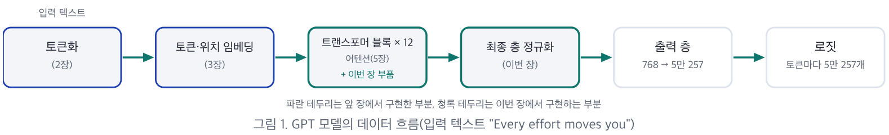
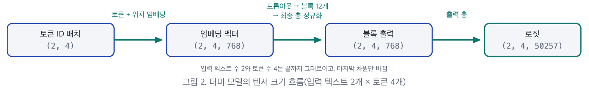
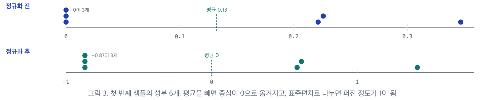
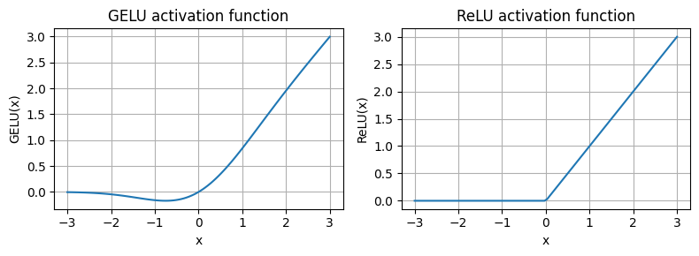
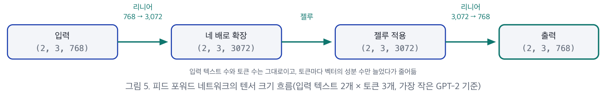
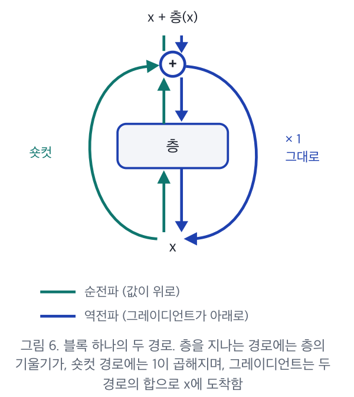

# 6장. GPT 구성 요소 (LayerNorm · GELU · FeedForward · Shortcut)

> 컴퓨터특론 · *밑바닥부터 만들면서 배우는 LLM* (원서 4.1 ~ 4.4절)
> 원본: `6장_요약본.pdf` + `6장_실습.ipynb`
> 이전 장: [5장. 코잘·멀티 헤드 어텐션](05-causal_multihead_attention.md)

---

## 📌 목차

**Part 1. GPT 모델의 구조와 더미 모델**
1. [GPT 모델의 전체 구조](#_1-gpt-모델의-전체-구조)
2. [파라미터 개수와 설정 딕셔너리](#_2-파라미터-개수와-설정-딕셔너리)
3. [구현 순서](#_3-구현-순서-—-골격을-먼저-부품은-나중에)
4. [더미 모델 DummyGPTModel](#_4-더미-모델-dummygptmodel-—-토큰-id-배치를-받아-로짓을-반환)
5. [입력 배치와 출력 로짓](#_5-입력-배치와-출력-로짓)

**Part 2. 층 정규화**

6. [층 정규화가 필요한 이유](#_6-층-정규화가-필요한-이유)
7. [예제와 평균 · 분산 — 딤 인자](#_7-예제와-평균-·-분산-—-딤-인자로-계산-방향을-정함)
8. [정규화 계산](#_8-정규화-계산-—-x-−-평균-÷-√분산)
9. [층 정규화 클래스 LayerNorm](#_9-층-정규화-클래스-layernorm-—-토큰-벡터를-받아-정규화한-벡터를-반환)
10. [편향 분산과 배치 정규화와의 차이](#_10-편향-분산과-배치-정규화와의-차이)

**Part 3. 젤루 · 피드 포워드 · 숏컷 연결**

11. [렐루에서 젤루로](#_11-렐루에서-젤루로)
12. [젤루와 렐루 비교](#_12-젤루와-렐루-비교)
13. [피드 포워드 네트워크 FeedForward](#_13-피드-포워드-네트워크-feedforward-—-같은-크기의-벡터를-반환)
14. [숏컷 연결의 원리](#_14-숏컷-연결의-원리-—-그레이디언트가-줄지-않는-경로)
15. [그레이디언트 실험](#_15-그레이디언트-실험-—-층-5개-모델-숏컷-연결만-다르게)

[요약](#_16-요약) · [퀴즈](#_17-셀프-체크-퀴즈)

> 💻 실습 노트북(`6장_실습.ipynb`)의 코드와 출력은 관련 절 안의 **🧪 실습** 박스에 넣었다. 출력값은 노트북에 저장된 실행 결과 그대로이며, **[보충]** 으로 표시한 숫자는 직접 계산해 확인했다.

### 🎯 학습 목표

- GPT 모델의 **전체 구조** 와, 입력 토큰이 **로짓** 이 되기까지의 데이터 흐름
- 가장 작은 GPT-2의 **설정 딕셔너리**(`GPT_CONFIG_124M`)와 전체 골격만 갖춘 **더미 모델**(`DummyGPTModel`)
- 층의 출력을 평균 0, 분산 1로 조정하는 **층 정규화**(`LayerNorm`)의 원리와 구현
- **젤루(GELU)** 활성화 함수와, 이를 사용하는 **피드 포워드 네트워크**(`FeedForward`)
- **숏컷 연결** 이 그레이디언트 소실을 줄이는 원리와 실험 결과

### 이 장의 진행


### 지금까지와의 연결

```
2장 토큰화 ─▶ 3장 토큰·위치 임베딩 ─▶ 4·5장 (멀티 헤드) 어텐션 ─▶ ★6장 블록 부품 4가지★ ─▶ 7장 트랜스포머 블록 조립 + GPT 완성
```

> 💡 5장까지는 "토큰끼리 정보를 주고받는 장치(어텐션)"를 만들었다. 6장은 그 어텐션을 감싸서 **깊게 쌓아도 훈련이 잘 되게** 해 주는 부품들을 만든다.

---

# Part 1. GPT 모델의 구조 — 같은 구조의 블록을 쌓은 모델

## 1. GPT 모델의 전체 구조

GPT는 입력 텍스트 뒤에 올 토큰을 **한 번에 하나씩 예측** 해 새 텍스트를 생성하는 모델이다. 규모는 크지만, **같은 구조의 트랜스포머 블록을 여러 번 쌓은 것** 이어서 구조 자체는 단순하다.



> 파란 테두리는 앞 장에서 구현한 부분, 청록 테두리는 이번 장에서 구현하는 부분이다.

| 항목 | 내용 |
|---|---|
| **데이터 흐름** | 입력 텍스트 → 토큰 ID → 임베딩 층에서 토큰마다 벡터 → 트랜스포머 블록을 차례로 통과 → 최종 층 정규화 → 출력 층 → **로짓** |
| **로짓** | 다음 토큰을 예측하는 데 쓰는 값 (5절에서 자세히) |
| **블록 수** | 가장 작은 GPT-2는 같은 구조의 트랜스포머 블록 **12개** 를 차례로 연결. 구조는 같지만 **블록마다 가중치는 따로** 가진다 |
| **이미 구현한 부분** | 토큰화(2장), 토큰·위치 임베딩(3장), 미래 토큰을 가리는 멀티 헤드 어텐션(5장). 그림에서는 코잘 마스크를 쓰므로 **마스크드 멀티 헤드 어텐션** 으로 표기 |
| **이번 장의 범위** | 트랜스포머 블록에서 멀티 헤드 어텐션을 **제외한** 구성 요소 네 가지 — **층 정규화, 젤루, 피드 포워드 네트워크, 숏컷 연결** |
| **7장에서 할 일** | 계산의 대부분이 이루어지는 트랜스포머 블록을 조립하고 GPT 모델을 완성 |

> 💡 **[보충] 비유**: GPT는 같은 모양의 층을 12번 쌓은 건물이다. 5장에서 각 층의 핵심 설비(어텐션)를 만들었고, 6장에서는 층마다 들어갈 나머지 설비(정규화, 변환 장치, 비상 통로 같은 숏컷)를 만든다.

---

## 2. 파라미터 개수와 설정 딕셔너리

### 2.1 파라미터란

- **파라미터** 는 훈련으로 조정되는 가중치로, 모델의 예측과 정답의 차이인 **손실** 이 줄어드는 방향으로 조정된다.
- 가중치 행렬 하나의 파라미터 수 = **행 수 × 열 수**. 2,048 × 2,048 행렬 하나만으로도 **4,194,304개** 다.

| 모델 | 파라미터 | 비고 |
|---|---|---|
| **가장 작은 GPT-2** | **1억 2,400만** | 이번 강의의 구현 대상. GPT-2 논문의 1억 1,700만은 이후 정정된 값(5장 표의 값) |
| 더 큰 GPT-2 세 가지 | 3억 4,500만 ~ 15억 4,200만 | 3억 4,500만 / 7억 6,200만 / 15억 4,200만. 사전 훈련된 가중치는 9장에서 불러옴 |
| GPT-3 | 1,750억 | 구조는 GPT-2와 기본적으로 같지만 **가중치가 공개되지 않음** |

> **GPT-2를 구현하는 이유** — 훈련된 가중치가 공개되어 있어 구현한 모델에 불러와 확인할 수 있고, 개인용 컴퓨터에서도 실행할 수 있다. GPT-3는 V100 GPU 한 대로 훈련하면 **355년**, RTX 8000으로는 **665년** 이 걸린다는 추정이 있을 만큼 규모가 크다(Lambda Labs).

### 2.2 설정 딕셔너리 `GPT_CONFIG_124M` — 모델의 구성을 정하는 값 일곱 개

이후의 클래스들은 이 딕셔너리를 받아 필요한 값을 가져다 쓴다.

| 키 | 값 | 의미 | 앞 장과의 연결 · 근거 |
|---|---|---|---|
| `vocab_size` | 50,257 | 모델이 구분하는 토큰의 종류 수(어휘사전 크기) | 2장 BPE 토크나이저의 토큰 수와 같음 |
| `context_length` | 1,024 | 한 번에 받을 수 있는 최대 토큰 수(문맥 길이) | 5장에서 코잘 마스크 크기를 정한 값과 같은 설정. 5장 실습은 6, GPT-2는 1,024 |
| `emb_dim` | 768 | 토큰 하나를 나타내는 벡터의 성분 수(임베딩 차원) | 토큰·위치 임베딩과 모든 블록의 입출력 크기 |
| `n_heads` | 12 | 어텐션 헤드 수 | 성분 768개를 12개 헤드가 나누어, 헤드 하나의 성분 수는 64(5장) |
| `n_layers` | 12 | 트랜스포머 블록 수 | 그림 1의 × 12 |
| `drop_rate` | 0.1 | 드롭아웃 비율 | 훈련 중 값의 10%를 무작위로 0으로 만들어 과대적합을 줄임(5장) |
| `qkv_bias` | False | 쿼리·키·값 리니어 층의 편향 사용 여부 | 5장 어텐션 클래스와 같이 편향을 쓰지 않음. 9장에서 다시 살펴봄 |

> ### 🧪 실습: 설정 딕셔너리
>
> ```python
> GPT_CONFIG_124M = {
>     "vocab_size": 50257,     # 어휘사전 크기
>     "context_length": 1024,  # 문맥 길이
>     "emb_dim": 768,          # 임베딩 차원
>     "n_heads": 12,           # 어텐션 헤드 개수
>     "n_layers": 12,          # 층 개수
>     "drop_rate": 0.1,        # 드롭아웃 비율
>     "qkv_bias": False        # 쿼리, 키, 값 계산을 위한 편향
> }
> ```

> 💡 **[보충] 왜 딕셔너리로 모아 두나?** 모델 크기를 바꿀 때(예: GPT-2 medium은 `emb_dim` 1,024, `n_layers` 24, `n_heads` 16) 클래스 코드는 그대로 두고 **딕셔너리만 바꾸면** 된다. 하이퍼파라미터를 한곳에서 관리하는 흔한 설계다.

---

## 3. 구현 순서 — 골격을 먼저, 부품은 나중에

모든 구성 요소를 처음부터 구현하지 않고, 세부 계산은 비워 둔 **더미 모델** 로 전체 골격과 데이터 흐름을 먼저 확인한다. 아직 구현하지 않은 부분이 비어 있어도 입력이 끝까지 전달되어 **예상한 크기의 출력** 이 나오는지 볼 수 있기 때문이다.


| 단계 | 장 | 하는 일 |
|---|---|---|
| 1 | **이번 장** | 더미 모델: 설정 딕셔너리로 층 구성 → 블록과 층 정규화는 자리 표시자 → 출력 크기 확인 |
| 2~5 | **이번 장** | 부품 구현: 층 정규화 → 젤루 → 피드 포워드 네트워크 → 숏컷 연결 |
| 6~7 | 7장 | 조립: 부품 + 5장 멀티 헤드 어텐션 → 트랜스포머 블록 → 블록 12개 → GPT 모델 완성 |

> 💡 **[보충] 실무에서도 쓰는 방식**: 큰 시스템을 만들 때 인터페이스(입출력 모양)부터 맞춰 놓고 내부를 하나씩 채우는 방식을 "골격(스켈레톤) 먼저"라고 한다. 텐서 모양이 맞지 않는 버그를 일찍 잡을 수 있다.

---

## 4. 더미 모델 `DummyGPTModel` — 토큰 ID 배치를 받아 로짓을 반환

초기화 메서드(`__init__`)는 설정 딕셔너리를 받아 층을 **만들기만** 하고, 실제 계산은 포워드 메서드(`forward`)에서 이 층들을 차례로 실행해 이루어진다.

| 층 | 구성 | 역할 · 근거 |
|---|---|---|
| `tok_emb` | 임베딩 · 5만 257행 × 768 | 토큰 ID마다 벡터 한 행을 꺼냄. 행 수 = 어휘사전 크기 |
| `pos_emb` | 임베딩 · 1,024행 × 768 | 토큰 위치마다 벡터 한 행. 행 수 = 문맥 길이 |
| `drop_emb` | 드롭아웃 · 0.1 | 두 임베딩을 더한 벡터에 적용 |
| `trf_blocks` | 시퀀셜(`nn.Sequential`) · 블록 12개 | 앞 블록의 출력을 다음 블록의 입력으로 넘기며 차례로 실행. 지금은 더미 블록 |
| `final_norm` | 층 정규화 · 성분 768개 | 출력 층에 전달할 값을 조정. 지금은 더미 층 정규화 |
| `out_head` | 리니어 · 768 → 5만 257, 편향 없음 | 토큰마다 어휘사전의 토큰 종류 수만큼 값을 계산. 원본 GPT-2에 편향이 없어 맞춤 |

> ### 🧪 실습: DummyGPTModel
>
> ```python
> import torch
> import torch.nn as nn
>
> class DummyGPTModel(nn.Module):
>     def __init__(self, cfg):
>         super().__init__()
>         self.tok_emb = nn.Embedding(cfg["vocab_size"], cfg["emb_dim"])
>         self.pos_emb = nn.Embedding(cfg["context_length"], cfg["emb_dim"])
>         self.drop_emb = nn.Dropout(cfg["drop_rate"])
>         self.trf_blocks = nn.Sequential(
>             *[DummyTransformerBlock(cfg) for _ in range(cfg["n_layers"])]
>         )
>         self.final_norm = DummyLayerNorm(cfg["emb_dim"])
>         self.out_head = nn.Linear(
>             cfg["emb_dim"], cfg["vocab_size"], bias=False
>         )
>
>     def forward(self, in_idx):
>         batch_size, seq_len = in_idx.shape
>         tok_embeds = self.tok_emb(in_idx)
>         pos_embeds = self.pos_emb(
>             torch.arange(seq_len, device=in_idx.device)
>         )
>         x = tok_embeds + pos_embeds
>         x = self.drop_emb(x)
>         x = self.trf_blocks(x)
>         x = self.final_norm(x)
>         logits = self.out_head(x)
>         return logits
>
>
> class DummyTransformerBlock(nn.Module):  # 아직 아무것도 하지 않는 자리 표시자
>     def __init__(self, cfg):
>         super().__init__()
>
>     def forward(self, x):
>         return x  # 입력을 그대로 반환
>
>
> class DummyLayerNorm(nn.Module):         # 아직 아무것도 하지 않는 자리 표시자
>     def __init__(self, normalized_shape, eps=1e-5):
>         super().__init__()
>
>     def forward(self, x):
>         return x  # 입력을 그대로 반환
> ```

**코드에서 짚을 점**

| 부분 | 설명 |
|---|---|
| **위치 인덱스** | `torch.arange(seq_len, device=in_idx.device)` 로 0부터 토큰 수 − 1까지의 위치 번호를 만든다. `arange` 는 기본으로 **CPU** 에 텐서를 만드는데, 한 연산에 쓰는 텐서는 모두 **같은 장치** 에 있어야 하므로 입력과 같은 장치를 지정한다 (5장 버퍼와 같은 이유) |
| **토큰 + 위치** | 토큰 임베딩 `(2, 4, 768)` 과 위치 임베딩 `(4, 768)` 을 더하면, 위치 임베딩이 입력 텍스트마다 같이 더해져(**브로드캐스팅**, 3장) 크기는 `(2, 4, 768)` 그대로 |
| **`*[... for _ in range(12)]`** | 리스트 앞의 `*` 는 리스트를 풀어서 `nn.Sequential(블록1, 블록2, …, 블록12)` 처럼 인자 12개로 넘긴다 **[보충]** |
| **자리 표시자** | 더미 트랜스포머 블록과 더미 층 정규화는 아무 계산 없이 **입력을 그대로 반환** 한다 |
| **쓰지 않는 인자** | 더미 층 정규화가 쓰지도 않는 성분 수 인자를 받는 것은, 나중에 실제 층 정규화 클래스로 바꿔도 **객체를 만드는 코드를 고치지 않기** 위해서다 |
| **교체 예정** | 층 정규화는 이번 장에서, 트랜스포머 블록은 7장에서 실제 구현으로 교체 |



> 입력 텍스트 수 2와 토큰 수 4는 끝까지 그대로이고, **마지막 차원만** 바뀐다: (2, 4) → (2, 4, 768) → (2, 4, 768) → (2, 4, 50257)

> 💡 **[보충] 더미 모델의 파라미터 수**: 블록과 층 정규화에는 가중치가 없으므로 `tok_emb`(50,257 × 768 = 38,597,376) + `pos_emb`(1,024 × 768 = 786,432) + `out_head`(768 × 50,257 = 38,597,376) = **77,981,184개** 뿐이다. 1억 2,400만 개와의 차이(약 4,600만 개)가 7장에서 채울 트랜스포머 블록 12개와 층 정규화의 몫이다.

---

## 5. 입력 배치와 출력 로짓

> ### 🧪 실습: 입력 배치 만들기
>
> ```python
> import tiktoken
>
> tokenizer = tiktoken.get_encoding("gpt2")
> batch = []
> txt1 = "Every effort moves you"
> txt2 = "Every day holds a"
>
> batch.append(torch.tensor(tokenizer.encode(txt1)))
> batch.append(torch.tensor(tokenizer.encode(txt2)))
> batch = torch.stack(batch, dim=0)
> print(batch)
> ```
>
> ```
> tensor([[6109, 3626, 6100,  345],
>         [6109, 1110, 6622,  257]])
> ```

| 항목 | 내용 |
|---|---|
| **입력 배치** | 2장의 GPT-2 토크나이저(`tiktoken`)로 텍스트 두 개를 토큰 ID로 바꾸고, `torch.stack` 으로 한 행씩 쌓아 **2행 4열** 텐서를 만든다 |
| 행의 의미 | 행 하나 = 입력 텍스트 하나. 그 행에 토큰 ID가 토큰 순서대로 들어 있다 |
| stack vs cat | 스택은 새 차원을 추가해 쌓으므로 두 텍스트가 **구분된 채** 유지된다. 이어 붙이는 `torch.cat` 을 쓰면 길이 8인 1차원 텐서가 된다 (5장 7절과 같은 내용) |
| 첫 열이 같은 이유 | 두 텍스트가 같은 단어(`Every`)로 시작해 첫 열의 토큰 ID가 **6109** 로 같다 |

> ### 🧪 실습: 더미 모델 실행
>
> ```python
> torch.manual_seed(123)
> model = DummyGPTModel(GPT_CONFIG_124M)
> logits = model(batch)
> print("출력 크기:", logits.shape)
> print(logits)
> ```
>
> ```
> 출력 크기: torch.Size([2, 4, 50257])
> tensor([[[-1.2034,  0.3201, -0.7130,  ..., -1.5548, -0.2390, -0.4667],
>          [-0.1192,  0.4539, -0.4432,  ...,  0.2392,  1.3469,  1.2430],
>          [ 0.5307,  1.6720, -0.4695,  ...,  1.1966,  0.0111,  0.5835],
>          [ 0.0139,  1.6755, -0.3388,  ...,  1.1586, -0.0435, -1.0400]],
>
>         [[-1.0908,  0.1798, -0.9484,  ..., -1.6047,  0.2439, -0.4530],
>          [-0.7860,  0.5581, -0.0610,  ...,  0.4835, -0.0077,  1.6621],
>          [ 0.3567,  1.2698, -0.6398,  ..., -0.0162, -0.1296,  0.3717],
>          [-0.2407, -0.7349, -0.5102,  ...,  2.0057, -0.3694,  0.1814]]],
>        grad_fn=<UnsafeViewBackward0>)
> ```

| 항목 | 내용 |
|---|---|
| **출력 크기** | `(2, 4, 50257)` — 입력 텍스트 2개의 토큰 4개마다 값이 **5만 257개씩** 나온다 |
| 왜 5만 257개? | 출력 층이 토큰마다 벡터 768개 성분을 받아, 출력 층 가중치의 **행마다 점곱** 한 값을 하나씩 계산하기 때문 (가중치 행이 50,257개) |
| **로짓** | 어휘사전의 토큰 하나하나가 **다음에 올 토큰으로 얼마나 적합한지** 를 나타내는 값. 클수록 다음 토큰일 가능성이 높다 |
| 아직 확률이 아님 | 음수도 있고 합이 1이 아니다. 7장에서 **소프트맥스** 로 확률로 바꾸고, 가장 큰 값의 위치를 토큰 ID로 골라 디코딩한다 |
| **지금 값의 의미** | 가중치가 훈련 전의 무작위 값이고 블록도 입력을 그대로 넘기므로 **숫자 자체에는 의미가 없다**. 입력이 모델 전체를 지나 예상한 크기의 출력이 나온다는 점만 확인한다 |

```
logits[0, 3, :]  = "Every effort moves you" 의 마지막 토큰(you) 위치에서
                   어휘사전 50,257개 토큰 각각이 "다음 토큰"으로 얼마나 그럴듯한지 점수
                   → 7장: softmax → 가장 큰 값의 인덱스 = 다음 토큰 ID
```

---

# Part 2. 층 정규화 — 층의 출력을 평균 0, 분산 1로 조정

## 6. 층 정규화가 필요한 이유

층이 많은 모델은 그레이디언트가 지나치게 작아지거나(**소실**) 커져서(**폭주**) 훈련이 불안정해지기 쉽다. **층 정규화(layer normalization)** 는 층의 출력(활성화)을 **평균 0, 분산 1** 이 되도록 조정해 가중치가 더 빨리, 안정적으로 수렴하게 한다.

| 항목 | 내용 |
|---|---|
| **평균 0, 분산 1의 뜻** | 값이 0과 1 사이에 들어간다는 뜻이 **아니다**. 값들의 **중심** 을 0에, **퍼진 정도** 를 1에 맞춘다는 뜻이며, 정규화한 값에는 음수도, 1보다 큰 값도 있다 |
| **계산 단위** | **토큰 하나의 벡터 안에서** 성분들의 평균과 분산을 구한다. 따라서 **토큰마다 따로** 정규화된다 |
| **적용 위치** | GPT-2를 비롯한 요즘 트랜스포머에서는 **멀티 헤드 어텐션 앞뒤** 와 **최종 출력 층 앞** 에 둔다. 블록 안의 정확한 위치는 7장에서 다룬다 |

> 💡 **[보충] 왜 정규화가 훈련을 안정시키나?** 층을 지날 때마다 값의 크기가 들쭉날쭉하면, 다음 층은 매번 다른 범위의 입력에 맞춰야 하고 그레이디언트도 커졌다 작아졌다 한다. 매 층의 출력을 비슷한 범위로 맞춰 주면 각 층이 일정한 조건에서 학습할 수 있다.

---

## 7. 예제와 평균 · 분산 — 딤 인자로 계산 방향을 정함

성분 5개인 무작위 샘플 2개를 리니어 층(5 → 6)과 **렐루** 에 넣어 성분 6개인 출력 2행을 만든다. 렐루는 음수 입력을 0으로 바꾸므로 출력에 **음수가 없고 0이 여러 개** 있다.

> ### 🧪 실습: 정규화 전 층 출력과 평균·분산
>
> ```python
> torch.manual_seed(123)
> batch_example = torch.randn(2, 5)   # 5개 특성을 가진 샘플 2개
> layer = nn.Sequential(nn.Linear(5, 6), nn.ReLU())
> out = layer(batch_example)
> print(out)
>
> mean = out.mean(dim=-1, keepdim=True)
> var = out.var(dim=-1, keepdim=True)
> print("평균:\n", mean)
> print("분산:\n", var)
> ```
>
> ```
> tensor([[0.2260, 0.3470, 0.0000, 0.2216, 0.0000, 0.0000],
>         [0.2133, 0.2394, 0.0000, 0.5198, 0.3297, 0.0000]])
> 평균:
>  tensor([[0.1324],
>         [0.2170]])
> 분산:
>  tensor([[0.0231],
>         [0.0398]])
> ```

| 샘플 | 정규화 전 출력(성분 6개) | 평균 | 분산 |
|---|---|---|---|
| 입력 1 | `0.2260 0.3470 0.0000 0.2216 0.0000 0.0000` | 0.1324 | 0.0231 |
| 입력 2 | `0.2133 0.2394 0.0000 0.5198 0.3297 0.0000` | 0.2170 | 0.0398 |

### 딤(`dim`) 인자

- 어느 차원을 따라 값을 모아 평균과 분산을 계산할지 정한다.
- 2차원 텐서에서 `dim=-1` 은 마지막 차원인 열 차원이어서 `dim=1` 과 같고, 한 행 안의 성분 6개를 모아 **행마다** 값 하나를 낸다.
- `dim=0` 이면 두 샘플의 값을 열마다 모아 **열마다** 값 하나(모두 6개)를 낸다.

```
               dim=-1 (= dim=1): 행 안에서 모음 → 행마다 1개
              ─────────────────────────────▶
 입력 1  [0.2260 0.3470 0.0000 0.2216 0.0000 0.0000]  → 평균 0.1324
 입력 2  [0.2133 0.2394 0.0000 0.5198 0.3297 0.0000]  → 평균 0.2170
            │
            ▼ dim=0: 열 안에서 모음 → 열마다 1개 (6개)
```

### 1 대신 −1을 쓰는 이유

- GPT 모델의 텐서는 **(입력 텍스트, 토큰, 성분)** 의 3차원이어서 `1` 은 **토큰 차원** 을 가리킨다.
- `−1` 은 2차원이든 3차원이든 **항상 마지막인 성분 차원** 을 가리킨다. → 같은 코드를 예제(2차원)와 GPT(3차원)에 그대로 쓸 수 있다.

### 킵딤(`keepdim=True`)

- 계산에 쓴 차원을 없애지 않고 **크기 1로 남겨** 결과가 2행 1열이 된다.
- 평균이 행마다 하나씩 2행 1열로 있어야 다음 단계에서 각 행의 값에서 **자기 행의 평균** 을 뺄 수 있다 (브로드캐스팅).
- 킵딤이 없으면 결과는 값 2개인 1차원 텐서가 된다.

| 코드 | 결과 모양 | `out - mean` 이 의도대로 되나? |
|---|---|---|
| `out.mean(dim=-1, keepdim=True)` | `(2, 1)` | ✅ 행마다 자기 평균을 뺌 |
| `out.mean(dim=-1)` | `(2,)` | ❌ `(2, 6) - (2,)` 는 브로드캐스팅이 맞지 않아 오류 **[보충]** |

---

## 8. 정규화 계산 — (x − 평균) ÷ √분산

각 값에서 자기 행의 평균을 빼고, 분산의 제곱근인 **표준편차** 로 나눈다.

$$
\hat{x}_i = \frac{x_i - \mu}{\sqrt{\sigma^2}} \qquad \mu = \text{평균}, \; \sigma^2 = \text{분산}, \; \sigma = \text{표준편차}
$$

- **표준편차** 는 값들이 평균에서 보통 얼마나 떨어져 있는지를 나타내며, 분산(평균과의 차이를 제곱해 평균한 값)의 제곱근이다.

> ### 🧪 실습: 정규화 적용
>
> ```python
> out_norm = (out - mean) / torch.sqrt(var)
> mean = out_norm.mean(dim=-1, keepdim=True)
> var = out_norm.var(dim=-1, keepdim=True)
> print("정규화된 층 출력:\n", out_norm)
> print("평균:\n", mean)
> print("분산:\n", var)
>
> torch.set_printoptions(sci_mode=False)   # 과학적 표기 끄기
> print("평균:\n", mean)
> print("분산:\n", var)
> ```
>
> ```
> 정규화된 층 출력:
>  tensor([[ 0.6159,  1.4126, -0.8719,  0.5872, -0.8719, -0.8719],
>         [-0.0189,  0.1121, -1.0876,  1.5173,  0.5647, -1.0876]])
> 평균:
>  tensor([[9.9341e-09],
>         [1.9868e-08]])
> 분산:
>  tensor([[1.0000],
>         [1.0000]])
> 평균:                          ← sci_mode=False 로 다시 출력
>  tensor([[0.0000],
>         [0.0000]])
> 분산:
>  tensor([[1.0000],
>         [1.0000]])
> ```



**[보충] 첫 번째 샘플의 0을 손으로 확인**: 표준편차 = √0.0231 ≈ 0.152 → (0 − 0.1324) ÷ 0.152 ≈ **−0.8719** ✅

| 질문 | 답 |
|---|---|
| **0이 음수가 되는 이유** | 렐루가 0으로 만든 값은 그 행의 평균(0.13)보다 작으므로 평균을 빼면 음수가 된다. 평균은 렐루를 거친 출력으로 계산한 값이며, **렐루 이전의 음수가 되살아난 것이 아니다** |
| **분산이 정확히 1이 되는 이유** | 모든 값을 표준편차로 나누면 평균과의 차이도 모두 같은 비율로 줄어, 그 제곱의 평균인 분산은 표준편차의 제곱, 곧 **원래 분산으로 나눈 값** 이 되기 때문 (σ² ÷ σ² = 1) |
| **평균이 정확히 0이 아닌 이유** | 첫 번째 평균 `9.9341e-09` 는 약 **1억분의 1** 이다. 컴퓨터는 실수를 정해진 자릿수까지만 저장하는 **부동소수점** 으로 계산하므로 이 정도 오차가 생기며, 사실상 0이다. 지수 표기법을 끄면(`torch.set_printoptions(sci_mode=False)`) 0으로 표시된다 |

---

## 9. 층 정규화 클래스 `LayerNorm` — 토큰 벡터를 받아 정규화한 벡터를 반환

앞에서 본 정규화 계산에 **세 가지를 더한** 클래스다. 초기화 메서드는 성분 수(`emb_dim`)를 받는다.

| 구성 | 값 | 역할 · 근거 |
|---|---|---|
| **작은 상수 `eps`** | `1e-5` (10만분의 1) | 제곱근을 구하기 전에 분산에 더함. 한 행의 값이 모두 같아 **분산이 0이 되어도 0으로 나누지 않게** 함. 값이 아주 작아 결과에는 거의 영향이 없음 |
| **스케일 `scale`** | 성분 수만큼의 1 | 정규화한 값에 성분마다 **곱함**. 값이 퍼진 정도를 다시 조정 |
| **시프트 `shift`** | 성분 수만큼의 0 | 스케일을 곱한 값에 성분마다 **더함**. 값의 중심을 다시 조정 |

$$
\text{LayerNorm}(x) = \text{scale} \odot \frac{x - \mu}{\sqrt{\sigma^2 + \epsilon}} + \text{shift}
$$

> ### 🧪 실습: LayerNorm 클래스
>
> ```python
> class LayerNorm(nn.Module):
>     def __init__(self, emb_dim):
>         super().__init__()
>         self.eps = 1e-5
>         self.scale = nn.Parameter(torch.ones(emb_dim))
>         self.shift = nn.Parameter(torch.zeros(emb_dim))
>
>     def forward(self, x):
>         mean = x.mean(dim=-1, keepdim=True)
>         var = x.var(dim=-1, keepdim=True, unbiased=False)
>         norm_x = (x - mean) / torch.sqrt(var + self.eps)
>         return self.scale * norm_x + self.shift
>
>
> ln = LayerNorm(emb_dim=5)
> out_ln = ln(batch_example)
> mean = out_ln.mean(dim=-1, keepdim=True)
> var = out_ln.var(dim=-1, unbiased=False, keepdim=True)
> print("평균:\n", mean)
> print("분산:\n", var)
> ```
>
> ```
> 평균:
>  tensor([[-0.0000],
>         [ 0.0000]])
> 분산:
>  tensor([[1.0000],
>         [1.0000]])
> ```

**스케일과 시프트를 두는 이유**
- 둘 다 파라미터(`nn.Parameter`)로 등록되어 **훈련 중에 조정** 된다.
- 처음에는 1과 0이라 정규화한 값을 바꾸지 않지만, 평균 0, 분산 1이 아닌 분포가 모델에 더 유리하면 모델이 두 값을 조정해 **분포를 바꿀 수 있다**.
- **[보충]** 즉 "무조건 평균 0, 분산 1"로 묶어 두지 않고, 필요하면 모델 스스로 원래 분포로 되돌릴 수도 있게 여지를 남긴 것이다. 성분 768개 기준 파라미터는 768 × 2 = **1,536개** 다.

**실행 결과**
- 성분 수 5로 객체를 만들어 처음 만든 무작위 입력에 적용하면 두 샘플 모두 **평균 0, 분산 1** 이 나온다.
- 평균의 `-0.0000` 은 0에 아주 가까운 **음수** 가 소수 넷째 자리에서 0으로 표시된 것이다.
- 이 실습은 렐루를 거치기 전의 `batch_example`(5개 성분)에 바로 적용했다는 점도 확인하자 **[보충]**.

---

## 10. 편향 분산과 배치 정규화와의 차이

### 10.1 분산 계산의 마지막 단계

- 분산은 각 값과 평균의 차이를 제곱해 모두 더한 뒤 **나누어** 구하는데, 이때 나누는 수가 두 가지다.
- 값의 개수 **n** 으로 나누면 **편향 분산**, **n − 1** 로 나누면(**베셀 보정**) 편향이 없는 분산이다.
- n으로 나누면 표본으로 구한 분산이 실제보다 **작게 치우치는** 경향이 있어 '편향'이라 부른다.

$$
\text{편향 분산} = \frac{1}{n}\sum_{i=1}^{n}(x_i - \mu)^2 \qquad \text{편향 없는 분산} = \frac{1}{n-1}\sum_{i=1}^{n}(x_i - \mu)^2
$$

### 10.2 `unbiased=False`

- 언바이어스드(편향이 없다)를 **끄므로 n으로 나눈다**.
- 성분 수 n이 768처럼 크면 n과 n − 1의 차이는 **무시할 만하다**.
- 텐서플로 기본 동작으로 구현된 **원본 GPT-2와 맞춰**, 9장에서 사전 훈련된 가중치를 불러올 때 결과가 같도록 하기 위함이다.

> ⚠️ **[보충] 실습 코드 비교 포인트**: 7~8절의 수동 계산은 `out.var(dim=-1, keepdim=True)` 로 기본값(`unbiased=True`, n − 1로 나눔)을 썼고, `LayerNorm` 클래스는 `unbiased=False`(n으로 나눔)를 쓴다. 7절의 분산 0.0231은 n − 1 = 5로 나눈 값이다. 결과 확인용 출력에서도 각자 같은 방식으로 다시 계산했기 때문에 두 경우 모두 분산이 1로 나온다.

### 10.3 배치 정규화 vs 층 정규화

| 구분 | 배치 정규화 | 층 정규화 |
|---|---|---|
| **정규화 방향** | 배치 차원 (여러 샘플의 **같은 성분끼리**) | 성분 차원 (샘플 하나의 **성분끼리**) |
| **배치 크기의 영향** | 있음 — 배치가 작거나 크기가 바뀌면 통계가 흔들림 | 없음 — 샘플마다 따로 계산 |
| **LLM에 맞는지** | 배치 크기가 자주 바뀌는 환경에 취약 | 분산 훈련이나 자원이 제한된 환경에서도 안정적 |

```
             성분1  성분2  성분3  …
 샘플 1   [  ●      ●      ●    ]  ◀── 층 정규화: 한 행(샘플 하나) 안에서 평균·분산
 샘플 2   [  ●      ●      ●    ]
 샘플 3   [  ●      ●      ●    ]
             ▲
             └─ 배치 정규화: 한 열(같은 성분) 안에서 평균·분산
```

> 💡 **[보충]** 7절의 `dim` 인자로 보면, 층 정규화는 `dim=-1`, 배치 정규화는 `dim=0` 방향으로 통계를 낸다.

---

# Part 3. 젤루와 피드 포워드 네트워크 — 토큰마다 한 번 더 변환하는 모듈

## 11. 렐루에서 젤루로

### 11.1 활성화 함수가 필요한 이유

- 리니어 층은 가중치 행렬을 곱하고 편향을 더하는 계산이라, 두 개를 바로 이으면 **리니어 층 하나와 같은 계산으로 합쳐진다** (2를 곱한 뒤 3을 곱하면 6을 한 번 곱한 것과 같음).
- 그 사이에 곱셈과 덧셈만으로는 나타낼 수 없는 **활성화 함수** 를 두어야 층을 쌓는 의미가 생긴다.

$$
W_2(W_1 x + b_1) + b_2 = \underbrace{(W_2 W_1)}_{W}x + \underbrace{(W_2 b_1 + b_2)}_{b} \quad \text{← 결국 리니어 층 하나}
$$

### 11.2 렐루와 LLM의 활성화 함수

- **렐루(ReLU)** 는 계산이 단순해 딥러닝에서 오랫동안 표준으로 쓰였다.
- LLM에서는 **젤루(GELU)** 와 **스위글루(SwiGLU)** 가 주로 쓰이며, **GPT-2는 젤루** 를 쓴다.

### 11.3 젤루의 정의

$$
\text{GELU}(x) = x \cdot \Phi(x)
$$

- Φ(x)는 **표준 가우스 분포**(평균 0, 분산 1인 정규 분포)의 **누적 분포 함수** 로, 이 분포에서 x보다 작은 값이 나올 확률이어서 **0과 1 사이** 다.
- x가 큰 양수이면 Φ가 1에 가까워 입력이 **거의 그대로** 나오고, x가 0보다 훨씬 작은 음수이면 Φ가 0에 가까워 출력도 **0에 가까워진다**.

> 💡 **[보충] 직관**: 렐루는 "x가 양수면 통과, 음수면 차단"을 칼같이 나누는 스위치다. 젤루는 x에 "통과시킬 확률" Φ(x)를 곱하는 **부드러운 스위치** 다. 0 근처에서는 반쯤 통과시킨다 (Φ(0) = 0.5).

### 11.4 근사식

Φ는 기본 연산만으로 식이 정리되지 않아 실제로는 근사식을 쓴다.

$$
\text{GELU}(x) \approx 0.5 \cdot x \cdot \left(1 + \tanh\!\left[\sqrt{\tfrac{2}{\pi}} \cdot \left(x + 0.044715 \cdot x^3\right)\right]\right)
$$

- 하이퍼볼릭 탄젠트는 출력이 −1과 1 사이여서 1을 더하고 0.5를 곱하면 **0과 1 사이** 가 되고, 이 값이 Φ를 대신한다.
- 원본 GPT-2도 **이 근사식으로 훈련** 되었다.
- 젤루는 **모듈 클래스** 로 구현해 시퀀셜 안에 리니어 층과 함께 넣을 수 있게 한다.

> ### 🧪 실습: GELU 클래스
>
> ```python
> class GELU(nn.Module):
>     def __init__(self):
>         super().__init__()
>
>     def forward(self, x):
>         return 0.5 * x * (1 + torch.tanh(
>             torch.sqrt(torch.tensor(2.0 / torch.pi)) *
>             (x + 0.044715 * torch.pow(x, 3))
>         ))
> ```

**[보충] 근사식으로 계산한 값** (직접 계산해 확인)

| x | −3 | −1 | −0.75 | 0 | 1 |
|---|---|---|---|---|---|
| GELU(x) | −0.0036 | −0.1588 | **−0.17** (최저점 근처) | 0 | 0.8412 |
| ReLU(x) | 0 | 0 | 0 | 0 | 1 |

---

## 12. 젤루와 렐루 비교

> ### 🧪 실습: 두 함수 그래프 그리기
>
> ```python
> import matplotlib.pyplot as plt
>
> gelu, relu = GELU(), nn.ReLU()
>
> x = torch.linspace(-3, 3, 100)      # -3 ~ 3 사이 100개 데이터 포인트
> y_gelu, y_relu = gelu(x), relu(x)
>
> plt.figure(figsize=(8, 3))
> for i, (y, label) in enumerate(zip([y_gelu, y_relu], ["GELU", "ReLU"]), 1):
>     plt.subplot(1, 2, i)
>     plt.plot(x, y)
>     plt.title(f"{label} activation function")
>     plt.xlabel("x")
>     plt.ylabel(f"{label}(x)")
>     plt.grid(True)
> plt.tight_layout()
> plt.show()
> ```



| 구분 | 렐루 | 젤루 |
|---|---|---|
| **모양** | 음수 구간에서 0으로 평평하다가 원점에서 갑자기 방향을 바꿔 곧게 올라감 | 전체 모양은 비슷하지만 원점 근처에서도 서서히 휘어지는 곡선 |
| **원점의 기울기** | 0에서 1로 **갑자기** 바뀜 | **조금씩** 바뀜 |
| **음수 입력의 출력** | 0 | 0이 아닌 작은 음수. x ≈ −0.75 근처에서 가장 작음 |
| **음수 구간의 기울기** | 0 — 그 가중치의 그레이디언트도 0이 되어 **수정되지 않음** | 최저점 한 곳을 빼면 0이 아님 — 음수 입력을 받아도 가중치가 **계속 수정됨** |

- 가중치의 그레이디언트를 계산할 때 **활성화 함수의 기울기가 곱해진다**.
- 기울기가 조금씩 바뀌면 입력이 조금 달라질 때 그레이디언트도 조금씩만 달라져, 가중치를 **세밀하게 조정** 하는 데 유리하다.

> 💡 **[보충] 죽은 렐루(dying ReLU)**: 렐루를 쓰는 뉴런이 계속 음수 입력만 받으면 기울기가 0이라 가중치가 전혀 수정되지 않아 "죽은" 상태가 될 수 있다. 젤루는 음수 구간에도 기울기가 있어 이 문제가 덜하다.

---

## 13. 피드 포워드 네트워크 `FeedForward` — 같은 크기의 벡터를 반환

멀티 헤드 어텐션이 **다른 토큰의 정보를 반영** 한다면, 피드 포워드 네트워크는 어텐션의 출력을 **토큰마다 한 번 더 변환** 하는 모듈이다. 리니어 층 두 개와 젤루를 시퀀셜로 잇는다.



> ### 🧪 실습: FeedForward 클래스
>
> ```python
> class FeedForward(nn.Module):
>     def __init__(self, cfg):
>         super().__init__()
>         self.layers = nn.Sequential(
>             nn.Linear(cfg["emb_dim"], 4 * cfg["emb_dim"]),   # 768 → 3,072
>             GELU(),
>             nn.Linear(4 * cfg["emb_dim"], cfg["emb_dim"]),   # 3,072 → 768
>         )
>
>     def forward(self, x):
>         return self.layers(x)
>
>
> ffn = FeedForward(GPT_CONFIG_124M)
> x = torch.rand(2, 3, 768)     # 배치 2, 토큰 3, 임베딩 768
> out = ffn(x)
> print(out.shape)
> ```
>
> ```
> torch.Size([2, 3, 768])     ← 입력과 같은 크기
> ```

| 항목 | 설명 |
|---|---|
| **토큰마다 따로 변환** | 리니어 층은 토큰 벡터 하나를 받아 새 벡터 하나를 내놓으므로, 토큰 6개(2 × 3)에 **같은 가중치를 하나씩** 적용한다 |
| **네 배로 늘리는 이유** | 젤루를 적용하는 성분이 많을수록 학습할 수 있는 변환이 다양해지므로, 젤루 앞에서 성분 수를 768개에서 **3,072개** 로 늘린다. 이를 **더 풍부한 표현 공간을 탐색한다** 고 한다 |
| 왜 하필 4배? | 원리로 도출한 것이 아니라, 트랜스포머를 처음 제안한 논문의 설정을 GPT-2가 따른 것이다 |
| **다시 768로 줄이는 이유** | 출력 크기를 입력과 같게 하면 크기를 조정하는 층을 따로 두지 않아도 트랜스포머 블록을 **여러 개 이을 수 있다**. 5장에서 멀티 헤드 어텐션의 입력 크기와 출력 크기를 같게 한 것과 같은 이유다 |

> 💡 **[보충] 파라미터 수**: 첫 리니어 768 × 3,072 + 3,072 = 2,362,368, 둘째 리니어 3,072 × 768 + 768 = 2,360,064 → 합 **4,722,432개**. 5장에서 계산한 멀티 헤드 어텐션(2,360,064개)의 **약 2배** 로, 블록 안에서 피드 포워드가 파라미터를 가장 많이 차지한다.

```
어텐션:         토큰들 사이에서 정보 교환  ("누구를 참고할까?")
피드 포워드:    각 토큰이 혼자서 정보 가공  ("받은 정보를 어떻게 바꿀까?")
```

---

# Part 4. 숏컷 연결 — 층의 입력을 출력에 그대로 더하는 연결

## 14. 숏컷 연결의 원리 — 그레이디언트가 줄지 않는 경로

**숏컷 연결(shortcut connection)** 은 층에 들어간 입력을 층에서 나온 출력에 그대로 더하는 연결(`x + layer(x)`)이다.

| 다른 이름 | 뜻 |
|---|---|
| **스킵 연결** (skip connection) | 층을 **건너뛴다** 는 뜻 |
| **잔차 연결** (residual connection) | 층이 원하는 출력과 입력의 **차이(잔차)** 만 학습하면 된다는 뜻 |

- 층이 매우 많은 이미지 처리 모델의 그레이디언트 소실을 줄이려고 **컴퓨터 비전 분야에서 처음 제안** 되었다 (**[보충]** 2015년 ResNet).

$$
\text{출력} = x + \text{층}(x)
$$



| 개념 | 설명 |
|---|---|
| **역전파** | 모델은 입력에서 출력까지 층을 차례로 거쳐 계산한 뒤 손실을 구하고, 손실을 줄이도록 각 층의 가중치를 얼마나 고칠지(**그레이디언트**) 계산한다. 어떤 층의 그레이디언트를 구하려면 그보다 **출력에 가까운 층의 그레이디언트가 먼저** 있어야 하므로, 계산 방향을 거슬러 출력 쪽에서 입력 쪽으로 전달한다 |
| **그레이디언트 소실** | 그레이디언트는 층을 하나 지날 때마다 그 층의 가중치와 활성화 함수의 기울기가 **곱해진다**. 곱해지는 값이 1보다 작으면 입력에 가까운 층에 도착할 때쯤 **거의 0** 이 되어, 그 층의 가중치가 거의 수정되지 않는다 |
| **숏컷 연결의 효과** | 역전파는 순전파에서 지난 경로를 거꾸로 따라가므로 **숏컷 경로로도 그레이디언트가 내려온다**. 이 경로에는 가중치나 기울기가 곱해지지 않아(**× 1**) 그레이디언트가 줄지 않고, 층이 많아도 입력에 가까운 층까지 충분히 도착한다 |

**[보충] 식으로 보면**: 출력 y = x + f(x) 를 x로 미분하면

$$
\frac{\partial y}{\partial x} = 1 + \frac{\partial f(x)}{\partial x}
$$

층의 기울기 ∂f/∂x 가 아주 작아져도 **1이 남기 때문에** 그레이디언트가 0으로 사라지지 않는다. 숏컷이 없으면 0.5 × 0.5 × 0.5 × … 처럼 작은 수가 계속 곱해지지만, 숏컷이 있으면 (1 + 작은 수)가 곱해진다.

---

## 15. 그레이디언트 실험 — 층 5개 모델, 숏컷 연결만 다르게

### 15.1 실험용 모델

| 항목 | 내용 |
|---|---|
| **구성** | 리니어 층과 젤루로 된 층 5개를 모듈 리스트(`nn.ModuleList`)에 저장 |
| **층 크기** | `[3, 3, 3, 3, 3, 1]` 에서 바로 붙은 두 값이 각 층의 입력 크기와 출력 크기여서, 층 5개에 값 6개가 필요 |
| **왜 모듈 리스트?** | 시퀀셜로 이으면 층 사이에 입력을 더할 수 없으므로 모듈 리스트에 저장하고 포워드 메서드에서 층을 **하나씩 실행** 한다. 파이썬 리스트와 달리 저장한 층의 가중치를 **모델의 파라미터로 등록** 한다 (5장 래퍼 방식과 같은 이유) |
| **숏컷 적용 조건** | `use_shortcut` 이 참이고 **층의 입력과 출력 크기가 같을 때만** 입력을 더한다. 같은 위치의 성분끼리 더하기 때문이며, 마지막 층(3 → 1)에는 적용되지 않는다 |
| **측정 방법** | 입력 `[1, 0, −1]` 의 출력과 타깃 0의 **평균 제곱 오차** 를 손실로 역전파하고, 층마다 가중치 그레이디언트의 **절댓값 평균** 을 출력한다. 타깃 값 자체에는 의미가 없고, 같은 시드로 두 모델의 초기 가중치를 맞춰 **차이가 숏컷 연결에서만** 나오게 한다 |

> ### 🧪 실습: 실험용 심층 신경망
>
> ```python
> class ExampleDeepNeuralNetwork(nn.Module):
>     def __init__(self, layer_sizes, use_shortcut):
>         super().__init__()
>         self.use_shortcut = use_shortcut
>         self.layers = nn.ModuleList([          # 5개의 층
>             nn.Sequential(nn.Linear(layer_sizes[0], layer_sizes[1]), GELU()),
>             nn.Sequential(nn.Linear(layer_sizes[1], layer_sizes[2]), GELU()),
>             nn.Sequential(nn.Linear(layer_sizes[2], layer_sizes[3]), GELU()),
>             nn.Sequential(nn.Linear(layer_sizes[3], layer_sizes[4]), GELU()),
>             nn.Sequential(nn.Linear(layer_sizes[4], layer_sizes[5]), GELU()),
>         ])
>
>     def forward(self, x):
>         for layer in self.layers:
>             layer_output = layer(x)                     # 현재 층의 출력
>             # 숏컷 적용 가능 여부(플래그 + 입출력 크기 동일) 확인
>             if self.use_shortcut and x.shape == layer_output.shape:
>                 x = x + layer_output
>             else:
>                 x = layer_output
>         return x
> ```

> ### 🧪 실습: 층별 그레이디언트 출력 함수
>
> ```python
> def print_gradients(model, x):
>     output = model(x)                 # 정방향 계산
>     target = torch.tensor([[0.]])
>
>     loss = nn.MSELoss()
>     loss = loss(output, target)       # 출력과 타깃의 가까운 정도로 손실 계산
>
>     loss.backward()                   # 역전파로 그레이디언트 계산
>     for name, param in model.named_parameters():
>         if 'weight' in name:
>             print(f"{name}의 평균 그레이디언트는 {param.grad.abs().mean().item()}입니다.")
> ```

> ### 🧪 실습: 숏컷 없음 vs 숏컷 있음
>
> ```python
> layer_sizes = [3, 3, 3, 3, 3, 1]
> sample_input = torch.tensor([[1., 0., -1.]])
>
> torch.manual_seed(123)   # 초기 가중치 재현용 시드
> model_without_shortcut = ExampleDeepNeuralNetwork(layer_sizes, use_shortcut=False)
> print_gradients(model_without_shortcut, sample_input)
>
> torch.manual_seed(123)
> model_with_shortcut = ExampleDeepNeuralNetwork(layer_sizes, use_shortcut=True)
> print_gradients(model_with_shortcut, sample_input)
> ```
>
> ```
> # 숏컷 없음
> layers.0.0.weight의 평균 그레이디언트는 0.00020173584925942123입니다.
> layers.1.0.weight의 평균 그레이디언트는 0.00012011159560643137입니다.
> layers.2.0.weight의 평균 그레이디언트는 0.0007152040489017963입니다.
> layers.3.0.weight의 평균 그레이디언트는 0.0013988736318424344입니다.
> layers.4.0.weight의 평균 그레이디언트는 0.005049645435065031입니다.
>
> # 숏컷 있음
> layers.0.0.weight의 평균 그레이디언트는 0.22169792652130127입니다.
> layers.1.0.weight의 평균 그레이디언트는 0.20694108307361603입니다.
> layers.2.0.weight의 평균 그레이디언트는 0.3289699852466583입니다.
> layers.3.0.weight의 평균 그레이디언트는 0.2665732204914093입니다.
> layers.4.0.weight의 평균 그레이디언트는 1.3258541822433472입니다.
> ```

### 15.2 결과

| 층 (가중치 이름) | 숏컷 없음 | 숏컷 있음 |
|---|---|---|
| 첫 번째 `layers.0.0` | 0.000202 | 0.2217 |
| 두 번째 `layers.1.0` | 0.000120 | 0.2069 |
| 세 번째 `layers.2.0` | 0.000715 | 0.3290 |
| 네 번째 `layers.3.0` | 0.001399 | 0.2666 |
| 마지막 `layers.4.0` | 0.005050 | 1.3259 |

- 이름의 첫 번호는 **층 번호**, 둘째 번호 0은 층 안의 **리니어 층** 이다 (젤루는 가중치가 없음).
- 숏컷이 없으면 마지막 층에서 첫 층으로 오며 약 **25분의 1** 로 줄어든다 (0.005050 ÷ 0.000202 = 25) → **그레이디언트 소실**
- 숏컷이 있으면 첫 층이 **1천 배 이상** 커지고(0.2217 ÷ 0.000202 ≈ 1,098), 마지막 층과의 차이도 약 **6분의 1** 로 줄어든다(1.3259 ÷ 0.2217 ≈ 6).

```
그레이디언트 크기 (로그 눈금 개념도)

숏컷 없음:  layers.4 ■■■■■ 0.005   →   layers.0 ▪ 0.0002   (출력에서 멀수록 작아짐)
숏컷 있음:  layers.4 ■■■■■ 1.33    →   layers.0 ■■■■ 0.22  (앞쪽 층까지 충분히 도착)
```

> 💡 숏컷 연결은 **LLM 규모의 모델을 훈련하는 데 필요한 핵심 요소** 다. GPT-2 small만 해도 블록이 12개이고 블록마다 층이 여러 개라, 숏컷이 없으면 앞쪽 블록은 사실상 학습되지 않는다.

---

## 16. 요약

- **GPT 모델** 은 임베딩 층, 같은 구조로 반복되는 **트랜스포머 블록**, 출력 층으로 이루어지며, 입력 토큰마다 어휘사전 크기만큼의 **로짓** 을 출력한다.
- 가장 작은 GPT-2의 설정은 어휘사전 50,257, 문맥 길이 1,024, 임베딩 768, 헤드 12, 블록 12, 드롭아웃 0.1, QKV 편향 없음이다.
- **더미 모델** 로 골격과 텐서 모양 (2, 4) → (2, 4, 768) → (2, 4, 50257)을 먼저 확인하고 부품을 채운다.
- **층 정규화** 는 토큰 벡터의 성분을 평균 0, 분산 1로 조정해 훈련을 안정시키고, 훈련 가능한 **스케일과 시프트** 로 분포를 다시 조정할 수 있게 한다. `dim=-1`, `keepdim=True`, `eps`, `unbiased=False`(원본 GPT-2와 호환)가 핵심 인자다.
- 층 정규화는 **샘플(토큰) 하나의 성분끼리**, 배치 정규화는 **여러 샘플의 같은 성분끼리** 정규화한다 → LLM에는 배치 크기와 무관한 층 정규화가 적합하다.
- **젤루** 는 렐루와 달리 원점에서도 부드럽고 음수 입력에도 0이 아닌 값을 내는 활성화 함수다 (GELU(x) = x·Φ(x), tanh 근사식).
- **피드 포워드 네트워크** 는 768 → 3,072 → 768로 늘렸다가 줄여 **토큰마다** 벡터를 변환하며, 입출력 크기가 같아 블록을 쌓을 수 있다.
- **숏컷 연결** 은 층의 출력에 입력을 더해 그레이디언트가 줄지 않는 경로(× 1)를 만들어, 층이 많은 LLM에서 **그레이디언트 소실** 을 줄인다. 실험에서 첫 층 그레이디언트가 0.0002 → 0.22로 1천 배 이상 커졌다.
- 7장에서는 이 부품 네 가지를 5장의 멀티 헤드 어텐션과 결합해 **트랜스포머 블록** 을 조립하고, GPT 모델을 완성해 첫 텍스트를 생성한다.

### 🧠 마인드맵

```
GPT 구성 요소
├── GPT 구조
│   ├── 토큰화 → 토큰·위치 임베딩 → 트랜스포머 블록 × 12 → 최종 층 정규화 → 출력 층 → 로짓
│   ├── GPT_CONFIG_124M: 50257 / 1024 / 768 / 12 / 12 / 0.1 / False
│   └── DummyGPTModel: 골격 먼저, (2,4) → (2,4,768) → (2,4,50257)
├── 층 정규화 (LayerNorm)
│   ├── 평균 0, 분산 1 (범위 0~1 아님), 토큰마다 따로
│   ├── dim=-1 (성분 차원), keepdim=True (브로드캐스팅)
│   ├── (x − 평균) / √(분산 + eps) × scale + shift
│   ├── unbiased=False: n으로 나눔 (원본 GPT-2 호환)
│   └── vs 배치 정규화: 방향·배치 크기 영향
├── 젤루 (GELU)
│   ├── 활성화 함수 없으면 리니어 층 여러 개 = 하나
│   ├── x·Φ(x), tanh 근사식 (GPT-2도 사용)
│   └── vs 렐루: 부드러움, 음수 입력에도 기울기 (최저 x≈−0.75)
├── 피드 포워드 (FeedForward)
│   ├── Linear 768→3072 → GELU → Linear 3072→768
│   ├── 4배 확장 = 풍부한 표현 공간 (트랜스포머 논문 설정)
│   └── 입출력 같음 → 블록 쌓기 가능, 토큰마다 같은 가중치
└── 숏컷 연결 (스킵·잔차)
    ├── x + layer(x), 역전파 경로에 × 1
    ├── 그레이디언트 소실 완화 (ResNet에서 유래)
    └── 실험: 첫 층 0.000202 → 0.2217
```

---

## 17. 셀프 체크 퀴즈

> 답을 먼저 생각해 본 뒤 `▶ 정답 보기`를 눌러 확인하자.

**Q1.** GPT 모델에서 입력 텍스트가 로짓이 되기까지 거치는 단계를 순서대로 쓰라.

<details><summary>▶ 정답 보기</summary>

토큰화 → 토큰 임베딩 + 위치 임베딩 → (드롭아웃) → 트랜스포머 블록 12개 → 최종 층 정규화 → 출력 층(768 → 50,257) → 로짓
</details>

**Q2.** `GPT_CONFIG_124M` 의 일곱 가지 키와 값을 쓰라.

<details><summary>▶ 정답 보기</summary>

`vocab_size` 50,257 / `context_length` 1,024 / `emb_dim` 768 / `n_heads` 12 / `n_layers` 12 / `drop_rate` 0.1 / `qkv_bias` False
</details>

**Q3.** 더미 모델을 먼저 만드는 이유는?

<details><summary>▶ 정답 보기</summary>

세부 계산이 비어 있어도 입력이 끝까지 전달되어 예상한 크기의 출력이 나오는지, 즉 전체 골격과 데이터 흐름(텐서 모양)을 먼저 확인할 수 있기 때문이다.
</details>

**Q4.** `torch.arange(seq_len, device=in_idx.device)` 에서 `device` 를 지정하는 이유는?

<details><summary>▶ 정답 보기</summary>

`arange` 는 기본으로 CPU에 텐서를 만드는데, 입력이 GPU에 있으면 같은 연산의 텐서들이 서로 다른 장치에 있게 되어 오류가 난다. 입력과 같은 장치에 만들기 위해서다.
</details>

**Q5.** 입력 배치 (2, 4)를 더미 모델에 넣으면 출력 크기는? 각 숫자의 의미는?

<details><summary>▶ 정답 보기</summary>

(2, 4, 50257) — 입력 텍스트 2개, 토큰 4개, 토큰마다 어휘사전 크기만큼의 로짓 50,257개
</details>

**Q6.** 로짓이 아직 확률이 아닌 이유와, 7장에서 어떻게 바꾸는가?

<details><summary>▶ 정답 보기</summary>

음수도 있고 합이 1이 아니기 때문이다. 7장에서 소프트맥스로 확률로 바꾸고, 가장 큰 값의 위치를 토큰 ID로 골라 디코딩한다.
</details>

**Q7.** "평균 0, 분산 1로 정규화한다"가 "값을 0과 1 사이로 만든다"와 다른 점은?

<details><summary>▶ 정답 보기</summary>

중심을 0에, 퍼진 정도를 1에 맞추는 것이라 정규화한 값에는 음수도, 1보다 큰 값도 있다 (예: −0.8719, 1.4126).
</details>

**Q8.** 3차원 텐서 (입력 텍스트, 토큰, 성분)에서 층 정규화의 평균을 구할 때 `dim=1` 대신 `dim=-1` 을 쓰는 이유는?

<details><summary>▶ 정답 보기</summary>

3차원에서 `dim=1` 은 토큰 차원을 가리키지만, 층 정규화는 성분 차원으로 계산해야 한다. `dim=-1` 은 차원 수와 관계없이 항상 마지막인 성분 차원을 가리킨다.
</details>

**Q9.** `keepdim=True` 가 없으면 무엇이 문제인가?

<details><summary>▶ 정답 보기</summary>

평균이 (2, 1)이 아니라 (2,) 모양의 1차원 텐서가 되어, (2, 6)에서 각 행의 평균을 빼는 브로드캐스팅이 의도대로 되지 않는다.
</details>

**Q10.** 렐루 출력의 0이 정규화 후 −0.87이 되는 이유는? 렐루 이전의 음수가 되살아난 것인가?

<details><summary>▶ 정답 보기</summary>

0은 그 행의 평균(0.1324)보다 작아서 평균을 빼면 음수가 되고, 표준편차(약 0.152)로 나누면 −0.87이 된다. 렐루 이전의 음수가 되살아난 것이 아니다.
</details>

**Q11.** 정규화한 평균이 `9.9341e-09` 처럼 정확히 0이 아닌 이유는?

<details><summary>▶ 정답 보기</summary>

컴퓨터가 실수를 유한한 자릿수의 부동소수점으로 계산해 생기는 아주 작은 오차(약 1억분의 1)이며, 사실상 0이다.
</details>

**Q12.** `LayerNorm` 의 `eps`, `scale`, `shift` 역할과 초깃값은?

<details><summary>▶ 정답 보기</summary>

- `eps` = 1e-5: 분산이 0이어도 0으로 나누지 않게 분산에 더하는 작은 상수
- `scale` = 1 (성분 수만큼): 정규화한 값에 곱해 퍼진 정도를 다시 조정 (훈련 가능)
- `shift` = 0 (성분 수만큼): 더해서 중심을 다시 조정 (훈련 가능)
</details>

**Q13.** `unbiased=False` 는 무엇을 뜻하고, 왜 이렇게 설정하는가?

<details><summary>▶ 정답 보기</summary>

분산을 n − 1이 아니라 n으로 나누는 편향 분산을 쓴다는 뜻이다. 텐서플로 기본 동작으로 구현된 원본 GPT-2와 맞춰, 9장에서 사전 훈련된 가중치를 불러올 때 결과가 같게 하기 위해서다. n이 768처럼 크면 차이는 무시할 만하다.
</details>

**Q14.** 층 정규화와 배치 정규화를 정규화 방향과 배치 크기의 영향으로 비교하라.

<details><summary>▶ 정답 보기</summary>

- 층 정규화: 샘플 하나의 성분끼리 정규화, 배치 크기의 영향 없음
- 배치 정규화: 여러 샘플의 같은 성분끼리 정규화, 배치가 작거나 바뀌면 통계가 흔들림
</details>

**Q15.** 리니어 층 사이에 활성화 함수가 반드시 필요한 이유는?

<details><summary>▶ 정답 보기</summary>

리니어 층 두 개를 바로 이으면 행렬 곱과 덧셈이 합쳐져 리니어 층 하나와 같은 계산이 되므로, 층을 쌓는 의미가 없어진다. 곱셈·덧셈만으로 나타낼 수 없는 비선형 함수가 사이에 있어야 한다.
</details>

**Q16.** GELU(x) = x·Φ(x)에서 Φ(x)는 무엇이며, x가 큰 양수일 때와 큰 음수일 때 출력은?

<details><summary>▶ 정답 보기</summary>

Φ(x)는 표준 가우스 분포의 누적 분포 함수(0~1)다. x가 큰 양수면 Φ ≈ 1이라 출력 ≈ x, x가 큰 음수면 Φ ≈ 0이라 출력 ≈ 0이다.
</details>

**Q17.** 음수 입력 구간에서 렐루와 젤루의 기울기 차이가 학습에 주는 영향은?

<details><summary>▶ 정답 보기</summary>

렐루는 음수 구간의 기울기가 0이라 그 가중치의 그레이디언트도 0이 되어 수정되지 않는다. 젤루는 최저점 한 곳을 빼면 기울기가 0이 아니라 음수 입력을 받아도 가중치가 계속 수정된다.
</details>

**Q18.** 피드 포워드 네트워크에서 768을 3,072로 늘렸다가 다시 768로 줄이는 이유를 각각 쓰라.

<details><summary>▶ 정답 보기</summary>

- 늘리는 이유: 젤루를 적용할 성분이 많을수록 다양한 변환을 학습할 수 있다(더 풍부한 표현 공간). 4배는 원본 트랜스포머 논문 설정을 따른 것.
- 줄이는 이유: 입출력 크기를 같게 해 크기 조정 층 없이 블록을 여러 개 이을 수 있게 하기 위해.
</details>

**Q19.** 멀티 헤드 어텐션과 피드 포워드 네트워크의 역할 차이는?

<details><summary>▶ 정답 보기</summary>

어텐션은 다른 토큰의 정보를 반영(토큰 사이의 정보 교환)하고, 피드 포워드는 어텐션의 출력을 토큰마다 따로(같은 가중치로) 한 번 더 변환한다.
</details>

**Q20.** 숏컷 연결이 그레이디언트 소실을 줄이는 원리를 "× 1"이라는 말로 설명하라.

<details><summary>▶ 정답 보기</summary>

역전파 때 그레이디언트는 층을 지날 때마다 층의 가중치와 활성화 함수 기울기가 곱해져 작아진다. 숏컷 경로에는 아무것도 곱해지지 않아(× 1) 그레이디언트가 줄지 않고 입력 쪽 층까지 도착한다. 식으로 ∂(x + f(x))/∂x = 1 + ∂f/∂x.
</details>

**Q21.** 실험 모델에서 숏컷을 마지막 층에 적용하지 않는 이유와, `nn.Sequential` 대신 `nn.ModuleList` 를 쓰는 이유는?

<details><summary>▶ 정답 보기</summary>

마지막 층은 3 → 1로 입출력 크기가 달라 같은 위치의 성분끼리 더할 수 없다. 시퀀셜은 층을 자동으로 이어 실행해 층 사이에 입력을 더할 수 없으므로, 모듈 리스트에 담고 forward에서 하나씩 실행한다(가중치도 파라미터로 등록됨).
</details>

**Q22.** 그레이디언트 실험 결과를 숫자로 요약하라.

<details><summary>▶ 정답 보기</summary>

숏컷이 없으면 마지막 층 0.005050 → 첫 층 0.000202로 약 25분의 1로 줄어든다(소실). 숏컷이 있으면 첫 층이 0.2217로 1천 배 이상 커지고, 마지막 층(1.3259)과의 차이도 약 6분의 1로 줄어든다.
</details>

---

### 📚 용어 사전

| 용어 | 정의 |
|---|---|
| 트랜스포머 블록 | 어텐션·층 정규화·피드 포워드·숏컷으로 이루어진, GPT에서 반복되는 단위 (7장에서 조립) |
| 로짓 (logit) | 어휘사전의 각 토큰이 다음 토큰으로 얼마나 적합한지 나타내는 정규화 전 점수 |
| 설정 딕셔너리 | 모델 구성값(어휘사전 크기, 차원, 헤드 수 등)을 모은 딕셔너리 |
| 더미 모델 / 자리 표시자 | 세부 계산 없이 골격만 갖춘 모델 / 입력을 그대로 반환하는 임시 층 |
| 그레이디언트 소실 / 폭주 | 역전파 중 그레이디언트가 지나치게 작아짐 / 커짐 |
| 층 정규화 (LayerNorm) | 토큰 벡터의 성분을 평균 0, 분산 1로 조정하고 scale·shift로 다시 조정 |
| 배치 정규화 (BatchNorm) | 배치 안 여러 샘플의 같은 성분끼리 정규화 |
| 표준편차 | 분산의 제곱근, 값들이 평균에서 떨어진 정도 |
| 편향 분산 / 베셀 보정 | n으로 나눈 분산 / n − 1로 나누는 보정 |
| eps (엡실론) | 0으로 나누기를 막는 작은 상수 (1e-5) |
| 부동소수점 오차 | 실수를 유한한 자릿수로 저장해 생기는 아주 작은 오차 |
| 활성화 함수 | 층 사이의 비선형 함수 (렐루, 젤루 등) |
| 렐루 (ReLU) | max(0, x), 음수는 0 |
| 젤루 (GELU) | x·Φ(x), 부드러운 활성화 함수 (GPT-2 사용) |
| 누적 분포 함수 Φ | 표준 정규 분포에서 x보다 작은 값이 나올 확률 |
| 스위글루 (SwiGLU) | LLM에서 쓰이는 또 다른 활성화 함수 |
| 피드 포워드 네트워크 | Linear(확장) → GELU → Linear(축소), 토큰마다 변환 |
| 숏컷 / 스킵 / 잔차 연결 | 층의 입력을 출력에 더하는 연결 x + layer(x) |
| 역전파 | 출력 쪽에서 입력 쪽으로 그레이디언트를 전달하며 계산 |
| 평균 제곱 오차 (MSE) | 출력과 타깃 차이의 제곱 평균, 실험의 손실 함수 |
| `nn.Sequential` / `nn.ModuleList` | 층을 자동으로 이어 실행 / 층을 담아 두고 직접 실행 |
