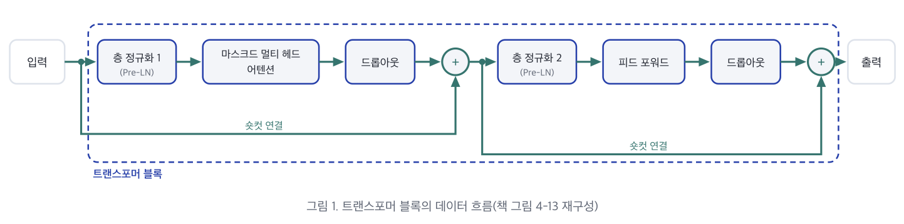
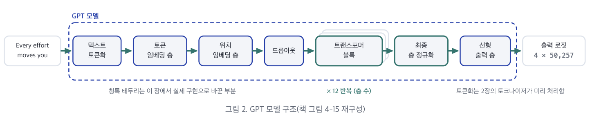

# 7장. 트랜스포머 블록과 GPT 완성

> 한양대학교 공학대학원 컴퓨터특론\
> 교재: *밑바닥부터 만들면서 배우는 LLM* (Build a Large Language Model From Scratch) — Ch 4 후반부 (4.5 ~ 4.7)\
> 자료: `7장 요약본.pdf` (5p) + `7장_실습.ipynb` 통합 정리\
> 이전 장: [5장. 코잘·멀티 헤드 어텐션](./05-causal_multihead_attention.md) · [6장. GPT 구성 요소](./06-gpt_components.md)
>
> 💡 요약본의 모든 문장·수치·표·원본 도식과 실습 노트북의 모든 코드·출력을 빠짐없이 수록하고, 직관적 비유·손계산 검증·파이토치 문법 해설은 **[보충]** 표기로 구분하여 덧붙였습니다.

---

## 학습 목표

- **6장에서 만든 구성 요소를 결합** 해 완성하는, 텍스트를 생성하는 GPT 모델
- 트랜스포머 블록(`TransformerBlock`)의 **구성 요소 배치 순서** 와 **입력·출력 크기가 같은 이유**
- 더미 블록과 더미 층 정규화를 실제 구현으로 바꾼 **GPT 모델 클래스(`GPTModel`)**
- 파라미터 **1억 6,300만** 과 **1억 2,400만** 의 차이 — **가중치 공유(`weight tying`)**
- 로짓이 가장 큰 토큰을 하나씩 추가하는 **그리디 디코딩 생성 함수(`generate_text_simple`)**

---

## 📌 목차

- [이 장의 진행](#이-장의-진행)
- [0. 실습 환경 준비와 이전 챕터 부품 불러오기](#_0-실습-환경-준비와-이전-챕터-부품-불러오기)
- **Part 1. 트랜스포머 블록 - 구성 요소를 정해진 순서로 배치한 GPT의 기본 단위**
  - [1. 기본 단위와 역할 분담](#_1-기본-단위와-역할-분담)
  - [2. 데이터 흐름](#_2-데이터-흐름)
  - [3. 블록 클래스 TransformerBlock - 토큰 벡터를 받아 같은 크기의 벡터를 반환](#_3-블록-클래스-transformerblock-토큰-벡터를-받아-같은-크기의-벡터를-반환)
  - [4. 사전 층 정규화와 사후 층 정규화](#_4-사전-층-정규화와-사후-층-정규화)
- **Part 2. GPT 모델 완성 - 더미 구현을 실제 구현으로 바꾸고 파라미터를 셈**
  - [5. GPT 모델 클래스 GPTModel - 토큰 ID 배치를 받아 토큰 위치마다 로짓을 출력](#_5-gpt-모델-클래스-gptmodel-토큰-id-배치를-받아-토큰-위치마다-로짓을-출력)
  - [6. 파라미터 개수와 가중치 공유](#_6-파라미터-개수와-가중치-공유)
  - [7. 메모리 요구량](#_7-메모리-요구량)
- **Part 3. 텍스트 생성 - 로짓이 가장 큰 토큰을 하나씩 입력에 추가**
  - [8. 자기회귀 생성](#_8-자기회귀-생성)
  - [9. 생성 함수 generate_text_simple와 그리디 디코딩](#_9-생성-함수-generate-text-simple와-그리디-디코딩)
  - [10. 훈련 전 모델의 생성 결과](#_10-훈련-전-모델의-생성-결과)
- [11. 연습문제 (4.1 ~ 4.3)](#_11-연습문제-4-1-4-3)
- [장 전체 정리 및 자기점검](#장-전체-정리-및-자기점검)

---

## 이 장의 진행


| 순서 | 파트 | 핵심 내용 |
|---|---|---|
| **먼저** | **트랜스포머 블록** | 1. 기본 단위와 역할 분담 → 2. 데이터 흐름 → 3. 블록 클래스(`TransformerBlock`) → 4. 사전·사후 층 정규화(`Pre-LN` vs `Post-LN`) |
| **다음** | **GPT 모델 완성** | 5. GPT 모델 클래스(`GPTModel`) → 6. 파라미터 개수(1억 6,300만 vs 1억 2,400만)와 가중치 공유 → 7. 메모리 요구량(621.83 MB) |
| **끝으로** | **텍스트 생성** | 8. 자기회귀(`autoregressive`) 생성 → 9. 생성 함수(`generate_text_simple`)와 그리디 디코딩 → 10. 훈련 전 모델의 생성 결과 |

---

## 0. 실습 환경 준비와 이전 챕터 부품 불러오기

7장 실습 노트북(`7장_실습.ipynb`)은 5장·6장에서 만든 부품을 그대로 불러와 조립한다.

| 이름 | 내용 | 출처 |
|---|---|---|
| `GPT_CONFIG_124M` | GPT-2 124M 설정 딕셔너리 | ch06 |
| `MultiHeadAttention` | 마스크드 멀티 헤드 어텐션 | ch05 |
| `LayerNorm` · `GELU` · `FeedForward` | 층 정규화 · 활성화 함수 · 피드 포워드 | ch06 |
| `batch` | 텍스트 2개를 토큰화한 `2 × 4` 입력 배치 | ch06 |

> ### 🧪 실습: 환경 준비 및 5장·6장 부품 불러오기
>
> ```python
> # Colab 환경 준비
> !pip install -q torch tiktoken
>
> # 공통 임포트 + GPT-2 124M 설정 (ch06)
> import torch
> import torch.nn as nn
> import tiktoken
>
> GPT_CONFIG_124M = {
>     "vocab_size": 50257,     # 어휘사전 크기
>     "context_length": 1024,  # 문맥 길이
>     "emb_dim": 768,          # 임베딩 차원
>     "n_heads": 12,           # 어텐션 헤드 개수
>     "n_layers": 12,          # 층 개수
>     "drop_rate": 0.1,        # 드롭아웃 비율
>     "qkv_bias": False,       # 쿼리, 키, 값 계산을 위한 편향
> }
> print("설정 준비 완료:", GPT_CONFIG_124M)
> ```
>
> ```text
> 설정 준비 완료: {'vocab_size': 50257, 'context_length': 1024, 'emb_dim': 768, 'n_heads': 12, 'n_layers': 12, 'drop_rate': 0.1, 'qkv_bias': False}
> ```
>
> ```python
> # 마스크드 멀티 헤드 어텐션 (ch05)
> class MultiHeadAttention(nn.Module):
>     def __init__(self, d_in, d_out,
>                  context_length, dropout, num_heads, qkv_bias=False):
>         super().__init__()
>         assert (d_out % num_heads == 0), \
>             "d_out은 num_heads로 나누어 떨어져야 합니다"
>
>         self.d_out = d_out
>         self.num_heads = num_heads
>         self.head_dim = d_out // num_heads   # 출력 차원에 맞춰 헤드별 투영 차원
>         self.W_query = nn.Linear(d_in, d_out, bias=qkv_bias)
>         self.W_key = nn.Linear(d_in, d_out, bias=qkv_bias)
>         self.W_value = nn.Linear(d_in, d_out, bias=qkv_bias)
>         self.out_proj = nn.Linear(d_out, d_out)   # 헤드 출력을 결합하는 선형 층
>         self.dropout = nn.Dropout(dropout)
>         self.register_buffer(
>             "mask",
>             torch.triu(torch.ones(context_length, context_length),
>                        diagonal=1)
>         )
>
>     def forward(self, x):
>         b, num_tokens, d_in = x.shape
>         keys = self.W_key(x)
>         queries = self.W_query(x)
>         values = self.W_value(x)
>
>         # (b, num_tokens, d_out) -> (b, num_tokens, num_heads, head_dim)
>         keys = keys.view(b, num_tokens, self.num_heads, self.head_dim)
>         values = values.view(b, num_tokens, self.num_heads, self.head_dim)
>         queries = queries.view(b, num_tokens, self.num_heads, self.head_dim)
>
>         # -> (b, num_heads, num_tokens, head_dim)
>         keys = keys.transpose(1, 2)
>         queries = queries.transpose(1, 2)
>         values = values.transpose(1, 2)
>
>         attn_scores = queries @ keys.transpose(2, 3)   # 헤드별 점곱
>         mask_bool = self.mask.bool()[:num_tokens, :num_tokens]
>         attn_scores.masked_fill_(mask_bool, -torch.inf)
>
>         attn_weights = torch.softmax(
>             attn_scores / keys.shape[-1]**0.5, dim=-1)
>         attn_weights = self.dropout(attn_weights)
>
>         context_vec = (attn_weights @ values).transpose(1, 2)
>         context_vec = context_vec.contiguous().view(
>             b, num_tokens, self.d_out)
>         context_vec = self.out_proj(context_vec)   # 선형 투영
>         return context_vec
>
> # 층 정규화 + GELU + 피드 포워드 (ch06)
> class LayerNorm(nn.Module):
>     def __init__(self, emb_dim):
>         super().__init__()
>         self.eps = 1e-5
>         self.scale = nn.Parameter(torch.ones(emb_dim))
>         self.shift = nn.Parameter(torch.zeros(emb_dim))
>
>     def forward(self, x):
>         mean = x.mean(dim=-1, keepdim=True)
>         var = x.var(dim=-1, keepdim=True, unbiased=False)
>         norm_x = (x - mean) / torch.sqrt(var + self.eps)
>         return self.scale * norm_x + self.shift
>
> class GELU(nn.Module):
>     def __init__(self):
>         super().__init__()
>
>     def forward(self, x):
>         return 0.5 * x * (1 + torch.tanh(
>             torch.sqrt(torch.tensor(2.0 / torch.pi)) *
>             (x + 0.044715 * torch.pow(x, 3))
>         ))
>
> class FeedForward(nn.Module):
>     def __init__(self, cfg):
>         super().__init__()
>         self.layers = nn.Sequential(
>             nn.Linear(cfg["emb_dim"], 4 * cfg["emb_dim"]),
>             GELU(),
>             nn.Linear(4 * cfg["emb_dim"], cfg["emb_dim"]),
>         )
>
>     def forward(self, x):
>         return self.layers(x)
>
> # 입력 배치 — 텍스트 2개를 토큰 ID로 (ch06)
> tokenizer = tiktoken.get_encoding("gpt2")
> batch = []
> txt1 = "Every effort moves you"
> txt2 = "Every day holds a"
>
> batch.append(torch.tensor(tokenizer.encode(txt1)))
> batch.append(torch.tensor(tokenizer.encode(txt2)))
> batch = torch.stack(batch, dim=0)
> print(batch)   # [2, 4] 크기의 토큰 ID 배치
> ```
>
> ```text
> tensor([[6109, 3626, 6100,  345],
>         [6109, 1110, 6622,  257]])
> ```

---

# Part 1. 트랜스포머 블록 - 구성 요소를 정해진 순서로 배치한 GPT의 기본 단위

## 1. 기본 단위와 역할 분담

블록 하나는 토큰마다 **성분 768개인 벡터** 를 받아 **같은 크기의 벡터** 를 출력한다. 그래서 구조가 같은 블록을 연결하기만 하면 블록 수를 얼마든지 늘릴 수 있고, GPT뿐 아니라 다른 LLM 구조도 이 블록을 기본 단위로 쓴다. 가장 작은 GPT-2는 블록 **12개** 를 연결한다(설정 딕셔너리의 층 수 `n_layers: 12`).

| 구분 | 핵심 내용 |
|---|---|
| **구성 요소** | • 5장의 **멀티 헤드 어텐션**, 6장의 **층 정규화·피드 포워드·숏컷 연결** 에 **드롭아웃** 과 **젤루(GELU)** 가 더해진 구성<br>• **젤루** 는 피드 포워드 안의 활성화 함수임<br>• **드롭아웃** 은 과대적합을 막기 위해 **어텐션 뒤** 와 **피드 포워드 뒤**, 두 자리에 둠 |
| **역할 분담** | • **멀티 헤드 어텐션**: 각 토큰이 **다른 토큰들을 참고** 해 문맥 벡터를 만듦 (토큰 간 관계 파악)<br>• **피드 포워드**: 성분 수를 **네 배(768 → 3,072)로 늘렸다가 되돌리는** 변환을 하는데, 이 변환은 **토큰 하나의 벡터 안에서만** 일어나고 다른 토큰은 참고하지 않음 |
| **모델 용량** | • 한 블록이 **토큰 사이의 관계 파악** 과 **토큰 각각의 변환** 을 모두 처리함<br>• 블록을 쌓으면 둘이 여러 번 반복되어 더 복잡한 패턴을 표현할 수 있음<br>• 모델이 표현할 수 있는 패턴의 범위를 **모델 용량(model capacity)** 이라고 함 |

---

## 2. 데이터 흐름



| 핵심 원리 | 상세 설명 |
|---|---|
| **같은 틀의 반복** | • **층 정규화 → 어텐션(또는 피드 포워드) → 드롭아웃 → 숏컷 연결** 의 틀이 **두 번 반복** 됨<br>• 앞쪽은 **마스크드 멀티 헤드 어텐션**(5장에서 구현한, 코잘 마스크를 적용한 멀티 헤드 어텐션), 뒤쪽은 **피드 포워드** 임<br>• 그림의 **프리 엘엔(`Pre-LN`)** 은 층 정규화가 어텐션과 피드 포워드보다 **앞에 온다** 는 뜻임 |
| **숏컷 연결** | • 앞쪽은 **블록 입력** 을, 뒤쪽은 **앞쪽의 결과** 를 드롭아웃 출력에 그대로 더함<br>• 6장에서 본 대로 **층 출력에 층 입력을 더하는 것** 임 |
| **입력과 출력의 크기가 같은 이유** | • 숏컷 연결에서 두 벡터를 더하려면 **성분 수가 같아야** 함<br>• 층 정규화와 드롭아웃은 성분 수를 바꾸지 않으므로, 어텐션과 피드 포워드가 출력 벡터의 성분 수를 입력과 같은 **768** 로 맞춤<br>• 그래서 **블록의 출력이 그대로 다음 블록의 입력** 이 되어 블록을 몇 개든 연결할 수 있음 |

---

## 3. 블록 클래스 TransformerBlock - 토큰 벡터를 받아 같은 크기의 벡터를 반환

초기화 메서드(`__init__`)는 설정 딕셔너리를 받아 구성 요소를 만들고, 포워드 메서드(`forward`)는 **그림 1의 순서대로** 적용한다.

| 구성 요소 | 만드는 방식 | 근거 |
|---|---|---|
| **멀티 헤드 어텐션 (`self.att`)** | 5장 클래스 그대로. 인수는 설정 딕셔너리 값 | 입력·출력 차원 모두 임베딩 차원 **768** |
| **피드 포워드 (`self.ff`)** | 6장 클래스 그대로 | 성분 수를 네 배로 늘려 젤루를 적용한 뒤 되돌림 |
| **층 정규화 (`norm1`, `norm2`)** | **두 개**. 어텐션 앞, 피드 포워드 앞 | 훈련되는 **스케일(`scale`)·시프트(`shift`)** 가 있고 두 자리가 정규화하는 벡터가 다르므로 **각자 따로 훈련** 해야 함 |
| **드롭아웃 (`drop_shortcut`)** | **하나**. 두 자리에서 같이 씀 | **훈련되는 파라미터가 없어** 하나로 충분함. 두 자리 모두 숏컷 연결 바로 앞이라 이름이 `drop_shortcut` |

### 포워드 메서드 동작 순서

1. 먼저 입력을 `shortcut` 변수에 저장해 둔다. **층 정규화를 적용하기 전의 입력** 을 마지막에 더해야 하기 때문이다.
2. **층 정규화(`norm1`) · 멀티 헤드 어텐션(`att`) · 드롭아웃(`drop_shortcut`)** 을 차례로 적용하고, 드롭아웃 출력에 저장해 둔 입력(`shortcut`)을 더한다.
3. 피드 포워드 쪽도 같은 순서이며, 이번에는 **어텐션까지 거친 결과** 를 `shortcut`에 저장해 두고 마지막에 더한다.

> ### 🧪 실습: TransformerBlock 클래스 구현 및 차원 보존 확인
>
> ```python
> class TransformerBlock(nn.Module):
>     def __init__(self, cfg):
>         super().__init__()
>         self.att = MultiHeadAttention(
>             d_in=cfg["emb_dim"],
>             d_out=cfg["emb_dim"],
>             context_length=cfg["context_length"],
>             num_heads=cfg["n_heads"],
>             dropout=cfg["drop_rate"],
>             qkv_bias=cfg["qkv_bias"])
>         self.ff = FeedForward(cfg)
>         self.norm1 = LayerNorm(cfg["emb_dim"])
>         self.norm2 = LayerNorm(cfg["emb_dim"])
>         self.drop_shortcut = nn.Dropout(cfg["drop_rate"])
>
>     def forward(self, x):
>         # 어텐션 블록: 층 정규화 -> 어텐션 -> 드롭아웃 -> 숏컷 덧셈
>         shortcut = x
>         x = self.norm1(x)
>         x = self.att(x)
>         x = self.drop_shortcut(x)
>         x = x + shortcut             # 원본 입력을 더합니다.
>
>         # 피드 포워드 블록: 층 정규화 -> 피드 포워드 -> 드롭아웃 -> 숏컷 덧셈
>         shortcut = x
>         x = self.norm2(x)
>         x = self.ff(x)
>         x = self.drop_shortcut(x)
>         x = x + shortcut             # 원본 입력을 더합니다.
>         return x
>
> torch.manual_seed(123)
> x = torch.rand(2, 4, 768)   # [batch_size, num_tokens, emb_dim]
> block = TransformerBlock(GPT_CONFIG_124M)
> output = block(x)
>
> print("입력 크기:", x.shape)
> print("출력 크기:", output.shape)
> ```
>
> ```text
> 입력 크기: torch.Size([2, 4, 768])
> 출력 크기: torch.Size([2, 4, 768])
> ```

- **차원 보존 확인**:
  - 입력 텍스트 두 개, 토큰 네 개, 성분 768개인 난수 텐서를 넣으면 출력 크기도 `(2, 4, 768)` 로 같다.
  - 성분 수는 같지만 각 토큰 벡터는 **이전 토큰들의 정보가 반영된 새 값** 이 된다. 입력 토큰 하나마다 출력 벡터가 하나씩 만들어지므로, 토큰 위치마다 예측이 필요한 **시퀀스-투-시퀀스(sequence-to-sequence)** 작업에 이 블록 구조를 쓸 수 있다.

---

## 4. 사전 층 정규화와 사후 층 정규화

층 정규화를 어디에 두느냐에 따라 두 가지 방식으로 나뉜다.

| 방식 | 층 정규화 위치 | 특징 |
|---|---|---|
| **사전 층 정규화 (`Pre-LayerNorm`)** | **어텐션·피드 포워드 앞** (프리 엘엔) | **이 장의 블록이 채택**. 숏컷으로 더한 결과가 그대로 다음 블록의 입력이 되어 **그레이디언트가 블록을 건너뛰는 경로가 마지막 블록까지 이어짐**. 블록이 많아도 훈련이 안정됨 |
| **사후 층 정규화 (`Post-LayerNorm`)** | **숏컷으로 더한 뒤** | **2017년 원본 트랜스포머가 채택**. 더한 뒤 층 정규화를 한 번 더 거치므로 블록이 많아질수록 **그레이디언트 소실** 이 생기기 쉬움 |

- **선택**: GPT-2를 비롯한 최근 LLM이 대부분 **사전 방식(`Pre-LN`)** 을 쓰는 이유가 바로 이 **훈련 안정성** 때문이다.
- **드롭아웃**: 어텐션 뒤와 피드 포워드 뒤에 적용해, 6장에서 본 대로 과대적합을 막는다.
- **숏컷 연결**: 어텐션과 피드 포워드 각각의 출력에 그 입력을 더한다.

---

# Part 2. GPT 모델 완성 - 더미 구현을 실제 구현으로 바꾸고 파라미터를 셈

## 5. GPT 모델 클래스 GPTModel - 토큰 ID 배치를 받아 토큰 위치마다 로짓을 출력

6장 더미 모델(`DummyGPTModel`)과 구조가 같고, 입력을 그대로 반환하던 **더미 트랜스포머 블록** 과 **더미 층 정규화** 를 실제 구현(`TransformerBlock`, `LayerNorm`)으로 바꾼다. 6장 구현 순서 일곱 단계 가운데 **마지막 단계** 다.



| 항목 | 설명 |
|---|---|
| **블록 수** | 설정 딕셔너리의 층 수(`n_layers`)만큼 블록을 만들어 시퀀셜(`nn.Sequential`)로 연결함. 가장 작은 GPT-2는 **12개**, 가장 큰 GPT-2(15억 4,200만)는 **48개** |
| **출력 층 (`out_head`)** | • 마지막 블록의 출력은 **최종 층 정규화(`final_norm`)** 를 거쳐 출력 층에 전달됨<br>• 출력 층은 토큰마다 성분 768개의 벡터를 받아 어휘사전 크기인 **5만 257개의 로짓** 을 출력함(**편향 없는 리니어 층**, `bias=False`)<br>• 로짓은 소프트맥스를 적용하기 전의 값이라 **아직 확률이 아님** |
| **마지막 행만 쓰는 이유** | • 입력 토큰이 네 개면 로짓 벡터도 위치마다 하나씩 **네 개** 가 계산됨<br>• 다음 토큰을 예측할 때는 **네 번째(마지막) 로짓 벡터만** 씀. 코잘 마스크 때문에 각 위치는 이전 토큰까지만 참고하므로, **네 토큰을 모두 참고한 위치는 마지막 위치뿐** 이기 때문임 |
| **원본 구조를 따르는 이유** | • 완성한 모델은 8장에서 직접 사전 훈련하고, 9장에서는 오픈AI가 공개한 GPT-2의 가중치를 그대로 불러와 사용함<br>• 그 가중치를 쓰려면 **층의 종류와 크기가 원본 GPT-2와 같아야** 하므로, 구현은 원본 구조를 그대로 따름 |

> ### 🧪 실습: GPTModel 클래스 구현 및 정방향 계산
>
> ```python
> class GPTModel(nn.Module):
>     def __init__(self, cfg):
>         super().__init__()
>         self.tok_emb = nn.Embedding(cfg["vocab_size"], cfg["emb_dim"])
>         self.pos_emb = nn.Embedding(cfg["context_length"], cfg["emb_dim"])
>         self.drop_emb = nn.Dropout(cfg["drop_rate"])
>
>         self.trf_blocks = nn.Sequential(
>             *[TransformerBlock(cfg) for _ in range(cfg["n_layers"])])
>
>         self.final_norm = LayerNorm(cfg["emb_dim"])
>         self.out_head = nn.Linear(
>             cfg["emb_dim"], cfg["vocab_size"], bias=False
>         )
>
>     def forward(self, in_idx):
>         batch_size, seq_len = in_idx.shape
>         tok_embeds = self.tok_emb(in_idx)
>         pos_embeds = self.pos_emb(
>             torch.arange(seq_len, device=in_idx.device)   # 입력 위치에 따라 CPU/GPU 자동 대응
>         )
>         x = tok_embeds + pos_embeds
>         x = self.drop_emb(x)
>         x = self.trf_blocks(x)
>         x = self.final_norm(x)
>         logits = self.out_head(x)   # 다음 토큰에 대한 정규화되지 않은 확률(로짓)
>         return logits
>
> torch.manual_seed(123)
> model = GPTModel(GPT_CONFIG_124M)
> out = model(batch)
>
> print("입력 배치:\n", batch)
> print("\n출력 크기:", out.shape)   # [2, 4, 50257]
> ```
>
> ```text
> 입력 배치:
>  tensor([[6109, 3626, 6100,  345],
>         [6109, 1110, 6622,  257]])
>
> 출력 크기: torch.Size([2, 4, 50257])
> ```

---

## 6. 파라미터 개수와 가중치 공유

모델의 파라미터는 **1억 6,300만 개(`163,009,536`)** 로, 가장 작은 GPT-2의 **1억 2,400만** 보다 약 **3,900만 개** 많다.

- **원인**:
  - 파라미터가 가장 많은 층은 **토큰 임베딩 층(`tok_emb`)** 과 **출력 층(`out_head`)** 이다.
  - 두 층 모두 토큰 종류 5만 257개마다 성분 768개씩이라, 각각 $50,257 \times 768 \approx 3,860\text{만 개}$(`38,597,376`개)의 파라미터를 가진다.
  - 원본 GPT-2는 이 두 층이 **가중치 행렬 하나를 같이 쓰므로**, 약 3,860만 개가 적은 **1억 2,400만(`124,412,160`)** 이다.

| 확인 항목 | 실행 결과 | 의미 |
|---|---|---|
| **두 층의 가중치 크기** | `[50257, 768]` 둘 다 | 크기가 같으므로 행렬 하나를 두 층에서 같이 쓸 수 있음. 이 방식이 **가중치 공유(`weight tying`, 가중치 묶기)** |
| **출력 층 파라미터를 뺀 개수** | `124,412,160` | **원본 GPT-2의 파라미터 수와 같음** |

- **따로 두는 이유**:
  - 가중치를 공유하면 파라미터가 줄어 메모리가 적게 들지만, **두 층을 따로 두는 쪽이 훈련과 성능에 유리** 하다.
  - 그래서 이 구현과 최근 LLM 대부분은 두 층을 따로 둔다. 왜 유리한지는 9장에서 원본 가중치를 불러올 때 다룬다.

> ### 🧪 실습: 총 파라미터 개수와 가중치 묶기 확인
>
> ```python
> total_params = sum(p.numel() for p in model.parameters())
> print(f"총 파라미터 개수: {total_params:,}")   # 163,009,536
>
> print("토큰 임베딩 층 크기:", model.tok_emb.weight.shape)   # [50257, 768]
> print("출력 층 크기:", model.out_head.weight.shape)        # [50257, 768]
>
> total_params_gpt2 = (
>     total_params - sum(p.numel()
>     for p in model.out_head.parameters())
> )
> print(f"가중치 묶기를 고려한 훈련 가능한 파라미터 개수: {total_params_gpt2:,}")   # 124,412,160
> ```
>
> ```text
> 총 파라미터 개수: 163,009,536
> 토큰 임베딩 층 크기: torch.Size([50257, 768])
> 출력 층 크기: torch.Size([50257, 768])
> 가중치 묶기를 고려한 훈련 가능한 파라미터 개수: 124,412,160
> ```

---

## 7. 메모리 요구량

- **계산**:
  - 파라미터 하나는 **32비트 실수(`float32`)**, 즉 **4바이트** 로 저장하므로, 파라미터 수에 4를 곱하면 전체 바이트 수다.
  - $1024^2$ (`1024 * 1024`)으로 나누어 메가바이트로 바꾸면 **약 622메가바이트(`621.83 MB`)** 가 필요하다.
- **범위**:
  - 이는 **파라미터만 저장할 때의 메모리** 이고, 훈련할 때는 **그레이디언트와 옵티마이저 상태** 도 저장해야 하므로 실제로는 더 필요하다.

> ### 🧪 실습: 모델 메모리 요구량 계산
>
> ```python
> total_size_bytes = total_params * 4                  # float32: 파라미터당 4바이트
> total_size_mb = total_size_bytes / (1024 * 1024)    # MB 단위 변환
> print(f"모델에 필요한 메모리 공간: {total_size_mb:.2f} MB")   # 621.83 MB
> ```
>
> ```text
> 모델에 필요한 메모리 공간: 621.83 MB
> ```

---

# Part 3. 텍스트 생성 - 로짓이 가장 큰 토큰을 하나씩 입력에 추가

## 8. 자기회귀 생성

모델에 토큰 ID를 넣으면 **마지막 위치의 로짓** 에서 다음 토큰 하나를 고르고, 고른 토큰을 **입력 뒤에 붙여 다시 모델에 넣는다**. 모델의 출력을 다음 입력으로 쓰는 이 방식을 **자기회귀(`autoregressive`) 생성** 이라고 한다.

| 단계 | 반복 한 번의 처리 |
|---|---|
| **1 · 2** | 입력 텍스트를 토큰 ID로 바꿔 모델에 넣음. 토큰 위치마다 어휘사전 크기의 로짓 벡터가 하나씩 출력됨 |
| **3** | **마지막 위치의 로짓 벡터만** 선택. 마지막 위치만 입력 토큰 전체를 참고했기 때문 |
| **4 · 5** | 소프트맥스로 토큰 종류마다 다음에 올 확률을 계산하고, **확률이 가장 큰 토큰의 ID** 를 선택(`argmax`) |
| **6** | 선택한 토큰 ID를 **입력 뒤에 추가** 해(`torch.cat`) 다음 반복의 입력으로 씀 |

- **반복**:
  - 반복할 때마다 입력 뒤에 토큰이 하나씩 붙고, 모델은 붙은 토큰까지 포함한 입력 전체를 받아 다음 토큰을 예측한다.
  - 토큰 하나를 예측해 입력에 추가하는 과정을 지정한 횟수(`max_new_tokens`)만큼 반복하면, 그 길이의 텍스트가 생성된다.

---

## 9. 생성 함수 generate_text_simple와 그리디 디코딩

모델(`model`), 토큰 ID 배치(`idx`), 생성할 토큰 수(`max_new_tokens`), 문맥 길이(`context_size`)를 받아, 받은 배치 뒤에 생성한 토큰 ID를 이어 붙여 반환한다. 텍스트로의 디코딩은 반환받은 뒤 한 번에 한다.

| 핵심 요소 | 설명 |
|---|---|
| **문맥 자르기 (`idx[:, -context_size:]`)** | • 반복하면서 입력이 계속 길어지는데, 모델은 문맥 길이인 **1,024개** 까지만 받을 수 있음<br>• 입력이 1,024개를 넘으면 앞쪽 토큰은 버리고 **가장 최근 1,024개만** 모델에 넣음. **위치 임베딩이 1,024개 위치까지만 있기 때문** 임 |
| **노 그래드 (`torch.no_grad()`)** | • 파이토치는 모델을 실행할 때 훈련에 쓸 역전파를 위해 중간 계산값을 모두 저장해 둠<br>• 생성은 역전파를 하지 않으므로, `no_grad` 안에서 실행해 저장을 생략하고 **메모리와 시간을 아낌** |
| **그리디 디코딩 (`greedy decoding`)** | 반복마다 **확률이 가장 큰 토큰 하나** 를 선택하는 방식 |
| **소프트맥스의 단조성** | • 소프트맥스는 입력이 클수록 출력도 커지는 **단조 함수(monotonic function)** 라, 로짓 벡터에 적용하면 **로짓이 가장 컸던 토큰이 확률도 가장 큼**<br>• 가장 큰 것만 고를 때는 확률로 바꾸지 않고 **로짓에서 바로 골라도(`argmax`) 결과가 같음**<br>• 함수에 소프트맥스를 둔 이유는 로짓이 확률로 바뀌는 과정을 설명하기 위해서임 |
| **9장 예고** | • 매번 가장 큰 토큰만 고르면 **같은 입력에는 항상 같은 문장이 생성** 됨<br>• 9장에서는 확률에 비례해 토큰을 무작위로 선택하는 **샘플링 기법(온도 스케일링, 탑-k 샘플링)** 을 씀. 확률이 낮은 토큰도 가끔 선택되므로 같은 입력에서도 다른 문장이 생성됨 |

> ### 🧪 실습: generate_text_simple 정의
>
> ```python
> def generate_text_simple(model, idx,      # idx: (batch, num_tokens) 크기의 현재 문맥
>                          max_new_tokens, context_size):
>     for _ in range(max_new_tokens):
>         idx_cond = idx[:, -context_size:]  # 지원 문맥 크기 초과 시 잘라냄
>         with torch.no_grad():
>             logits = model(idx_cond)
>         logits = logits[:, -1, :]          # 마지막 타임 스텝만: (batch, vocab_size)
>         probas = torch.softmax(logits, dim=-1)                 # (batch, vocab_size)
>         idx_next = torch.argmax(probas, dim=-1, keepdim=True)  # (batch, 1)
>         idx = torch.cat((idx, idx_next), dim=1)                # (batch, num_tokens+1)
>     return idx
> ```

---

## 10. 훈련 전 모델의 생성 결과

- **실행**:
  - `"Hello, I am"` 을 토큰 ID 네 개로 바꾸고 **언스퀴즈(`unsqueeze(0)`)** 로 배치 차원을 추가한 뒤, 드롭아웃을 적용하지 않는 **평가 모드(`eval`)** 에서 토큰 여섯 개를 생성한다.
  - 출력은 열 개(입력 4개 + 생성 6개). **스퀴즈(`squeeze(0)`)** 로 배치 차원을 제거하고 텍스트로 바꾼다.
- **결과**:
  - `"Hello, I am Featureiman Byeswickattribute argue"` — 생성된 토큰들은 일관된 문장을 이루지 않는다. 가중치가 아직 훈련하지 않은 **난수 초기값** 이기 때문이며, 일관된 텍스트를 생성하려면 **8장의 훈련** 이 필요하다.

> ### 🧪 실습: 시작 문맥 인코딩 및 텍스트 생성·디코딩
>
> ```python
> start_context = "Hello, I am"
> encoded = tokenizer.encode(start_context)
> print("인코딩된 ID:", encoded)                    # [15496, 11, 314, 716]
> encoded_tensor = torch.tensor(encoded).unsqueeze(0)  # 배치 차원 추가
> print("encoded_tensor.shape:", encoded_tensor.shape) # torch.Size([1, 4])
>
> model.eval()          # 훈련이 아니므로 드롭아웃을 끕니다.
> out = generate_text_simple(
>     model=model,
>     idx=encoded_tensor,
>     max_new_tokens=6,
>     context_size=GPT_CONFIG_124M["context_length"]
> )
> print("출력:", out)
> print("출력 길이:", len(out[0]))   # 10 = 입력 4 + 생성 6
>
> decoded_text = tokenizer.decode(out.squeeze(0).tolist())
> print(decoded_text)
> ```
>
> ```text
> 인코딩된 ID: [15496, 11, 314, 716]
> encoded_tensor.shape: torch.Size([1, 4])
> 출력: tensor([[15496,    11,   314,   716, 27018, 24086, 47843, 30961, 42348,  7267]])
> 출력 길이: 10
> Hello, I am Featureiman Byeswickattribute argue
> ```

---

## 11. 연습문제 (4.1 ~ 4.3)

7장 실습 노트북 말미에 수록된 세 가지 연습문제다.

- **연습문제 4.1**: 트랜스포머 블록 안의 **피드 포워드 모듈(`block.ff`)** 과 **멀티 헤드 어텐션 모듈(`block.att`)** 의 파라미터 개수를 비교하는 문제다.
- **연습문제 4.2**: 코드는 그대로 두고 **설정 딕셔너리만 바꿔** 더 큰 GPT 모델을 만드는 문제다.
- **연습문제 4.3**: `drop_rate` 하나 대신 임베딩 층·숏컷 연결·어텐션 모듈에 **각각 다른 드롭아웃 비율** 을 적용하는 문제다.

| 모델 | 임베딩 차원 (`emb_dim`) | 트랜스포머 블록 (`n_layers`) | 어텐션 헤드 (`n_heads`) |
|---|---|---|---|
| **GPT-2 small (124M)** | 768 | 12 | 12 |
| **GPT-2 medium** | 1,024 | 24 | 16 |
| **GPT-2 large** | 1,280 | 36 | 20 |
| **GPT-2 XL** | 1,600 | 48 | 25 |

> ### 🧪 실습: 연습문제 4.1 & 4.2
>
> ```python
> # 연습문제 4.1 — 모듈별 파라미터 개수
> block = TransformerBlock(GPT_CONFIG_124M)
>
> ff_params = sum(p.numel() for p in block.ff.parameters())
> att_params = sum(p.numel() for p in block.att.parameters())
> print(f"피드 포워드 모듈 파라미터: {ff_params:,}")
> print(f"멀티 헤드 어텐션 모듈 파라미터: {att_params:,}")
>
> # 연습문제 4.2 — 설정만 바꿔 더 큰 모델 정의
> GPT_CONFIG_MEDIUM = {**GPT_CONFIG_124M, "emb_dim": 1024, "n_layers": 24, "n_heads": 16}
> GPT_CONFIG_LARGE  = {**GPT_CONFIG_124M, "emb_dim": 1280, "n_layers": 36, "n_heads": 20}
> GPT_CONFIG_XL     = {**GPT_CONFIG_124M, "emb_dim": 1600, "n_layers": 48, "n_heads": 25}
> for name, cfg in [("medium", GPT_CONFIG_MEDIUM), ("large", GPT_CONFIG_LARGE), ("XL", GPT_CONFIG_XL)]:
>     print(f"GPT-2 {name}: emb_dim={cfg['emb_dim']}, n_layers={cfg['n_layers']}, n_heads={cfg['n_heads']}")
> ```
>
> ```text
> 피드 포워드 모듈 파라미터: 4,722,432
> 멀티 헤드 어텐션 모듈 파라미터: 2,360,064
> GPT-2 medium: emb_dim=1024, n_layers=24, n_heads=16
> GPT-2 large: emb_dim=1280, n_layers=36, n_heads=20
> GPT-2 XL: emb_dim=1600, n_layers=48, n_heads=25
> ```

> 💡 **[보충] 왜 피드 포워드 파라미터(`4,722,432`)가 어텐션 파라미터(`2,360,064`)의 거의 2배일까?**
> - **멀티 헤드 어텐션**: $W_q, W_k, W_v$ 세 행렬(편향 없음, $3 \times 768 \times 768 = 1,769,472$) + 출력 투영 `out_proj`(편향 있음, $768 \times 768 + 768 = 590,592$) = **`2,360,064`개**
> - **피드 포워드**: 첫 번째 리니어($768 \times 3072 + 3072 = 2,362,368$) + 두 번째 리니어($3072 \times 768 + 768 = 2,360,064$) = **`4,722,432`개** (4배 확장 층 2개가 있어 어텐션의 $768 \times 768$ 행렬 4개보다 딱 2배 크다!)

---

## 장 전체 정리 및 자기점검

### 📋 요약본 장 전체 정리

| 주제 | 핵심 요약 |
|---|---|
| **트랜스포머 블록** | • **층 정규화 → 어텐션(또는 피드 포워드) → 드롭아웃 → 숏컷 연결** 의 틀을 두 번 반복한 GPT의 기본 단위이며, **입력과 출력의 성분 수가 같아** 블록 수를 얼마든지 늘릴 수 있음<br>• 층 정규화를 앞에 두는 **사전 층 정규화(`Pre-LN`)** 는 그레이디언트가 블록을 건너뛰는 경로를 마지막 블록까지 유지해 훈련을 안정시킴 |
| **GPT 모델 클래스** | • 6장 더미 모델의 더미 블록과 더미 층 정규화를 실제 구현으로 바꾼 것임<br>• 파라미터는 **1억 6,300만 개** 이며, 원본처럼 토큰 임베딩 층과 출력 층이 **가중치를 공유(`weight tying`)** 하면 **1억 2,400만 개** 임 |
| **텍스트 생성** | • 마지막 위치의 로짓에서 확률이 가장 큰 토큰을 골라 입력에 추가하는 **그리디 디코딩** 을 반복하는 **자기회귀(`autoregressive`)** 방식임<br>• 훈련 전 모델은 일관되지 않은 텍스트를 생성하며, **8장** 에서 이 모델을 사전 훈련함 |

### ✅ 자기점검 질문 (Q1 ~ Q8)

**Q1.** 트랜스포머 블록 안에서 멀티 헤드 어텐션과 피드 포워드 네트워크는 각각 어떤 역할을 분담하는가?

<details><summary>▶ 정답 보기</summary>

- **멀티 헤드 어텐션**: 각 토큰이 **다른 토큰들을 참고** 해 문맥 벡터를 만든다(토큰 사이의 관계 파악).
- **피드 포워드**: 성분 수를 4배(768 → 3,072)로 늘렸다가 되돌리는 변환을 **토큰 하나의 벡터 안에서만 개별적으로** 수행한다(다른 토큰은 참고하지 않음).
</details>

**Q2.** `TransformerBlock` 초기화 메서드에서 층 정규화(`norm1`, `norm2`)는 왜 두 개를 따로 만들고, 드롭아웃(`drop_shortcut`)은 왜 하나만 만들어 같이 쓰는가?

<details><summary>▶ 정답 보기</summary>

- **층 정규화**: 훈련되는 파라미터(`scale`, `shift`)가 있고 어텐션 앞과 피드 포워드 앞이 정규화하는 벡터의 분포가 다르므로 **각자 따로 훈련** 해야 한다.
- **드롭아웃**: **훈련되는 파라미터가 전혀 없으므로** 객체 하나로 두 자리에서 같이 써도 완전히 동일하게 동작한다.
</details>

**Q3.** 사전 층 정규화(`Pre-LayerNorm`)와 사후 층 정규화(`Post-LayerNorm`)의 위치 차이와, 최근 LLM이 사전 층 정규화를 선호하는 이유는?

<details><summary>▶ 정답 보기</summary>

- **사전 층 정규화(`Pre-LN`)**: 어텐션과 피드 포워드 **앞** 에 둔다. 숏컷으로 더한 결과가 그대로 다음 블록 입력으로 이어져 **그레이디언트가 블록을 건너뛰는 경로가 마지막 블록까지 막힘없이 유지** 되므로 깊은 모델도 훈련이 안정된다.
- **사후 층 정규화(`Post-LN`)**: 숏컷으로 더한 **뒤** 에 둔다(2017 원본 트랜스포머). 숏컷 덧셈 후 정규화를 또 거치므로 블록이 깊어지면 그레이디언트 소실이 생기기 쉽다.
</details>

**Q4.** 입력 토큰이 4개일 때 `GPTModel`은 로짓 벡터를 위치마다 4개 출력한다. 다음 토큰을 예측할 때 왜 **마지막(네 번째) 로짓 벡터만** 사용하는가?

<details><summary>▶ 정답 보기</summary>

코잘 마스크(Causal Mask) 때문에 각 위치는 자기 자신과 이전 토큰까지만 참고하므로, **입력된 네 토큰 전체를 모두 참고한 위치는 마지막 위치뿐** 이기 때문이다.
</details>

**Q5.** 우리가 구현한 `GPTModel`의 파라미터 수가 1억 2,400만 개가 아니라 **1억 6,300만 개(`163,009,536`)** 가 나오는 이유는 무엇이며, 왜 원본과 달리 두 층을 분리했는가?

<details><summary>▶ 정답 보기</summary>

원본 GPT-2는 크기가 `[50257, 768]`로 같은 **토큰 임베딩 층(`tok_emb`)과 선형 출력 층(`out_head`)이 가중치 행렬 하나를 공유(`weight tying`)** 하지만, 우리 구현은 두 층을 따로 두었기 때문에 $50,257 \times 768 \approx 3,860\text{만 개}$만큼 파라미터가 더 많다. 메모리는 더 들지만 두 층을 분리하는 쪽이 훈련과 성능에 더 유리하다.
</details>

**Q6.** 1억 6,300만 개 파라미터를 32비트 부동소수점(`float32`)으로 저장할 때 필요한 메모리 용량을 계산하는 식과 결과는?

<details><summary>▶ 정답 보기</summary>

`float32`는 파라미터당 **4바이트** 이므로:
$$\frac{163,009,536 \times 4\text{ bytes}}{1024 \times 1024} \approx \mathbf{621.83\text{ MB}}$$
(단, 훈련 시에는 그레이디언트와 옵티마이저 상태도 저장해야 하므로 실제로는 더 많은 메모리가 필요하다.)
</details>

**Q7.** `generate_text_simple`에서 매 반복마다 `idx[:, -context_size:]`로 문맥을 자르는 이유와, 그리디 디코딩에서 소프트맥스를 생략하고 로짓에 바로 `argmax`를 적용해도 결과가 같은 이유는?

<details><summary>▶ 정답 보기</summary>

- **문맥 자르기**: 위치 임베딩(`pos_emb`)이 문맥 길이(`context_size=1024`) 위치까지만 정의되어 있으므로, 입력이 그 길이를 넘으면 앞쪽 토큰을 버리고 가장 최근 1,024개만 넣어야 한다.
- **소프트맥스 생략 가능 이유**: 소프트맥스는 입력이 클수록 출력도 커지는 **단조 증가 함수** 이므로, 로짓이 가장 큰 인덱스와 소프트맥스 확률이 가장 큰 인덱스가 항상 일치한다.
</details>

**Q8.** 생성할 때 `model.eval()`과 `with torch.no_grad():`를 함께 쓰는 이유는 각각 무엇인가?

<details><summary>▶ 정답 보기</summary>

- `model.eval()`: 평가 모드로 전환하여 **드롭아웃을 비활성화** 한다(생성 시 무작위로 성분이 꺼지지 않게 함).
- `with torch.no_grad():`: 생성 시에는 역전파를 하지 않으므로, 역전파용 중간 계산 그래프 저장을 생략하여 **메모리와 계산 시간을 아낀다**.
</details>
