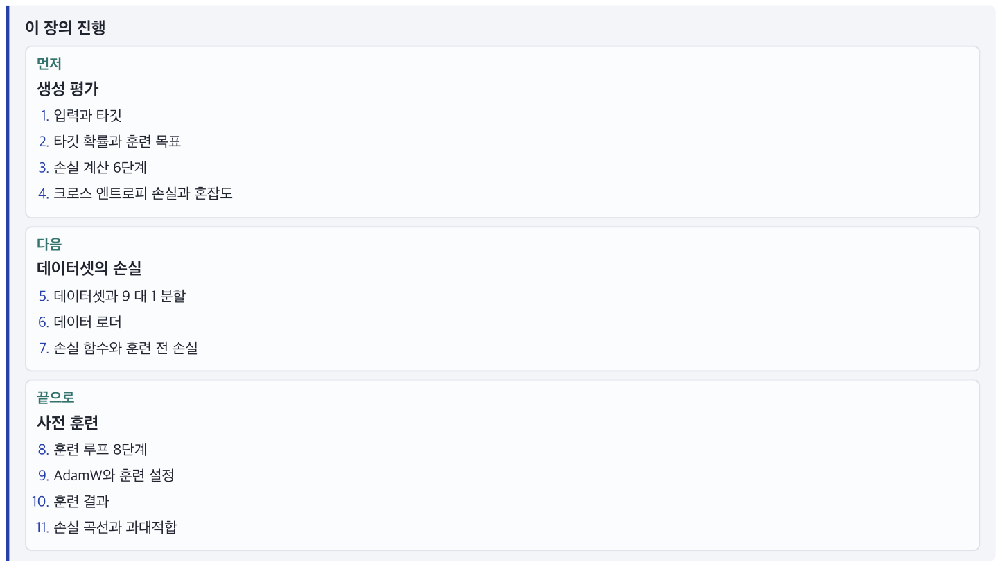
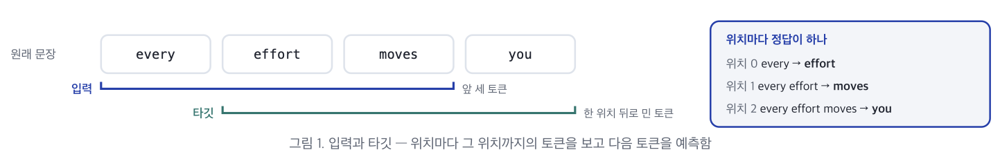
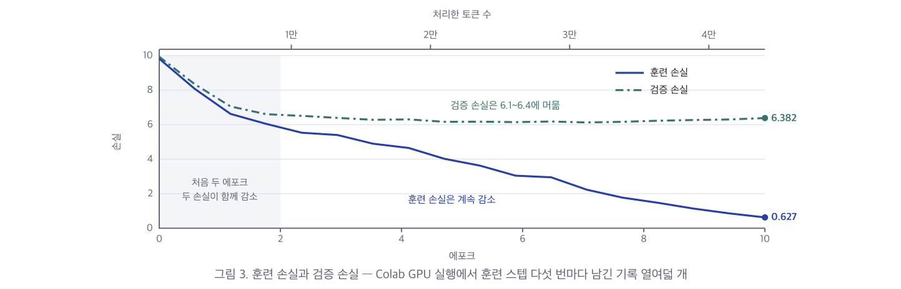

# 8장. 생성 평가와 사전 훈련

> 한양대학교 공학대학원 컴퓨터특론\
> 교재: *밑바닥부터 만들면서 배우는 LLM* (Build a Large Language Model From Scratch) — Ch 5 전반부 (5.1 ~ 5.2)\
> 자료: `8장_요약본.pdf` (7p) + `8장_실습.ipynb` 통합 정리\
> 이전 장: [6장. GPT 구성 요소](./06-gpt_components.md) · [7장. 트랜스포머 블록과 GPT 완성](./07-transformer_block_gpt.md)
>
> 💡 요약본(7p)의 모든 개념·수식·표·원본 도식과 실습 노트북(`8장_실습.ipynb`)의 전체 코드·실행 결과를 빠짐없이 통합 정리했습니다. 이해를 돕는 부연 설명은 **[보충]** 표기로 구분했습니다.

---

## 학습 목표

- **7장에서 만든 GPT 모델을 실제로 훈련** 시키는 과정
- 생성된 텍스트의 품질을 숫자 하나로 평가하는 **크로스 엔트로피 손실(`cross-entropy loss`)** 과 **혼잡도(`perplexity`)**
- 짧은 소설 데이터셋(*The Verdict*)을 **훈련 세트와 검증 세트로 나누고(9:1)** 손실을 구하는 방법
- 파이토치의 표준 훈련 루프로 가중치를 수정하는 **사전 훈련 함수(`train_model_simple`)** 와 **과대적합(`overfitting`)** 의 의미

---

## 📌 목차

- [이 장의 진행](#이-장의-진행)
- [0. 실습 환경 준비와 이전 챕터 부품 불러오기](#_0-실습-환경-준비와-이전-챕터-부품-불러오기)
- **Part 1. 생성 평가 - 생성 결과를 손실이라는 숫자 하나로 평가**
  - [1. 입력과 타깃](#_1-입력과-타깃)
  - [2. 타깃 확률과 훈련 목표](#_2-타깃-확률과-훈련-목표)
  - [3. 손실 계산 6단계](#_3-손실-계산-6단계)
  - [4. 크로스 엔트로피 손실과 혼잡도](#_4-크로스-엔트로피-손실과-혼잡도)
- **Part 2. 데이터셋의 손실 - 훈련 세트와 검증 세트 전체에서 손실을 구함**
  - [5. 데이터셋과 9 대 1 분할](#_5-데이터셋과-9-대-1-분할)
  - [6. 데이터 로더](#_6-데이터-로더)
  - [7. 손실 함수와 훈련 전 손실](#_7-손실-함수와-훈련-전-손실)
- **Part 3. 사전 훈련 - 손실을 낮추는 방향으로 가중치를 반복해서 고침**
  - [8. 훈련 루프 8단계 train_model_simple](#_8-훈련-루프-8단계-train-model-simple)
  - [9. AdamW와 훈련 설정](#_9-adamw와-훈련-설정)
  - [10. 훈련 결과](#_10-훈련-결과)
  - [11. 손실 곡선과 과대적합](#_11-손실-곡선과-과대적합)
- [12. 8장 실습 과제 완벽 가이드 (마감 11월 16일)](#_12-8장-실습-과제-완벽-가이드-마감-11월-16일)
- [장 전체 정리 및 자기점검](#장-전체-정리-및-자기점검)

---

## 이 장의 진행



| 순서 | 파트 | 핵심 내용 |
|---|---|---|
| **먼저** | **생성 평가** | 1. 입력과 타깃 → 2. 타깃 확률과 훈련 목표 → 3. 손실 계산 6단계 → 4. 크로스 엔트로피 손실(`cross_entropy`)과 혼잡도(`perplexity`) |
| **다음** | **데이터셋의 손실** | 5. 데이터셋(*The Verdict*)과 9 대 1 분할 → 6. 데이터 로더(`train_loader`, `val_loader`) → 7. 손실 함수(`calc_loss_batch`, `calc_loss_loader`)와 훈련 전 손실 |
| **끝으로** | **사전 훈련** | 8. 훈련 루프 8단계(`train_model_simple`) → 9. `AdamW`와 훈련 설정 → 10. 훈련 결과(10 에포크) → 11. 손실 곡선과 과대적합·체크포인트 저장 |

---

## 0. 실습 환경 준비와 이전 챕터 부품 불러오기

8장 실습 노트북(`8장_실습.ipynb`)은 ch03 ~ ch07에서 만든 데이터 로더, 어텐션, 트랜스포머 블록, `GPTModel`, `generate_text_simple`을 그대로 불러오며, 계산량을 줄이기 위해 **문맥 길이(`context_length`)만 1,024에서 256으로 낮추어** 사용한다.

| 이름 | 내용 | 출처 |
|---|---|---|
| `GPTDatasetV1` · `create_dataloader_v1` | 슬라이딩 윈도 데이터셋 · 데이터 로더 | ch03 |
| `MultiHeadAttention` | 마스크드 멀티 헤드 어텐션 | ch05 |
| `LayerNorm` · `GELU` · `FeedForward` | 층 정규화 · 활성화 함수 · 피드 포워드 | ch06 |
| `TransformerBlock` · `GPTModel` · `generate_text_simple` | 트랜스포머 블록 · GPT 모델 · 그리디 생성 | ch07 |

> ### 🧪 실습: 환경 준비 및 ch03~ch07 부품 불러오기
>
> ```python
> # Colab 환경 준비 + The Verdict 텍스트 자동 다운로드
> !pip install -q torch tiktoken matplotlib
>
> import os
> import urllib.request
>
> if not os.path.exists("the-verdict.txt"):
>     url = (
>         "https://raw.githubusercontent.com/rasbt/"
>         "LLMs-from-scratch/main/ch02/01_main-chapter-code/"
>         "the-verdict.txt"
>     )
>     urllib.request.urlretrieve(url, "the-verdict.txt")
> print("the-verdict.txt 준비 완료:", os.path.getsize("the-verdict.txt"), "bytes")
> ```
>
> ```text
> the-verdict.txt 준비 완료: 20479 bytes
> ```
>
> ```python
> # 데이터셋 · 데이터 로더 (ch03)
> import torch
> import torch.nn as nn
> from torch.utils.data import Dataset, DataLoader
> import tiktoken
>
> class GPTDatasetV1(Dataset):
>     def __init__(self, txt, tokenizer, max_length, stride):
>         self.input_ids = []
>         self.target_ids = []
>
>         token_ids = tokenizer.encode(txt, allowed_special={"<|endoftext|>"})
>         for i in range(0, len(token_ids) - max_length, stride):
>             input_chunk = token_ids[i:i + max_length]
>             target_chunk = token_ids[i + 1: i + max_length + 1]
>             self.input_ids.append(torch.tensor(input_chunk))
>             self.target_ids.append(torch.tensor(target_chunk))
>
>     def __len__(self):
>         return len(self.input_ids)
>
>     def __getitem__(self, idx):
>         return self.input_ids[idx], self.target_ids[idx]
>
>
> def create_dataloader_v1(txt, batch_size=4, max_length=256,
>                          stride=128, shuffle=True, drop_last=True,
>                          num_workers=0):
>     tokenizer = tiktoken.get_encoding("gpt2")
>     dataset = GPTDatasetV1(txt, tokenizer, max_length, stride)
>     dataloader = DataLoader(
>         dataset,
>         batch_size=batch_size,
>         shuffle=shuffle,
>         drop_last=drop_last,
>         num_workers=num_workers
>     )
>     return dataloader
>
> print("GPTDatasetV1 / create_dataloader_v1 정의 완료")
> ```
>
> (※ `MultiHeadAttention`, `LayerNorm`, `GELU`, `FeedForward`, `TransformerBlock`, `GPTModel`, `generate_text_simple` 클래스 정의는 [7장](./07-transformer_block_gpt.md)과 동일하게 불러온다.)

---

# Part 1. 생성 평가 - 생성 결과를 손실이라는 숫자 하나로 평가

## 1. 입력과 타깃

훈련 전 모델은 `"Every effort moves you rentingetic wasnم refres RexMeCHicular stren"` 처럼 뜻이 없는 텍스트를 생성한다. 훈련으로 품질이 나아지는지 확인하려면 **생성 결과를 숫자로 평가하는 지표** 가 필요하다.

이 장은 훈련에 드는 계산을 줄이려고 **문맥 길이(`context_length`)만 1,024에서 256으로 낮추고**, 나머지 설정은 7장의 GPT 모델과 같게 둔다.

> ### 🧪 실습: 문맥 길이 256 설정 및 텍스트-토큰 변환 유틸리티 함수
>
> ```python
> GPT_CONFIG_124M = {
>     "vocab_size": 50257,    # 어휘사전 크기
>     "context_length": 256,  # 문맥 길이 (원본 1024에서 축소)
>     "emb_dim": 768,         # 임베딩 차원
>     "n_heads": 12,          # 어텐션 헤드 개수
>     "n_layers": 12,         # 층 개수
>     "drop_rate": 0.1,       # 드롭아웃 비율
>     "qkv_bias": False       # 쿼리-키-값 편향 여부
> }
>
> torch.manual_seed(123)
> model = GPTModel(GPT_CONFIG_124M)
> model.eval()  # 추론 시에는 드롭아웃 비활성화
> print("GPTModel(context_length=256) 준비 완료")
>
> # 리스팅 5.1 — 텍스트와 토큰 ID 변환 유틸리티 함수
> def text_to_token_ids(text, tokenizer):
>     encoded = tokenizer.encode(text, allowed_special={'<|endoftext|>'})
>     encoded_tensor = torch.tensor(encoded).unsqueeze(0)  # 배치 차원 추가
>     return encoded_tensor
>
> def token_ids_to_text(token_ids, tokenizer):
>     flat = token_ids.squeeze(0)  # 배치 차원 제거
>     return tokenizer.decode(flat.tolist())
>
> start_context = "Every effort moves you"
> tokenizer = tiktoken.get_encoding("gpt2")
>
> token_ids = generate_text_simple(
>     model=model,
>     idx=text_to_token_ids(start_context, tokenizer),
>     max_new_tokens=10,
>     context_size=GPT_CONFIG_124M["context_length"]
> )
> print("출력 텍스트:\n", token_ids_to_text(token_ids, tokenizer))
> ```
>
> ```text
> GPTModel(context_length=256) 준비 완료
> 출력 텍스트:
>  Every effort moves you rentingetic wasnم refres RexMeCHicular stren
> ```



| 항목 | 핵심 내용 |
|---|---|
| **타깃 (`targets`)** | • 입력을 **한 위치 뒤로 민 토큰 시퀀스** 임. 3장 데이터 로더가 입력과 타깃을 만든 방식과 같음<br>• 타깃은 정답 하나가 아니라 **위치마다 하나씩 있는 정답을 순서대로 나열한 것** 임. 위치 0과 1의 정답은 입력에도 있는 토큰이고, 마지막 위치의 정답은 입력 바로 다음에 올 토큰임 |
| **예제 배치** | • 길이가 토큰 세 개인 입력 텍스트 두 개로 설명함. 배치는 샘플 두 개, 토큰 세 개라 크기가 `(2, 3)` 임<br>• 샘플마다 세 위치에서 다음 토큰을 하나씩 예측하므로, 이 배치에서 예측할 정답은 **모두 여섯 개(`2 × 3 = 6`)** 임 |
| **문맥 길이를 줄이는 이유** | • 어텐션 점수는 토큰 수 제곱만큼 계산하므로, 최대 길이를 1,024에서 256으로 **네 배 줄이면** 최대 길이 입력의 어텐션 계산은 **열여섯 배($4^2 = 16$) 줄어** 일반 노트북에서도 훈련할 수 있음<br>• 단, 원본 GPT-2의 위치 임베딩은 1,024개이므로 **9장에서 원본 가중치를 불러올 때는 다시 1,024로 돌려놓음** |

> ### 🧪 실습: 2×3 입력(`inputs`)과 타깃(`targets`) 배치 구성
>
> ```python
> inputs = torch.tensor([[16833, 3626, 6100],   # ["every effort moves",
>                        [40,    1107, 588]])   #  "I really like"]
>
> targets = torch.tensor([[3626, 6100, 345],    # [" effort moves you",
>                         [1107,  588, 11311]]) #  " really like chocolate"]
> print("inputs:", inputs.shape, "targets:", targets.shape)
> ```
>
> ```text
> inputs: torch.Size([2, 3]) targets: torch.Size([2, 3])
> ```

---

## 2. 타깃 확률과 훈련 목표

배치를 모델에 넣고 소프트맥스를 적용하면 토큰 위치마다 **5만 257개의 확률** 이 나온다. 가장 큰 확률의 토큰을 골라 디코딩하면 타깃과 전혀 다른 단어가 나오는데, 아직 훈련하지 않아 **어휘사전 전체에 거의 고른 확률** 을 주기 때문이다.

> ### 🧪 실습: 모델 출력 확률과 훈련 전 예측 토큰 확인
>
> ```python
> with torch.no_grad():
>     logits = model(inputs)
>
> probas = torch.softmax(logits, dim=-1)   # 각 토큰의 확률
> print("probas.shape:", probas.shape)     # [2, 3, 50257]
>
> token_ids = torch.argmax(probas, dim=-1, keepdim=True)
> print("토큰 ID:\n", token_ids)
>
> print(f"첫 번째 샘플 타깃: {token_ids_to_text(targets[0], tokenizer)}")
> print(f"첫 번째 샘플 출력: {token_ids_to_text(token_ids[0].flatten(), tokenizer)}")
> ```
>
> ```text
> probas.shape: torch.Size([2, 3, 50257])
> 토큰 ID:
>  tensor([[[16657],
>          [  339],
>          [42826]],
>
>         [[49906],
>          [29669],
>          [41751]]])
> 첫 번째 샘플 타깃:  effort moves you
> 첫 번째 샘플 출력:  Armed heNetflix
> ```

**표 1. 훈련 전 모델이 타깃 토큰에 준 확률 — 각 위치의 5만 257개 확률 가운데 정답 위치의 값**

| 샘플 | 위치 0 | 위치 1 | 위치 2 |
|---|---|---|---|
| **첫 번째 (`텍스트 1`)** | `effort` (3626) → **`0.0000745`** | `moves` (6100) → **`0.0000311`** | `you` (345) → **`0.0000115`** |
| **두 번째 (`텍스트 2`)** | `really` (1107) → **`0.0000104`** | `like` (588) → **`0.0000568`** | `chocolate` (11311) → **`0.0000048`** |

> ### 🧪 실습: 6개 타깃 토큰의 예측 확률 추출
>
> ```python
> text_idx = 0
> target_probas_1 = probas[text_idx, [0, 1, 2], targets[text_idx]]
> print("텍스트 1:", target_probas_1)
>
> text_idx = 1
> target_probas_2 = probas[text_idx, [0, 1, 2], targets[text_idx]]
> print("텍스트 2:", target_probas_2)
> # 초기값은 1/50257 ≈ 0.00002 부근의 작은 값. 훈련으로 이 값을 끌어올립니다.
> ```
>
> ```text
> 텍스트 1: tensor([7.4541e-05, 3.1061e-05, 1.1563e-05])
> 텍스트 2: tensor([1.0368e-05, 5.6776e-05, 4.7559e-06])
> ```

| 핵심 포인트 | 상세 설명 |
|---|---|
| **타깃 확률** | • 위치마다 5만 257개 확률 가운데 **타깃 토큰 ID 자리의 값 하나만** 꺼낸 것임<br>• 훈련 전에는 어휘사전 5만 257개에 거의 고른 확률을 주므로 타깃 확률은 $\frac{1}{50,257} \approx \mathbf{0.00002}$ 근처임<br>• 훈련이 잘되면 정답 토큰에 거의 모든 확률이 몰려 타깃 확률이 **1에 가까워지고**, 나머지 5만 256개 토큰의 확률은 0에 가까워짐 |
| **훈련 목표** | 여섯 개 타깃 확률을 **모두 1에 가깝게 높이는 것** |
| **왜 평균 제곱 오차(MSE)가 아닌가** | • 6장 숏컷 실험에서 쓴 평균 제곱 오차는 예측한 숫자와 정답 숫자의 **차이** 를 재는 것임<br>• 토큰 ID는 어휘사전의 **번호일 뿐** 이라 번호가 비슷하다고 뜻이 비슷한 것이 아니며(3626번 대신 3625번을 골랐다고 거의 맞은 게 아님), 평가해야 할 것은 번호의 차이가 아니라 **정답 번호에 준 확률이 얼마나 높은지** 임 |

---

## 3. 손실 계산 6단계

여섯 개의 타깃 확률을 **하나의 손실 값** 으로 합치는 여섯 단계다. 앞의 세 단계는 이미 계산한 것이고, 뒤의 세 단계가 확률을 손실로 바꾼다.

| 단계 | 결과 | 크기 · 값 | 하는 일 |
|---|---|---|---|
| **① 로짓** | 모델 출력 | `(2, 3, 50257)` | 배치를 모델에 넣어 위치마다 로짓을 구함 |
| **② 확률** | 소프트맥스 출력 | `(2, 3, 50257)` | 로짓에 소프트맥스를 적용해 합이 1인 확률로 바꿈 |
| **③ 타깃 확률** | 정답 위치의 확률 | **값 6개** | 각 위치에서 타깃 토큰 ID 자리의 확률만 꺼냄 |
| **④ 로그 확률** | 자연로그 적용 | 음수 6개 | 타깃 확률에 **자연로그($\ln$)** 를 씌움 (`torch.log`) |
| **⑤ 평균 로그 확률** | 여섯 값의 평균 | **`-10.7940`** | 여섯 로그 확률을 더해 6으로 나눔 (`torch.mean`) |
| **⑥ 음의 평균 로그 확률** | 부호 반전 ($\times -1$) | **`10.7940`** | `-1`을 곱해 양수로 바꿈. **이 값이 손실(크로스 엔트로피 손실)임** |

> ### 🧪 실습: 손실 계산 4~6단계 수동 계산
>
> ```python
> # 4단계: 로그 확률
> log_probas = torch.log(
>     torch.cat((target_probas_1, target_probas_2))
> )
> print("로그 확률:", log_probas)
>
> # 5단계: 평균 로그 확률
> avg_log_probas = torch.mean(log_probas)
> print("평균 로그 확률:", avg_log_probas)
>
> # 6단계: 음의 평균 로그 확률 (= 크로스 엔트로피 손실)
> neg_avg_log_probas = avg_log_probas * -1
> print("음의 평균 로그 확률:", neg_avg_log_probas)
> ```
>
> ```text
> 로그 확률: tensor([ -9.5042, -10.3796, -11.3677, -11.4798,  -9.7764, -12.2561])
> 평균 로그 확률: tensor(-10.7940)
> 음의 평균 로그 확률: tensor(10.7940)
> ```

### 왜 그냥 확률이 아니라 `로그`와 `음수`를 씌우는가?

| 질문 | 핵심 원리 |
|---|---|
| **로그를 씌우는 이유 (언더플로 방지)** | • 여섯 위치를 모두 잘 맞출 확률은 여섯 확률의 **곱** 인데, `0.00002` 같은 작은 수를 여러 번 곱하면 너무 작아져 컴퓨터가 **0으로 처리(언더플로, underflow)** 함. 실제 배치(토큰 256개)에서는 $0.00002^{256} \approx \mathbf{10^{-1203}}$ 이라 32비트 실수가 표현할 수 있는 가장 작은 양수(약 $10^{-38}$)보다 훨씬 작아 **바로 0이 됨**<br>• 로그를 씌우면 **곱셈이 덧셈** 이 되어($\ln(a \cdot b) = \ln a + \ln b$) 숫자가 적당한 크기로 유지되고 그레이디언트 계산도 안정됨<br>• 로그는 0과 1 사이의 값을 **음수** 로 바꾸며, 확률이 **1이면 0**, 0에 가까워질수록 **더 작은 음수($-\infty$)** 가 됨 |
| **부호를 바꾸는 이유 (`× -1`)** | • 타깃 확률이 1에 가까워지면 평균 로그 확률은 음수에서 **0으로 올라감(최대화)**<br>• 딥러닝에서는 손실을 **낮추는 것(최소화)** 이 관례이므로, 부호를 바꿔 **양수에서 0으로 내려가게** 함 |

---

## 4. 크로스 엔트로피 손실과 혼잡도

### 4.1 크로스 엔트로피 손실 (`F.cross_entropy`)

- **정의**: 두 확률 분포의 차이를 재는 손실이며, 여기서는 **정답 분포(타깃 토큰만 1, 나머지는 0)** 와 **모델이 예측한 분포** 의 차이를 잰다. 정답이 토큰 하나뿐이므로 계산 결과는 **3절의 음의 평균 로그 확률과 정확히 같다**.
- **파이토치 함수**: `torch.nn.functional.cross_entropy`가 **소프트맥스부터 음의 평균 로그까지(2~6단계)** 한 번에 계산하므로, 모델이 출력한 **로짓** 과 **타깃 ID** 만 넘기면 된다.
- **텐서 펼치기 (`flatten`)**:
  - 이 함수는 **위치마다 로짓 벡터 하나, 정답 ID 하나** 가 나란히 있는 형태를 받으므로, 샘플 차원과 토큰 차원을 합쳐 **여섯 위치를 한 줄로 세워야** 한다.

| 텐서 | 펼치기 전 | 펼친 후 |
|---|---|---|
| `logits` | `(2, 3, 50257)` | `logits.flatten(0, 1)` → **`(6, 50257)`** |
| `targets` | `(2, 3)` | `targets.flatten()` → **`(6,)`** |

- 계산한 손실은 **`10.7940`** 으로 3절에서 직접 구한 값과 정확히 같다.

> ### 🧪 실습: F.cross_entropy로 6단계 일괄 계산 및 혼잡도(Perplexity)
>
> ```python
> print("로짓 크기:", logits.shape)     # [2, 3, 50257]
> print("타깃 크기:", targets.shape)     # [2, 3]
>
> logits_flat = logits.flatten(0, 1)     # [6, 50257]
> targets_flat = targets.flatten()       # [6]
> print("펼친 로짓:", logits_flat.shape)
> print("펼친 타깃:", targets_flat.shape)
>
> loss = torch.nn.functional.cross_entropy(logits_flat, targets_flat)
> print("손실:", loss)   # 수동 6단계 결과와 동일
>
> perplexity = torch.exp(loss)
> print("혼잡도:", perplexity)   # tensor(48725.8203)
> ```
>
> ```text
> 로짓 크기: torch.Size([2, 3, 50257])
> 타깃 크기: torch.Size([2, 3])
> 펼친 로짓: torch.Size([6, 50257])
> 펼친 타깃: torch.Size([6])
> 손실: tensor(10.7940)
> 혼잡도: tensor(48725.8203)
> ```

### 4.2 혼잡도 (`Perplexity`)

$$\text{Perplexity} = \exp(\text{loss}) = e^{\text{loss}}$$

| 항목 | 설명 |
|---|---|
| **정의 및 계산** | 크로스 엔트로피 손실에 **지수 함수(`torch.exp`)** 를 씌운 값임 |
| **직관적 의미** | 모델이 다음 토큰을 고를 때 **어휘사전 가운데 몇 개를 놓고 망설이는지(유효 어휘사전 크기)** 를 뜻하며, 손실과 마찬가지로 **낮을수록 좋음** |
| **왜 지수 함수를 쓰면 후보 개수가 되는가** | • 손실은 타깃 확률에 로그를 씌우고 부호를 바꾼 값($-\ln p$)이므로, 지수 함수를 씌우면 로그가 풀려 **타깃 확률의 역수($e^{-\ln p} = \frac{1}{p}$)** 가 됨<br>• 후보 $N$개를 똑같은 확률 $\frac{1}{N}$로 놓고 찍을 때 타깃 확률이 $\frac{1}{N}$이므로, 그 역수인 $N$이 **고민하는 후보 개수** 가 됨 |
| **이 예제의 값 해석** | $\exp(10.7940) \approx \mathbf{48,726}$ — 어휘사전 **5만 257개 가운데 약 4만 8,726개를 비슷하게 보고 무작위로 찍는 수준** 이라는 뜻임 |

---

# Part 2. 데이터셋의 손실 - 훈련 세트와 검증 세트 전체에서 손실을 구함

## 5. 데이터셋과 9 대 1 분할

- **데이터셋**: 2장·3장에서 쓴 단편 소설 *The Verdict*(**2만 479자, 5,145 토큰**)다. 소설 한 편이라 몇 분 안에 훈련이 끝나 학습용으로 알맞다.

| 비교 항목 | 이 장 (교재 실습) | 실무 (Llama 2 7B) |
|---|---|---|
| **모델 크기** | 1억 6,300만 파라미터 | 70억 파라미터 |
| **훈련 토큰 수** | **5,145개** | **2조 개** (약 4억 배) |
| **소요 시간 · 장비** | 노트북 수 분 / GPU 수 초 | A100 GPU 18만 시간 |

- **9 대 1 분할 (`train_ratio = 0.90`)**:
  - 전체 텍스트의 **앞 90%는 훈련 세트(`train_data`)**, **뒤 10%는 검증 세트(`val_data`)** 로 나눈다.
- **검증 세트가 필요한 이유**:
  - 훈련 세트의 손실만 보면 모델이 **언어의 일반 규칙을 배웠는지**, 아니면 **훈련 문장을 통째로 외웠는지** 구별할 수 없다.
  - 훈련에 쓰지 않은 검증 세트의 손실을 함께 봐야 외우기만 한 상태(**과대적합, overfitting**)를 찾아낼 수 있다.

> ### 🧪 실습: The Verdict 텍스트 로드 및 문자·토큰 수 확인
>
> ```python
> file_path = "the-verdict.txt"
> with open(file_path, "r", encoding="utf-8") as file:
>     text_data = file.read()
>
> total_characters = len(text_data)
> total_tokens = len(tokenizer.encode(text_data))
> print("문자 수:", total_characters)   # 20479
> print("토큰 수:", total_tokens)        # 5145
> ```
>
> ```text
> 문자 수: 20479
> 토큰 수: 5145
> ```

---

## 6. 데이터 로더

3장의 `create_dataloader_v1` 함수로 훈련 로더(`train_loader`)와 검증 로더(`val_loader`)를 만든다.

| 인자 | 훈련 로더 (`train_loader`) | 검증 로더 (`val_loader`) | 설정 이유 |
|---|---|---|---|
| **샘플 길이 (`max_length`)** | **256** | **256** | 이 장에서 줄인 모델의 문맥 길이(`context_length`)에 맞춤 |
| **스트라이드 (`stride`)** | **256** | **256** | 샘플 길이와 같게 두어 샘플들이 **서로 겹치지 않게** 자름 |
| **배치 크기 (`batch_size`)** | **2** | **2** | 메모리를 적게 쓰려고 작게 잡음. 데이터셋이 작아도 배치가 여러 개 나옴 |
| **마지막 배치 버림 (`drop_last`)** | **`True`** | **`False`** | 훈련에서는 크기가 다른 마지막 배치가 손실 계산에 주는 영향을 막으려고 버리고, 검증에서는 데이터를 빠짐없이 평가하려고 남김 |
| **섞기 (`shuffle`)** | **`True`** | **`False`** | 훈련에서는 에포크마다 샘플 순서를 섞어 순서에 의존하지 않게 하고, 검증에서는 가중치를 고치지 않으므로 섞을 필요가 없음 |
| **워커 수 (`num_workers`)** | `0` | `0` | 데이터를 불러오는 작업자 프로세스 수이며, 0이면 메인 프로세스가 직접 처리함 |

- **배치 수 계산**:
  - **훈련 세트**: 약 4,630 토큰을 256씩 자르면 **18개 샘플** 이 나오고, 배치 크기 2로 묶으면 **9개 배치** 가 됨 (`18 ÷ 2 = 9`)
  - **검증 세트**: 약 515 토큰에서 **2개 샘플** 이 나와 **1개 배치** 가 됨 (`2 ÷ 2 = 1`)
  - 각 배치는 입력과 타깃 모두 **`(2, 256)`** 크기임

> ### 🧪 실습: 9:1 분할과 훈련·검증 데이터 로더 생성 및 배치 차원 확인
>
> ```python
> train_ratio = 0.90
> split_idx = int(train_ratio * len(text_data))
> train_data = text_data[:split_idx]
> val_data = text_data[split_idx:]
>
> torch.manual_seed(123)
>
> train_loader = create_dataloader_v1(
>     train_data,
>     batch_size=2,
>     max_length=GPT_CONFIG_124M["context_length"],
>     stride=GPT_CONFIG_124M["context_length"],
>     drop_last=True,
>     shuffle=True,
>     num_workers=0
> )
> val_loader = create_dataloader_v1(
>     val_data,
>     batch_size=2,
>     max_length=GPT_CONFIG_124M["context_length"],
>     stride=GPT_CONFIG_124M["context_length"],
>     drop_last=False,
>     shuffle=False,
>     num_workers=0
> )
>
> print("훈련 데이터 로더:")
> for x, y in train_loader:
>     print(x.shape, y.shape)
>
> print("\n검증 데이터 로더:")
> for x, y in val_loader:
>     print(x.shape, y.shape)
> ```
>
> ```text
> 훈련 데이터 로더:
> torch.Size([2, 256]) torch.Size([2, 256])
> torch.Size([2, 256]) torch.Size([2, 256])
> torch.Size([2, 256]) torch.Size([2, 256])
> torch.Size([2, 256]) torch.Size([2, 256])
> torch.Size([2, 256]) torch.Size([2, 256])
> torch.Size([2, 256]) torch.Size([2, 256])
> torch.Size([2, 256]) torch.Size([2, 256])
> torch.Size([2, 256]) torch.Size([2, 256])
> torch.Size([2, 256]) torch.Size([2, 256])
>
> 검증 데이터 로더:
> torch.Size([2, 256]) torch.Size([2, 256])
> ```

---

## 7. 손실 함수와 훈련 전 손실

배치 하나의 손실을 구하는 함수(`calc_loss_batch`)와, 데이터 로더 전체의 평균 손실을 구하는 함수(`calc_loss_loader`)를 만든다.

| 함수 | 역할 및 동작 |
|---|---|
| **배치 손실 함수 (`calc_loss_batch`)** | • 입력 배치와 타깃 배치를 모델이 있는 **장치(CPU 또는 GPU)** 로 옮긴 뒤, 로짓을 구하고 펼쳐서(`flatten`) **크로스 엔트로피 손실** 을 반환함<br>• 4절의 계산을 함수 하나로 묶은 것임 |
| **로더 손실 함수 (`calc_loss_loader`)** | • 로더에서 배치를 하나씩 꺼내 배치 손실을 구하고, `.item()`으로 파이썬 숫자로 바꿔 더한 뒤 배치 수로 나누어 **평균** 을 냄<br>• 평가할 배치 수 인자(`num_batches`)를 두어, 전체 로더가 클 때는 **앞쪽 몇 개 배치만 평가** 해 시간을 아낄 수 있게 함<br>• 요청한 배치 수가 로더의 전체 배치 수보다 클 수도 있으므로(`eval_iter=5`인데 검증 로더는 1배치뿐인 경우 등), **둘 가운데 작은 값(`min(num_batches, len(data_loader))`)** 만큼만 반복함 |

- **훈련 전 손실**:
  - 모델을 장치로 옮기고, 평가 단계이므로 **노 그래드(`with torch.no_grad():`)** 안에서 두 로더의 손실을 구한다.
  - **훈련 손실 `10.988`, 검증 손실 `10.981`** — 5만 257개 토큰을 고른 확률로 찍을 때의 손실인 $\ln(50,257) \approx \mathbf{10.82}$ 와 거의 같은 값이다.

> ### 🧪 실습: calc_loss_batch · calc_loss_loader 정의 및 훈련 전 초기 손실 측정
>
> ```python
> def calc_loss_batch(input_batch, target_batch, model, device):
>     input_batch = input_batch.to(device)
>     target_batch = target_batch.to(device)
>     logits = model(input_batch)
>     loss = torch.nn.functional.cross_entropy(
>         logits.flatten(0, 1), target_batch.flatten()
>     )
>     return loss
>
> # 리스팅 5.2 — 훈련 손실과 검증 손실을 계산하는 함수
> def calc_loss_loader(data_loader, model, device, num_batches=None):
>     total_loss = 0.
>     if len(data_loader) == 0:
>         return float("nan")
>     elif num_batches is None:
>         num_batches = len(data_loader)   # 미지정 시 전체 배치 순회
>     else:
>         num_batches = min(num_batches, len(data_loader))
>     for i, (input_batch, target_batch) in enumerate(data_loader):
>         if i < num_batches:
>             loss = calc_loss_batch(input_batch, target_batch, model, device)
>             total_loss += loss.item()   # 각 배치의 손실을 누적
>         else:
>             break
>     return total_loss / num_batches   # 모든 배치의 손실을 평균
>
> device = torch.device("cuda" if torch.cuda.is_available() else "cpu")
> model.to(device)
> with torch.no_grad():   # 훈련이 아니므로 그레이디언트 추적을 끕니다.
>     train_loss = calc_loss_loader(train_loader, model, device)
>     val_loss = calc_loss_loader(val_loader, model, device)
> print("사용 장치:", device)
> print("훈련 손실:", train_loss)
> print("검증 손실:", val_loss)
> ```
>
> ```text
> 사용 장치: cuda
> 훈련 손실: 10.987583372328016
> 검증 손실: 10.98110580444336
> ```

---

# Part 3. 사전 훈련 - 손실을 낮추는 방향으로 가중치를 반복해서 고침

## 8. 훈련 루프 8단계 train_model_simple

훈련 세트를 처음부터 끝까지 한 번 도는 것이 **에포크(`epoch`)**, 배치 하나로 가중치를 한 번 고치는 것이 **훈련 스텝(`global_step`)** 이다. 에포크 한 번에 배치가 **아홉 개** 이므로 훈련 스텝도 아홉 번이고, 에포크를 열 번 반복하면 훈련 스텝은 **모두 아흔 번(`9 × 10 = 90`, Step 000000 ~ Step 000089)** 이다.


| 구분 | 단계 및 핵심 역할 |
|---|---|
| **표준 훈련 단계 (3 ~ 6단계)** | • **3단계 — 그레이디언트 초기화 (`optimizer.zero_grad()`)**: 파이토치는 역전파를 할 때 그레이디언트를 덮어쓰지 않고 **이전 값에 더하므로**, 매 스텝 시작할 때 먼저 0으로 비워야 함<br>• **4단계 — 손실 계산 (`loss = calc_loss_batch(...)`)**: 현재 배치의 크로스 엔트로피 손실을 구함<br>• **5단계 — 역전파 (`loss.backward()`)**: 손실에서 거꾸로 따라가며 모든 가중치의 그레이디언트를 계산함<br>• **6단계 — 가중치 수정 (`optimizer.step()`)**: 옵티마이저가 그레이디언트 방향으로 가중치를 한 걸음 고침 |
| **확인 단계 (7 · 8단계)** | • **7단계 — 손실 평가 (`evaluate_model`)**: 지정한 스텝 간격(`eval_freq=5`)마다 평가 모드와 노 그래드로 바꿔 훈련 손실과 검증 손실을 구하고 기록한 뒤, 다시 훈련 모드(`model.train()`)로 돌림<br>• **8단계 — 샘플 생성 (`generate_and_print_sample`)**: 에포크가 끝날 때마다 `"Every effort moves you"` 뒤에 토큰 50개를 생성해 문장이 나아지는지 눈으로 확인함 |
| **훈련 모드와 평가 모드** | • 에포크를 시작할 때 훈련 모드(`model.train()`)로 두고, 7·8단계에서는 잠시 평가 모드(`model.eval()`)로 바꿨다가 끝나면 다시 훈련 모드로 돌려놓음<br>• 평가할 때는 **드롭아웃을 꺼야** 손실과 생성 결과가 흔들리지 않고, 훈련으로 돌아오면 과대적합을 막기 위해 **다시 켜야** 하기 때문임 |
| **토큰 수 기록 (`tokens_seen`)** | • 스텝마다 배치의 전체 원소 수(`input_batch.numel() = 2 × 256 = 512`)를 더해 **지금까지 처리한 토큰 수** 를 기록함<br>• 손실 곡선의 두 번째 가로축(`Tokens seen`)을 그릴 때 씀 |

> ### 🧪 실습: train_model_simple 및 보조 함수(evaluate_model, generate_and_print_sample) 정의
>
> ```python
> # 리스팅 5.3 — LLM 사전 훈련 함수
> def train_model_simple(model, train_loader, val_loader,
>                        optimizer, device, num_epochs,
>                        eval_freq, eval_iter, start_context, tokenizer):
>     # 손실과 지금까지 처리한 토큰 수 추적용 리스트
>     train_losses, val_losses, track_tokens_seen = [], [], []
>     tokens_seen, global_step = 0, -1
>
>     for epoch in range(num_epochs):        # 1) 에포크 루프
>         model.train()
>         for input_batch, target_batch in train_loader:   # 2) 배치 루프
>             optimizer.zero_grad()          # 3) 그레이디언트 초기화
>             loss = calc_loss_batch(        # 4) 현재 배치 손실
>                 input_batch, target_batch, model, device)
>             loss.backward()                # 5) 역전파
>             optimizer.step()               # 6) 가중치 업데이트
>             tokens_seen += input_batch.numel()
>             global_step += 1
>
>             if global_step % eval_freq == 0:   # 7) 평가·출력 단계
>                 train_loss, val_loss = evaluate_model(
>                     model, train_loader, val_loader, device, eval_iter)
>                 train_losses.append(train_loss)
>                 val_losses.append(val_loss)
>                 track_tokens_seen.append(tokens_seen)
>                 print(f"에포크 {epoch+1} (Step {global_step:06d}): "
>                       f"훈련 손실 {train_loss:.3f}, "
>                       f"검증 손실 {val_loss:.3f}")
>
>         generate_and_print_sample(         # 8) 에포크 후 샘플 텍스트 생성
>             model, tokenizer, device, start_context
>         )
>
>     return train_losses, val_losses, track_tokens_seen
>
>
> def evaluate_model(model, train_loader, val_loader, device, eval_iter):
>     model.eval()
>     with torch.no_grad():
>         train_loss = calc_loss_loader(
>             train_loader, model, device, num_batches=eval_iter)
>         val_loss = calc_loss_loader(
>             val_loader, model, device, num_batches=eval_iter)
>     model.train()
>     return train_loss, val_loss
>
>
> def generate_and_print_sample(model, tokenizer, device, start_context):
>     model.eval()
>     context_size = model.pos_emb.weight.shape[0]
>     encoded = text_to_token_ids(start_context, tokenizer).to(device)
>     with torch.no_grad():
>         token_ids = generate_text_simple(
>             model=model, idx=encoded,
>             max_new_tokens=50, context_size=context_size
>         )
>     decoded_text = token_ids_to_text(token_ids, tokenizer)
>     print(decoded_text.replace("\n", " "))   # 간결한 출력 포맷
>     model.train()
> ```

---

## 9. AdamW와 훈련 설정

- **옵티마이저**: 그레이디언트를 받아 가중치를 실제로 고치는 도구이며, LLM 훈련에서 가장 널리 쓰는 **`AdamW`** 를 쓴다.

| 설정 | 값 | 역할 |
|---|---|---|
| **학습률 (`lr`)** | **`0.0004`** | 한 스텝에서 가중치를 고치는 보폭. 너무 크면 손실이 튀고, 너무 작으면 학습이 느림 |
| **가중치 감쇠 (`weight_decay`)** | **`0.1`** | 매 스텝 가중치를 조금씩 줄여 값이 지나치게 커지지 않게 함. 특정 패턴에 과하게 맞춰지는 **과대적합을 줄임** |
| **에포크 수 (`num_epochs`)** | **`10`** | 훈련 세트 전체를 열 번 반복함 (총 90 스텝) |
| **평가 간격 · 배치 수** | **`eval_freq=5` · `eval_iter=5`** | 다섯 스텝마다 다섯 배치로 손실을 평가함 (검증 로더는 배치가 1개뿐이라 자동으로 1개만 평가됨) |

- **Adam과 AdamW의 차이**:
  - **Adam** 은 가중치마다 그동안의 그레이디언트 크기에 맞춰 학습률을 자동으로 조절하는 옵티마이저다.
  - 기존 Adam은 가중치를 줄이는 항(L2 정규화)을 **그레이디언트에 섞어서** 처리해 가중치마다 줄어드는 비율이 달라졌는데, **AdamW** 는 가중치 감쇠를 그레이디언트 계산과 **분리해 직접 줄여서** 과대적합을 더 잘 막는다.

---

## 10. 훈련 결과

**표 2. Colab GPU 실행 기록 발췌 — 훈련 스텝 다섯 번마다 손실을 찍고, 에포크 끝마다 샘플을 생성함**

| 에포크 (스텝) | 훈련 손실 | 검증 손실 | 에포크 끝 생성 샘플 (`"Every effort moves you"` 뒤) |
|---|---|---|---|
| **1 (`Step 000000`)** | `9.818` | `9.930` | — |
| **1 (`Step 000005`)** | `8.066` | `8.336` | `Every effort moves you,,,,,,,,,,,,.` |
| **2 (`Step 000015`)** | `6.047` | `6.605` | `Every effort moves you, and,, and,,,,,,, and,.` |
| **4 (`Step 000035`)** | `4.648` | **`6.304`** | `Every effort moves you. "I the picture. "I"I the picture"I had the the honour of the picture...` |
| **7 (`Step 000060`)** | `2.230` | **`6.128`** | `Every effort moves you know the picture to have been too--I felt, and Mrs. "I was no--and the fact...` |
| **10 (`Step 000085`)** | **`0.627`** | **`6.382`** | `Every effort moves you?" "Yes--quite insensible to the irony. She wanted him vindicated--and by me!"...` |

- **생성 품질의 변화**:
  - **1~2 에포크**: 쉼표(`,`)와 접속사(`and`)만 반복한다. 소설에서 가장 자주 나오는 토큰부터 먼저 배운 것이다.
  - **4~7 에포크**: 따옴표와 단어가 이어져 문장 모양을 갖추기 시작한다.
  - **10 에포크**: 문법에 맞는 자연스러운 문장이 나오지만, `"quite insensible to the irony. She wanted him vindicated--and by me!"` 는 **소설 *The Verdict* 본문에 있는 문장을 그대로 외워 출력** 한 것이다.

> ### 🧪 실습: AdamW로 10 에포크 사전 훈련 실행
>
> ```python
> torch.manual_seed(123)
> model = GPTModel(GPT_CONFIG_124M)
> model.to(device)
> optimizer = torch.optim.AdamW(
>     model.parameters(),
>     lr=0.0004, weight_decay=0.1
> )
>
> # 장치에 맞춰 에포크 수 자동 조정 (GPU: 원본 10 / CPU: 빠른 검증용 2)
> ON_GPU = torch.cuda.is_available()
> num_epochs = 10 if ON_GPU else 2
>
> train_losses, val_losses, tokens_seen = train_model_simple(
>     model, train_loader, val_loader, optimizer, device,
>     num_epochs=num_epochs, eval_freq=5, eval_iter=5,
>     start_context="Every effort moves you", tokenizer=tokenizer
> )
> ```
>
> ```text
> 에포크 1 (Step 000000): 훈련 손실 9.818, 검증 손실 9.930
> 에포크 1 (Step 000005): 훈련 손실 8.066, 검증 손실 8.336
> Every effort moves you,,,,,,,,,,,,.                                     
> 에포크 2 (Step 000010): 훈련 손실 6.623, 검증 손실 7.053
> 에포크 2 (Step 000015): 훈련 손실 6.047, 검증 손실 6.605
> Every effort moves you, and,, and,,,,,,, and,.                                   
> 에포크 3 (Step 000020): 훈련 손실 5.532, 검증 손실 6.507
> 에포크 3 (Step 000025): 훈련 손실 5.399, 검증 손실 6.389
> Every effort moves you, and to the to the of the to the, and I had. Gis, and, and, and, and, and, and I had the, and, and, and, and, and, and, and, and, and
> 에포크 4 (Step 000030): 훈련 손실 4.895, 검증 손실 6.280
> 에포크 4 (Step 000035): 훈련 손실 4.648, 검증 손실 6.304
> Every effort moves you.  "I the picture.                    "I"I the picture"I had the the honour of the picture and I had been the picture of
> 에포크 5 (Step 000040): 훈련 손실 4.023, 검증 손실 6.165
> Every effort moves you know                                                 
> 에포크 6 (Step 000045): 훈련 손실 3.625, 검증 손실 6.172
> 에포크 6 (Step 000050): 훈련 손실 3.045, 검증 손실 6.144
> Every effort moves you know the was his a little the.  "I had the last word.           "Oh, and I had a little.   "I looked, and I had a little of
> 에포크 7 (Step 000055): 훈련 손실 2.948, 검증 손실 6.183
> 에포크 7 (Step 000060): 훈련 손실 2.230, 검증 손실 6.128
> Every effort moves you know the picture to have been too--I felt, and Mrs.  "I was no--and the fact, and that, and I was his pictures.  "I looked up his pictures--and--because he was a little
> 에포크 8 (Step 000065): 훈련 손실 1.774, 검증 손실 6.162
> 에포크 8 (Step 000070): 훈련 손실 1.475, 검증 손실 6.229
> Every effort moves you?"  "Yes--I glanced after him, and uncertain.  "I looked up, and the fact, and to see a smile behind his close grayish beard--as if he had the donkey. "There were days when I
> 에포크 9 (Step 000075): 훈련 손실 1.135, 검증 손실 6.268
> 에포크 9 (Step 000080): 훈련 손실 0.858, 검증 손실 6.298
> Every effort moves you?"  "Yes--quite insensible to the fact with the last word.    "I looked, and that, and I remember getting off a prodigious phrase about the honour being _mine_--because he's the first
> 에포크 10 (Step 000085): 훈련 손실 0.627, 검증 손실 6.382
> Every effort moves you?"  "Yes--quite insensible to the irony. She wanted him vindicated--and by me!"  He laughed again, and threw back his head to look up at the sketch of the donkey. "There were days when I
> ```

---

## 11. 손실 곡선과 과대적합



| 분석 포인트 | 상세 설명 |
|---|---|
| **가로축 두 개 (`twiny`)** | • LLM 훈련의 규모는 보통 에포크가 아니라 **처리한 토큰 수(`Tokens seen`)** 로 비교하므로, 세로축을 공유하는 두 번째 가로축에 이 값을 표시함(`ax1.twiny()`)<br>• 훈련 스텝마다 토큰 **512개(`2 × 256`)** 를 처리하므로, 에포크 하나(9스텝)에 약 **4,608개**, 10 에포크 동안 약 **4만 6천 개** 를 처리함<br>• 손실을 에포크 중간에도 기록해 가로축 값에 소수가 섞이지만, 에포크는 정수로 세는 단위이므로 눈금은 정수에만 둠(`MaxNLocator(integer=True)`) |
| **두 곡선의 갈라짐** | • **2 에포크까지는** 훈련 손실과 검증 손실이 함께 빠르게 내려감 (모델이 두 세트에 공통으로 쓰이는 영어의 기본 패턴을 배우는 구간)<br>• **2 에포크 뒤부터는** 훈련 손실만 **`0.627`** 까지 계속 내려가고, 검증 손실은 **`6.1 ~ 6.4`** 에서 멈추다 오히려 조금 올라감 |
| **과대적합과 암기** | • 파라미터가 **1억 6,300만 개** 인 모델을 **4,600개 남짓한 훈련 토큰** 으로 열 번이나 반복 훈련했기 때문에, 일반 규칙을 더 배우는 대신 **훈련 문장을 그대로 외운 것** 임<br>• 10 에포크 끝에 혼잡도(`exp(loss)`)로 바꾸면 **훈련 세트는 약 `1.9` ($\exp(0.627)$)** 인데 **검증 세트는 약 `590` ($\exp(6.382)$)** 이라, 외운 문장에서는 다음 토큰을 거의 확정하지만 처음 보는 문장에서는 여전히 수백 개 사이에서 망설임<br>• 실제 사전 훈련에서는 수조 개의 토큰을 **보통 한두 에포크만** 돌려 같은 문장을 반복해 외우지 못하게 함<br>• 여기서 중요한 것은 과대적합 자체가 아니라, **작성한 훈련 코드가 실제로 손실을 낮추며 학습한다** 는 사실을 확인한 것임 |
| **체크포인트 저장 (`model_and_optimizer.pth`)** | • 훈련이 끝난 뒤 모델의 가중치(`model.state_dict()`)와 옵티마이저 상태(`optimizer.state_dict()`)를 파일로 저장함<br>• 9장에서 이 파일을 불러와 디코딩 전략 실습에 이어서 쓰며, 저장하고 불러오는 방법 자체도 9장에서 자세히 다룸 |

> ### 🧪 실습: 손실 곡선 시각화(plot_losses) 및 체크포인트 저장
>
> ```python
> import matplotlib.pyplot as plt
> from matplotlib.ticker import MaxNLocator
>
> def plot_losses(epochs_seen, tokens_seen, train_losses, val_losses):
>     fig, ax1 = plt.subplots(figsize=(5, 3))
>     ax1.plot(epochs_seen, train_losses, label="Training loss")
>     ax1.plot(epochs_seen, val_losses, linestyle="-.", label="Validation loss")
>     ax1.set_xlabel("Epochs")
>     ax1.set_ylabel("Loss")
>     ax1.legend(loc="upper right")
>     ax1.xaxis.set_major_locator(MaxNLocator(integer=True))
>
>     ax2 = ax1.twiny()   # y축을 공유하는 두 번째 x축 (토큰 수)
>     ax2.plot(tokens_seen, train_losses, alpha=0)   # 눈금 정렬용 투명 그래프
>     ax2.set_xlabel("Tokens seen")
>
>     fig.tight_layout()
>     plt.savefig("loss-plot.png")
>     plt.show()
>
> epochs_tensor = torch.linspace(0, num_epochs, len(train_losses))
> plot_losses(epochs_tensor, tokens_seen, train_losses, val_losses)
>
> # 모델 + 옵티마이저 상태 저장 (원본 5.4절 방식)
> torch.save(
>     {
>         "model_state_dict": model.state_dict(),
>         "optimizer_state_dict": optimizer.state_dict(),
>     },
>     "model_and_optimizer.pth"
> )
> print("체크포인트 저장 완료: model_and_optimizer.pth")
> ```
>
> ```text
> 체크포인트 저장 완료: model_and_optimizer.pth
> ```

---

## 12. 8장 실습 과제 완벽 가이드 (마감 11월 16일)

> 📝 **과제명**: 새로운 훈련 텍스트 GPT 훈련 실습 및 결과 보고\
> ⏰ **제출 마감**: **2026년 11월 16일(월) 23:59**\
> 📧 **제출 메일**: `hello0048@hanyang.ac.kr`

### 12.1 과제 제출 요강 및 필수 체크리스트

| 항목 | 세부 요구사항 | 주의사항 (실수 방지 체크) |
|---|---|---|
| **과제 내용** | `8장_실습.ipynb` 코드에서 훈련 텍스트(`the-verdict.txt`)를 **다른 새로운 텍스트로 바꿔서 훈련** 하고, **훈련 과정 및 결과에 대해 자유롭게 서술** | 손실 계산 시연 셀 등 불필요한 앞부분 셀은 지우거나 고쳐도 되지만, **클래스·함수·`tokenizer` 정의 셀은 지우면 안 됨** |
| **새 텍스트 기준** | • 파일 크기: **약 20KB 이상**<br>• 토큰 수: **`5,145개` 이상** (`file_path` 셀 실행 시 출력되는 `토큰 수:` 값으로 확인) | 너무 큰 책 한 권 전체(수십만 토큰)를 넣으면 10 에포크 훈련 시간이 오래 걸리므로 **25KB ~ 80KB (토큰 6,000 ~ 20,000개)** 분량이 가장 적당함 |
| **제출 파일 (3종 압축)** | ① **코랩 노트북 (`.ipynb`)** — **실행 결과(Output)가 모두 남아 있는 상태**<br>② **설명 문서 (`.docx`)** — **Word 문서 첫 줄에 반드시 `사번(학번)_이름` 기재!**<br>③ **훈련에 사용한 텍스트 파일 (`.txt`)** (필요시)<br>👉 위 파일을 **`8장실습과제_사번_이름.zip`** 하나로 압축해서 제출 | • 메일 제목: **`[LLM 8장 실습 과제] 사번_이름`**<br>• 압축 파일명: **`8장실습과제_사번_이름.zip`**<br>• Word 첫 줄: **`사번(학번) 이름`** 필수 기재 |
| **평가 기준** | **감점 없음, 추가 점수 있음** | 단순 실행 로그 캡처만 넣기보다 **데이터 특성, 배치 수 변화, 손실·혼잡도 변화, 과대적합(암기) 현상 비교** 등을 체계적으로 서술하면 추가 점수 획득에 매우 유리함 |

### 12.2 코랩 노트북(`8장_실습.ipynb`)에서 수정해야 할 핵심 포인트 3곳

기존 `8장_실습.ipynb`를 그대로 쓰되, **아래 3곳만 새 텍스트에 맞게 수정** 하여 **런타임 유형을 `T4 GPU`** 로 설정한 뒤 `모두 실행`하면 된다.

#### ① 텍스트 파일 준비 및 `file_path` 수정 (0절 & 5.1.3절)
Project Gutenberg 등의 퍼블릭 도메인 영어 단편 소설(예: 아서 코난 도일의 셜록 홈즈 단편 *A Scandal in Bohemia* 중 일부, 에드거 앨런 포의 *The Tell-Tale Heart* + *The Black Cat*, 루이스 캐럴의 *Alice's Adventures in Wonderland* 앞부분 등) 또는 한국어/기술 문서를 준비하여 `my-training-text.txt`로 저장한다.

```python
# [수정 예시] 직접 준비하거나 다운로드한 새 텍스트 파일 지정
file_path = "my-training-text.txt"
with open(file_path, "r", encoding="utf-8") as file:
    text_data = file.read()

total_characters = len(text_data)
total_tokens = len(tokenizer.encode(text_data))
print("문자 수:", total_characters)   # 약 20KB(20,000자) 이상인지 확인!
print("토큰 수:", total_tokens)        # 5,145 이상인지 확인!
```

> 💡 **영어 텍스트 vs 한국어 텍스트 선택 팁**:
> - **영어 텍스트 (추천)**: GPT-2 BPE 토크나이저(`tiktoken`)가 영어 위주로 설계되어 있어 문자 25~35KB면 토큰 약 6,000~9,000개가 나오고, 생성되는 문장의 문법적 발전 과정이 매우 뚜렷하게 보인다.
> - **한국어 텍스트 (실험적 비교용으로 좋음)**: GPT-2 토크나이저는 한글 1글자를 UTF-8 바이트 단위 토큰 2~3개로 쪼개므로 같은 글자 수라도 **토큰 수가 2~3배 많이 나온다**(문자 10~20KB만 되어도 토큰 6,000~12,000개 이상). 만약 한국어 텍스트로 실험한다면 **"GPT-2 토크나이저의 바이트 레벨 BPE 특성상 한글의 토큰 분할 효율이 낮아 영어보다 토큰 수가 많이 발생했다"** 고 보고서에 적으면 훌륭한 가산점 포인트가 된다!

#### ② 데이터 로더 배치 수 확인 (5.1.3절)
토큰 수가 늘어나면 9:1 분할 후 생성되는 **훈련 배치 수** 와 **검증 배치 수** 가 달라진다.
- 기존 `the-verdict.txt` (5,145 토큰): 훈련 배치 **9개** (`4,630 ÷ 512`), 검증 배치 **1개** (`515 ÷ 512`)
- 예: 새 텍스트가 **8,000 토큰** 이라면:
  - 훈련 토큰 약 `7,200`개 $\rightarrow$ 샘플 `7,200 // 256 = 28`개 $\rightarrow$ 배치 크기 2이므로 **훈련 배치 14개** (10 에포크면 총 **140 스텝**, `Step 000000` ~ `Step 000135`)
  - 검증 토큰 약 `800`개 $\rightarrow$ 샘플 `800 // 256 = 3`개 $\rightarrow$ `drop_last=False`이므로 **검증 배치 2개** (`[2, 256]`, `[1, 256]`)

#### ③ 시작 문맥 프롬프트(`start_context`) 변경 (선택 사항, 5.2절)
기본 코드의 `start_context="Every effort moves you"`를 그대로 써도 되고, **내가 넣은 새로운 텍스트에 등장하는 첫 구절이나 주제어** 로 바꾸면 에포크가 진행됨에 따라 새 텍스트의 문체와 어휘가 학습되는 모습을 훨씬 직관적으로 관찰할 수 있다.

```python
train_losses, val_losses, tokens_seen = train_model_simple(
    model, train_loader, val_loader, optimizer, device,
    num_epochs=num_epochs, eval_freq=5, eval_iter=5,
    start_context="Every effort moves you",  # 또는 새 텍스트에 어울리는 시작 구절
    tokenizer=tokenizer
)
```

### 12.3 설명 문서(`.docx`) 작성 템플릿 (추가 점수 공략용 구성안)

Word 문서(`.docx`) 작성 시 아래 목차와 포인트를 포함해 1~2페이지로 정리하면 완벽하다.

```text
[첫 줄 필수] 사번(학번): 2026XXXXXX / 이름: 홍길동
제목: [컴퓨터 특론 8장 실습 과제] 새로운 텍스트를 활용한 GPT-2 124M 사전 훈련 및 결과 분석

1. 훈련 텍스트 선정 및 데이터셋 규모 비교
   - 선정한 텍스트 소개 (제목, 장르/주제, 선정 이유)
   - 기존 The Verdict와 크기 비교표:
     * 바이트 크기 (KB), 문자 수(total_characters), 토큰 수(total_tokens)
     * 9:1 분할 후 훈련 배치 개수 및 검증 배치 개수, 10 에포크당 총 훈련 스텝(global_step) 수

2. 훈련 전 초기 상태 분석
   - 훈련 전 초기 훈련 손실 및 검증 손실 (약 10.98 내외 → 이론값 ln(50,257) ≈ 10.82와 일치함을 언급)
   - 초기 혼잡도(Perplexity = exp(loss) ≈ 48,000~59,000)의 의미 해석

3. 에포크별 훈련 과정 및 생성 텍스트 품질 변화 분석
   - 초기 에포크(1~2 에포크): 쉼표, 마침표, 관사/접속사 등 고빈도 토큰 반복 현상
   - 중기 에포크(3~6 에포크): 새 훈련 텍스트 특유의 단어와 구문이 문장 형태로 조합되기 시작함
   - 후기 에포크(7~10 에포크): 문법적으로 완성된 문장이 생성되나, 훈련 텍스트 원문을 그대로 암기(Memorization)하여 출력하는 구절 발견

4. 훈련·검증 손실 곡선(loss-plot.png) 및 과대적합(Overfitting) 고찰
   - 손실 그래프 첨부 (코랩에서 생성된 그래프 이미지 붙여넣기)
   - 몇 번째 에포크(또는 몇 토큰 처리 시점)부터 훈련 손실과 검증 손실이 벌어지기 시작했는지 분석
   - 왜 과대적합이 발생했는가? (모델 파라미터 1억 6,300만 개 대비 훈련 토큰 수가 수천~수만 개로 적고 10 에포크 반복 학습했기 때문)
   - 기존 The Verdict(5,145 토큰) 실험 결과와 비교했을 때 토큰 수 증가에 따른 검증 손실 최저점 변화 고찰
```

---

## 장 전체 정리 및 자기점검

### 📋 요약본 장 전체 정리

| 파트 | 핵심 요약 |
|---|---|
| **생성 평가** | • 타깃은 입력을 **한 위치 뒤로 민 시퀀스** 이며, 각 위치에서 정답 토큰에 준 확률을 **1에 가깝게 높이는 것** 이 훈련 목표임<br>• 로짓 → 소프트맥스 → 타깃 확률 → 로그 → 평균 → 부호 반전의 6단계가 **크로스 엔트로피 손실** 이며, 파이토치 `cross_entropy` 함수 한 줄로 계산함<br>• 손실에 지수 함수를 씌운 **혼잡도(`exp(loss)`)** 는 모델이 몇 개 후보 사이에서 망설이는지를 나타냄 |
| **데이터셋의 손실** | • 소설 *The Verdict*(5,145 토큰)를 **9 대 1** 로 나누어 256 토큰씩 겹치지 않게 자르면 **훈련 9배치, 검증 1배치** 가 됨<br>• 훈련 전 손실은 약 **`10.98`** 로, 어휘사전 5만 257개를 고른 확률로 찍을 때의 이론값($\ln 50,257 \approx 10.82$)과 같음 |
| **사전 훈련** | • 에포크마다 배치를 돌며 **그레이디언트 초기화 → 손실 계산 → 역전파 → 가중치 수정** 의 네 단계를 반복하고, `AdamW` 옵티마이저를 씀<br>• 10 에포크 훈련으로 훈련 손실은 **`0.627`** 까지 내려가고 문장도 자연스러워지지만, 작은 데이터를 반복 학습해 **2 에포크 이후로는 과대적합** 이 일어남 |

### ✅ 자기점검 질문 (Q1 ~ Q10)

**Q1.** 이 장에서 GPT 모델의 `context_length`를 1,024에서 256으로 4배 줄인 이유는 무엇이며, 어텐션 계산량은 최대 몇 배 줄어드는가?

<details><summary>▶ 정답 보기</summary>

셀프 어텐션 점수 행렬은 토큰 수의 **제곱($L^2$)** 에 비례하므로, 최대 문맥 길이를 1,024에서 256으로 4배 줄이면 최대 길이 입력의 어텐션 계산량이 **$4^2 = 16$배 줄어들어** 일반 노트북이나 무료 GPU에서도 몇 분 내에 훈련할 수 있기 때문이다. (단, 9장에서 오픈AI의 원본 GPT-2 가중치를 불러올 때는 위치 임베딩 크기를 맞추기 위해 다시 1,024로 되돌린다.)
</details>

**Q2.** 훈련 전 모델이 각 위치의 타깃 토큰에 부여하는 확률이 약 `0.00002` 부근인 이유와, LLM 훈련에서 MSE(평균 제곱 오차) 대신 타깃 확률 기반의 크로스 엔트로피 손실을 쓰는 이유는?

<details><summary>▶ 정답 보기</summary>

- 훈련 전에는 어휘사전 50,257개 토큰에 거의 균등한 확률을 부여하므로 $\frac{1}{50,257} \approx 0.00002$가 나온다.
- 토큰 ID는 어휘사전의 일련번호(범주형 인덱스)일 뿐이어서 번호의 수치적 차이(MSE)는 아무 의미가 없다. 대신 **정답 토큰 ID 자리에 할당된 확률을 1에 가깝게 높이는 것** 이 목표이므로 크로스 엔트로피 손실을 사용한다.
</details>

**Q3.** 로짓에서 크로스 엔트로피 손실을 수동으로 구하는 **6단계** 를 순서대로 쓰고, 왜 확률을 그대로 곱하지 않고 **로그($\ln$)** 와 **음수($\times -1$)** 를 취하는지 설명하시오.

<details><summary>▶ 정답 보기</summary>

- **6단계**: ① 로짓(`logits`) → ② 확률(`torch.softmax`) → ③ 타깃 토큰 확률 추출 → ④ 로그 확률(`torch.log`) → ⑤ 평균 로그 확률(`torch.mean`) → ⑥ 음의 평균 로그 확률($\times -1$).
- **로그를 취하는 이유**: `0.00002` 같은 작은 확률을 256번 곱하면 $10^{-1203}$이 되어 32비트 부동소수점 한계($10^{-38}$) 밑으로 내려가 **언더플로(0으로 소실)** 가 발생한다. 로그를 취하면 곱셈이 덧셈으로 바뀌어 수치적으로 안정된다.
- **음수를 취하는 이유**: $0 < p < 1$에서 $\ln p$는 음수이며 $p \to 1$일수록 $0$으로 커진다. 딥러닝은 손실을 **최소화** 하는 것이 관례이므로 $-1$을 곱해 양수에서 $0$으로 감소하게 만든다.
</details>

**Q4.** `logits` 크기가 `[2, 3, 50257]`이고 `targets` 크기가 `[2, 3]`일 때, `F.cross_entropy`에 넣기 전에 두 텐서를 어떻게 변형해야 하며 그 결과 크기는?

<details><summary>▶ 정답 보기</summary>

- `logits.flatten(0, 1)` → **`[6, 50257]`** (배치 차원과 시퀀스 차원을 합침)
- `targets.flatten()` → **`[6]`** (1차원으로 펼침)
</details>

**Q5.** 혼잡도(`Perplexity`)의 수식과 직관적 의미를 쓰고, 손실이 `10.7940`일 때 혼잡도 약 `48,726`이 무엇을 뜻하는지 해석하시오.

<details><summary>▶ 정답 보기</summary>

- **수식**: $\text{Perplexity} = \exp(\text{loss}) = e^{\text{loss}}$ (`torch.exp(loss)`)
- **직관적 의미**: 모델이 다음 토큰을 예측할 때 **어휘사전 중 몇 개의 후보를 놓고 동등하게 고민하는지(유효 어휘사전 크기)** 를 뜻한다.
- **해석**: 손실이 $-\ln p$이므로 지수를 취하면 $\frac{1}{p}$이 된다. 혼잡도 `48,726`은 전체 어휘 50,257개 중 약 48,726개 사이에서 무작위로 찍는 수준으로 불확실하다는 뜻이다.
</details>

**Q6.** `train_loader`와 `val_loader`를 만들 때 `drop_last`와 `shuffle` 설정을 왜 다르게(`True` vs `False`) 주는가?

<details><summary>▶ 정답 보기</summary>

- **훈련 로더(`drop_last=True`, `shuffle=True`)**: 마지막 배치의 크기가 혼자 작으면 손실과 그레이디언트 평균이 흔들릴 수 있어 버리고, 에포크마다 샘플 순서를 섞어 모델이 데이터 순서에 의존하지 않게 한다.
- **검증 로더(`drop_last=False`, `shuffle=False`)**: 검증에서는 가중치를 업데이트하지 않으므로 순서를 섞을 필요가 없고, 모든 검증 데이터를 빠짐없이 평가하기 위해 마지막 배치도 버리지 않는다.
</details>

**Q7.** 훈련 전 초기 손실이 약 `10.98`로 나오는 이론적 근거를 자연로그 수식으로 설명하시오.

<details><summary>▶ 정답 보기</summary>

훈련 전 모델은 50,257개 토큰에 거의 균등한 확률 $p \approx \frac{1}{50,257}$을 부여하므로, 기대되는 초기 크로스 엔트로피 손실은:
$$-\ln\left(\frac{1}{50,257}\right) = \ln(50,257) \approx \mathbf{10.82}$$
가 되어 실제 측정값(`10.988`)과 매우 가깝다.
</details>

**Q8.** `train_model_simple` 내부의 표준 파이토치 훈련 4단계(3~6단계) 코드를 순서대로 쓰고, 왜 매 스텝마다 `optimizer.zero_grad()`를 가장 먼저 호출해야 하는지 설명하시오.

<details><summary>▶ 정답 보기</summary>

1. `optimizer.zero_grad()` — 이전 스텝의 그레이디언트 0으로 초기화
2. `loss = calc_loss_batch(input_batch, target_batch, model, device)` — 현재 배치 손실 계산
3. `loss.backward()` — 역전파로 각 파라미터의 그레이디언트 계산
4. `optimizer.step()` — 그레이디언트를 이용해 가중치 업데이트

파이토치의 `backward()`는 새 그레이디언트를 덮어쓰지 않고 기존 `.grad` 버퍼에 **누적해서 더하기** 때문에, 매 스텝 시작 시 0으로 비우지 않으면 이전 배치의 그레이디언트가 섞여 엉뚱한 방향으로 학습된다.
</details>

**Q9.** 기존 `Adam`과 비교했을 때 `AdamW` 옵티마이저가 갖는 차이점과 장점은 무엇인가?

<details><summary>▶ 정답 보기</summary>

기존 `Adam`은 가중치 감쇠(L2 정규화) 항을 그레이디언트에 더해서 적응형 학습률로 나누기 때문에 가중치마다 줄어드는 비율이 들쭉날쭉해진다. 반면 **`AdamW`는 가중치 감쇠를 그레이디언트 계산과 분리하여 가중치에서 직접 빼주기 때문에** 정규화가 일관되게 작동하여 **과대적합을 더 효과적으로 방지하고 일반화 성능을 높인다**.
</details>

**Q10.** 10 에포크 훈련 결과 훈련 손실은 `0.627`(혼잡도 약 `1.9`)까지 내려갔는데 검증 손실은 2 에포크 이후 `6.382`(혼잡도 약 `590`)에서 정체된 현상을 무엇이라 하며, 왜 발생했는가?

<details><summary>▶ 정답 보기</summary>

**과대적합(`Overfitting`, 암기)** 이다. 파라미터는 1억 6,300만 개인데 훈련 데이터는 약 4,600 토큰뿐이고 이를 10 에포크나 반복 학습했기 때문에, 모델이 2 에포크 이후부터는 일반적 언어 규칙 대신 *The Verdict* 본문 문장을 통째로 외워 버렸기 때문이다. 실무 사전 훈련에서는 수조 개의 토큰을 1~2 에포크만 학습시켜 이를 방지한다.
</details>
